# Week 03 — Cracking LLM Basics
## Revised learning material

> **Purpose of this chapter:** Build a connected understanding of how neural networks process information, how sequence models evolved into Transformers, and how modern language models are trained, adapted, and used.
>
> **How to study:** Read the intuition first, then work through the equations and examples. You do not need to memorize every formula on the first pass. Focus on understanding what each operation does and why it is needed.

---

## Learning outcomes

By the end of this chapter, you should be able to:

1. Explain how a feedforward neural network makes a prediction and learns from errors.
2. Describe how tokenization and embeddings represent text numerically.
3. Explain why RNNs were useful for sequences and why their limitations motivated attention.
4. Trace the flow of information through self-attention and a Transformer block.
5. Distinguish encoder-only, decoder-only, and encoder–decoder models.
6. Explain next-token prediction, pre-training, instruction tuning, and inference.
7. Compare common adaptation and efficiency techniques, including LoRA, RLHF, distillation, and distributed training.
8. Describe the basic retrieval-and-reranking pipeline used in semantic search and RAG.
9. Recognize the main computational challenges of long-context models.

## Roadmap

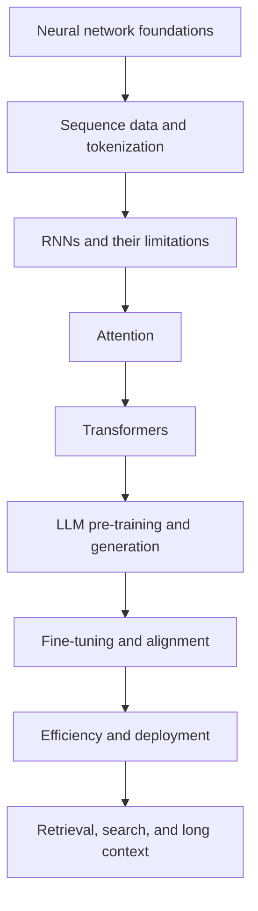

---

# 1. Feedforward Neural Networks

## 1.1 What is a neural network?

A neural network is a function with adjustable parameters. It receives an input, transforms it through one or more layers, and produces a prediction.

For example, a network might receive measurements of a house and predict its sale price. During training, it compares its prediction with the known price and adjusts its parameters to reduce the error.

A simple feedforward network contains:

- **Input layer:** receives the features.
- **Hidden layers:** learn intermediate representations.
- **Output layer:** produces the prediction.

Information moves from input to output. There are no cycles or recurrent connections in a basic feedforward network.

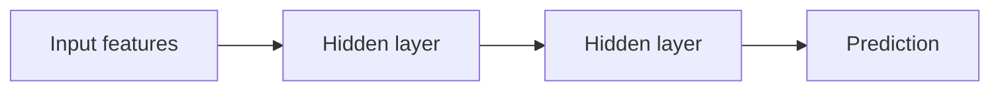

## 1.2 A single neuron

A neuron first calculates a weighted sum of its inputs, adds a bias, and then applies an activation function:

$$
z = \sum_{i=1}^{n} w_i x_i + b
\qquad
a = f(z)
$$

- $x_i$: input feature.
- $w_i$: learned weight that controls the feature's influence.
- $b$: learned bias that shifts the result.
- $f$: activation function.
- $a$: neuron's output, also called its activation.

**Small example**

Suppose $x_1=2$, $x_2=3$, $w_1=0.5$, $w_2=-0.2$, and $b=0.1$.

$$
z = (2)(0.5) + (3)(-0.2) + 0.1 = 0.5
$$

If the activation is ReLU, $a=\max(0,0.5)=0.5$.

The neuron has not "understood" the inputs. It has applied a learned mathematical transformation. A network combines many such transformations to model more complicated relationships.

## 1.3 Why activation functions matter

Without nonlinear activation functions, a stack of linear layers is still equivalent to one linear transformation. Nonlinearities allow networks to model more complex patterns.

### Sigmoid

$$
\sigma(z)=\frac{1}{1+e^{-z}}
$$

- Output range: $0$ to $1$.
- Useful for interpreting a single output as a probability in binary classification.
- Can saturate for very positive or negative inputs, producing small gradients.

### Tanh

$$
\tanh(z)=\frac{e^z-e^{-z}}{e^z+e^{-z}}
$$

- Output range: $-1$ to $1$.
- Zero-centered output can be useful in recurrent networks.
- Also saturates and can suffer from vanishing gradients.

### ReLU

$$
\mathrm{ReLU}(z)=\max(0,z)
$$

- Simple and inexpensive.
- Has gradient 1 for positive inputs, which helps avoid saturation on that side.
- A unit can become inactive if it repeatedly receives negative inputs ("dying ReLU").
- ReLU does not prevent every form of exploding or vanishing gradient.

### Leaky ReLU and PReLU

$$
\mathrm{LeakyReLU}(z)=\max(\lambda z,z)
$$

Leaky ReLU uses a small fixed negative-side slope $\lambda$. PReLU learns that slope.

**Practical rule:** ReLU and its variants are common hidden-layer choices. The output activation depends on the task: sigmoid for a binary probability, softmax for mutually exclusive classes, and often no activation for regression.


General Recommendations:

1. Start with ReLU - it's simple and works well in most cases
2. If dying ReLU is an issue, try Leaky ReLU or ELU
3. For deeper networks, consider Swish or PReLU
4. Use Sigmoid/TanH only for specific cases (like LSTM gates)
5. Avoid Binary Step in most cases
6. Consider computational resources when choosing between advanced functions

## 1.4 Loss functions

A loss function measures how far a prediction is from its target.

### Mean squared error (regression)

$$
L_{\mathrm{MSE}}=\frac{1}{N}\sum_{i=1}^{N}(y_i-\hat y_i)^2
$$

Large errors are penalized more heavily because the error is squared.

### Binary cross-entropy (binary classification)

For target $y\in\lbrace0,1\rbrace$ and predicted probability $p$:

$$
L=-[y\log(p)+(1-y)\log(1-p)]
$$

It penalizes confident predictions that are wrong.

### Cross-entropy (multi-class classification)

For a one-hot target distribution $y$ and predicted probabilities $p$:

$$
L=-\sum_{k}y_k\log(p_k)
$$

The loss is small when the model assigns high probability to the correct class.

## 1.5 How a network learns

Training repeatedly performs four operations:

1. **Forward pass:** calculate the prediction.
2. **Loss calculation:** compare prediction with the target.
3. **Backward pass:** use backpropagation and the chain rule to calculate gradients.
4. **Optimizer step:** update parameters to reduce the loss.

For gradient descent:

$$
W \leftarrow W-\alpha\frac{\partial L}{\partial W},
\qquad
b \leftarrow b-\alpha\frac{\partial L}{\partial b}
$$

Here $\alpha$ is the learning rate. A learning rate that is too high can make training unstable; one that is too low can make learning very slow.

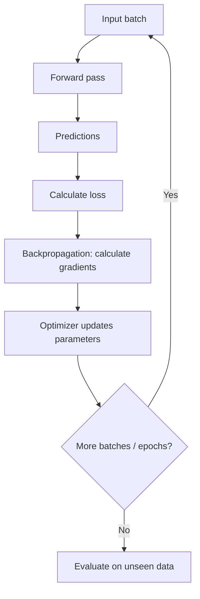

**Important vocabulary**

- **Sample:** one training example.
- **Batch:** a group of samples processed together.
- **Mini-batch:** a batch smaller than the full dataset.
- **Iteration / step:** one optimizer update.
- **Epoch:** one complete pass through the training dataset.

Stochastic gradient descent (SGD) uses mini-batches to estimate the gradient. Mini-batches make training practical and introduce some gradient noise, which can sometimes help optimization.

## 1.6 PyTorch building blocks

```python
import torch
from torch import nn

model = nn.Sequential(nn.Linear(5, 16), nn.ReLU(), nn.Linear(16, 1))

criterion = nn.MSELoss()
optimizer = torch.optim.SGD(model.parameters(), lr=0.01)
```

- `nn.Linear(in_features, out_features)` applies a learned affine transformation.
- `nn.ReLU()` applies ReLU.
- Tensors can track operations when `requires_grad=True`; PyTorch uses this computation graph to calculate gradients.
- `loss.backward()` calculates gradients.
- `optimizer.step()` updates parameters.
- `optimizer.zero_grad()` clears gradients before the next update.

A typical training loop is:

```python
for epoch in range(num_epochs):
    model.train()
    for x_batch, y_batch in train_loader:
        optimizer.zero_grad()
        predictions = model(x_batch)
        loss = criterion(predictions, y_batch)
        loss.backward()
        optimizer.step()
```

In real projects, also track validation performance, save checkpoints, and handle device placement and tensor shapes carefully.

## 1.7 Overfitting and dropout

A model overfits when it performs well on training data but poorly on new data. It has learned details that do not generalize.

Dropout randomly sets a proportion of activations to zero during training:

```python
nn.Dropout(p=0.2)
```

In standard PyTorch dropout, the remaining activations are scaled during training (inverted dropout). During evaluation, dropout is disabled; **you do not manually multiply outputs by `p`**. Use `model.eval()` for evaluation and inference.

Other ways to reduce overfitting include more data, data augmentation, weight decay, early stopping, and a suitable model size.

### Section 1 — Key takeaways

- A neural network is a parameterized function.
- Nonlinear activation functions allow networks to model nonlinear relationships.
- Backpropagation calculates gradients; an optimizer uses them to update parameters.
- Training performance alone does not show whether a model generalizes.

### Check your understanding

1. What is the role of a bias in a neuron?
2. Why are activation functions needed between linear layers?
3. What is the difference between a batch and an epoch?
4. What does `loss.backward()` do, and what does `optimizer.step()` do?

---

# 2. Text Representation: Tokens and Embeddings

A neural network operates on numbers, not directly on words. A language model therefore needs a way to convert text into a sequence of numeric IDs and then into vectors.

The high-level process is:

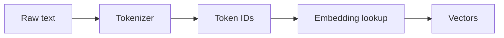

## 2.1 Tokenization

A tokenizer divides text into units called **tokens**. A token may be a whole word, part of a word, punctuation, whitespace, or another text unit, depending on the tokenizer.

### Word-level tokenization

Each word is assigned an ID.

- Advantage: easy to understand.
- Disadvantages: large vocabulary; unseen or rare words need special handling, often an `[UNK]` token; morphology is poorly represented.

### Character-level tokenization

Each character is a token.

- Advantage: can represent any word built from the supported characters.
- Disadvantage: sequences become long, increasing computation and making long-range patterns harder to learn.

### Subword tokenization

Modern language models commonly use subword methods. Frequent character sequences become tokens, while rare words can be represented by combinations of smaller pieces.

**Byte-Pair Encoding (BPE), simplified**

1. Start from a base vocabulary (often bytes or characters, depending on the implementation).
2. Count adjacent token pairs in the training corpus.
3. Merge a frequent pair into a new token.
4. Repeat until the vocabulary or merge budget is reached.

Example, illustratively:

```text
l o w e r
e r  → er
l o w er → low er
```

The exact segmentation depends on the tokenizer's learned vocabulary and pre-tokenization rules.

### Related methods

- **WordPiece:** used by BERT-family tokenizers; chooses merges using a likelihood-related criterion rather than simply the most frequent pair.
- **SentencePiece:** a tokenizer framework that can use BPE or Unigram language-model tokenization. It can treat whitespace as a normal symbol and is useful across languages.
- **Byte-level tokenization:** starts from bytes, helping represent arbitrary text without requiring an unknown-word token, although some characters may require multiple tokens.

| Approach | Main idea | Typical trade-off |
|---|---|---|
| Word-level | One token per word | Large vocabulary; unknown words |
| Character-level | One token per character | Small vocabulary; long sequences |
| Subword / BPE | Frequent pieces become tokens | Balance between vocabulary and sequence length |
| WordPiece | Likelihood-oriented subword merges | Common in BERT-style tokenizers |
| SentencePiece | Framework for subword tokenization | Language-independent preprocessing |

**Important:** A token is not necessarily a word. Token counts therefore differ from word counts, and the ratio depends on language, text, and tokenizer.

## 2.2 Embeddings

A token ID is only an index. An embedding layer maps that index to a learned dense vector:

$$
E:\lbrace0,\ldots,V-1\rbrace\rightarrow\mathbb{R}^{d}
$$

where $V$ is vocabulary size and $d$ is embedding dimension.

For example, a token ID might map to a vector such as:

$$
[0.12,\ -0.31,\ 0.84,\ 0.07,\ldots]
$$

The values are learned during training. Similar contexts can lead to useful geometric relationships between vectors, but an embedding is not a dictionary definition.

### Static and contextual representations

- **Word2Vec-style static embedding:** a word type has one learned vector, regardless of the sentence in which it appears.
- **Contextual representation:** a Transformer updates token representations using surrounding tokens. The representation of "bank" can differ in "river bank" and "bank account".

### Special tokens

Tokenizers may define special tokens such as:

- beginning/end-of-sequence markers;
- padding tokens;
- unknown tokens;
- separator tokens;
- instruction or chat markers.

The exact set depends on the model and its tokenizer.

### Check your understanding

1. Why can a tokenizer split one word into several tokens?
2. What is the difference between a token ID and an embedding?
3. Why can contextual representations distinguish two meanings of "bank"?

---

# 3. Recurrent Neural Networks (RNNs)

## 3.1 Why recurrent networks were introduced

Text, audio, and time series are sequential. The order of elements matters, and the interpretation of the current element can depend on earlier elements.

A feedforward network does not automatically maintain state between positions. An RNN addresses this by updating a hidden state as it reads each element.

$$
h_t=f(W_hh_{t-1}+W_xx_t+b)
$$

- $x_t$: input vector at time $t$.
- $h_{t-1}$: previous hidden state.
- $h_t$: updated hidden state.
- $f$: usually a nonlinear activation such as tanh.

The hidden state is a learned summary of information from the sequence so far. It is not a perfect record of every earlier input.

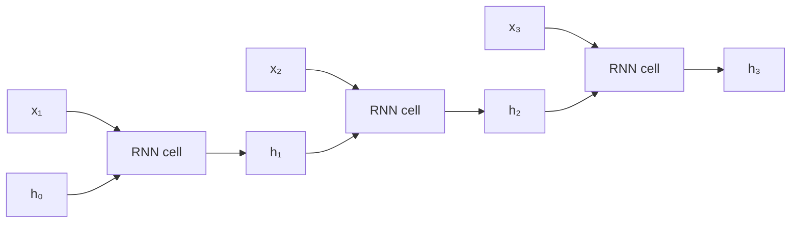

The same RNN cell and weights are reused at every time step.

## 3.2 Example: reading a sentence

Consider "The dog chased the ball."

1. The first token updates the hidden state.
2. The next token updates it using both the new token and the previous state.
3. The process continues until the sentence ends.
4. A downstream classifier might use the final hidden state to predict sentiment or topic.

For sequence labeling, the model can instead produce an output at every time step.

## 3.3 Training: backpropagation through time

Backpropagation Through Time (BPTT) unfolds the recurrent computation across time and applies the chain rule through those steps.

Long chains of derivatives can cause:

- **Vanishing gradients:** gradients become very small, making early inputs difficult to learn from.
- **Exploding gradients:** gradients become very large and make updates unstable.

Gradient clipping limits gradient magnitude and can help with exploding gradients. It does not solve vanishing gradients.

## 3.4 LSTM and GRU

LSTM and GRU networks add gates that control how information is retained, updated, and exposed.

- **LSTM:** uses input, forget, and output gates, plus a cell state.
- **GRU:** uses update and reset gates and has a simpler state structure.

Gating helps preserve useful information over longer spans, although it does not guarantee perfect long-range memory.

## 3.5 RNN limitations

1. **Sequential computation:** time step $t$ depends on $t-1$, limiting parallelism across sequence positions.
2. **Long-range dependencies:** information can become difficult to preserve over many steps.
3. **Fixed-size state:** a hidden state must summarize a growing history.

These limitations motivated attention mechanisms and Transformers.

### Section 3 — Key takeaways

- An RNN processes a sequence while carrying a hidden state.
- BPTT trains the recurrent computation across time.
- LSTM and GRU gates help manage information flow.
- RNNs are inherently sequential across time steps.

### Check your understanding

1. What information does $h_t$ receive?
2. Why can a vanilla RNN struggle with a dependency many steps in the past?
3. How do LSTM and GRU gates help?

---

# 4. From RNNs to Attention

## 4.1 Encoder–decoder models for translation

An encoder–decoder model can translate a source sequence $X$ into a target sequence $Y$.

The encoder reads the source sentence. The decoder generates the target sentence one token at a time:

$$
P(Y\mid X)=\prod_{t=1}^{m}P(y_t\mid y_{\lt t},X)
$$

The most likely sequence is the one with the highest conditional probability, though practical decoding methods often use approximations such as beam search or sampling.

### Encoder

The encoder converts source tokens into hidden states:

$$
h_1^E,h_2^E,\ldots,h_n^E
$$

An early encoder–decoder design passed only the final encoder state to the decoder. This creates a **fixed-context bottleneck**: the entire source must be summarized in one vector.

### Decoder

The decoder uses its previous state and previously generated tokens to predict the next token. Its initial state may be initialized from the encoder's final state.

### Teacher forcing

During training, the decoder is typically given the correct previous target token as input, rather than its own previous prediction. This makes training more stable and efficient.

At inference time, the correct future target tokens are unavailable, so the decoder conditions on tokens it has generated so far.

## 4.2 Why attention helps

Attention allows the decoder to consult all encoder states at each output step instead of relying on one compressed vector.

For example, when translating a sentence, the decoder can place more weight on the source word most relevant to the next target word.

## 4.3 Query, Key, and Value intuition

Attention uses three learned representations:

- **Query (Q):** what the current position is looking for.
- **Key (K):** what each candidate position can be matched on.
- **Value (V):** the information each position contributes if selected.

A useful analogy is a search system:

- the query describes what you need;
- keys describe what each item is about;
- values are the content retrieved.

The analogy is not exact, but it captures the roles.

## 4.4 Scaled dot-product attention

For a query $q$, keys $K$, and values $V$:

$$
\mathrm{Attention}(Q,K,V)
=\mathrm{softmax}\left(\frac{QK^\top}{\sqrt{d_k}}\right)V
$$

The operations are:

1. **Compare:** calculate dot products between queries and keys.
2. **Scale:** divide by $\sqrt{d_k}$ to keep score magnitudes manageable as key dimension grows.
3. **Normalize:** softmax converts scores into weights that sum to 1 across the attended positions.
4. **Combine:** take the weighted sum of value vectors.

### Tiny numerical illustration

Suppose one query gives two attention scores: $[1,2]$.

After softmax, the weights are approximately:

$$
[0.269,\ 0.731]
$$

If the two value vectors are $[1,0]$ and $[0,2]$, the context vector is:

$$
0.269[1,0]+0.731[0,2]=[0.269,\ 1.462]
$$

The result is a weighted combination of the values. In a real model, the vectors have many dimensions and the weights are learned indirectly through training.

## 4.5 Attention in encoder–decoder models vs. Transformers

The original encoder–decoder attention described above is **cross-attention**: decoder queries attend to encoder keys and values.

A Transformer also uses **self-attention**, where queries, keys, and values are all derived from the same sequence.

This distinction matters:

- **Self-attention:** positions within one sequence exchange information.
- **Cross-attention:** one sequence (often the decoder) retrieves information from another sequence (often encoder output).

### Section 4 — Key takeaways

- Attention removes the need to compress the entire source into one fixed context vector.
- Q and K determine attention weights; V supplies the information being combined.
- Cross-attention connects decoder positions to encoder outputs.
- Self-attention connects positions within the same sequence.

### Check your understanding

1. What problem does attention address in early encoder–decoder models?
2. What is the difference between a key and a value?
3. Why do attention weights sum to 1?
4. Is decoder-to-encoder attention self-attention or cross-attention?

---

# 5. Transformer Architecture

## 5.1 The central idea

The Transformer, introduced in *Attention Is All You Need* (2017), replaces recurrence with attention and position-wise feedforward layers.

This allows the model to process many positions in parallel during training, subject to masking and implementation constraints.

A Transformer can be built as an encoder, a decoder, or an encoder–decoder stack.

## 5.2 Self-attention projections

Given input representations $X$, the model creates queries, keys, and values using learned projection matrices:

$$
Q=XW^Q,\qquad K=XW^K,\qquad V=XW^V
$$

The projections let the model learn different roles for matching and information retrieval.

For a sequence of length $n$, the attention score matrix has shape $n\times n$ per head. Entry $(i,j)$ represents how strongly query position $i$ attends to key position $j$, before masking and normalization.

## 5.3 Three attention patterns

### Bidirectional self-attention

Every token can attend to every other token in the permitted input sequence. This is used by BERT-style encoders.

```text
       Key positions
       1  2  3  4
Query 1 ●  ●  ●  ●
      2 ●  ●  ●  ●
      3 ●  ●  ●  ●
      4 ●  ●  ●  ●
```

### Causal self-attention

A token can attend only to itself and earlier positions. A causal mask prevents access to future tokens. This is used for autoregressive generation in GPT-style models.

```text
       Key positions
       1  2  3  4
Query 1 ●  ×  ×  ×
      2 ●  ●  ×  ×
      3 ●  ●  ●  ×
      4 ●  ●  ●  ●
```

### Cross-attention

Queries come from one sequence, while keys and values come from another sequence, such as decoder states attending to encoder outputs.

| Attention type | Q source | K and V source | Typical use |
|---|---|---|---|
| Bidirectional self | Same sequence | Same sequence | BERT encoder |
| Causal self | Same sequence | Same sequence | GPT-style decoder |
| Cross-attention | Decoder sequence | Encoder output | Translation / seq2seq |

## 5.4 Multi-head attention

Instead of using one attention operation, a Transformer uses several heads. Each head has its own learned projections and can learn a different pattern of interaction.

$$
\mathrm{head}_i=
\mathrm{Attention}(QW_i^Q,KW_i^K,VW_i^V)
$$

```math
\mathrm{MultiHead}(Q,K,V)=
\mathrm{Concat}(\mathrm{head}_1,\ldots,\mathrm{head}_h)W^O
```

Heads may learn syntactic, positional, semantic, or other patterns. These are useful intuitions, not guaranteed human-interpretable roles; heads do not necessarily specialize neatly.

If the model dimension is $d_{\text{model}}$ and there are $h$ heads, a common design uses head dimension $d_k=d_{\text{model}}/h$.

## 5.5 Feedforward network

After attention, each token representation is passed through a small feedforward network, independently at each position:

$$
\mathrm{FFN}(x)=\phi(xW_1+b_1)W_2+b_2
$$

where $\phi$ is an activation such as GELU or ReLU.

Attention mixes information across positions. The FFN transforms each position's representation.

## 5.6 Residual connections and layer normalization

A residual connection adds a block's input to its output:

$$
y=x+\mathrm{Sublayer}(x)
$$

This gives information and gradients a more direct path through deep networks.

Layer normalization normalizes features within a token representation and applies learned scale and shift parameters. It helps stabilize optimization.

Transformer implementations differ in whether normalization is applied before or after the sublayer (pre-norm vs. post-norm). The original Transformer used post-norm; many modern architectures use pre-norm variants.

A simplified pre-norm encoder block:

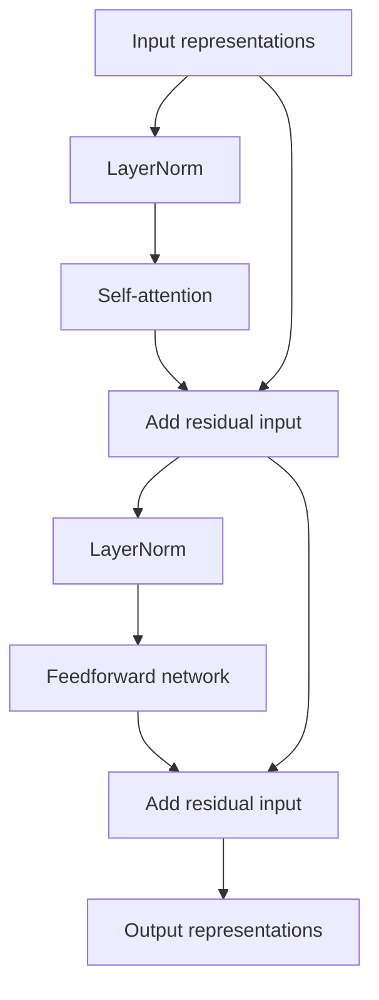

## 5.7 Positional information

Self-attention alone does not inherently encode token order. If positions are permuted together with their representations, the attention operation has no built-in concept of "first" or "next".

Transformers therefore need positional information.

### Sinusoidal positional encoding

The original Transformer added fixed sine and cosine vectors to token embeddings:

$$
PE_{(pos,2i)}=\sin\left(\frac{pos}{10000^{2i/d}}\right)
$$

$$
PE_{(pos,2i+1)}=\cos\left(\frac{pos}{10000^{2i/d}}\right)
$$

### Learned positional embeddings

The model learns a vector for each position up to a configured limit. This is flexible within the trained range but does not automatically generalize to arbitrary lengths.

### Relative position methods and RoPE

Relative-position methods represent relationships between positions. Rotary Position Embeddings (RoPE), widely used in decoder-only LLMs, rotate query and key representations according to position so attention scores carry relative-position information.

Do not treat all positional methods as interchangeable: they modify the attention computation in different ways.

## 5.8 Encoder, decoder, and encoder–decoder model families

### Encoder-only

Examples: BERT and RoBERTa.

- Usually use bidirectional self-attention.
- Produce contextual representations.
- Common for classification, named-entity recognition, and retrieval embeddings.
- BERT was pretrained using masked language modeling; the original BERT also used next sentence prediction.

### Decoder-only

Examples: GPT-family and Llama-family models.

- Use causal self-attention.
- Predict the next token.
- Common for text generation, chat, and code generation.

### Encoder–decoder

Examples: T5 and BART.

- Encoder reads the source sequence.
- Decoder generates a target sequence using causal self-attention and cross-attention.
- Useful for translation, summarization, and other sequence-to-sequence tasks.

| Family | Attention pattern | Typical objective / use |
|---|---|---|
| Encoder-only | Bidirectional self-attention | Understand or classify input |
| Decoder-only | Causal self-attention | Autoregressive generation |
| Encoder–decoder | Encoder self + decoder causal self + cross-attention | Transform one sequence into another |

**Clarification:** Encoder-only models can be used in systems that produce text through additional components, but a standard BERT masked-language-model head is not an autoregressive text-generation interface like GPT.

## 5.9 BERT in brief

BERT (Bidirectional Encoder Representations from Transformers) is an encoder-only Transformer introduced in 2018.

- **Masked Language Modeling (MLM):** selected input tokens are masked or otherwise corrupted, and the model learns to predict the original tokens using context on both sides.
- **Next Sentence Prediction (NSP):** included in the original BERT pre-training setup to classify whether one segment followed another in the source text. Later work showed that NSP is not essential for every strong encoder pre-training recipe.
- **Fine-tuning:** a task-specific head is added and the model is trained on labeled examples.

BERT-base has 12 Transformer layers and about 110 million parameters; BERT-large has 24 layers and about 340 million parameters.

### Section 5 — Key takeaways

- A Transformer uses attention and feedforward layers rather than recurrence.
- Causal masking is essential for next-token generation without future-token leakage.
- Multi-head attention provides multiple learned attention subspaces.
- Residual connections, normalization, and positional information are important parts of the architecture.
- Encoder-only, decoder-only, and encoder–decoder models are designed for different patterns of input and output.

### Check your understanding

1. Why does a decoder-only language model need a causal mask?
2. What is the difference between self-attention and cross-attention?
3. What does the FFN do that attention does not?
4. Why are residual connections useful?
5. Why does a Transformer need positional information?

---

# 6. How Large Language Models Are Trained and Generate Text

## 6.1 Pre-training: learning to predict the next token

A decoder-only LLM is commonly pretrained on large text collections using next-token prediction.

Given a sequence of tokens $x_1,\ldots,x_T$, the model learns:

$$
P(x_t\mid x_1,\ldots,x_{t-1})
$$

The training objective is commonly the average negative log-likelihood (cross-entropy):

$$
\mathcal{L}=-\frac{1}{T}\sum_{t=1}^{T}
\log P(x_t\mid x_{\lt t})
$$

### Example

Training text:

```text
The capital of France is Paris.
```

At a particular position, the context might be:

```text
The capital of France is
```

The model produces a probability distribution over the vocabulary. Training increases the probability assigned to the actual next token, "Paris" (or the tokenizer's corresponding token sequence).

The model is not given a database of facts in this objective. It learns statistical patterns from data. Its learned representations can support language, coding, and some reasoning-like behavior, but pre-training alone does not guarantee factual correctness.

## 6.2 What pre-training teaches

Depending on the data and training process, pre-training can teach:

- grammar and common linguistic patterns;
- associations and information present in training data;
- code patterns and programming conventions;
- multilingual patterns when multiple languages are represented;
- the ability to continue text in ways that can support in-context task performance.

**In-context learning** means the model adapts its behavior to examples or instructions in the prompt without updating its weights.

## 6.3 Training vs. inference

- **Training:** compare predictions with known targets, calculate loss, and update model parameters.
- **Inference:** use fixed model parameters to produce outputs. No weight update is required for ordinary generation.

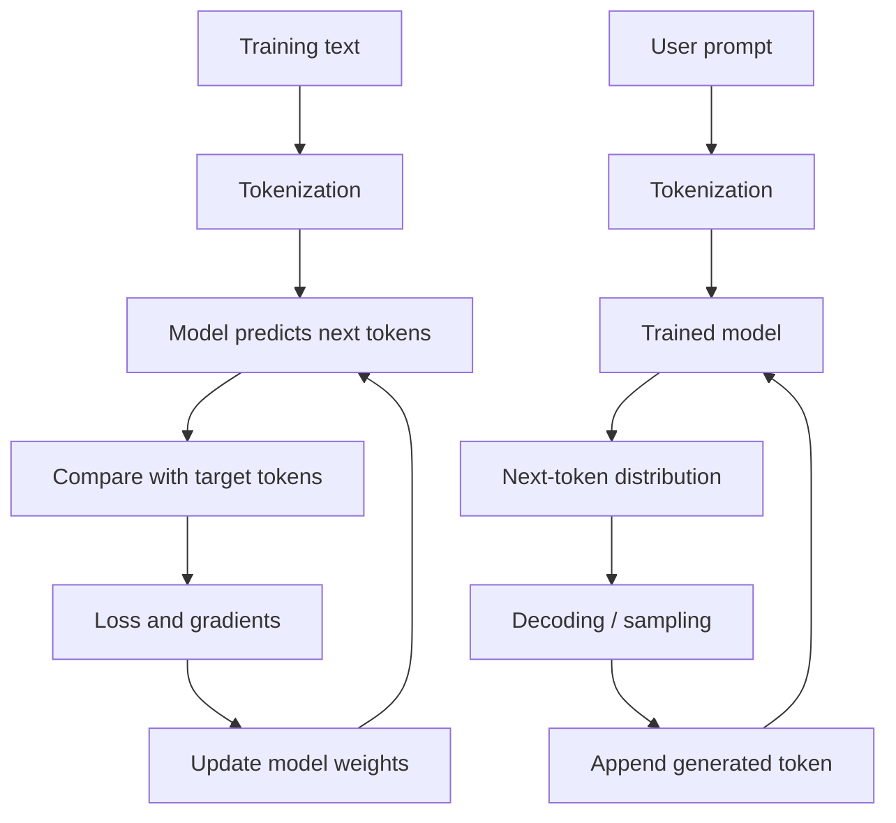

## 6.4 How generation works

At inference time:

1. The prompt is tokenized into token IDs.
2. The IDs are mapped to embeddings and processed by Transformer layers.
3. The final-position representation is mapped by the language-model head to vocabulary logits.
4. A decoding rule converts logits into the next token.
5. The new token is appended to the context and the process repeats until a stopping condition is reached.

**Logits** are unnormalized scores. Softmax converts them into probabilities:

$$
P_i=\frac{e^{z_i}}{\sum_j e^{z_j}}
$$

The model chooses the next token using a decoding strategy. Greedy decoding selects the highest-probability token; sampling draws from a probability distribution. Beam search tracks several candidate sequences.

## 6.5 Temperature and sampling

Temperature modifies logits before softmax:

$$
P_i(T)=\frac{\exp(z_i/T)}{\sum_j\exp(z_j/T)}
$$

- $T \lt 1$: sharpens the distribution; high-probability tokens become more dominant.
- $T=1$: leaves the original softmax distribution unchanged.
- $T \gt 1$: flattens the distribution and increases randomness.

Temperature controls sampling behavior, **not factual reliability directly**. A low temperature can still produce a false answer if the model assigns high probability to it.

Other decoding controls include:

- **Top-k:** sample only from the $k$ highest-scoring tokens.
- **Top-p (nucleus sampling):** sample from the smallest set of tokens whose cumulative probability reaches $p$.
- **Repetition penalties:** adjust scores to discourage repeated tokens.

## 6.6 Base models and instruct models

- **Base model:** trained primarily to continue text.
- **Instruct model:** further trained to respond to instructions and conversational formats.

An instruct model is commonly produced through supervised fine-tuning and preference/alignment stages. Chat templates specify how messages, roles, and control markers are serialized into tokens. Templates are model-specific and should match the tokenizer/model being used.

### Section 6 — Key takeaways

- Many decoder-only LLMs learn by predicting the next token.
- Training updates weights; ordinary inference does not.
- The language-model head produces logits over the vocabulary.
- Temperature changes distribution sharpness, not truthfulness.
- An instruct model has additional training intended to improve instruction following.

### Check your understanding

1. What target is used in next-token prediction?
2. What is the difference between logits and probabilities?
3. Why does generation proceed token by token?
4. Does a low temperature guarantee a correct answer?
5. What additional behavior is instruction tuning intended to encourage?

---

# 7. Fine-Tuning and Alignment

Pre-training creates a general model. Additional training can adapt it to a task, a domain, a response format, or human preferences.

## 7.1 Supervised fine-tuning (SFT)

SFT trains on examples of desired behavior, often prompt-and-response pairs.

Example:

```text
Prompt: Explain photosynthesis in two sentences.
Target: Photosynthesis is the process...
```

For a causal language model, the training sequence contains the prompt followed by the target response. The loss is usually applied to target response tokens (implementation details vary). The model predicts each target token conditioned on all preceding tokens in the sequence.

SFT can teach format, instruction following, and task-specific behavior. Its quality depends heavily on the coverage and quality of training examples.

## 7.2 Parameter-efficient fine-tuning (PEFT)

Full fine-tuning updates all or most model weights. For large models, optimizer states, gradients, and model weights can require substantial memory.

PEFT methods freeze most pretrained weights and train a smaller set of parameters.

### Adapters

Small trainable modules are inserted between or within existing layers. They add parameters and may add some inference overhead unless the architecture or deployment system can merge or optimize them.

### LoRA (Low-Rank Adaptation)

LoRA represents a weight update using two low-rank matrices.

For a frozen weight matrix $W$, one common formulation is:

$$
W'=W+\frac{\alpha}{r}BA
$$

where $A$ and $B$ are trainable low-rank matrices, $r$ is the rank, and $\alpha$ is a scaling hyperparameter. Implementations differ in matrix naming and initialization conventions.

Only the low-rank matrices are trained. This can reduce trainable parameter count substantially.

After training, the update can often be merged into the original weight matrix for inference. If merged, the adapter need not add a separate matrix operation at runtime. LoRA is commonly applied to attention projections, but it can also be applied to other linear layers.

### Bias tuning

Only selected bias parameters are trained while other weights remain frozen. It is inexpensive but less expressive than many other adaptation methods.

| Method | What is trained? | Main trade-off |
|---|---|---|
| Full fine-tuning | Most or all model weights | Flexible, expensive |
| Adapters | Small inserted modules | Modular, may add inference overhead |
| LoRA | Low-rank weight updates | Efficient, often mergeable |
| Bias tuning | Bias parameters | Very cheap, limited capacity |

## 7.3 Preference alignment and RLHF

Reinforcement Learning from Human Feedback (RLHF) is one approach to adapting a model toward human preferences.

A simplified reward-model-based pipeline:

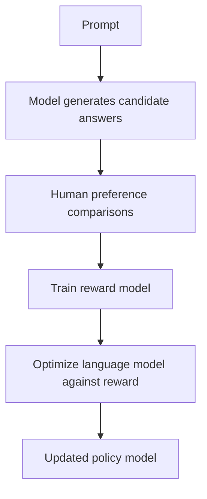

1. Generate multiple candidate responses to prompts.
2. Ask annotators to compare or rank responses.
3. Train a reward model to predict those preferences.
4. Optimize the language model to increase reward while usually constraining it from drifting too far from a reference model.

PPO is one historically important optimization method, but RLHF is a family of approaches and not every preference-training pipeline uses PPO.

**Limitations:** human judgments can be inconsistent or biased; reward models are imperfect; a model may exploit weaknesses in the reward signal ("reward hacking") rather than becoming genuinely more useful.

## 7.4 Learning from verifiable rewards

Some tasks have outcomes that can be checked automatically.

Examples:
- Does generated code pass the test suite?
- Does a mathematical answer satisfy a verifier?
- Does a structured output meet a formal constraint?

Training with such signals is often described as reinforcement learning with verifiable rewards or related terminology. It can reduce reliance on human preference labels when a reliable verifier exists.

It is not suitable for every task. Many important qualities—clarity, empathy, usefulness, and nuanced judgment—are difficult to verify automatically.

## 7.5 Distributed training: DDP and FSDP

Large models may need multiple GPUs.

- **Distributed Data Parallel (DDP):** each GPU typically holds a full model replica and processes a different data shard. Gradients are synchronized. This is effective when the model fits on each GPU.
- **Fully Sharded Data Parallel (FSDP):** shards model parameters, gradients, and optimizer states across workers, reducing per-device memory requirements at the cost of more complex communication and execution.

DDP and FSDP are training-distribution strategies, not fine-tuning objectives. They can be used with different training methods.

## 7.6 Transfer learning

The same principle appears in computer vision and other fields: pre-train a model on a broad dataset, then adapt it to a narrower task. For example, an image model pretrained on a large image collection may be fine-tuned for a smaller set of medical or industrial categories.

### Section 7 — Key takeaways

- SFT teaches behavior from example responses.
- PEFT reduces the number of trainable parameters.
- LoRA learns a low-rank update to frozen weights.
- RLHF uses human preference information, often through a reward model.
- Verifiable rewards are useful when task correctness can be checked automatically.
- DDP and FSDP distribute training computation and state across devices.

### Check your understanding

1. Why can full fine-tuning be expensive?
2. What does LoRA train, and what remains frozen?
3. How does RLHF differ from SFT?
4. Why is a verifiable reward not suitable for every conversational task?
5. What is the key memory difference between DDP and FSDP?

---

# 8. Knowledge Distillation

## 8.1 Core idea

Knowledge distillation trains a smaller **student** model using outputs or internal representations from a larger **teacher** model.

The student learns from more than the single correct class label: it can learn the teacher's distribution over alternatives.

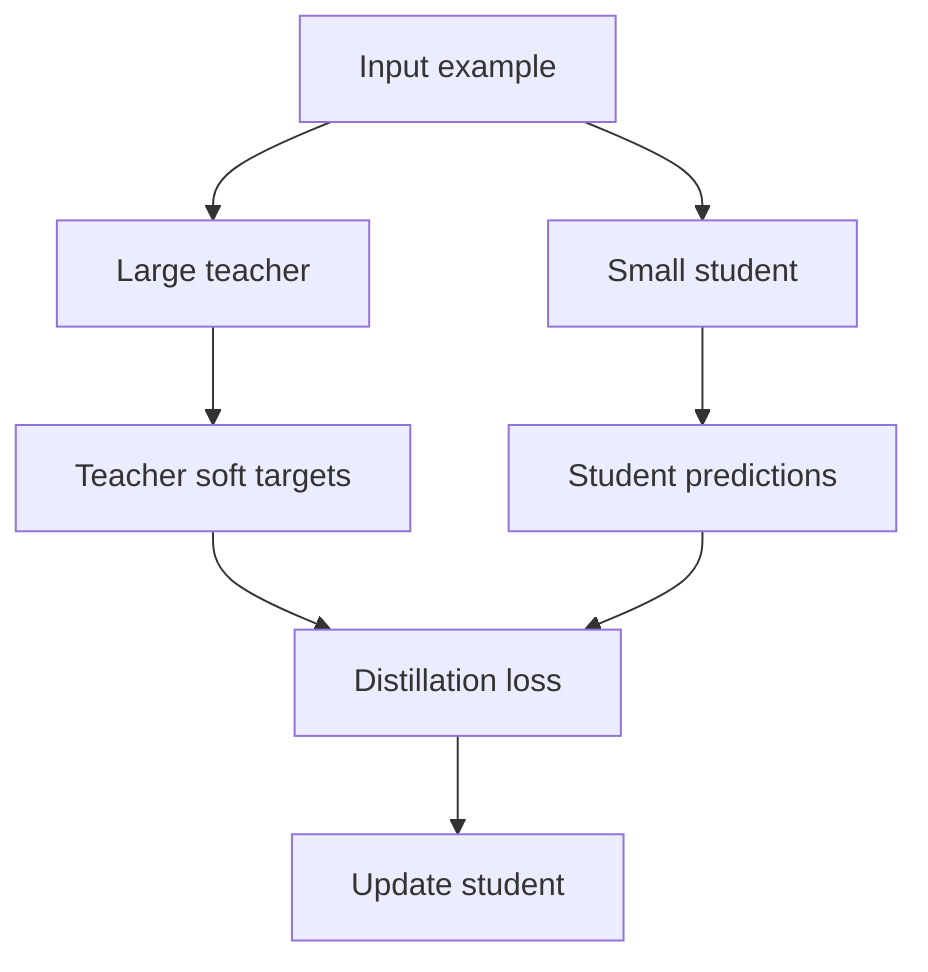

## 8.2 Why soft targets can help

Suppose a teacher predicts:

$$
[0.01,\ 0.02,\ 0.85,\ 0.08,\ 0.04]
$$

This conveys that class 3 is most likely, while class 4 is more plausible than class 1. A one-hot label would only say which class is correct.

For language models, the teacher's distribution over vocabulary tokens can similarly provide a richer training signal.

## 8.3 Temperature and distillation loss

A temperature $T \gt 1$ softens the teacher and student distributions:

$$
p_i(T)=\frac{\exp(z_i/T)}{\sum_j\exp(z_j/T)}
$$

A common objective combines the hard-label loss and the soft-target loss:

$$
\mathcal{L}=
\lambda\mathcal L_{\mathrm{hard}}+
(1-\lambda)T^2\mathcal L_{\mathrm{soft}}
$$

where:

$$
\mathcal L_{\mathrm{hard}}=\mathrm{CE}(y,p_{\mathrm{student}})
$$

$$
\mathcal L_{\mathrm{soft}}=
D_{\mathrm{KL}}(p_{\mathrm{teacher}}(T)\thinspace\Vert\thinspace p_{\mathrm{student}}(T))
$$

The $T^2$ factor is commonly used to compensate for gradient scaling introduced by temperature. Exact formulations vary.

## 8.4 Types

- **Response-based:** student imitates teacher outputs.
- **Feature-based:** student imitates intermediate hidden representations.
- **Relation-based:** student learns relationships among examples or representations.

Distillation can reduce model size or improve a student's training signal, but it does not guarantee that a much smaller model will match the teacher's quality on every task.

### Check your understanding

1. What information can a soft target contain that a one-hot label does not?
2. What is the role of temperature?
3. What is the difference between response-based and feature-based distillation?

---

# 9. Label Smoothing

## 9.1 Motivation

In ordinary classification training, the target is often one-hot: probability 1 for the correct class and 0 for all other classes.

Label smoothing replaces the hard target with a slightly softened distribution. This discourages the model from becoming excessively confident.

For vocabulary size $V$, target class $k$, and smoothing parameter $\varepsilon$, one common convention is:

$$
y_{\mathrm{smooth}}(j)=
(1-\varepsilon)\mathbf{1}[j=k]+\frac{\varepsilon}{V}
$$

Some implementations distribute the smoothing mass over only the non-target classes, so check the convention used by the library.

The cross-entropy loss becomes:

$$
\mathcal{L}=-\sum_j y_{\mathrm{smooth}}(j)\log p(j)
$$

## 9.2 What it can and cannot do

Potential benefits:
- reduce overconfident predictions;
- improve generalization in some settings;
- improve calibration in some settings.

Trade-offs:
- the model is trained against softened targets rather than the original one-hot target;
- likelihood-based metrics such as cross-entropy or perplexity may not improve;
- downstream metrics such as BLEU are task- and setup-dependent. Label smoothing does **not** guarantee a BLEU improvement.

### Check your understanding

1. What does $\varepsilon$ control?
2. Why might label smoothing reduce overconfidence?
3. Does label smoothing always improve perplexity or BLEU?

---

# 10. Search, Embeddings, and Retrieval

## 10.1 Semantic search

Keyword search looks for matching terms. Semantic search aims to find text with related meaning, even when the wording differs.

An embedding model converts text into a vector. A similarity function compares query and document vectors.

Cosine similarity is:

$$
\mathrm{cos}(a,b)=
\frac{a\cdot b}{\Vert a\Vert\Vert b\Vert}
$$

It measures the angle between vectors. Higher cosine similarity often indicates greater semantic relatedness for a suitable embedding model, but similarity scores are not guaranteed probabilities.

## 10.2 Bi-encoders

A bi-encoder encodes the query and document independently:

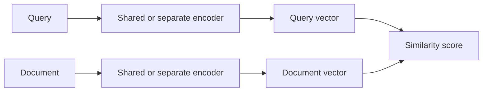

Advantages:
- document vectors can be computed ahead of time;
- vectors can be stored in an approximate-nearest-neighbor (ANN) index;
- search can scale to large collections.

Disadvantage:
- query and document do not interact deeply inside the encoder, which can limit fine-grained relevance judgments.

Examples of vector index/search tools include FAISS and Annoy.

## 10.3 Cross-encoders

A cross-encoder processes the query and document together:

```text
[CLS] query text [SEP] document text [SEP]
                    ↓
              Transformer
                    ↓
              Relevance score
```

Because the model jointly attends to both texts, it can make more detailed relevance judgments. However, it must process each query–document pair, so scoring every document is expensive.

## 10.4 Two-stage retrieval and reranking

A common pipeline uses a fast bi-encoder to retrieve candidates and a slower cross-encoder to rerank a smaller set:

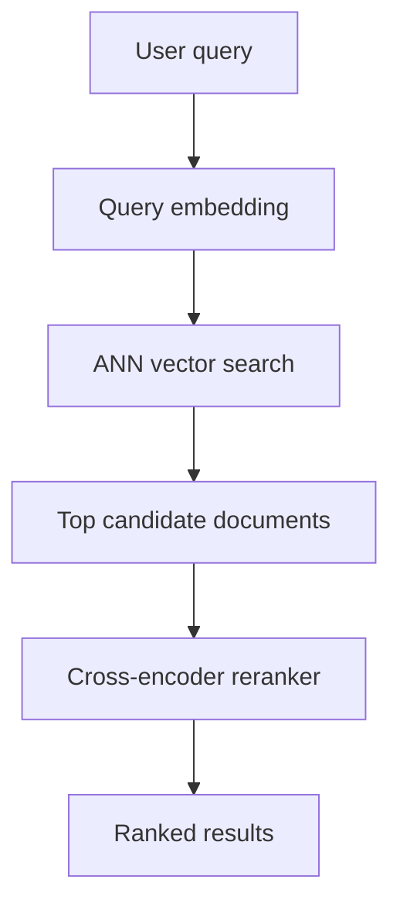

For example, retrieve 100 candidates, then rerank those candidates and return the best 10. The numbers are illustrative; real systems tune them to latency, cost, and quality.

## 10.5 Connection to RAG

Retrieval-Augmented Generation (RAG) combines retrieval with an LLM:

1. Convert the user's question into a retrieval query.
2. Retrieve relevant documents or passages.
3. Put selected passages into the model's context.
4. Ask the LLM to answer using that evidence.

RAG can make external or private information available at inference time without changing the model's weights. It does not guarantee correctness: retrieval can miss relevant evidence, and the model can still misinterpret or ignore retrieved content.

### Section 10 — Key takeaways

- Embeddings represent text as vectors.
- Bi-encoders are efficient for large-scale candidate retrieval.
- Cross-encoders are often more accurate for reranking a small candidate set.
- RAG supplies retrieved information to a model at inference time.

### Check your understanding

1. Why can document embeddings be precomputed in a bi-encoder system?
2. Why is a cross-encoder usually used after initial retrieval rather than across an entire collection?
3. Does RAG guarantee that an answer is correct?

---

# 11. Long Context and Efficient Transformers

## 11.1 Why long context is difficult

In full self-attention, each token can compare itself with every other token. For sequence length $N$, the attention score matrix contains $N^2$ entries per head.

The attention computation therefore has quadratic dependence on sequence length:

$$
O(N^2d)
$$

where $d$ represents a model dimension factor.

Doubling sequence length can make the attention-score work roughly four times as large, all else equal.

**Memory illustration:** a dense $1{,}000{,}000 \times 1{,}000{,}000$ matrix contains $10^{12}$ values. At four bytes per float32 value, that is about 4 TB for one such matrix. Efficient implementations avoid storing this entire matrix at once, but the underlying full-attention computation remains expensive.

## 11.2 Techniques and the problems they address

It is helpful to separate three concerns: attention computation, memory use, and autoregressive inference.

### A. Sparse and local attention

Instead of allowing every token to attend to every other token, sparse attention restricts the allowed connections.

- **Sliding-window attention:** each token attends to a local neighborhood.
- **Strided or dilated attention:** connections skip at regular intervals.
- **Block-sparse attention:** only selected blocks interact.
- **Global tokens:** selected positions can communicate across a larger portion of the sequence.

Sparse attention can reduce computation, but it changes which interactions are available.

### B. FlashAttention

FlashAttention is an exact attention algorithm that improves memory efficiency by tiling the computation and reducing reads and writes to high-bandwidth memory.

- It avoids materializing the full attention matrix in high-bandwidth memory.
- It reduces memory traffic and can improve speed.
- It does **not** make dense full attention linear in sequence length; the attention arithmetic remains quadratic.

### C. Ring Attention and distributed sequence processing

Ring Attention distributes sequence blocks across devices and circulates key/value blocks so that devices can compute attention over a larger sequence in a distributed way.

It is a strategy for distributing full attention computation, not the same as sparse attention. Communication costs and hardware topology matter.

### D. KV cache and attention-head variants

During autoregressive generation, previously computed keys and values can be cached so they do not need to be recomputed for every new token.

The cache grows with sequence length and the number of stored key/value heads.

- **Multi-Head Attention (MHA):** each query head has its own key and value heads.
- **Multi-Query Attention (MQA):** query heads share a single key head and value head.
- **Grouped-Query Attention (GQA):** groups of query heads share key/value heads.

MQA and GQA reduce KV-cache size and memory bandwidth requirements, often making inference more efficient.

### E. KV-cache compression

Possible approaches include:
- lower-precision storage (quantization);
- keeping recent tokens at higher precision;
- compressing or selecting older information.

These methods trade memory use against potential quality loss. Their effectiveness depends on model, context, and implementation.

### F. Hierarchical and compressed context

A system can summarize or compress local chunks, then reason over those summaries at a higher level. This can reduce the amount of detailed information that must be carried forward, but compression may discard details needed later.

### G. Mixture of Experts (MoE)

MoE architectures contain multiple expert subnetworks and a router that selects a subset of experts for each token. This can increase total model capacity without activating every parameter for every token.

MoE is primarily a conditional-computation strategy. It does **not**, by itself, remove the quadratic cost of dense self-attention.

## 11.3 Context window vs. effective use

A model's context window is the maximum amount of input/output token context it can accept under its configuration. This does not mean it uses every position equally well.

Performance can vary with:
- where relevant information appears;
- the length and complexity of the prompt;
- the model's training and positional method;
- interference from irrelevant material.

The **lost-in-the-middle** effect describes cases where models use information near the beginning or end of a long context more reliably than information buried in the middle. The effect varies by model and task; it is not a universal fixed limit.

Practical strategies:
- retrieve only relevant passages;
- place important instructions clearly;
- structure long inputs with headings and metadata;
- test the model at the context lengths and positions that matter for the application.

### Section 11 — Key takeaways

- Dense attention has quadratic dependence on sequence length.
- FlashAttention improves memory efficiency but does not remove quadratic arithmetic.
- Sparse attention reduces the number of attention connections.
- KV caching speeds up generation but consumes memory as context grows.
- MQA and GQA reduce the number of stored key/value heads.
- MoE reduces active parameter computation but is not a direct solution to attention complexity.

### Check your understanding

1. Why does doubling context length increase dense attention work by roughly four times?
2. What does FlashAttention optimize?
3. Why does a KV cache grow during generation?
4. How do MQA and GQA reduce cache requirements?
5. Why is MoE not the same as sparse attention?

---

# 12. Practical Hugging Face Workflow

This section connects the concepts to a practical model-inference workflow. The exact model name and chat template depend on the model being used.

## 12.1 Load a tokenizer and model

```python
import torch
from transformers import AutoTokenizer, AutoModelForCausalLM

model_id = "distilgpt2"  # Small example model for experimentation

tokenizer = AutoTokenizer.from_pretrained(model_id)
model = AutoModelForCausalLM.from_pretrained(model_id)

device = "cuda" if torch.cuda.is_available() else "cpu"
model.to(device)
model.eval()
```

## 12.2 Tokenize and inspect input

```python
prompt = "A neural network learns by"
inputs = tokenizer(prompt, return_tensors="pt").to(device)

print(inputs["input_ids"])
print(tokenizer.convert_ids_to_tokens(inputs["input_ids"][0]))
```

This makes the tokenization step visible. Do not assume one word corresponds to one token.

## 12.3 Generate text

```python
with torch.no_grad():
    output_ids = model.generate(
        **inputs,
        max_new_tokens=40,
        do_sample=True,
        temperature=0.8,
        top_p=0.9,
        pad_token_id=tokenizer.eos_token_id,
    )

print(tokenizer.decode(output_ids[0], skip_special_tokens=True))
```

`torch.no_grad()` disables gradient tracking for inference. `model.eval()` disables training-specific behavior such as dropout.

## 12.4 Inspect logits

A causal language model returns logits for each input position:

```python
with torch.no_grad():
    outputs = model(**inputs)

last_position_logits = outputs.logits[0, -1, :]
next_token_probs = torch.softmax(last_position_logits, dim=-1)

top_probs, top_ids = torch.topk(next_token_probs, k=5)

for probability, token_id in zip(top_probs, top_ids):
    token = tokenizer.decode([token_id.item()])
    print(token, probability.item())
```

The logits at the final input position are used to predict the next token. This small experiment connects the mathematical description of generation to a real model output.

**Practical cautions**

- Use a model and tokenizer from the same checkpoint.
- Some models require a chat template rather than a plain-text prompt.
- Check the model card for license, intended use, context length, and hardware requirements.
- Use `model.train()` for training and `model.eval()` for evaluation/inference.
- For fine-tuning, verify label masking, padding, truncation, and evaluation procedures.

---

# 13. Consolidated Glossary

| Term | Meaning |
|---|---|
| Activation | Output of a neuron or layer |
| Backpropagation | Chain-rule procedure for calculating parameter gradients |
| Batch | Group of training examples processed together |
| Causal mask | Mask that prevents a position from seeing future positions |
| Context window | Maximum token context a model can process in a given configuration |
| Cross-attention | Attention from one sequence to another |
| Embedding | Learned vector representation of a token or item |
| Epoch | One complete pass through the training dataset |
| FFN | Position-wise feedforward network in a Transformer block |
| Gradient clipping | Limits gradient magnitude |
| Logits | Unnormalized model scores before softmax |
| Loss | Scalar measure of prediction error |
| LoRA | Low-rank adaptation of frozen model weights |
| KV cache | Stored keys and values reused during autoregressive generation |
| Pre-training | Broad initial training, often using next-token prediction |
| Query / Key / Value | Learned representations used by attention |
| RAG | Retrieval-Augmented Generation |
| Self-attention | Attention among positions in the same sequence |
| SFT | Supervised fine-tuning on examples of desired behavior |
| Token | Unit produced by a tokenizer |
| Weight | Learned parameter controlling a transformation |

---

# 14. Review Questions

Use these questions to test whether you understand the chapter as a connected story.

1. Why are nonlinear activation functions necessary in a deep neural network?
2. Explain the difference between a token, a token ID, and an embedding.
3. What limitation of RNNs motivated the use of attention?
4. Explain the roles of Q, K, and V without using only the words "query", "key", and "value".
5. What is the difference between causal self-attention and cross-attention?
6. Why does a Transformer need positional information?
7. How does next-token prediction train a language model?
8. Compare a base model and an instruct model.
9. Explain the difference between SFT, LoRA, and RLHF.
10. Why are bi-encoders suitable for retrieval and cross-encoders suitable for reranking?
11. What is the difference between FlashAttention and sparse attention?
12. Why does a long context window not guarantee that every detail will be used reliably?

## Suggested practical exercises

1. **Neuron calculation:** Change the weights and bias in Section 1.2 and calculate the output by hand.
2. **Tokenizer inspection:** Tokenize the same sentence with two different tokenizers and compare token counts.
3. **Attention calculation:** Reproduce the two-value numerical example in Section 4.4 using Python.
4. **Masking:** Draw a causal attention mask for a sequence of six tokens.
5. **Generation:** Run the Hugging Face example with different temperatures and compare outputs. Do not interpret a more confident-sounding output as necessarily more correct.
6. **Retrieval:** Create embeddings for five short documents, rank them by cosine similarity to a query, and inspect whether the ranking makes sense.

---

# References and further reading

The following references were included in the source material and are useful starting points:

- [Attention Is All You Need](https://arxiv.org/abs/1706.03762)
- [BERT: Pre-training of Deep Bidirectional Transformers for Language Understanding](https://arxiv.org/abs/1810.04805)
- [Transformer explanation](https://www.aleksagordic.com/blog/transformer)
- [The Ultimate Guide to Fine-Tuning LLMs](https://arxiv.org/html/2408.13296v1)
- [Distributed Compute in Transformer](https://ailzhang.github.io/posts/distributed-compute-in-transformer/)
- [Transformer Explained (video)](https://www.youtube.com/watch?v=7fvxOgliYRw)
- [Attention Explained (video)](https://www.youtube.com/watch?v=KJtZARuO3JY)
- [Small Transformer, Optimized](https://www.linkedin.com/pulse/tiny-code-models-nikita-sushko-iim0e)

## Editorial note

This revision preserves the original chapter's main subject areas while reorganizing them into a progressive learning path. It also corrects or qualifies claims that were too broad or technically misleading, adds worked examples and Mermaid diagrams, and removes some repetition and unsupported precision. Model-specific details, benchmark claims, and rapidly changing context-window figures have intentionally been avoided where they are not necessary to understand the underlying concepts.
