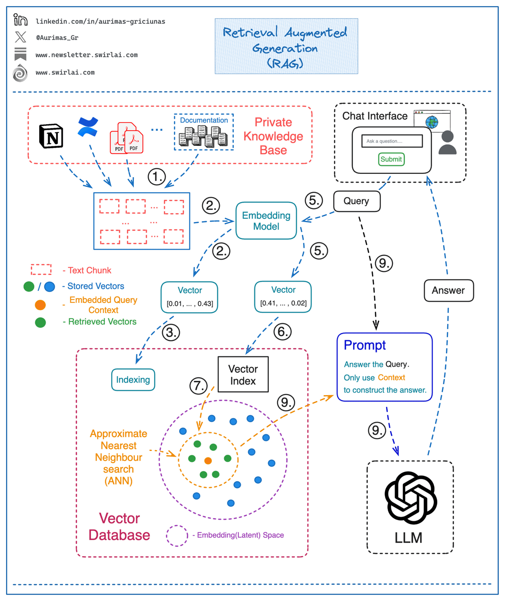

* [12 factor agents](https://github.com/humanlayer/12-factor-agents)
* [PydanticAI docs](https://ai.pydantic.dev/)
* [PydanticAI: Nebius Token Factory integration](https://docs.tokenfactory.nebius.com/integrations/agents/pydantic)
* [multi agent patterns](https://developers.googleblog.com/developers-guide-to-multi-agent-patterns-in-adk/)
* [pydantic-deepagents](https://github.com/vstorm-co/pydantic-deepagents)
* [CS329A Self-Improving AI Agents](https://cs329a.stanford.edu/)
* [Multi-Agent Video Recommenders: Evolution, Patterns, and Open Challenges](https://arxiv.org/abs/2604.02211)
* [Small Language Models for Efficient Agentic Tool Calling: Outperforming Large Models with Targeted Fine-tuning](https://arxiv.org/abs/2512.15943)
* [LiquidAI: small language fine tuning](https://www.linkedin.com/posts/pau-labarta-bajo-4432074b_you-dont-need-a-trillion-parameter-model-activity-7465703450614521856-NU6Y)
* [agent skills](https://www.linkedin.com/posts/activity-7420544568703651841-LwmW)
* [linear for agents management](https://www.linkedin.com/posts/markkropf_hello-from-the-floor-of-the-agentic-software-activity-7420544815286689792-b24t)
* [Era of Agentic Organization](https://arxiv.org/abs/2510.26658)
* [Microsoft: Peli’s agents factory](https://www.linkedin.com/posts/mikolajsedek_welcome-to-pelis-agent-factory-github-activity-7428755975676850176-KhGz)
* [Alibabalong term and short term memory](https://arxiv.org/abs/2601.01885)
* [Agentic Design patterns: google engineer book](https://docs.google.com/document/d/1rsaK53T3Lg5KoGwvf8ukOUvbELRtH-V0LnOIFDxBryE/preview?tab=t.0#)
* [google agents technical guide](https://www.linkedin.com/feed/update/urn:li:activity:7375837282467069952)
* [AGENTS.md](https://www.linkedin.com/posts/sumanth077_finally-a-simple-open-format-for-building-activity-7365289392548036609-TafF)
* [writing agents.md](https://www.linkedin.com/posts/viktormalyi_most-agents-md-files-i-audit-are-useless-activity-7424349225678807041--cNt)
* [cdn.openai.com/business-guides-and-resources/a-practical-guide-to-building-agents.pdf](http://cdn.openai.com/business-guides-and-resources/a-practical-guide-to-building-agents.pdf)
* [agentic protocols](https://www.linkedin.com/posts/sergey-ignatov_last-year-we-saw-lots-of-standards-in-the-activity-7416226657033781248-Waxi)
* [FinAI bot](https://fin.ai/research/)
* [FinAI cx models](https://fin.ai/cx-models)
* [Reranker experiment: data beats model size](https://salespeak.ai/blog/reranker-experiment-data-beats-model-size)
* [Open source agentic search is here](https://www.linkedin.com/posts/mary-newhauser_open-source-agentic-search-is-here-share-7443309648176349184-4vQ_/)
* [Clickhouse MCP](https://clickhouse.com/blog/integrating-clickhouse-mcp)
    - https://github.com/ClickHouse/mcp-clickhouse
* [fastapi_mcp](https://github.com/tadata-org/fastapi_mcp)
* [mcp-use](https://github.com/mcp-use/mcp-use)
* [philoagents-course](https://github.com/neural-maze/philoagents-course)
* [microsoft course](https://github.com/microsoft/ai-agents-for-beginners)
* [LangGraph course](https://academy.langchain.com/courses/intro-to-langgraph)
* [microsoft agents framework](https://devblogs.microsoft.com/foundry/introducing-microsoft-agent-framework-the-open-source-engine-for-agentic-ai-apps/)
* [MCP githib registry](https://github.com/modelcontextprotocol/registry/tree/main)
* [MCP example](https://codenrock.com/blog/model-context-protocol-dlya-sozdaniya-ai-assistentov-standart-kotoryj-pomozhet-pobezhdat-v-ml-chellendzhah)
* [MCP course (youtube)](https://youtu.be/5xqFjh56AwM?si=a5-NhRtiYc6btUmF)
* [mcp course (youtube)](https://m.youtube.com/watch?v=VfZlglOWWZw)
* [MCP course](https://github.com/decodingml/enterprise-mcp-course)
* [MCP course with anthropic](https://www.deeplearning.ai/short-courses/mcp-build-rich-context-ai-apps-with-anthropic/)
* [MCP HuggingFace course](https://huggingface.co/mcp-course)
    - [anthropic: tools for agents](https://www.anthropic.com/engineering/writing-tools-for-agents)
* [PC usage](https://manus.im/blog/Context-Engineering-for-AI-Agents-Lessons-from-Building-Manus)
    - [manus PC agents](https://manus.im/blog/Context-Engineering-for-AI-Agents-Lessons-from-Building-Manus)
    - [Agentic browser usage](https://docs.browser-use.com/quickstart)
    - [agent mail](https://www.agentmail.to/)
* [whatsapp agent](https://github.com/neural-maze/ava-whatsapp-agent-course?tab=readme-ov-file#course-syllabus)
* [LLaMA cloud agents](https://www.linkedin.com/posts/jerry-liu-64390071_im-excited-to-release-a-post-which-outlines-activity-7320875199615184897-vBZJ)
* [AI agents digest](https://www.linkedin.com/posts/rakeshgohel01_ai-agent-update-week-april-20-26-ugcPost-7322235143727808512-50v1)
* [stanford Agents course](https://rdi.berkeley.edu/llm-agents/f24)
* [astronomer agents](https://github.com/astronomer/agents)
* [redis: context rot](https://redis.io/blog/context-rot/)
* [DSPY agents prompt optimization](https://docs.cloud.google.com/vertex-ai/generative-ai/docs/learn/prompts/prompt-optimizer)
* [promptim](https://blog.langchain.dev/promptim/)
* [im-sick-and-tired-of-prompt-engineering-so-i-m-making-a-prompt-optimizer-part-2-9ff3aa47641d](https://ai.plainenglish.io/im-sick-and-tired-of-prompt-engineering-so-i-m-making-a-prompt-optimizer-part-2-9ff3aa47641d)
* [LangGraph](https://opendatascience.com/the-prompt-optimization-stack/)
* [https://medium.com/@mustangs007/auto-prompt-optimisation-with-dspy-say-good-bye-to-manual-prompt-engineering-b786aef984c3](https://medium.com/@mustangs007/auto-prompt-optimisation-with-dspy-say-good-bye-to-manual-prompt-engineering-b786aef984c3)
* [The Prompt Report: A Systematic Survey of Prompting Techniques](https://www.linkedin.com/feed/update/ugcPost:7208896181089808384)
* [prompt-like-a-data-scientist](https://medium.com/data-science/prompt-like-a-data-scientist-auto-prompt-optimization-and-testing-with-dspy-ff699f030cb7)
* [The Prompt Report: A Systematic Survey of Prompting Techniques](https://arxiv.org/abs/2406.06608)
* [Prompting techniques](https://www.linkedin.com/posts/charlie-hills_how-to-master-chatgpt-4o-the-secret-activity-7240238673642811393-QMed/)
* [Agent’s auto ML: microsoft lightning](https://www.linkedin.com/posts/lewisxl_automl-agents-rl-activity-7400973450946801666-yMy2)
* [sber devices agents](https://youtu.be/7Reld2bpsZI?si=8F9g_vauG_p3IbDv)
* [how to build mcp server in python using fastapi](https://medium.com/@miki_45906/how-to-build-mcp-server-in-python-using-fastapi-d3efbcb3da3a)
* [craziest mcp servers you must try](https://medium.com/everyday-ai/craziest-mcp-servers-you-must-try-f23526a165f5)
* [the model context protocol mcp a complete tutorial](https://medium.com/@nimritakoul01/the-model-context-protocol-mcp-a-complete-tutorial-a3abe8a7f4ef)
* [from noisy docs to fine tuning datasets](https://decodingml.substack.com/p/from-noisy-docs-to-fine-tuning-datasets)
* [Agentic Data generation (huggingface)](https://huggingface.co/blog/mlabonne/agentic-datagen)
* [Building save and alighnment AI chatbots](https://padolsey.medium.com/build-a-safe-informed-ai-chatbot-3485f34486d4)
* [create-a-synthetic-dataset-using-llama-3-1-405b-for-instruction-fine-tuning](https://medium.com/towards-data-science/create-a-synthetic-dataset-using-llama-3-1-405b-for-instruction-fine-tuning-9afc22fb6eef)
* [tool-calling-guide-for-local-llms](https://unsloth.ai/docs/basics/tool-calling-guide-for-local-llms)
* [AlignLLMHumanSurvey](https://github.com/GaryYufei/AlignLLMHumanSurvey)
* [build-e-commerce-shopping-assistant-chatbot-llms](https://getindata.com/blog/build-e-commerce-shopping-assistant-chatbot-llms/)
* [mcp servers explained python and agentic ai tool integration](https://generativeai.pub/mcp-servers-explained-python-and-agentic-ai-tool-integration-aa2ddca6cbe5)
* [long term agentic memory with langgraph](https://www.deeplearning.ai/short-courses/long-term-agentic-memory-with-langgraph/)
* [PLAYLIST: Building AI Apps using LangChain](https://www.youtube.com/playlist?list=PL83Wfqi-zYZH8Boxt51keR4vZUDHpAzoO)
* [Privacy AI Search Using LangChain and Elasticsearch](https://www.youtube.com/watch?v=S-CDlEWzGD4)
* [Multi-Agent Applications with PydanticAI (DeepLearning.AI)](https://www.deeplearning.ai/short-courses/multi-agent-applications-with-pydanticai/)
* [meet-ava-the-whatsapp-agent](https://open.substack.com/pub/theneuralmaze/p/meet-ava-the-whatsapp-agent?utm_campaign=post&utm_medium=web)
* [llms-are-just-one-piece-of-the-puzzle-in-activity-7289648412365336576-ZEAM](https://www.linkedin.com/posts/pavan-belagatti_llms-are-just-one-piece-of-the-puzzle-in-activity-7289648412365336576-ZEAM)
* [Learning facts with active reading](https://www.arxiv.org/pdf/2508.09494)
* [ai-agent-with-langgraph-langserve-aws-54c4eb04c640](https://ai.gopubby.com/how-i-built-deployed-an-ai-agent-with-langgraph-langserve-aws-54c4eb04c640)
* [top-12-mcp-servers-i-used-and-activity-7322898843463782400-2b8g](https://www.linkedin.com/posts/philipp-schmid-a6a2bb196_here-are-my-top-12-mcp-servers-i-used-and-activity-7322898843463782400-2b8g)
* [graph_constructing/#llm-graph-transformer](https://python.langchain.com/docs/how_to/graph_constructing/#llm-graph-transformer)
* [lioralex_theres-a-new-python-agent-framework](https://www.linkedin.com/posts/lioralex_theres-a-new-python-agent-framework-that-activity-7328072622204747777-ZqoF)
* [Agentic-RAG-with-langgraph](https://www.linkedin.com/posts/migueloteropedrido_%F0%9D%90%80%F0%9D%90%A0%F0%9D%90%9E%F0%9D%90%A7%F0%9D%90%AD%F0%9D%90%A2%F0%9D%90%9C-%F0%9D%90%91%F0%9D%90%80%F0%9D%90%86-with-langgraph-a-3-activity-7325799064627724288-suS3)
* [terminal based coding agents](https://github.com/rsrohan99/tig)
* [openai-new-tools-for-building-agents/](https://openai.com/index/new-tools-for-building-agents/)
* [computer use agent training](https://www.linkedin.com/posts/anshuizme_reinforcementlearning-machinelearning-datascience-activity-7373635325329362944-iAFQ)
* [agent-workflow-automation-n8n-weaviate](https://weaviate.io/blog/agent-workflow-automation-n8n-weaviate)
* [building-react-agents-from-scratch-a-hands-on-guide-using-gemini-ffe4621d90ae](https://medium.com/google-cloud/building-react-agents-from-scratch-a-hands-on-guide-using-gemini-ffe4621d90ae)
* [build-a-location-aware-agent-using-amazon-bedrock-agents-and-foursquare-apis](https://aws.amazon.com/blogs/machine-learning/build-a-location-aware-agent-using-amazon-bedrock-agents-and-foursquare-apis)
* [How_to_build_a_tool-using_agent_with_Langchain.ipynb](https://github.com/openai/openai-cookbook/blob/main/examples/How_to_build_a_tool-using_agent_with_Langchain.ipynb)
* [build-a-dialogue-chatbot-using-azure-openai-and-langchain](https://djajafer.medium.com/build-a-dialogue-chatbot-using-azure-openai-and-langchain-23a60835cc5)
* [build-a-dialogue-chatbot-using-azure-openai-and-langchain](https://djajafer.medium.com/build-a-dialogue-chatbot-using-azure-openai-and-langchain-23a60835cc5)
* [storing-langchain-conversation-chat-history-to-the-azure-table](https://medium.com/@chinmayvb/storing-langchain-conversation-chat-history-to-the-azure-table-de738f42792a)
* [pinecone:langchain-prompt-templates](https://www.pinecone.io/learn/series/langchain/langchain-prompt-templates/)
* [/langchain/handbook/03-langchain-conversational-memory.ipynb](https://github.com/pinecone-io/examples/blob/master/learn/generation/langchain/handbook/03-langchain-conversational-memory.ipynb)
* [agents/quick_start](https://python.langchain.com/docs/modules/agents/quick_start)
* [memory/adding_memory](https://python.langchain.com/docs/modules/memory/adding_memory)
* [langchain.com/memory/conversational_customization](https://python.langchain.com/docs/modules/memory/conversational_customization)
* [LangChain Cookbook Part 2 - Use Cases.ipynb](https://github.com/gkamradt/langchain-tutorials/blob/main/LangChain%20Cookbook%20Part%202%20-%20Use%20Cases.ipynb)
* [langchain/memory/types/buffer](https://python.langchain.com/docs/modules/memory/types/buffer)
* [langchain-building-language-model-applications](https://medium.com/@princekrampah/langchain-building-language-model-applications-c54cfe7219cb)
* [tutorials/extraction](https://python.langchain.com/docs/tutorials/extraction/)
* [how_to/chatbots_memory](https://python.langchain.com/docs/how_to/chatbots_memory/)
* [langchain-ai.github.io/langgraph](https://langchain-ai.github.io/langgraph/)
* [how-to-make-an-ai-agent-in-10-minutes-with-langchain](https://dev.to/timesurgelabs/how-to-make-an-ai-agent-in-10-minutes-with-langchain-3i2n)
* [AI agents for visualizations](https://medium.com/firebird-technologies/building-an-agent-for-data-visualization-plotly-39310034c4e9)
* [mongodb-developer/GenAI-Showcase](https://github.com/mongodb-developer/GenAI-Showcase)
* [Agentic patterns](https://www.linkedin.com/posts/migueloteropedrido_mlops-machinelearning-datascience-activity-7239895938209640449-Jjhj)
* [loop engineering framework](https://github.com/huangruiteng/loopx)

## Архитектура Agent-систем

* [Agent Design Pattern Catalogue: A Collection of Architectural Patterns for Foundation Model based Agents](https://arxiv.org/pdf/2405.10467)
- [How to design AI Agent Architecture with patterns | LinkedIn](https://www.linkedin.com/posts/rakeshgohel01_dont-waste-every-day-reinventing-your-ai-activity-7321515242390249472-vYzv)
- [nebius: agents on scale](https://nebius.com/blog/posts/launch-production-agents-at-scale)
- [Nebius agents blueprint](https://nebius.com/blog/posts/introducing-the-nebius-agents-blueprint)
- [Agentic System Workflow Patterns | LinkedIn](https://www.linkedin.com/posts/aurimas-griciunas_llm-ai-machinelearning-activity-7325103989090369536-MAtW/)
- [multi-agents architecture](https://userjot.com/blog/best-practices-building-agentic-ai-systems)
- [JetBrains/Mellum-4b-base · Hugging Face](https://huggingface.co/JetBrains/Mellum-4b-base)
- [Looking for a coding assistant that can handle new APIs | LinkedIn](https://www.linkedin.com/posts/egorkraev_can-anyone-recommend-a-coding-assistant-that-activity-7316073342254440448-Huc_)
- [LLM agents - Agent Development Kit (ADK)](https://google.github.io/adk-docs/agents/llm-agents/#planner)
- [Multi-agent systems - Agent Development Kit (ADK)](https://google.github.io/adk-docs/agents/multi-agents/)
- [Vertex AI Agent Engine overview | Google Cloud](https://docs.cloud.google.com/agent-builder/agent-engine/overview)
- [claude code spec driven development](https://github.com/glittercowboy/get-shit-done)
- [agentic meetup](https://www.youtube.com/watch?v=Fa9iRa9H9zM)
- [Architecting secure enterprise AI agents with MCP | IBM](https://www.ibm.com/downloads/documents/us-en/1443d5dd174f42e6)
- [MCP in Enterprise: Challenges, the Desired Outcome, and Ideas | Medium](https://medium.com/@annakokovina21/mcp-in-enterprise-challenges-the-desired-outcome-and-ideas-17bbc0902d3d)
- [OpenAI agent builder](https://youtu.be/44eFf-tRiSg?si=L9r1_jmz_bvhNhRv)
- [LLM agents](https://www.linkedin.com/feed/update/ugcPost:7219980531155828737)
- [automating code review with PydanticAI](https://pydantic.dev/articles/scaling-open-source-with-ai)
- [Doordash AI assistant](https://www.infoq.com/news/2026/07/doordash-ai-ask-assistant/)
- [glean agentic blog](https://www.glean.com/blog)
- [AI evals course](https://www.linkedin.com/posts/nikita-fedulov-887b7728_ai-evals-for-engineers-pm-qas-ugcPost-7477972702943854592-TiEp)
- [DS-STAR: Data Science Agent for Solving Diverse Tasks across Heterogeneous Formats and Open-Ended Queries](https://arxiv.org/pdf/2509.21825)

# RAG: Retrieval augmented generation

* [RAG with Weaviate and LLaMAIndex](https://lightning.ai/weaviate/studios/chat-with-your-code-rag-with-weaviate-and-llamaindex)
* [Azure AI Studio prompt flow](https://learn.microsoft.com/en-us/azure/ai-studio/how-to/prompt-flow)
* [Advanced RAG pipeline](https://learn.deeplearning.ai/courses/building-evaluating-advanced-rag/lesson/2/advanced-rag-pipeline)
* [Local RAG](https://medium.com/@vndee.huynh/build-your-own-rag-and-run-it-locally-langchain-ollama-streamlit-181d42805895)
* [RAG with Weaviate and LLaMAIndex](https://www.linkedin.com/feed/update/activity:7293939519232368640)
* [Knowledge Graphs for RAG course](https://learn.deeplearning.ai/courses/knowledge-graphs-rag/lesson/1/introduction)
* [Graph RAG: langchain + neo4j](https://medium.com/@valentinaalto/introducing-graphrag-with-https://medium.com/@valentinaalto/introducing-graphrag-with-langchain-and-neo4j-90446df17c1e-90446df17c1e)
* [NVIDIA: RAG with LLaMA2](https://courses.nvidia.com/courses/course-v1:NVIDIA+S-FX-16+v1/)
* [RAG: Gemma7B + FAISS (kaggle notebook)](https://www.kaggle.com/code/youssef19/building-rag-using-gemma-faiss-vector-db)
* [RAG chatbot Gemma2B](https://medium.com/towards-data-science/how-to-build-a-local-open-source-llm-chatbot-with-rag-f01f73e2a131)
* [integrating-vector-databases-with-llms-a-hands-on-guide](https://medium.com/@mlengineering/integrating-vector-databases-with-llms-a-hands-on-guide-82d2463114fb)
* [Weaviate RAG](https://www.youtube.com/watch?v=IiNDCPwmqF8&ab_channel=Weaviate%E2%80%A2VectorDatabase)
* [RAG LLAMA index](https://medium.com/dphi-tech/advanced-rag-using-llama-index-e06b00dc0ed8)
* [Open source RAG tools](https://medium.com/programmers-journey/three-open-source-rag-tools-you-need-to-know-about-331c3f28ab22)
* [RAG langchain](https://medium.com/@thakermadhav/build-your-own-rag-with-mistral-7b-and-langchain-97d0c92fa146)
* [RAG techiques](https://www.linkedin.com/feed/update/ugcPost:7166691825880174592)
* [RAG intelligent agent](https://medium.com/data-science-at-microsoft/forget-rag-embrace-agent-design-for-a-more-intelligent-grounded-chatgpt-6c562d903c61)
* [RAG LLaMA factory](https://www.linkedin.com/feed/update/activity:7177129541763563521)
* [RAG fine tuning](https://www.linkedin.com/feed/update/activity:7177221504454004736)
* [Cohere embeddings for RAG](https://txt.cohere.com/embed-compression-embedjobs/)
* [NVIDIA RAG](https://courses.nvidia.com/courses/course-v1:NVIDIA+S-FX-16+v1/course/)
* [RAG roadmap learning](https://github.com/aishwaryanr/awesome-generative-ai-guide/blob/main/resources/RAG_roadmap.md)
* [RAG weavite + LLaMAIndex](https://lightning.ai/weaviate/studios/chat-with-your-code-rag-with-weaviate-and-llamaindex)
* [a-practitioners-guide-to-retrieval-augmented-generation-rag](https://towardsdatascience.com/a-practitioners-guide-to-retrieval-augmented-generation-rag-36fd38786a84)
* [how-to-build-a-rag-system-with-a-self-querying-retriever-in-langchain](https://towardsdatascience.com/how-to-build-a-rag-system-with-a-self-querying-retriever-in-langchain-16b4fa23e9ad)
* [From Local to Global: A Graph RAG Approach to Query-Focused Summarization](https://arxiv.org/abs/2404.16130v1)
* [TabR: RAG for table data](https://artgor.medium.com/paper-review-tabr-unlocking-the-power-of-retrieval-augmented-tabular-deep-learning-ab85137958b9)
* [ColiVara multimodal RAG](https://www.linkedin.com/feed/update/activity:7309862835067502592)
* [LLAMA index: agentic reasoning system for search](https://www.linkedin.com/feed/update/activity:7306845599796973568)
*[RAG techniques](https://github.com/NirDiamant/RAG_Techniques)
* [graphrag-amazon-bedrock](https://aws.amazon.com/ru/blogs/database/using-knowledge-graphs-to-build-graphrag-applications-with-amazon-bedrock-and-amazon-neptune/)
* [graphrag-with-neo4j-and-langchain-constructing-the-graph](https://medium.com/neo4j/implementing-from-local-to-global-graphrag-with-neo4j-and-langchain-constructing-the-graph-73924cc5bab4)
* [neo4j graph RAG](https://www.linkedin.com/feed/update/urn:li:activity:7229542287062491137/)
* [LLAMA correctic RAG](https://www.linkedin.com/feed/update/activity:7306845599796973568)
* [langchain-graph-rag](https://pub.towardsai.net/langchain-graph-rag-gpt-4o-python-project-easy-ai-chat-for-your-website-46a46e24f161)
* [llamaindex-rag](https://medium.com/datadriveninvestor/build-knowledge-graph-rag-with-llamaindex-from-pdf-documents-99ccef833840)
* [graph rag](https://medium.com/singapore-gds/from-conventional-rag-to-graph-rag-a0202a1aaca7)
* [Large Dual Encoders Are Generalizable Retrievers](https://preview.aclanthology.org/emnlp-22-ingestion/2022.emnlp-main.669.pdf) + [Exploring Google’s T5 Text-To-Text Transformer Model](https://wandb.ai/mukilan/T5_transformer/reports/Exploring-Google-s-T5-Text-To-Text-Transformer-Model--VmlldzoyNjkzOTE2)
* [Graph RAG](https://neo4j.com/developer-blog/global-graphrag-neo4j-langchain/)
* [GraphRag langgraph langchain](https://medium.com/neo4j/implementing-from-local-to-global-graphrag-with-neo4j-and-langchain-constructing-the-graph-73924cc5bab4)
* [short-courses/knowledge-graphs-rag](https://www.deeplearning.ai/short-courses/knowledge-graphs-rag)
* [using-redis-for-real-time-rag-goes-beyond-a-vector-database](https://redis.io/blog/using-redis-for-real-time-rag-goes-beyond-a-vector-database/)
* [Open RAG](https://openrag.notion.site/Open-RAG-c41b2a4dcdea4527a7c1cd998e763595?pvs=21)
* [LLM-RAG](https://medium.com/@petrpan/llm-101-build-your-own-book-reading-bot-or-search-engine-with-llm-rag-21823684dfb2#603f)
* [RAG best practices](https://medium.com/@zilliz_learn/build-ai-apps-with-retrieval-augmented-generation-rag-c2e4ed8ada1d)
* [Advanced RAG implementation](https://medium.aiplanet.com/advanced-rag-implementation-on-custom-data-using-hybrid-search-embed-caching-and-mistral-ai-ce78fdae4ef6)
* [RAG base](https://medium.com/towards-data-science/a-guide-on-12-tuning-strategies-for-production-ready-rag-applications-7ca646833439)
* [OpenAI retrieval plugin](https://github.com/openai/chatgpt-retrieval-plugin) based on [GPT-Index](https://pypi.org/project/gpt-index/) + [GitHub demo](https://llamahub.ai/l/chatgpt_plugin) + [LinkedIn tutorial](https://www.linkedin.com/pulse/extending-chatgpt-knowledge-base-custom-datasources-cezar-romaniuc)
* [improving-RAG-systems-dhs2024](https://github.com/dipanjanS/improving-RAG-systems-dhs2024)
* [Graph-Native Infrastructure for Context and Accountable AI Systems](https://github.com/semantica-agi/semantica)