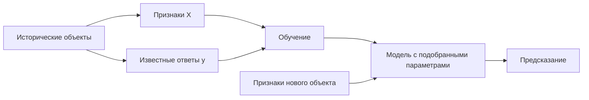
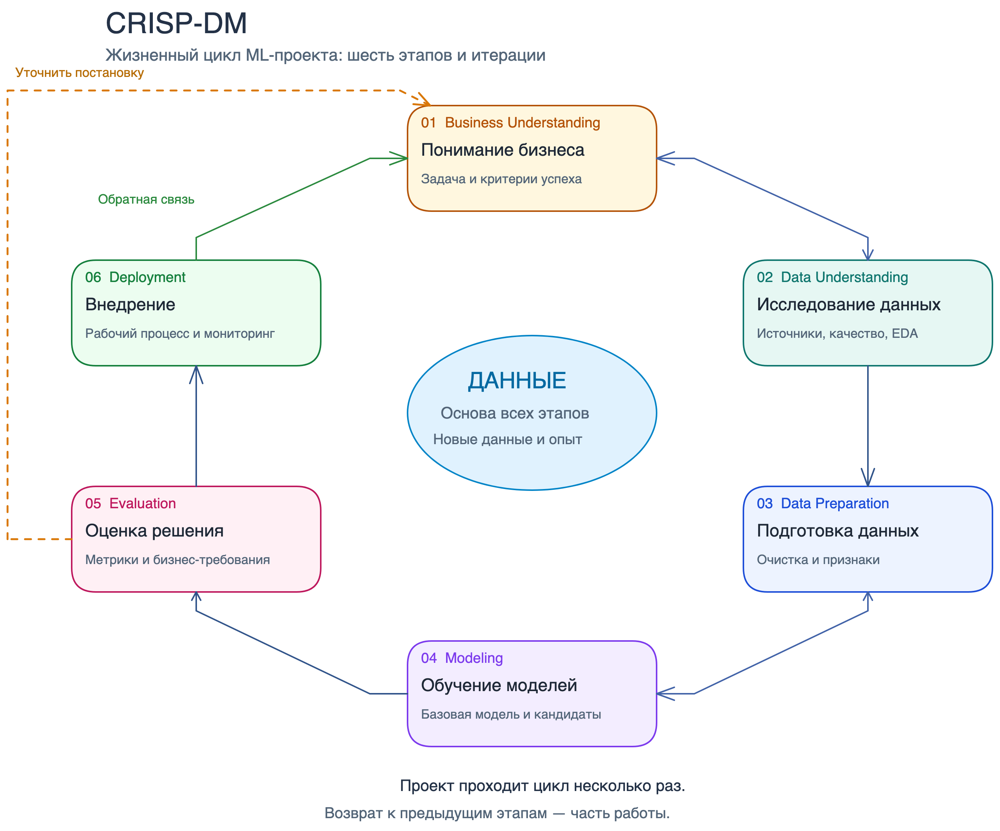
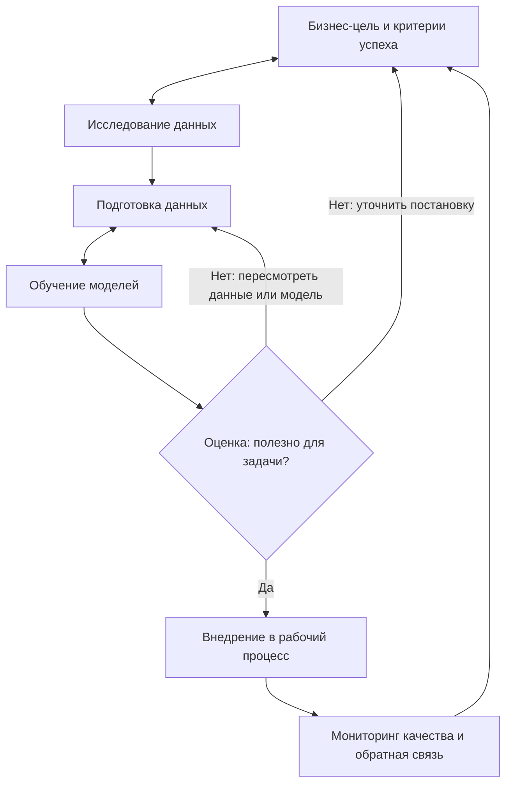

# Лекция: введение в ML и жизненный цикл проекта

---

## План лекции

1. Подготовка ноутбуков и данных
2. Что значит «обучить модель»: объекты, признаки и целевая переменная
3. Линейная регрессия и обучение в scikit-learn
4. Метрики и анализ ошибок
5. Категориальные признаки и интерпретация модели
6. Жизненный цикл ML-проекта: CRISP-DM
7. Виды задач машинного обучения
8. Самостоятельная работа и вопросы для самопроверки

Таймкоды относятся к записи `ml_intro_2025`: основная часть — примерно 1 ч 23 мин, затем вопросы. Сначала в записи разбирается обучение простой модели, затем этот пример помещается в полный цикл ML-проекта.

**Материалы:**

- [Вводный ноутбук: линейная регрессия, метрики и признаки](../jupyter_notebooks/vol_00_pre_requirements_01_machine_learning_intro.ipynb).
- [Домашняя работа к введению в ML](../jupyter_notebooks/vol_00_pre_requirements_01_machine_learning_intro_hw_1.ipynb).
- [Следующий практический пример: модерация контента по этапам ML-проекта](../jupyter_notebooks/vol_01_ml_products_01_ML_project_flow.ipynb).
- [Дополнительная запись о стадиях ML-проекта](https://www.youtube.com/watch?v=Fl440k56_yY).

---

## 1. Подготовка ноутбуков и данных `[00:00 – 06:19; 18:23 – 24:34]`

В репозитории две важные директории:

| Директория | Что в ней находится |
|---|---|
| `jupyter_notebooks` | Учебные тетрадки: объяснения, код и результаты вычислений |
| `src` | Общие функции, которые импортируются в ноутбуки |

Например, `from utils import load_sales` обращается к [src/utils.py](../src/utils.py), а не к стандартной библиотеке Python. Поэтому одного файла `.ipynb` для работы недостаточно: нужен доступ к общему коду и данным.

### Работа через Google Colab

1. Загрузите `jupyter_notebooks` и `src` на Google Drive, сохранив структуру путей из настроечной ячейки ноутбука.
2. Добавьте [датасеты курса](https://drive.google.com/drive/folders/1f0xJzIxfsfI_QbE6VB82W7xkcxTipgkP?usp=sharing). Для занятия нужны `sales_timeseries_dataset.csv.gz` и `insurance.csv`.
3. Откройте вводный ноутбук через Colab, подключите Drive и проверьте путь `root_data_dir`.
4. Выполняйте ячейки сверху вниз. После перезапуска среды выполнения переменные и обученные модели нужно создать заново.

При подключении Drive проверьте запрашиваемый доступ: ноутбук получает возможность читать доступные ему файлы. Путь в настроечной ячейке должен совпадать с расположением данных на вашем диске.

Для локальной работы из корня репозитория можно использовать `make run-jupyter`: эта команда задаёт пути к `data` и `src`. Перед занятием обновляйте учебные материалы, сохранив собственные изменения отдельно.

---

## 2. Что значит «обучить модель» `[06:19 – 18:23]`

Машинное обучение помогает находить зависимости в данных и применять их к новым объектам. Например, по размеченным письмам можно построить спам-классификатор, а по истории продаж — модель для оценки будущего спроса.

**Обучение полезно, если результат улучшается на новых данных**, а не только на примерах, которые модель уже видела. Дополнительные данные сами по себе не гарантируют улучшения: важны их качество, соответствие задаче и способ проверки.

### Основные термины

| Термин | Смысл | Пример для продаж |
|---|---|---|
| **Объект** | Один пример, для которого делаем предсказание | Продажи магазина за один день |
| **Признаки, features, фичи** | Описание объекта, доступное модели | Выручка вчера, средние продажи за прошлую неделю |
| **Целевая переменная, target, `y`** | Что требуется предсказать | Выручка в выбранный день |
| **Обучающая выборка** | Примеры с признаками и известными ответами | Исторические данные магазина |
| **Модель** | Правило преобразования признаков в предсказание | Линейная комбинация признаков |
| **Метрика** | Число для оценки качества | RMSE прогноза выручки |

В задачах с учителем данные удобно представить как пары `(x_i, y_i)`. Матрица `X` содержит объекты по строкам и признаки по столбцам. Вектор `y` содержит один ответ на каждую строку `X`.



### Признаки и параметры — разные вещи

Признаки описывают объект: например, выручку вчера. Параметры определяют, как модель использует эти признаки; они подбираются при обучении. В линейной регрессии параметрами являются коэффициенты и свободный член.

В записи теория сначала объясняется на цене дома, а код — на продажах магазина. Это две задачи регрессии, но разные данные и цели. Далее рассматриваем именно продажи.

---

## 3. Линейная регрессия на примере продаж `[24:34 – 35:48]`

Функция `load_sales(root_data_dir)` читает `sales_timeseries_dataset.csv.gz` и возвращает признаки в `.data`, целевую переменную в `.target`, описание признаков в `.DESCR`.

В демонстрационной выборке — 47 наблюдений и 6 признаков:

| Поле | Содержание |
|---|---|
| `QTy` | Количество проданных товаров |
| `NetSales_Previous_Day` | Выручка предыдущего дня |
| `Avg_Sale_Previous_Week` | Средние продажи за предыдущую неделю |
| `Sales_This_Day_Last_Week` | Продажи в соответствующий день прошлой недели |
| `Sales_This_Day_Week_Before_Last` | Продажи в соответствующий день позапрошлой недели |
| `Diff_Sales_This_Day_Last_Week_And_Week_Before_Last` | Разность двух предыдущих значений |

Целевая переменная — **`NetSales`**, выручка. Не путайте её с количеством проданных единиц.

**Важный вопрос:** что известно в момент предсказания? Если прогноз нужен до начала дня, фактическое `QTy` за этот день ещё неизвестно. Использование такого признака даст утечку информации. Учебный пример показывает интерфейс модели, но для реального прогноза нужно согласовать момент расчёта и доступность каждого признака.

### Как устроена модель

Линейная регрессия вычисляет взвешенную сумму:

$$
\hat y_i = w_0 + w_1x_{i1} + \ldots + w_px_{ip}.
$$

Здесь `p` — число признаков, `w_0` — свободный член, а `w_1, …, w_p` — коэффициенты. Обучение подбирает их так, чтобы уменьшить расхождение предсказаний с известными ответами.

Для квадратичной функции потерь минимизируется средняя ошибка на обучении:

$$
\operatorname{MSE} = \frac{1}{N}\sum_{i=1}^{N}(y_i-\hat y_i)^2.
$$

Эта величина — пример **эмпирического риска**. Низкая ошибка на обучении ещё не доказывает, что модель хорошо работает на новых данных.

### Обучение через scikit-learn

Следующий фрагмент предполагает, что настроечная ячейка уже задала `root_data_dir` и доступ к `src`:

```python
from sklearn.linear_model import LinearRegression
from utils import load_sales

sales = load_sales(root_data_dir)
X, y = sales.data, sales.target

model = LinearRegression()
model.fit(X, y)
y_pred = model.predict(X)

print(model.coef_)
print(model.intercept_)
```

- `fit(X, y)` подбирает параметры.
- `predict(X)` применяет обученную модель.
- `coef_` хранит коэффициенты, `intercept_` — свободный член.

Здесь `predict` вызывается на тех же данных, что и `fit`, как в демонстрации. Это проверка того, как модель описала обучающую выборку, а не оценка будущего прогноза.

---

## 4. Метрики и анализ ошибок `[35:48 – 42:26]`

График фактических и предсказанных значений помогает увидеть ошибки отдельных объектов. Метрика позволяет сравнить результаты нескольких моделей численно.

### Остатки модели

Зафиксируем определение: **остаток `e = y_pred − y_true`**.

- `e < 0`: недопрогноз — модель предсказала меньше фактического значения.
- `e > 0`: перепрогноз — модель предсказала больше.
- `e = 0`: точное совпадение.

Гистограмма показывает, какие ошибки встречаются часто и насколько велики хвосты распределения. Пик около нуля сам по себе не доказывает хорошее качество: сравните величину ошибок с масштабом задачи и проверьте их на отложенных данных.

### Метрики регрессии

| Метрика | Что измеряет | Как интерпретировать |
|---|---|---|
| **MAE** | Средний модуль ошибки | В единицах целевой переменной; меньше — лучше |
| **RMSE** | Корень из среднего квадрата ошибок | В единицах целевой переменной; сильнее реагирует на большие ошибки |
| **R²** | Качество относительно предсказания средним значением | Выше — лучше; может быть отрицательным |

```python
import numpy as np
from sklearn.metrics import mean_absolute_error, mean_squared_error, r2_score

print("MAE:", mean_absolute_error(y, y_pred))
print("RMSE:", np.sqrt(mean_squared_error(y, y_pred)))
print("R²:", r2_score(y, y_pred))
```

### Почему метрика зависит от бизнеса

В записи обсуждается закупка товаров. Недопрогноз может привести к отсутствию товара и потерянным продажам; перепрогноз — к излишкам, расходам на хранение и списаниям. Стоимость этих ошибок различается.

MAE и RMSE симметричны относительно знака ошибки. Если одна сторона ошибки существенно дороже, дополнительно оценивают соответствующие бизнес-потери. Выбор метрики нужно обосновывать тем, какое решение будет принято по предсказанию.

### Как проверять качество честно

Модель обучают на одной части данных, а оценивают на другой. Преобразования признаков, которые изучают статистику данных, тоже обучаются только на тренировочной части.

Для временного ряда проверка должна имитировать прогноз будущего: **обучаемся на прошлом, проверяем на более позднем периоде**. Случайное перемешивание дат может дать завышенную оценку.


Простой **baseline** для продаж — прогноз «как в соответствующий день прошлой недели». Сложная модель должна приносить пользу по сравнению с таким ориентиром, а не только иметь ненулевое качество.

---

## 5. Категориальные признаки и интерпретация `[42:26 – 57:46]`

Вторая демонстрация использует `insurance.csv`. Целевая переменная — **`charges`**, сумма медицинских расходов. Это снова регрессия: предсказываем величину, а не вероятность страхового случая.

Признаки включают `age`, `bmi`, `children`, `sex`, `smoker`, `region`. Линейной регрессии требуется числовое представление, поэтому категориальные поля нужно преобразовать.

### Почему недостаточно заменить категории номерами

В записи для простоты используется `LabelEncoder`. Но кодирование регионов числами `0, 1, 2, 3` создаёт для линейной модели искусственные порядок и расстояния: переход между соседними номерами получает одинаковый эффект.

[LabelEncoder](https://scikit-learn.org/stable/modules/generated/sklearn.preprocessing.LabelEncoder.html) предназначен для кодирования меток `y`. Для категориальных признаков без естественного порядка подходящим вариантом является [OneHotEncoder](https://scikit-learn.org/stable/modules/generated/sklearn.preprocessing.OneHotEncoder.html): каждая категория получает отдельный бинарный столбец.

| Регион | `region_north` | `region_south` | `region_west` |
|---|---|---|---|
| north | 1 | 0 | 0 |
| south | 0 | 1 | 0 |
| west | 0 | 0 | 1 |

Преобразование категорий выбирают вместе с моделью. Для проверки на новых данных важно заранее определить поведение на неизвестной категории и не обучать encoder повторно на тестовой выборке.

### Что говорят коэффициенты

Коэффициент линейной регрессии показывает изменение предсказания при увеличении соответствующего признака на единицу, если остальные признаки фиксированы.

**Величины коэффициентов нельзя напрямую сравнивать при разных масштабах признаков.** Возраст измеряется годами, BMI — в своей шкале, а бинарный признак принимает 0 или 1. Кроме масштаба, на коэффициенты влияет зависимость признаков друг от друга.

В демонстрации `smoker` имеет большой положительный коэффициент. Это означает связь с большим предсказанным значением `charges` в этой модели. Один коэффициент не доказывает причинность и не описывает вероятность страхового события.

---

## 6. Жизненный цикл ML-проекта: CRISP-DM `[1:03:01 – 1:17:32]`

Мы научились превращать признаки в предсказание. Но бизнесу нужна работающая система, которая помогает принимать решения. Для этого обучение модели становится частью более длинного процесса.

**CRISP-DM (Cross-Industry Standard Process for Data Mining)** описывает шесть этапов работы с данными и моделями.



[Редактируемая схема Excalidraw](img/crisp_dm.excalidraw)

### Сквозной пример: закупка товаров

Пусть сеть магазинов хочет планировать закупку картофеля. Прогноз спроса — только один вход в решение о заказе: также нужны остатки, срок доставки, ёмкость склада и срок хранения товара.

| Этап | Главный вопрос | Результат для задачи закупки |
|---|---|---|
| **Business Understanding** — понимание бизнеса | Какое решение улучшаем и что считаем успехом? | Согласованы горизонт прогноза, стоимость дефицита и излишков |
| **Data Understanding** — исследование данных | Какие данные есть и что они означают? | Проверены история продаж, остатки, пропуски и необычные дни |
| **Data Preparation** — подготовка данных | Как получить доступные и корректные признаки? | Подготовлены лаги продаж, календарные признаки и правила обработки пропусков |
| **Modeling** — моделирование | Какой подход подходит задаче? | Обучены baseline и модели-кандидаты |
| **Evaluation** — оценка решения | Выполнены ли критерии качества и бизнес-требования? | Проверены ошибки на будущих периодах, сегменты и влияние на решение о заказе |
| **Deployment** — применение | Как результат попадёт в рабочий процесс? | Прогноз поступает в систему закупок, интерфейс или уведомление ответственному |

### Понимание бизнеса определяет постановку

До обучения выясните:

- Для кого рассчитывается прогноз и какое действие он изменит?
- За сколько дней нужно оформить заказ?
- Какие данные будут известны в этот момент?
- Что дороже: нехватка товара или остатки, которые придётся списать?
- С чем сравниваем результат — ручным решением, текущими правилами или другой моделью?

Без этих ответов можно построить точную модель, которую невозможно использовать.

### Исследование и подготовка данных — разные этапы

**EDA (Exploratory Data Analysis)** помогает понять данные: посмотреть распределения, пропуски, выбросы и связи. Например, нулевые продажи в пятницу могут означать закрытый магазин или отсутствие товара, а не отсутствие спроса. Объяснение нужно проверить с владельцем процесса.

**Подготовка данных** превращает это понимание в воспроизводимые преобразования: объединение источников, обработку пропусков, расчёт признаков и кодирование категорий. ETL — один из способов организации таких преобразований, но он не исчерпывает всю подготовку данных.

Таблицы продаж — структурированные данные. Тексты документов поставщика, фотографии и описания товаров тоже могут быть источниками признаков, но требуют других способов обработки.

### Процесс не заканчивается первым обучением



Выбор метрик и правил проверки начинается при постановке задачи. На этапе Evaluation проверяют готовность решения к применению; нельзя бесконечно подбирать модель по одному и тому же финальному тесту.

**Deployment** — не обязательно HTTP-сервис. Результатом может быть ежедневный файл с прогнозом, отчёт, сообщение в Telegram или интеграция с системой заказа. Важно, кто и как использует предсказание.

После запуска наблюдают за техническими ошибками, качеством данных, предсказаний и бизнес-результатом. Новые данные и изменения процесса могут потребовать следующей итерации проекта.

---

## 7. Виды задач машинного обучения `[1:17:38 – 1:21:47]`

Тип задачи зависит от того, какие ответы доступны при обучении и какой результат требуется получить.

| Подход | Что доступно | Примеры задач |
|---|---|---|
| **Обучение с учителем** — supervised learning | Объекты и известные ответы | Классификация спама; регрессия выручки или расходов |
| **Обучение без учителя** — unsupervised learning | Объекты без целевых меток для решаемой задачи | Поиск сегментов клиентов; снижение размерности признаков |
| **Обучение с подкреплением** — reinforcement learning | Состояния, действия и награда за взаимодействие со средой | Выбор последовательности действий для управления системой |

- **Классификация:** ответ — класс, например «спам / не спам».
- **Регрессия:** ответ — числовая величина, например выручка.
- **Кластеризация:** поиск групп похожих объектов; полученные группы ещё нужно интерпретировать.
- **Снижение размерности:** более компактное представление данных для дальнейшего анализа, визуализации или модели.

В reinforcement learning агент выбирает действия и учится по полученным наградам. Это не означает отсутствие данных: они возникают при взаимодействии, а в некоторых постановках используются заранее собранные траектории. В отличие от обычной разметки, награда может приходить с задержкой и зависеть от последовательности действий.

---

## 8. Самостоятельная работа `[57:48 – 1:02:48; 1:23:31 – 1:30:35]`

В [домашнем ноутбуке](../jupyter_notebooks/vol_00_pre_requirements_01_machine_learning_intro_hw_1.ipynb) есть упражнения на коэффициенты регрессии, метрики и преобразование признаков. Для этого занятия основные задания следующие.

### 1. Проверить понимание линейной модели

Реализуйте аналитическое вычисление коэффициентов и сравните с `LinearRegression`. При сравнении одинаково обработайте свободный член: добавьте столбец единиц или используйте согласованное значение `fit_intercept`.

Формула `(XᵀX)⁻¹Xᵀy` требует обратимости `XᵀX`. Для численного решения в общем случае лучше использовать `np.linalg.lstsq`, а не явно вычислять обратную матрицу.

### 2. Сравнить способы кодирования категорий

На `insurance.csv` сравните простое присвоение категорий номерам и one-hot-кодирование:

1. Выделите `charges` в `y`, остальные столбцы — в `X`.
2. Зафиксируйте разбиение данных на обучение и проверку, например с `random_state=42`.
3. Обучайте преобразования только на тренировочной части.
4. Для обоих вариантов обучите линейную регрессию и посчитайте MAE и RMSE на одинаковой проверочной выборке.
5. Запишите результат и объясните, почему изменение кодирования повлияло на модель. Улучшение не нужно предполагать заранее.

Проверьте, что `charges` и добавленная колонка `prediction` случайно не попали в признаки. Для сравнения коэффициентов учитывайте, что one-hot меняет состав столбцов и выбор базовой категории.

### Вопросы для самопроверки

1. Чем признаки отличаются от параметров модели?
2. Как устроена матрица `X` и что хранится в `y`?
3. Почему ошибка на обучении не равна качеству будущих предсказаний?
4. Как определить утечку информации по моменту доступности признака?
5. Чем отличаются MAE и RMSE? Почему бизнес может по-разному оценивать недопрогноз и перепрогноз?
6. Почему номера регионов могут быть плохим представлением для линейной регрессии?
7. Назовите шесть этапов CRISP-DM и приведите пример возврата к предыдущему этапу.
8. Какую задачу можно решить без целевых меток? Чем такой результат отличается от классификации?

## Итоги

Обучение модели — часть ML-проекта. Полезное решение связывает бизнес-цель, доступные данные, корректную проверку качества и способ применения предсказаний. Ошибка на любом из этих переходов может сделать даже хорошую модель бесполезной.

Далее — [практический ML-проект по модерации контента](../jupyter_notebooks/vol_01_ml_products_01_ML_project_flow.ipynb) и [вывод модели в сервис](../jupyter_notebooks/vol_01_ml_products_02_machine_learning_production_docker.ipynb).
