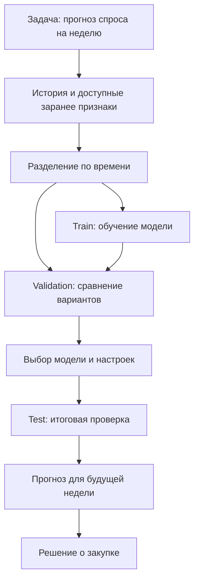
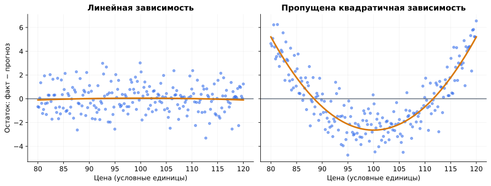
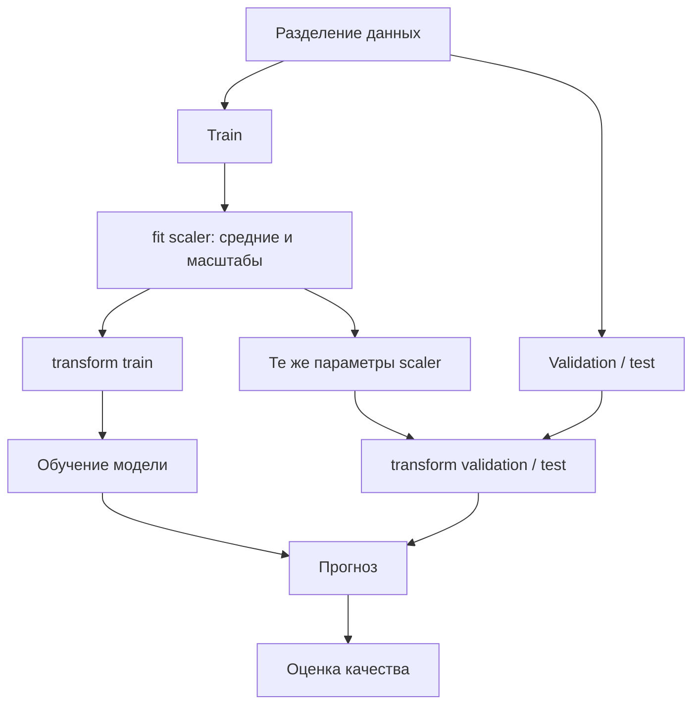
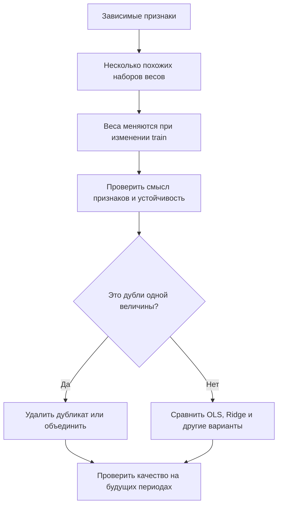
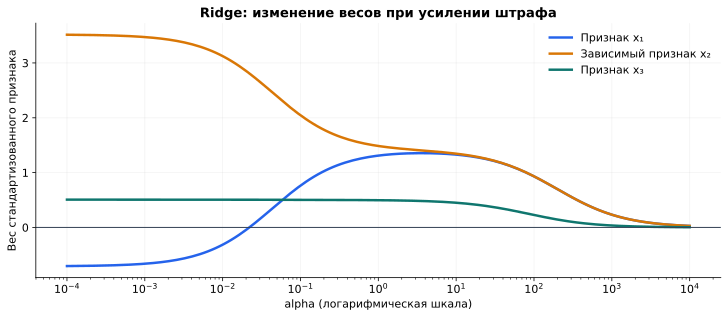
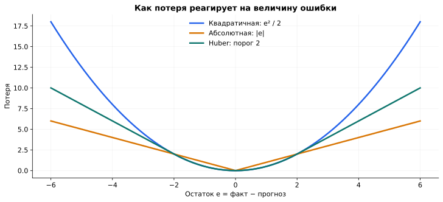
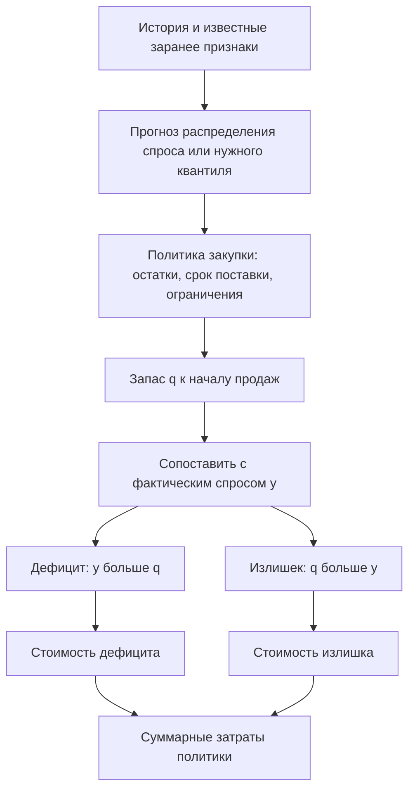

# Линейная регрессия: от прогноза к бизнес-решению

После лекции вы сможете объяснить, как линейная модель получает прогноз, как обучаются её коэффициенты, как проверить качество и когда нужны масштабирование, регуляризация и другая функция потерь.

## Ноутбуки и порядок практики

| Шаг | Ноутбук | Что сделать |
| --- | --- | --- |
| 1 | [Введение в ML и линейную регрессию](../jupyter_notebooks/vol_00_pre_requirements_01_machine_learning_intro.ipynb) | Изучите задания для самостоятельного выполнения и решите их. Разбор есть в записи занятия. |
| 2 | [Валидация, обобщение и переобучение](../jupyter_notebooks/vol_00_pre_requirements_05_machine_learning_validation_generalization_overfitting.ipynb) | Углублённо изучите переобучение и проверку качества модели на новых данных. |

## План лекции

1. Постановка задачи и сквозной пример.
2. Линейная модель и интерпретация коэффициентов.
3. Обучение: остатки, функция потерь и поиск весов.
4. Проверка качества: baseline, MAE, RMSE и R².
5. Диагностика ошибок.
6. Масштабирование без утечки данных.
7. Мультиколлинеарность и регуляризация.
8. Выбор loss и метрики: среднее, медиана, квантиль, относительные ошибки.
9. Бизнес-кейс: сколько товара заказать.
10. Итоги и самопроверка.

---

## 1. Какую задачу решаем

Магазин хочет заранее оценить спрос на товар на следующей неделе. На момент прогноза известны цена, запланированная скидка и продажи прошлых недель.

**Объект** — товар в конкретном магазине на конкретную прогнозируемую неделю. **Признаки** — информация, доступная до начала этой недели. **Таргет** — спрос за эту неделю, в штуках.

| Признак | Пример | Что необходимо проверить |
|---|---:|---|
| Продажи предыдущей недели | 100 шт. | Это прошлые продажи, а не продажи прогнозируемой недели |
| Цена следующей недели | 200 ₽ | Цена уже утверждена на момент прогноза |
| Запланированная скидка | 10% | Значение получено из плана, а не из будущего отчёта |

Спрос и наблюдаемые продажи могут различаться: если товар закончился, продажи не показывают весь спрос. В учебном примере считаем, что дефицита не было. В реальной задаче нужно учитывать доступность товара.

**Прогноз спроса** и **решение о закупке** — разные результаты. Прогноз описывает ожидаемую величину спроса или его квантиль; закупка также зависит от остатков, срока поставки и стоимости дефицита.



**Вопрос аудитории:** можно ли использовать фактическую выручку прогнозируемой недели как признак? Нет: в момент прогноза её ещё нет. Это утечка будущей информации.

---

## 2. Как устроена линейная модель

### От одного признака к нескольким

Сначала используем только продажи прошлой недели:

$$
\hat y_i = b + w_1 x_{i1}.
$$

Здесь $i$ — номер объекта, $x_{i1}$ — значение признака, $\hat y_i$ — прогноз, $w_1$ — коэффициент, $b$ — свободный член, или intercept.

Для нескольких признаков:

$$
\hat y_i = b + \sum_{j=1}^{p} w_j x_{ij}.
$$

Индекс $j$ обозначает признак, а не степень. Например, учебная модель может иметь вид:

$$
\hat y = 20 + 0.8 \cdot \text{sales}_{\text{prev week}} - 0.1 \cdot \text{price}.
$$

При прошлых продажах 100 штук и цене 200 ₽ прогноз равен $20 + 80 - 20 = 80$ штук. Коэффициенты здесь придуманы для объяснения; при обучении их подбирают по данным.

### Как читать коэффициенты

- $w_1 = 0.8$: при увеличении прошлых продаж на одну штуку прогноз растёт на 0.8 штуки **при фиксированных остальных признаках**.
- $w_2 = -0.1$: при увеличении цены на 1 ₽ прогноз снижается на 0.1 штуки при тех же остальных признаках.
- $b$: прогноз при нулевых значениях всех признаков. Если такие объекты не встречаются, intercept не имеет самостоятельного бизнес-смысла.

Коэффициент описывает связь внутри модели. Он не доказывает, что изменение цены вызовет именно такое изменение спроса: цена может зависеть от сезонности, промо и других факторов.

Сравнивать модули весов без учёта единиц нельзя. Коэффициент при цене в рублях и при цене в тысячах рублей будет разным, хотя прогноз останется тем же.

### Что значит «линейная»

Модель линейна **по коэффициентам**. Можно заранее создать признак $x^2$ или взаимодействие цены и скидки, а затем обучить линейную модель на этих признаках. Зависимость прогноза от исходных переменных при этом может быть нелинейной.

Но без таких преобразований модель описывает только аддитивную линейную зависимость. Кроме того, обычная линейная регрессия может выдавать отрицательный спрос; способ работы с такими прогнозами нужно заранее определить и проверить на валидации.

---

## 3. Как модель обучается

### От ошибки одного прогноза к общей потере

Определим остаток:

$$
e_i = y_i - \hat y_i.
$$

Положительный остаток означает недопрогноз. Если спрос равен 100, а прогноз — 80, остаток равен 20.

Просто суммировать остатки нельзя: ошибки $+20$ и $-20$ взаимно сократятся. Метод наименьших квадратов (МНК, OLS) минимизирует сумму квадратов остатков. Для удобства запишем эквивалентную задачу через среднее:

$$
L(b,w) = \frac{1}{n}\sum_{i=1}^{n}
\left(y_i - b - \sum_{j=1}^{p}w_jx_{ij}\right)^2,
\qquad
(\hat b,\hat w) = \arg\min_{b,w} L(b,w).
$$

Обучение — это поиск коэффициентов, при которых выбранная функция потерь на train минимальна. В базовой модели мы выбираем MSE; позже обсудим, как меняется задача при другой потере.

### Два способа найти коэффициенты

**Решение задачи наименьших квадратов.** Соберём признаки в матрицу $X$ размера $n \times (p+1)$, добавив столбец единиц для intercept. Тогда $\hat{\boldsymbol y}=X\boldsymbol\theta$, где $\boldsymbol\theta=(b,w_1,\ldots,w_p)^\top$.

При полном столбцовом ранге:

$$
\hat{\boldsymbol\theta} = (X^\top X)^{-1}X^\top\boldsymbol y.
$$

Это полезная теоретическая формула. В коде не нужно вручную обращать матрицу: численные методы, например QR или SVD, позволяют решать задачу устойчивее. Если столбцы зависимы, минимум всё ещё существует, но коэффициенты могут быть неединственными.

**Градиентный спуск.** Начинаем с некоторого набора коэффициентов и многократно двигаемся в сторону уменьшения потери:

$$
\boldsymbol\theta_{t+1} = \boldsymbol\theta_t - \eta\nabla L(\boldsymbol\theta_t).
$$

$\eta$ — шаг обучения. Слишком большой шаг может приводить к расходимости, слишком маленький — к медленному обучению. Для этой квадратичной задачи нет плохих локальных минимумов, но сходимость итераций зависит от шага и свойств данных.

Для первой реализации достаточно `LinearRegression`. Градиентный спуск подробно разбирается в [ноутбуке о линейной регрессии и SGD](../jupyter_notebooks/vol_00_pre_requirements_04_machine_learning_linear_regression_sgd_deep_dive.ipynb).

---

## 4. Как проверить качество

### Разделение данных и baseline

Низкая ошибка на train показывает, насколько модель подстроилась под известные данные. Нас интересуют новые недели, поэтому для спроса используем хронологическое разделение:

- **Train:** ранний период; здесь обучаем коэффициенты.
- **Validation:** следующий период; здесь выбираем признаки, регуляризацию и другие настройки.
- **Test:** последний период; используем после фиксации решения для итоговой оценки.

Для проверки устойчивости полезно повторить оценку на нескольких последовательных временных окнах. Случайное перемешивание может дать нереалистичную оценку прогноза будущего.

Сравниваем модель с **baseline**: например, прогнозируем продажи прошлой недели или того же дня прошлой недели. Если сложная модель не улучшает простой прогноз на будущих периодах, её польза пока не доказана.

### MAE и RMSE

$$
\mathrm{MAE}=\frac{1}{n}\sum_{i=1}^{n}|y_i-\hat y_i|,
\qquad
\mathrm{RMSE}=\sqrt{\frac{1}{n}\sum_{i=1}^{n}(y_i-\hat y_i)^2}.
$$

Обе метрики измеряются в единицах таргета: для спроса — в штуках. RMSE сильнее реагирует на большие ошибки из-за возведения остатков в квадрат.

| Факт | Прогноз A | Прогноз B |
|---:|---:|---:|
| 100 | 105 | 100 |
| 100 | 95 | 100 |
| 100 | 105 | 100 |
| 100 | 95 | 80 |

У A и B MAE = 5. Но RMSE у A равна 5, у B — 10: одна ошибка на 20 штук сильнее влияет на квадратичную потерю.

Это не делает B хуже для любого бизнеса. Предпочтение определяется стоимостью ошибок, а не названием метрики.

### R²: сравнение с константным прогнозом

$$
R^2 = 1 - \frac{\sum_i(y_i-\hat y_i)^2}{\sum_i(y_i-\bar y)^2}.
$$

$\bar y$ — среднее фактических значений на оцениваемой выборке.

- $R^2=1$: идеальные прогнозы.
- $R^2=0$: сумма квадратов ошибок равна ошибке константы $\bar y$.
- $R^2<0$: результат хуже этой константы. Это может быть следствием переобучения, сдвига данных или неподходящей модели; само значение не устанавливает причину.

Среднее test используется здесь только в определении метрики. Для рабочего baseline его нельзя брать из будущего. При постоянном таргете знаменатель равен нулю, и требуются специальные соглашения реализации.

**Для отчёта:** покажите качество модели и baseline на одном периоде, размер выборки, MAE/RMSE и ошибки по важным группам товаров. Одного R² недостаточно.

---

## 5. Диагностика: где модель ошибается

Общая метрика может скрывать систематические проблемы. Сохраним прогнозы на validation и посмотрим на остатки $e_i=y_i-\hat y_i$.

| Что исследуем | Наблюдение | Возможное объяснение и следующий шаг |
|---|---|---|
| Остатки против прогноза или признака | Видна дуга или другая структура | Линейной зависимости недостаточно; проверить преобразования и взаимодействия |
| Разброс остатков | При большом спросе ошибки заметно шире | Ошибка зависит от масштаба; оценить метрики по сегментам и смысл преобразования таргета |
| Остатки во времени | Несколько недель подряд положительные | Модель недопрогнозирует; проверить сезонность, сдвиг и пропущенные события |
| Отдельные большие ошибки | Редкие необычные точки | Проверить ошибки данных, промо и дефицит; не удалять наблюдения автоматически |
| Train против validation | На train хорошо, на validation плохо | Проверить переобучение, схему разделения и изменение данных |

Для этого блока полезны три графика: факт против прогноза, остатки против прогноза и средняя ошибка по неделям. Форма графика помогает выдвинуть гипотезу, но не доказывает её причину.



На синтетическом примере слева остатки колеблются около нуля без выраженной кривизны. Справа модель пропустила квадрат цены: дуга остатков показывает структуру, которую она не описала. Оранжевая линия — квадратичный тренд остатков для иллюстрации. Эти графики построены на обучающих данных для демонстрации формы; рабочую диагностику повторяем на validation.

Нормальность ошибок не нужна, чтобы вычислить прогноз МНК. Дополнительные предположения важны, если хотим использовать классические доверительные интервалы, стандартные ошибки и тесты значимости коэффициентов.

---

## 6. Масштабирование без утечки данных

### Зачем менять масштаб

Пусть цену вместо рублей выразили в тысячах рублей. Для нерегуляризованного МНК с intercept коэффициент при цене может увеличиться в 1000 раз и сохранить те же прогнозы. Большие значения признака сами по себе не заставляют модель «предпочитать» его.

Масштабирование особенно полезно в трёх случаях:

1. **Градиентный спуск:** разные масштабы могут затруднять выбор шага и замедлять сходимость.
2. **Регуляризация:** штраф зависит от величины весов; без согласования масштабов единицы измерения влияют на силу штрафа для разных признаков.
3. **Интерпретация:** на стандартизованных признаках коэффициент описывает изменение прогноза при изменении признака на одно стандартное отклонение. Это всё ещё не универсальная мера важности.

### Стандартизация

Для каждого признака отдельно:

$$
z_{ij}=\frac{x_{ij}-\mu_j}{\sigma_j}.
$$

$\mu_j$ и $\sigma_j$ вычисляем **только по train**. Validation, test и будущие объекты преобразуем теми же параметрами. Константные признаки требуют отдельной обработки; `StandardScaler` обрабатывает нулевую дисперсию.

Min-max scaling приводит train к заданному диапазону. Нормализация длины отдельного вектора — другое преобразование. Поэтому лучше называть конкретный метод, а не использовать «нормализацию» как общее название всех преобразований.



Обученный scaler — часть модели поставки. Нельзя заново вычислять средние на каждом запросе или обучать scaler на объединённых train и test. При кросс-валидации он обучается заново внутри каждого обучающего фолда.

### Минимальный воспроизводимый пример

Пример ниже создаёт учебные данные без внешних файлов. Это демонстрация механики; качество на синтетике не является результатом для реального магазина.

```python
import numpy as np
from sklearn.dummy import DummyRegressor
from sklearn.linear_model import LinearRegression
from sklearn.metrics import mean_absolute_error, mean_squared_error
from sklearn.pipeline import make_pipeline
from sklearn.preprocessing import StandardScaler

rng = np.random.default_rng(42)
n = 200
previous_sales = rng.uniform(50, 150, n)
price = rng.uniform(100, 200, n)
X = np.column_stack([previous_sales, price])
y = 20 + 0.8 * previous_sales - 0.1 * price + rng.normal(0, 5, n)

# Индекс строки обозначает момент прогноза: последние 40 объектов — test.
X_train, X_test = X[:160], X[160:]
y_train, y_test = y[:160], y[160:]

model = make_pipeline(StandardScaler(), LinearRegression())
model.fit(X_train, y_train)
baseline = DummyRegressor(strategy="mean").fit(X_train, y_train)

for name, estimator in [("baseline", baseline), ("linear", model)]:
    prediction = estimator.predict(X_test)
    mae = mean_absolute_error(y_test, prediction)
    rmse = np.sqrt(mean_squared_error(y_test, prediction))
    print(f"{name}: MAE={mae:.2f}, RMSE={rmse:.2f}")
```

Здесь настройки заранее фиксированы, поэтому отдельный validation не используется. Если начинаем выбирать признаки или `alpha`, выделяем validation внутри раннего периода либо используем временную кросс-валидацию. Test оставляем для финальной проверки. Для реального спроса сравниваем модель также с сезонным baseline.

Масштабирование включено в `Pipeline`, чтобы показать правильное разделение `fit` и `predict`. Для этой нерегуляризованной модели оно не обязательно. [Подробнее об утечках и Pipeline](https://scikit-learn.org/stable/common_pitfalls.html).

---

## 7. Мультиколлинеарность и регуляризация

### Почему коэффициенты могут быть нестабильны

Мультиколлинеарность — точная или приближённая линейная зависимость между столбцами признаков. Это может быть зависимость одного признака сразу от нескольких других, а не только большая попарная корреляция.

Допустим, включили площадь магазина в квадратных метрах и в квадратных футах:

$$
x_2 = c x_1,\qquad c \approx 10.764.
$$

Тогда вклад двух признаков равен:

$$
w_1x_1+w_2x_2=(w_1+cw_2)x_1.
$$

Данные определяют комбинацию $w_1+cw_2$, но не позволяют однозначно разделить её на два веса. Разные пары коэффициентов дают одинаковый прогноз. При приближённой зависимости небольшое изменение train может сильно менять веса, хотя прогнозы на похожих объектах меняются мало.

**Следствие:** нестабильные веса мешают интерпретации. Ухудшение прогнозов возможно, особенно при изменении связей между признаками, но не является обязательным результатом любой корреляции.

### Как диагностировать

- Начать с смысла признаков: нет ли двух единиц измерения одной величины или суммы и всех её составляющих.
- Посмотреть корреляции: полезный первый шаг, который не выявляет все зависимости.
- Проверить устойчивость весов на разных обучающих периодах.
- При необходимости использовать VIF и анализ сингулярных значений; подробности — в дополнительном блоке.



### Ridge и Lasso

Регуляризация добавляет к потере штраф за величину коэффициентов. В одной из распространённых записей:

$$
L_{\mathrm{Ridge}} = \mathrm{MSE} + \lambda\sum_{j=1}^{p}w_j^2,
\qquad
L_{\mathrm{Lasso}} = \mathrm{MSE} + \lambda\sum_{j=1}^{p}|w_j|.
$$

Intercept здесь не штрафуем. Нормировки loss и параметра штрафа различаются между реализациями, поэтому численное значение `alpha` нужно читать в документации конкретного estimator.

| Метод | Что меняется | На что обратить внимание |
|---|---|---|
| Ridge | Веса сжимаются; решение становится устойчивее | Может улучшить обобщение ценой смещения; не устраняет зависимость самих признаков |
| Lasso | Некоторые веса становятся ровно нулевыми | При зависимых признаках выбор оставшегося признака может быть нестабилен |

Параметр регуляризации выбираем по validation или временной кросс-валидации. Более сильный штраф не всегда лучше: чрезмерное сжатие приводит к недообучению. Для исходных числовых признаков с разными единицами обычно используем scaler внутри pipeline.



На графике два признака почти дублируют друг друга. При слабом штрафе их веса сильно различаются; при усилении штрафа они сближаются, а при очень большом штрафе все веса стремятся к нулю. Отдельный вес не обязан уменьшаться монотонно. По этому графику нельзя выбрать лучшее значение alpha: для этого нужна ошибка на validation.

PCA может уменьшить размерность и дать некоррелированные компоненты на обучающей выборке, но усложняет интерпретацию. Некоррелированность не означает статистическую независимость. SVD также применяется как численный метод решения МНК; это не обязательно отдельное преобразование признаков.

---

## 8. Как выбрать loss и метрику

### Три разных уровня оценки

**Loss** определяет, какие коэффициенты найдёт обучение. **ML-метрика** позволяет сравнить прогнозы на новых данных. **Бизнес-показатель** оценивает последствия решения: прибыль, затраты, доступность товара.

Можно обучать по MSE, сравнивать модели по MAE и RMSE, а окончательный выбор проверять по стоимости закупок. Но если обучение систематически оптимизирует не то, что важно для решения, стоит пересмотреть loss.

### Среднее, медиана и квантиль

Предположим, при одинаковых доступных признаках спрос может быть 0, 0 или 9 штук с одинаковыми вероятностями.

- Постоянный прогноз 3 минимизирует ожидаемую квадратичную потерю: это среднее.
- Постоянный прогноз 0 минимизирует ожидаемую абсолютную потерю: это медиана.

В общем случае MSE ориентирует оптимальный прогноз на условное среднее $E[Y\mid X=x]$, MAE — на условную медиану. Минимизация RMSE на фиксированной выборке эквивалентна минимизации MSE, так как корень — монотонное преобразование.

Линейная модель ограничена выбранным набором признаков: она может лишь приближать нужную условную характеристику. Из выбора MSE не следует, что модель обязательно восстановит истинное условное среднее.

| Задача обучения | Потеря | Результат при достаточно гибкой модели |
|---|---|---|
| Оценить средний спрос | Квадратичная | Условное среднее |
| Оценить центральный прогноз, устойчивый к экстремальным значениям таргета | Абсолютная | Условная медиана |
| Учесть разную цену дефицита и излишка | Квантильная | Выбранный условный квантиль |
| Снизить влияние больших остатков относительно квадратичной потери | Huber | Компромисс, зависящий от порога и распределения |

Huber квадратична около нуля и линейна для больших по модулю остатков. Это уменьшает влияние больших ошибок таргета по сравнению с MSE, но не даёт полной защиты от необычных значений признаков.



Здесь квадратичная потеря записана как половина квадрата для сравнения формы кривых. Множитель 1/2 не меняет минимум нерегуляризованной задачи. Порог Huber выбран равным 2 в единицах остатка; настройка масштаба в конкретной реализации может отличаться.

В scikit-learn `LinearRegression` обучается методом МНК; `QuantileRegressor(quantile=0.5, alpha=0)` решает линейную задачу абсолютной потери без штрафа, а `HuberRegressor` использует робастную потерю. Наличие метрики MAPE не означает наличие переключателя MAPE в `LinearRegression`. [Описание моделей и функций потерь](https://scikit-learn.org/stable/modules/linear_model.html).

### MAPE, WAPE и Bias: что именно усредняем

Для положительных фактических значений:

$$
\mathrm{MAPE}=\frac{1}{n}\sum_i\frac{|y_i-\hat y_i|}{|y_i|}.
$$

Каждый объект даёт одну относительную ошибку. У товара A факт 10 и ошибка 2: 20%. У товара B факт 1000 и ошибка 20: 2%. Средняя MAPE равна 11%.

WAPE суммирует абсолютные ошибки и нормирует их на общий объём:

$$
\mathrm{WAPE}=\frac{\sum_i|y_i-\hat y_i|}{\sum_i|y_i|}.
$$

Для тех же товаров WAPE равна $22/1010\approx2.18\%$. Для положительных $y$ это среднее относительных ошибок с весами, пропорциональными фактическому объёму. MAPE и WAPE отвечают на разные вопросы: первая даёт одинаковый вес объектам, вторая сильнее отражает большие объёмы.

В формулах получаем долю; для представления в процентах умножаем на 100. Эти ошибки **могут превышать 100%**. Нельзя требовать от них диапазона 0–100%.

| Показатель | Как читать | Ограничение |
|---|---|---|
| MAE | Средняя абсолютная ошибка в штуках | Не учитывает различия масштаба товаров |
| RMSE | Ошибка в штуках с повышенной чувствительностью к большим остаткам | Несколько больших ошибок могут доминировать |
| MAPE | Средняя относительная ошибка объекта | Не определена при нулевом факте; малые факты получают большой вес |
| WAPE | Абсолютная ошибка относительно общего объёма | Не определена при нулевом общем объёме; крупные товары могут скрывать проблемы мелких |
| Bias | Направление суммарной ошибки | Недо- и перепрогнозы могут взаимно компенсироваться |

Для неотрицательного спроса с ненулевой суммой определим нормированный Bias так:

$$
\mathrm{Bias}=\frac{\sum_i(\hat y_i-y_i)}{\sum_i y_i}.
$$

Положительное значение означает перепрогноз. Это выбранное соглашение о знаке, его нужно указывать в отчёте. Bias около нуля не гарантирует точность: ошибки могут сократиться при суммировании.

### Что означает асимметрия MAPE

При **фиксированном факте** 100 прогнозы 90 и 110 дают одинаковые 10%. По величине аддитивной ошибки вокруг этого факта MAPE симметрична.

Но поменяем местами факт и прогноз:

- факт 100, прогноз 200: MAPE = 100%;
- факт 200, прогноз 100: MAPE = 50%.

Другая особенность: для положительного спроса объекты с малым фактом получают вес $1/y$. Поэтому оптимальный по MAPE прогноз может быть ниже оптимального по MAE или MSE. Это не означает, что каждая ошибка недопрогноза штрафуется сильнее перепрогноза.

При нулях нельзя незаметно добавить константу в знаменатель: это изменяет метрику и веса объектов. Для прерывистого спроса рассматриваем MAE, WAPE при ненулевом общем объёме и оценку по сегментам. Любое правило обработки нулей фиксируем заранее.

### Дополнительно: sMAPE и логарифмы

Одна из распространённых версий sMAPE:

$$
\mathrm{sMAPE}=\frac{1}{n}\sum_i
\frac{2|y_i-\hat y_i|}{|y_i|+|\hat y_i|}.
$$

При одновременном нуле в числителе и знаменателе требуется соглашение, например нулевой вклад. Эта версия симметрична при перестановке факта и прогноза, но не обязана одинаково оценивать равные отклонения вверх и вниз от фиксированного факта. Важно указывать используемую формулу.

При обучении на $\ln(1+y)$ большие значения сжимаются. Для неотрицательных факта и прогноза RMSLE измеряет квадратичную ошибку в этом преобразованном пространстве:

$$
\mathrm{RMSLE}=\sqrt{\frac{1}{n}\sum_i
\left(\ln(1+\hat y_i)-\ln(1+y_i)\right)^2}.
$$

Это изменение цели обучения. Если модель оценивает среднее логарифма, простое обратное преобразование $\exp(\hat z)-1$ в общем случае **не равно** среднему спросу в исходных единицах. На больших положительных значениях небольшая разность логарифмов приближает относительную ошибку; около нуля это обоснование не работает.

Большой разброс таргета — повод исследовать преобразование, но не достаточный критерий выбора. Проверяем бизнес-смысл, качество после обратного преобразования и последствия для решения. Абсолютную ошибку логарифмов также можно использовать как отдельную потерю, но она не является универсальной заменой MAPE.

---

## 9. Бизнес-кейс: сколько товара заказать

### От прогноза к затратам

Для простоты рассматриваем один товар, один период и заказ без ограничений. Срок поставки уже учтён в горизонте спроса. Пусть $q$ — доступный к продаже запас после заказа, $y$ — спрос.

$$
C(q,y)=c_u\max(y-q,0)+c_o\max(q-y,0),
$$

где $c_u$ — стоимость единицы дефицита, $c_o$ — стоимость единицы излишка за рассматриваемый период. Это не обязательно полная закупочная цена: учитываем маржу, хранение, утилизацию и остаточную стоимость согласно экономике задачи.



Если дефицит стоит 30 ₽ за штуку, а излишек — 10 ₽, одинаковая по модулю ошибка в сторону дефицита дороже. При указанной линейной функции затрат оптимальный запас соответствует квантилю уровня:

$$
\tau=\frac{c_u}{c_u+c_o}=\frac{30}{30+10}=0.75.
$$

Нужен 75-й процентиль, то есть квантиль уровня 0.75. При непрерывном корректно оценённом распределении спрос не превышает такой запас примерно в 75% случаев. Это не означает «заказать на 75% больше среднего».

Для закупки вычтем доступный остаток из целевого запаса и учтём минимальные партии. Если есть ограничения бюджета, несколько периодов или общий склад, простая квантильная формула уже не описывает всю задачу.

Категория товара помогает оценить стоимости, но не задаёт универсальное правило «для скоропортящегося всегда недопрогноз». Нужны конкретные $c_u$ и $c_o$, а не произвольный целевой Bias от −5% до −1%.

### Как сравнивать решения

1. Зафиксировать стоимость дефицита и излишка, горизонт и правила работы с остатками.
2. На исторических будущих периодах получить прогнозы без доступа к будущим данным.
3. Применить к каждой модели одну согласованную политику закупки либо явно сравнить разные политики.
4. Измерить затраты, дефицит и излишки; сравнить с действующим решением.
5. Дополнительно показать MAE/WAPE и Bias по категориям, чтобы объяснить различия.

WAPE спроса не является прибылью. Для денежных выводов нужны цены и затраты. Если таргет — изменение прибыли, он может быть отрицательным или иметь сумму около нуля; относительная ошибка с таким знаменателем становится неустойчивой. В этом случае полезнее явно считать ошибки в деньгах и результат политики.

**Отдельная задача — эффект скидки.** Прогноз продаж при исторических ценах сам по себе не доказывает, сколько дополнительных продаж вызовет новая скидка. Для оценки причинного эффекта нужны дополнительные предположения или эксперимент.

---

## 10. Итоги и самопроверка

Линейная модель строит взвешенную сумму признаков. Обучение подбирает веса под выбранную потерю, а качество проверяется на данных, недоступных при обучении и выборе настроек. Масштабирование, регуляризация и преобразования — инструменты для конкретных проблем; их пользу проверяем на валидации.

Перед использованием модели проверьте:

- Определены объект, горизонт прогноза и доступность каждого признака.
- Есть подходящее разделение данных и простой baseline.
- Все обучаемые преобразования получают `fit` только на train.
- Метрики посчитаны в нужных единицах и по важным сегментам.
- Исследованы остатки и стабильность на нескольких периодах.
- Выбор loss соответствует нужной характеристике спроса.
- Бизнес-результат оценивается через решение и его стоимость.

### Вопросы аудитории

1. Почему коэффициент при цене изменится при переходе от рублей к тысячам рублей, а прогноз может сохраниться?
2. Почему нельзя обучать scaler на всех данных до разделения?
3. Если на train ошибка мала, а на следующем месяце велика, какие три гипотезы проверите первыми?
4. Может ли модель иметь нестабильные коэффициенты и стабильные прогнозы? Приведите пример.
5. Почему MAE и RMSE могут по-разному ранжировать две модели?
6. Какую задачу решаем: прогноз среднего спроса или выбор запаса при асимметричных затратах?
7. Что означает отрицательный R² и чего он не доказывает?

### Мини-задания

1. Для фактов `[10, 1000]` и прогнозов `[8, 980]` посчитайте MAE, MAPE, WAPE и Bias. Объясните разницу в весах объектов.
2. Создайте копию признака `price`, умноженную на 1000. Сравните прогнозы и коэффициенты OLS на двух обучающих периодах; затем повторите со стандартизацией и Ridge. Не ожидайте обязательного ухудшения прогнозов OLS.
3. Если дефицит стоит 10 ₽, а излишек — 30 ₽, какой квантиль нужен в упрощённой задаче закупки?
4. В синтетическом примере замените генерацию таргета на нелинейную зависимость от цены. Посмотрите, какую структуру образуют остатки, и добавьте подходящий признак.

**Ответы к расчётам:** MAE = 11 штук, MAPE = 11%, WAPE ≈ 2.18%, Bias ≈ −2.18%. В задаче 3 нужен квантиль уровня $10/(10+30)=0.25$.

Практика в репозитории:

- [Введение в ML и линейную регрессию](../jupyter_notebooks/vol_00_pre_requirements_01_machine_learning_intro.ipynb).
- [Линейная регрессия и градиентный спуск](../jupyter_notebooks/vol_00_pre_requirements_04_machine_learning_linear_regression_sgd_deep_dive.ipynb).

---

## Дополнительно: математика диагностики

Этот раздел можно изучить после основной лекции. Для первого рабочего baseline он не является обязательным.

### VIF: насколько признак объясняется остальными

Для признака $X_j$ обучим вспомогательную линейную регрессию по остальным признакам с intercept. Обозначим её коэффициент детерминации через $R_j^2$:

$$
\mathrm{VIF}_j=\frac{1}{1-R_j^2}.
$$

При стандартных условиях линейной модели VIF показывает увеличение дисперсии оценки коэффициента из-за линейных зависимостей между признаками. VIF = 1 соответствует $R_j^2=0$; при точной объяснимости знаменатель обращается в ноль.

Пороги 5 или 10 — ориентиры для диагностики, а не универсальная граница допустимости. Важны цель анализа, объём данных, устойчивость весов и качество на новых периодах.

### Число обусловленности

Для матрицы полного столбцового ранга в спектральной норме:

$$
\kappa_2(X)=\frac{\sigma_{\max}(X)}{\sigma_{\min}(X)},
\qquad
\kappa_2(X^\top X)=\kappa_2(X)^2.
$$

$\sigma$ — сингулярные значения. Большое число обусловленности указывает на чувствительность решения к возмущениям. На него влияют и зависимости признаков, и их масштабы. Поэтому нельзя задавать одну таблицу порогов для любых исходных данных и единиц измерения.

При потере ранга наименьшее сингулярное значение равно нулю, обусловленность бесконечна. Обратной матрицы $X^\top X$ нет, но минимум МНК существует; псевдообратная позволяет выбрать решение минимальной нормы.

### Adjusted R²

Для МНК с intercept на обучающей выборке добавление признаков не уменьшает обычный R². Скорректированный вариант вводит поправку на число признаков:

$$
R_{\mathrm{adj}}^2=1-\frac{(1-R^2)(n-1)}{n-p-1},\qquad n>p+1.
$$

Здесь $n$ — число объектов, $p$ — число признаков без intercept. Это дополнительная характеристика подгонки, которая не заменяет оценку на будущих данных.

---

## Материалы по теме

- [Линейные модели: OLS, Ridge, Lasso, Huber и квантильная регрессия](https://scikit-learn.org/stable/modules/linear_model.html).
- [Метрики регрессии и правила их интерпретации](https://scikit-learn.org/stable/modules/model_evaluation.html#regression-metrics).
- [Утечки данных, преобразования и Pipeline](https://scikit-learn.org/stable/common_pitfalls.html).
- [Стандартизация признаков](https://scikit-learn.org/stable/modules/generated/sklearn.preprocessing.StandardScaler.html).
- [Квантильная регрессия](https://scikit-learn.org/stable/modules/generated/sklearn.linear_model.QuantileRegressor.html).
- [Определение и особые случаи R²](https://scikit-learn.org/stable/modules/generated/sklearn.metrics.r2_score.html).
- [Метрики классификации и регрессии — учебник Яндекса](https://education.yandex.ru/handbook/ml/article/metriki-klassifikacii-i-regressii).
