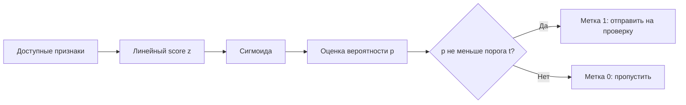
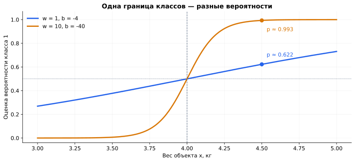
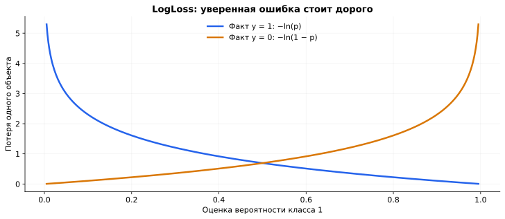
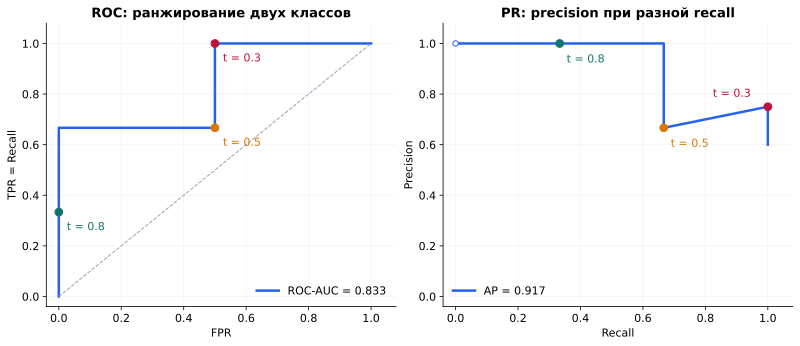
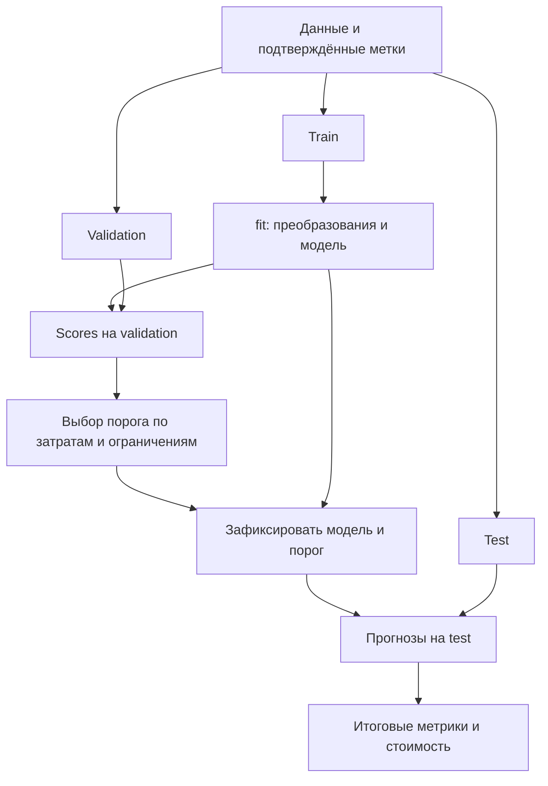

# Классификация: от логистической регрессии к решению

В этой лекции разберём, что предсказывает классификатор, почему его обучают по LogLoss, как вероятность превращается в метку и как оценить пользу решения для бизнеса.

После лекции вы сможете отличить качество ранжирования от качества вероятностей, рассчитать основные метрики и выбрать порог на валидации с учётом ограничений.

## Ноутбуки и порядок практики

| Шаг | Ноутбук | Что сделать |
| --- | --- | --- |
| 1 | [Задача классификации: основные метрики и алгоритмы](https://github.com/aleksandr-dzhumurat/ai_product_engineer/blob/main/jupyter_notebooks/vol_00_pre_requirements_02_machine_learning_classification.ipynb) | Изучите примеры алгоритмов классификации, расчёт метрик и задания для самостоятельной работы. |
| 2 | [Как работают деревья принятия решений и градиентный бустинг](https://github.com/aleksandr-dzhumurat/ai_product_engineer/blob/main/jupyter_notebooks/vol_04_deep_dive_09_trees_boosting.ipynb) | Разберите обучение деревьев и последовательное построение ансамбля в градиентном бустинге. |

## План лекции

1. Сквозная задача: проверка подозрительных транзакций.
2. Линейный score, сигмоида и оценка вероятности.
3. LogLoss и обучение модели.
4. Порог, confusion matrix и метрики.
5. Константный baseline и дисбаланс классов.
6. ROC и PR на одном примере.
7. Калибровка вероятностей.
8. Выбор порога и честная проверка результата.
9. Итоги и самопроверка.

---

## 1. Что именно предсказываем

Сервис хочет отправлять подозрительные транзакции на дополнительную проверку. Проверки стоят денег, но пропущенное мошенничество тоже приводит к потерям.

- **Объект:** транзакция в момент принятия решения.
- **Признаки:** сумма, история клиента и другая информация, доступная к этому моменту.
- **Таргет:** подтверждённое мошенничество — класс 1; легитимная транзакция — класс 0.
- **Действие:** отправить транзакцию на проверку или пропустить без неё.

Класс 1 называем **положительным**, хотя событие нежелательное. Это соглашение о кодировании. Положительный класс не обязан быть редким, но в нашем кейсе он редкий.

Факт отправки на проверку — не готовая метка мошенничества. Нужно получить подтверждённый исход; учитывать задержку разметки и то, что для непроверенных транзакций исход может быть неизвестен.

Различаем три результата:

| Результат | Пример | На какой вопрос отвечает |
|---|---|---|
| Score | 2.4 | Как высоко поставить объект в ранжировании? |
| Оценка вероятности | 0.73 | Какова оценка вероятности класса 1 по модели? |
| Метка / действие | Проверить | Что сделать с объектом при выбранном правиле? |

Score произвольного классификатора не обязательно является вероятностью. У логистической регрессии линейный score преобразуется сигмоидой в число от 0 до 1; качество этой оценки ещё нужно проверить.



**Вопрос аудитории:** можно ли использовать результат расследования транзакции как признак для её первоначального скоринга? Нет: в момент решения этого результата ещё нет.

---

## 2. Как устроена логистическая регрессия

### От линейного score к вероятности

В линейной регрессии взвешенная сумма признаков была самим прогнозом числового таргета. Здесь сначала вычисляем score, или логит:

$$
z_i=b+\sum_{j=1}^{p}w_jx_{ij}.
$$

Он может принимать любые действительные значения. Затем применяем сигмоиду:

$$
p_i=\sigma(z_i)=\frac{1}{1+e^{-z_i}}.
$$

Модель использует $p_i$ как оценку $P(Y=1\mid X=x_i)$. При $z=0$ получаем $p=0.5$, при положительном $z$ — значение выше 0.5, при отрицательном — ниже.

Слово «регрессия» в названии не означает, что выход — произвольное число: линейной является зависимость логита от признаков. При $0<p<1$:

$$
\log\frac{p}{1-p}=z.
$$

Коэффициент показывает изменение логарифма шансов при изменении признака на единицу и фиксированных остальных признаках. Это не постоянное изменение вероятности и не доказательство причинного влияния.

### Одинаковая граница, разные вероятности

Рассмотрим отдельный геометрический пример: по весу объекта $x$ предсказываем класс 0 при $x<4$ кг и класс 1 при $x>4$ кг. Случай $x=4$ договоримся относить к классу 1.

При пороге $t=0.5$ граница определяется условием:

$$
wx+b=0,\qquad b=-4w,\qquad w>0.
$$

Пары $(w=1,b=-4)$ и $(w=10,b=-40)$ дают одну границу и одинаковые метки. Но для объекта весом 4.5 кг:

| Параметры | Логит | Оценка вероятности класса 1 |
|---|---:|---:|
| $w=1$, $b=-4$ | 0.5 | ≈ 0.622 |
| $w=10$, $b=-40$ | 5 | ≈ 0.993 |



Вторая модель увереннее, но из одной границы нельзя заключить, что её вероятности лучше. Если реальные классы около границы шумные, излишняя уверенность может навредить.

Этот пример задаёт границу, а не решает задачу обучения весов. На полностью линейно разделимых данных нерегуляризованная логистическая регрессия может уменьшать LogLoss, неограниченно увеличивая веса; конечного оптимума без дополнительных условий может не быть.

---

## 3. Почему обучаем по LogLoss

### Ошибка вероятности, а не только метки

Для одного объекта бинарная кросс-энтропия (BCE, Binary LogLoss):

$$
\ell(y,p)=-y\log p-(1-y)\log(1-p).
$$

Используем натуральный логарифм. Если $y=1$, остаётся $-\log p$; если $y=0$ — $-\log(1-p)$.

| Фактический класс | Прогноз p | Метка при t = 0.5 | Потеря |
|---:|---:|---:|---:|
| 1 | 0.51 | 1 | ≈ 0.673 |
| 1 | 0.90 | 1 | ≈ 0.105 |
| 1 | 0.01 | 0 | ≈ 4.605 |
| 0 | 0.99 | 1 | ≈ 4.605 |

LogLoss различает два правильных класса с разными вероятностями и сильно штрафует уверенную ошибку. Но «всегда делай вероятность экстремальной» — неверный вывод: при неопределённых исходах это приводит к большим потерям на ошибках. Ожидаемая LogLoss минимальна при прогнозе истинной условной вероятности, если она доступна в классе моделей.



При ошибочной вероятности, стремящейся к 0 для класса 1 или к 1 для класса 0, потеря неограниченно растёт. В численном коде крайние вероятности обрабатывают так, чтобы избежать логарифма нуля.

### Что оптимизирует обучение

На train минимизируем среднюю потерю, при необходимости добавляя штраф за веса:

$$
L(b,w)=\frac{1}{n}\sum_i\ell(y_i,\sigma(z_i))+\lambda R(w).
$$

Для нерегуляризованной потери одного объекта производная **по логиту** особенно проста:

$$
\frac{\partial\ell}{\partial z_i}=p_i-y_i.
$$

Отсюда антиградиент по логиту равен $y_i-p_i$. Это не готовая производная по каждому весу: для $w_j$ дополнительно появляется множитель $x_{ij}$ и усреднение по объектам.

Пороговые метрики, например accuracy и F1, меняются скачками при изменении коэффициентов. LogLoss даёт гладкую задачу обучения. Затем порог выбираем отдельно под нужное действие.

Для практики: масштабирование признаков помогает численной оптимизации и согласованию регуляризации; все обучаемые преобразования получают `fit` только на train. В `LogisticRegression` scikit-learn по умолчанию применяется регуляризация; параметр `C` задаёт обратную силу штрафа.

---

## 4. От порога к confusion matrix

### Сначала фиксируем правило решения

Во всей лекции используем одно соглашение:

$$
\hat y_i=\mathbb{1}[p_i\geq t].
$$

Уменьшая порог на фиксированном наборе scores, отправляем на проверку больше объектов. Recall не уменьшается, но precision не обязана монотонно снижаться на конечной выборке. Значение 0.5 — удобная отправная точка, а не универсальный бизнес-оптимум.

### Четыре возможных исхода

Во всех матрицах ниже строки — факт, столбцы — прогноз; порядок классов 0, 1.

| Факт / прогноз | 0: пропустить | 1: проверить |
|---|---:|---:|
| 0: легитимная | TN | FP |
| 1: мошенничество | FN | TP |

- **TP:** мошенничество отправили на проверку.
- **FP:** легитимную транзакцию отправили на лишнюю проверку.
- **FN:** мошенничество пропустили.
- **TN:** легитимную транзакцию пропустили.

Пусть среди 1000 транзакций есть 100 мошеннических. Получили:

| Факт / прогноз | 0 | 1 |
|---|---:|---:|
| 0 | 850 | 50 |
| 1 | 20 | 80 |

### Что считают метрики

$$
\mathrm{Precision}=\frac{TP}{TP+FP},\qquad
\mathrm{Recall}=\frac{TP}{TP+FN}.
$$

**Precision:** из отправленных на проверку какая доля действительно мошенническая? Здесь $80/130\approx61.5\%$.

**Recall, TPR, чувствительность:** какую долю всех мошеннических транзакций нашли? Здесь $80/100=80\%$.

$$
\mathrm{Specificity}=\mathrm{TNR}=\frac{TN}{TN+FP},\qquad
\mathrm{FPR}=\frac{FP}{FP+TN}=1-\mathrm{TNR}.
$$

Specificity — доля легитимных транзакций, пропущенных без проверки: $850/900\approx94.4\%$. FPR — доля легитимных транзакций, ошибочно отправленных на проверку: $50/900\approx5.6\%$.

$$
\mathrm{Accuracy}=\frac{TP+TN}{TP+TN+FP+FN},\qquad
\mathrm{F1}=\frac{2TP}{2TP+FP+FN}.
$$

Accuracy здесь 93%, F1 ≈ 69.6%. F1 — гармоническое среднее precision и recall; она не учитывает TN и не кодирует денежную стоимость ошибок. Сам по себе дисбаланс не делает F1 лучшей целевой метрикой.

Если нет предсказанных положительных объектов, precision имеет знаменатель 0. Если в выборке нет фактического класса 1, не определена recall. В отчёте нужно явно указывать правила обработки таких случаев, а не выдавать условный ноль за измеренное качество.

**Вопрос аудитории:** если отправить на проверку вообще все транзакции, recall станет 100%. Что произойдёт с количеством проверок и precision?

---

## 5. Baseline, дисбаланс и постоянные предсказания

### Почему accuracy недостаточно

В 10 000 транзакций только 100 мошеннических. Модель всегда предсказывает класс 0:

| Факт / прогноз | 0 | 1 |
|---|---:|---:|
| 0 | 9900 | 0 |
| 1 | 100 | 0 |

Accuracy = 99%, recall = 0, specificity = 1. Balanced accuracy, среднее recall двух классов, равна 0.5. Precision класса 1 не определена: положительных предсказаний нет.

Это полезный **константный baseline**, с которым сравниваем модель. Высокая accuracy здесь не показывает способность находить мошенничество.

Другой baseline — всем выдавать одну вероятность, равную доле класса 1 на train. Он позволяет сравнивать LogLoss; при наличии обоих классов в оценке постоянный score даёт ROC-AUC = 0.5. Одна и та же доля может быть разумной общей оценкой частоты, но не ранжирует отдельные объекты.

### Как диагностировать постоянный прогноз

Проверяем распределение предсказанных меток, confusion matrix и качество каждого класса. Нулевой столбец означает, что модель ни разу не предсказала соответствующий класс на этой выборке. Нулевая строка означает отсутствие такого **фактического** класса, а не постоянство модели.

```python
import numpy as np
from sklearn.metrics import classification_report, confusion_matrix

y_true = np.array([0, 0, 0, 0, 1])
y_pred = np.array([0, 0, 0, 0, 0])

labels, counts = np.unique(y_pred, return_counts=True)
print("Распределение предсказаний:", dict(zip(labels, counts)))
print(confusion_matrix(y_true, y_pred, labels=[0, 1]))
# Для печати условимся выводить 0 при нулевом знаменателе.
print(classification_report(y_true, y_pred, labels=[0, 1], zero_division=0))
```

Один предсказанный класс — повод исследовать score, порог, обучение и данные. Модель может ранжировать объекты, но при слишком высоком пороге выдавать только нули. Поэтому постоянные **метки** ещё не доказывают постоянство **scores**.

Инверсия классов не является отдельным тестом обученности. Если одновременно заменить факт и прогноз на $1-y$, то recall нового класса 1 равна specificity старого класса 1. Это просто другой взгляд на ту же confusion matrix. Низкая метрика одного класса не доказывает, что модель предсказывает только один класс.

У хорошей модели некоторые ячейки могут быть нулевыми. У идеальной FP = FN = 0; требование «все ячейки заполнены» ошибочно.

---

## 6. ROC и PR: как оценить ранжирование

### Один набор scores для всех примеров

Возьмём пять транзакций. Это маленький искусственный пример с тремя положительными объектами, а не типичная доля мошенничества в продакшене.

| Объект | Score | Фактический класс |
|---|---:|---:|
| A | 0.9 | 1 |
| B | 0.7 | 1 |
| C | 0.6 | 0 |
| D | 0.4 | 1 |
| E | 0.2 | 0 |

Объекты уже отсортированы по убыванию score. Начнём с порога выше всех scores и будем его снижать. При правиле $s\geq t$:

| Порог t | Положительные предсказания | TP | FP | TPR = Recall | FPR | Precision |
|---|---|---:|---:|---:|---:|---:|
| > 0.9 | Нет | 0 | 0 | 0 | 0 | Не определена |
| 0.9 | A | 1 | 0 | 1/3 | 0 | 1 |
| 0.7 | A, B | 2 | 0 | 2/3 | 0 | 1 |
| 0.6 | A, B, C | 2 | 1 | 2/3 | 1/2 | 2/3 |
| 0.4 | A, B, C, D | 3 | 1 | 1 | 1/2 | 3/4 |
| 0.2 | Все | 3 | 2 | 1 | 1 | 3/5 |

### ROC-кривая и площадь

ROC строится по горизонтали **FPR**, по вертикали **TPR**. В этом примере каждый встреченный положительный объект даёт шаг вверх на 1/3, каждый отрицательный — вправо на 1/2. Конечная точка — (1, 1), идеальный верхний левый угол — **(0, 1)**.

ROC-AUC — площадь под этой кривой. Она не является равномерным средним метрик по числовым порогам от 0 до 1. Для ROC достаточно scores, вероятностная интерпретация не обязательна.

Удобная интерпретация площади:

$$
\mathrm{AUC}_{\mathrm{ROC}}=P(s(X^+)>s(X^-))
+\frac{1}{2}P(s(X^+)=s(X^-)).
$$

Случайно выбираем один положительный и один отрицательный объект. Проверяем, поставила ли модель положительный выше; при равных scores засчитываем половину.

Здесь $3\times2=6$ пар. Только пара D–C упорядочена неверно, поэтому ROC-AUC = $5/6\approx0.833$. Это характеристика ранжирования, а не «83.3% правильных классификаций».

### PR-кривая и Average Precision

PR-кривая строится по горизонтали **Recall**, по вертикали **Precision**. Она показывает, какую точность проверок получаем при разной полноте поиска положительного класса.



Цветные точки соответствуют одинаковым порогам на двух графиках. В PR при переходе от порога 0.6 к 0.4 precision растёт: добавился положительный объект. Поэтому утверждение «при снижении порога precision всегда падает» неверно.

Линии PR соединяют точки для последовательных порогов. Число AP в легенде рассчитано по приростам recall, а не как трапецеидальная площадь под этими отрезками.

Когда положительных предсказаний нет, precision не определена. Библиотека может добавлять для построения PR условную конечную точку с recall = 0 и precision = 1; это соглашение отображения, а не результат проверки объектов.

**Average Precision (AP)** суммирует precision с весами, равными приростам recall:

$$
\mathrm{AP}=\sum_k(R_k-R_{k-1})P_k.
$$

Для нашего примера AP = $(1+1+3/4)/3\approx0.917$. Это не то же самое, что площадь под PR по правилу трапеций. В отчёте лучше писать конкретно «AP» либо указывать способ расчёта «PR-AUC». [Определение AP в scikit-learn](https://scikit-learn.org/stable/modules/generated/sklearn.metrics.average_precision_score.html).

### Что меняет дисбаланс

Если распределения scores внутри классов фиксированы, изменение доли положительного класса не меняет теоретическую ROC-кривую. Но precision зависит от этой доли:

$$
\mathrm{Precision}=\frac{\pi\,\mathrm{TPR}}
{\pi\,\mathrm{TPR}+(1-\pi)\,\mathrm{FPR}},
$$

где $\pi$ — доля положительного класса. Формула применяется, когда положительные предсказания встречаются с ненулевой вероятностью.

Например, при 1% мошенничества, TPR = 80% и FPR = 1% на 10 000 транзакций ожидаем 80 найденных мошенничеств и 99 ложных тревог. Precision ≈ 44.7%. Низкий FPR здесь всё равно создаёт заметную нагрузку на проверки.

Отсюда не следует запрет ROC при дисбалансе или запрет PR на сбалансированных данных. Нужно смотреть на вопрос решения:

| Вопрос | Что показать |
|---|---|
| Насколько хорошо ранжируем два класса? | ROC-AUC, при необходимости область малых FPR |
| Сколько полезных проверок при нужной полноте? | PR, AP, precision при заданной recall |
| Можем проверить только K объектов? | Precision@K, Recall@K и стоимость этих проверок |
| Какие ошибки при рабочем пороге? | Confusion matrix, FP/FN, число проверок и затраты |
| Хороши ли сами вероятности? | LogLoss, Brier score и калибровочный график |

ROC-AUC = 0.5 означает отсутствие преимущества по попарному ранжированию в среднем; это не доказывает отсутствие любых полезных особенностей score. Универсальных границ «0.8 — хорошая модель» нет: важны baseline, рабочая область и результат применения.

---

## 7. Калибровка: можно ли верить числу 0.7

Хорошая калибровка означает: среди сопоставимых объектов, которым модель выдала вероятность около 0.7, положительный исход наблюдается примерно в 70% случаев. Это групповое свойство, а не гарантия исхода для отдельного объекта.

**Ранжирование** отвечает на вопрос «кого поставить выше?». **Калибровка** — «соответствуют ли значения вероятностей частотам?». **Порог** — «какое действие принять?». Эти свойства нельзя оценить одной метрикой.

### Что произойдёт при возведении вероятностей в квадрат

На диапазоне [0, 1] преобразование $p\mapsto p^2$ строго возрастает. В точной арифметике порядок и ничьи сохраняются, поэтому ROC-AUC и AP не меняются.

Но значения вероятностей меняются. При прежнем пороге 0.5 условие $p^2\geq0.5$ равносильно $p\geq\sqrt{0.5}\approx0.707$. На нашем примере до преобразования положительными были A, B, C; после — только A.

LogLoss и калибровка тоже могут измениться. Если исходные вероятности были корректно откалиброваны, произвольное возведение в квадрат обычно нарушает это соответствие. Чтобы сохранить исходные **метки**, можно перенести порог с $t$ на $t^2$, но это не восстанавливает смысл вероятностей.

### Как проверять вероятности

- На отложенных данных разбить прогнозы на интервалы и сравнить средний прогноз с долей положительных исходов в каждом интервале.
- Указать число объектов в интервалах: при редком классе график может быть очень шумным.
- Дополнить график LogLoss и Brier score, средним квадратом ошибки вероятности. Эти показатели зависят не только от калибровки, поэтому по одному числу нельзя установить её качество.

При необходимости используют отдельный калибратор, например sigmoid или isotonic. Его обучают на прогнозах для объектов, не использованных при подгонке базовой модели, либо внутри корректной кросс-валидации. Test не используют для обучения калибратора. [Подробнее о калибровке](https://scikit-learn.org/stable/modules/calibration.html).

---

## 8. Как выбирать порог и проверять результат

### Начать с действия и стоимости

Для учебной задачи введём условные стоимости:

- каждая проверка стоит 1 единицу;
- ложная тревога дополнительно стоит 2 единицы;
- пропущенное мошенничество стоит 10 единиц.

Тогда на одном и том же наборе транзакций:

$$
C(t)=1\cdot(TP+FP)+2\cdot FP+10\cdot FN.
$$

Стоимость ложной тревоги здесь **дополнительная** к стоимости самой проверки. В реальном проекте нужно явно определить, что включено в каждый компонент. Считаем для упрощения, что проверка обнаруживает отправленное ей мошенничество.

Для пяти объектов из примера:

| Порог | TP | FP | FN | Precision | Recall | Проверок | Стоимость |
|---:|---:|---:|---:|---:|---:|---:|---:|
| 0.8 | 1 | 0 | 2 | 100% | 33.3% | 1 | 21 |
| 0.5 | 2 | 1 | 1 | 66.7% | 66.7% | 3 | 15 |
| 0.3 | 3 | 1 | 0 | 75% | 100% | 4 | 6 |

Среди этих трёх порогов 0.3 даёт меньшую стоимость. Но если команда может проверить не больше трёх объектов, этот вариант недопустим. Максимальная precision сама по себе тоже не решает задачу: при пороге 0.8 пропускаем два мошенничества.

На маленьком примере нельзя выбирать порог для продакшена. Он только показывает связь метрик и решения.

### Критерии выбора

- Минимизировать ожидаемую или оценённую по validation стоимость.
- Максимизировать recall при ограничении на число проверок или минимально допустимую precision.
- Для фиксированного бюджета выбирать top-K, учитывая, что эквивалентный порог может меняться вместе с потоком scores.
- Максимизировать F1, если её компромисс действительно соответствует задаче.

Youden’s J равна $TPR-FPR$. Максимизация J и минимизация расстояния до точки (0, 1) на ROC — разные критерии. Ни один из них автоматически не учитывает потери от мошенничества, стоимость проверок и доступную команду.

### Train, validation и test



Для реального fraud обычно проверяем будущие периоды и учитываем задержку получения меток. Если цель — качество на новых клиентах, дополнительно нужна проверка разделения по клиентам. Схема должна соответствовать сценарию применения.

Порог не настраиваем на test. Если проверяем много моделей, калибраторов и порогов, можно переобучиться и на validation; нужны дополнительные периоды или вложенная процедура выбора. После переобучения модели scores могут измениться, поэтому старый порог нельзя автоматически считать подходящим.

### Минимальный воспроизводимый пример

Ниже синтетические независимые объекты, поэтому используем случайное стратифицированное разделение. Для реального потока транзакций заменяем его подходящим временным разделением. Стоимости здесь отдельные учебные настройки, не оценка реального ущерба.

```python
import numpy as np
from sklearn.datasets import make_classification
from sklearn.linear_model import LogisticRegression
from sklearn.metrics import (
    average_precision_score,
    confusion_matrix,
    log_loss,
    precision_score,
    recall_score,
    roc_auc_score,
)
from sklearn.model_selection import train_test_split
from sklearn.pipeline import make_pipeline
from sklearn.preprocessing import StandardScaler

X, y = make_classification(
    n_samples=3000, n_features=8, n_informative=5,
    n_redundant=1, weights=[0.95, 0.05],
    flip_y=0.01, random_state=42,
)
X_train, X_holdout, y_train, y_holdout = train_test_split(
    X, y, test_size=0.4, stratify=y, random_state=42,
)
X_valid, X_test, y_valid, y_test = train_test_split(
    X_holdout, y_holdout, test_size=0.5,
    stratify=y_holdout, random_state=43,
)

model = make_pipeline(
    StandardScaler(), LogisticRegression(C=1.0, max_iter=1000),
)
model.fit(X_train, y_train)
p_valid = model.predict_proba(X_valid)[:, 1]

# Проверки стоят 1; FP дополнительно стоит 5; FN стоит 100.
def decision_cost(truth, predicted):
    tn, fp, fn, tp = confusion_matrix(
        truth, predicted, labels=[0, 1],
    ).ravel()
    return int(tp + fp + 5 * fp + 100 * fn)

# Разрешено проверять не более 10% объектов validation.
capacity = int(0.1 * len(y_valid))
# Порог выше 1 включает также вариант без проверок.
thresholds = np.r_[0.0, np.unique(p_valid), np.nextafter(1.0, np.inf)]
candidates = []
for threshold in thresholds:
    predicted = (p_valid >= threshold).astype(int)
    if predicted.sum() <= capacity:
        candidates.append((decision_cost(y_valid, predicted), threshold))

# Правило разрешения ничьих: меньший порог среди равных стоимостей.
_, chosen_threshold = min(candidates)

# Test открываем только после выбора порога.
p_test = model.predict_proba(X_test)[:, 1]
y_pred = (p_test >= chosen_threshold).astype(int)
print(f"Порог: {chosen_threshold:.4f}")
print(confusion_matrix(y_test, y_pred, labels=[0, 1]))
print(f"Precision: {precision_score(y_test, y_pred, zero_division=0):.3f}")
print(f"Recall: {recall_score(y_test, y_pred):.3f}")
print(f"ROC-AUC: {roc_auc_score(y_test, p_test):.3f}")
print(f"AP: {average_precision_score(y_test, p_test):.3f}")
print(f"LogLoss: {log_loss(y_test, p_test):.3f}")
print(f"Проверок: {y_pred.sum()} из {len(y_test)}")
print(f"Стоимость решения: {decision_cost(y_test, y_pred)}")
print(f"Без проверок: {decision_cost(y_test, np.zeros_like(y_test))}")
```

Ограничение 10% соблюдается на validation. Фиксированный порог не гарантирует ту же долю проверок на test или в будущем. Если пропускная способность жёсткая, нужна политика top-K или очередь с ограничением; оцениваем именно эту политику.

Изменение порога не меняет scores, ROC-AUC и AP на фиксированной выборке, но меняет confusion matrix, precision, recall и затраты. [Подробнее о настройке порога](https://scikit-learn.org/stable/modules/classification_threshold.html).

---

## 9. Итоги и самопроверка

Перед применением классификатора проверьте:

- Определены положительный класс, момент прогноза и действие.
- Признаки доступны в момент решения; подтверждённые метки не подменены самим фактом проверки.
- Есть baseline и подходящее разделение данных.
- Качество ранжирования, вероятностей и решений оценено отдельно.
- Confusion matrix подписана, показаны абсолютные FP/FN и число проверок.
- Порог выбран без доступа к test, ограничения и стоимости зафиксированы.
- Проверены важные группы и будущие периоды; результаты сопровождаются размером выборки, а при необходимости оценкой неопределённости.

### Вопросы аудитории

1. Почему одинаковые метки не означают одинаковую LogLoss?
2. Может ли модель выдавать только нули при пороге 0.5, но хорошо ранжировать объекты?
3. Почему precision зависит от доли положительного класса, даже при тех же TPR и FPR?
4. Изменится ли ROC-AUC, если увеличить порог? А если возвести вероятности в квадрат?
5. Почему высокая F1 не гарантирует минимальные денежные потери?
6. Чем AP отличается от площади под PR по трапециям?
7. Почему нельзя выбрать порог по минимальной стоимости на test?

### Мини-задания

1. По матрице TN = 850, FP = 50, FN = 20, TP = 80 посчитайте precision, recall, specificity и F1.
2. Для пяти объектов A–E посчитайте ROC-AUC попарно и AP по приростам recall. Затем проверьте кодом ниже.
3. Для тех же пяти объектов сравните пороги 0.8, 0.5 и 0.3, если стоимость FN снизилась с 10 до 1, а остальные стоимости прежние.
4. В синтетическом примере измените допустимое число проверок. Выберите пороги на validation и объясните, какие компромиссы получили. Для многократных экспериментов анализируйте validation; test оставьте для выбранного варианта.

```python
import numpy as np
from sklearn.metrics import average_precision_score, log_loss, roc_auc_score

y_demo = np.array([1, 1, 0, 1, 0])
s_demo = np.array([0.9, 0.7, 0.6, 0.4, 0.2])
for name, scores in [("Исходные", s_demo), ("Квадрат", s_demo ** 2)]:
    print(
        name,
        "ROC-AUC:", round(roc_auc_score(y_demo, scores), 3),
        "AP:", round(average_precision_score(y_demo, scores), 3),
        "LogLoss:", round(log_loss(y_demo, scores), 3),
        "Метки:", (scores >= 0.5).astype(int),
    )
```

**Ответы к расчётам:** precision ≈ 61.5%, recall = 80%, specificity ≈ 94.4%, F1 ≈ 69.6%. Для A–E ROC-AUC ≈ 0.833, AP ≈ 0.917. При новой стоимости FN затраты трёх порогов равны 3, 6 и 6; среди них выгоднее 0.8.

---

## Материалы и практика

- [Учебный ноутбук по классификации](../jupyter_notebooks/vol_00_pre_requirements_02_machine_learning_classification.ipynb).
- [Дополнительная практика: наивный байесовский классификатор](../jupyter_notebooks/vol_04_deep_dive_00_probability_hw_2_naive_bayes.ipynb).
- [Логистическая регрессия в scikit-learn](https://scikit-learn.org/stable/modules/linear_model.html#logistic-regression).
- [Метрики классификации](https://scikit-learn.org/stable/modules/model_evaluation.html#classification-metrics).
- [ROC-AUC: scores, классы и усреднение](https://scikit-learn.org/stable/modules/generated/sklearn.metrics.roc_auc_score.html).
- [Average Precision и отличие от трапецеидальной площади](https://scikit-learn.org/stable/modules/generated/sklearn.metrics.average_precision_score.html).
- [Калибровка вероятностей](https://scikit-learn.org/stable/modules/calibration.html).
- [Настройка порога решения](https://scikit-learn.org/stable/modules/classification_threshold.html).
