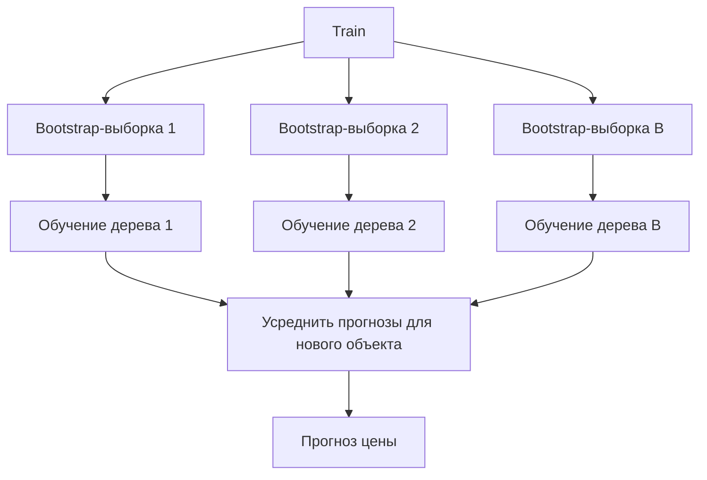
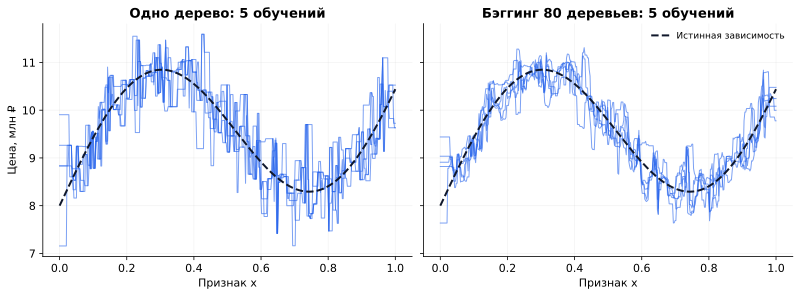
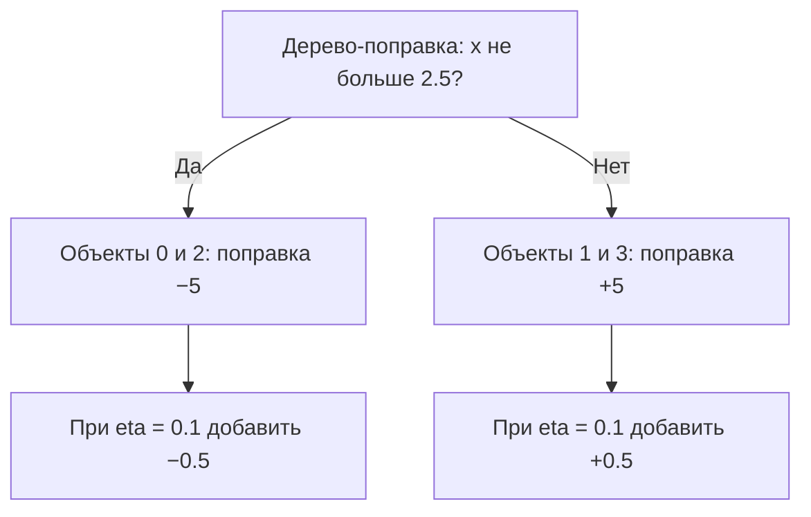
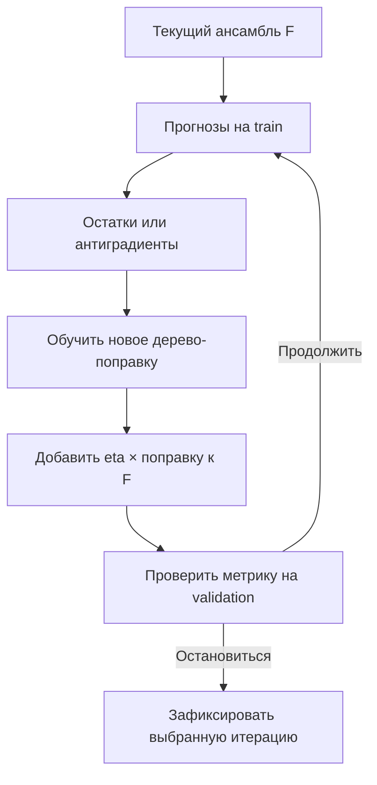
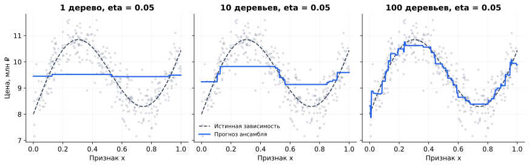
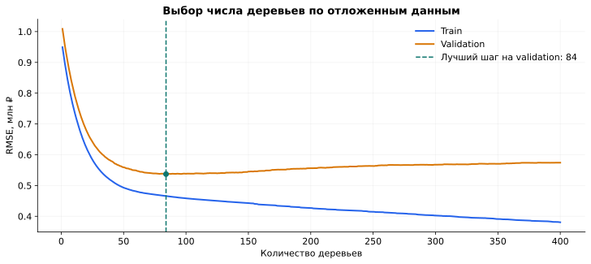

# Ансамбли деревьев: бэггинг, Random Forest и градиентный бустинг

Базовое устройство и обучение дерева разбираются отдельно: [деревья решений и бустинг — учебный ноутбук](../jupyter_notebooks/vol_04_deep_dive_09_trees_boosting.ipynb). Для этой лекции достаточно помнить: дерево делит пространство признаков на листья и выдаёт значение листа, в который попал объект.

Здесь разберём, зачем объединять деревья, чем усреднение отличается от последовательного добавления поправок и как проверить пользу ансамбля на новых данных.

## План лекции

1. Сквозная задача и нестабильность одного дерева.
2. Bootstrap и бэггинг.
3. Random Forest: разнообразие деревьев.
4. Бустинг: два шага на числах.
5. От остатков к антиградиентам, включая классификацию.
6. Регуляризация и выбор числа деревьев.
7. Воспроизводимое сравнение моделей.
8. Дополнительно: веса листьев и XGBoost.
9. Итоги и самопроверка.

---

## 1. Зачем нужен ансамбль

Сквозная задача — предсказать цену квартиры по доступным характеристикам. Таргет измеряем в миллионах рублей; качество оцениваем по MAE и RMSE на новых объектах.

Одно глубокое дерево может хорошо подстроиться под train, но заметно менять прогнозы при небольшом изменении обучающей выборки. Например, изменение нескольких квартир около границы разбиения может привести к другой структуре.

Здесь полезны два понятия:

- **Смещение, bias:** насколько средний прогноз процедуры обучения отклоняется от истинной зависимости при повторном обучении на разных выборках.
- **Дисперсия, variance:** насколько меняется прогноз в одной точке между такими обучениями.

Это свойства процедуры обучения относительно распределения данных. Их нельзя непосредственно прочитать как два отдельных числа из одной пары train/test метрик.

Ансамбль объединяет несколько базовых моделей. Два подхода:

- Обучать модели отдельно на разных вариантах данных и усреднять прогнозы.
- Последовательно добавлять модели, улучшающие текущий ансамбль.

На практике важна ошибка на новых данных, а не абстрактное требование всегда уменьшать только bias или только variance.

---

## 2. Bootstrap и бэггинг

### От одной выборки к нескольким

Bootstrap-выборку получаем случайным выбором объектов **с возвращением**. Например, из индексов `[0, 1, 2, 3]` можно получить `[2, 0, 2, 1]`: объект 2 встретился дважды, объект 3 не попал.

Для классического бэггинга создаём несколько таких выборок размера n, обучаем на каждой отдельную модель и усредняем прогнозы для регрессии:

$$
\hat f_{\mathrm{bag}}(x)=\frac{1}{B}\sum_{b=1}^{B}T_b(x).
$$



Обучение отдельных деревьев не требует прогнозов друг друга, поэтому его можно распараллелить. Однако ошибки деревьев не становятся независимыми: они используют пересекающиеся данные и одинаковые признаки.

### Почему помогает усреднение

В упрощённой модели, если ошибки всех деревьев в фиксированной точке имеют дисперсию $\sigma^2$ и одинаковую попарную корреляцию $\rho$, то:

$$
\mathrm{Var}\left(\frac{1}{B}\sum_b e_b\right)
=\rho\sigma^2+\frac{1-\rho}{B}\sigma^2.
$$

Чем меньше корреляция ошибок, тем больше эффект усреднения. Увеличение числа почти одинаковых деревьев не устраняет общий компонент ошибки. Это иллюстрация механизма, а не гарантия качества на любом наборе данных.

Бэггинг особенно полезен для нестабильных базовых моделей. Деревья в нём могут быть глубокими и хорошо подгонять свои выборки: каждое дерево не обязано быть «слабым». Бэггинг может снизить variance, но не устраняет переобучение автоматически и не исправляет утечки или сдвиг данных.



На синтетическом примере показаны пять обучений на разных подвыборках по 120 объектов. Для каждой подвыборки отдельно обучены одно дерево и бэггинг из 80 деревьев. Усреднение сглаживает часть различий, но не устраняет общие ошибки. Это иллюстрация изменчивости прогнозов, а не точное измерение разложения bias–variance.

### OOB: объекты вне bootstrap

Вероятность не попасть в одну выборку из n извлечений равна $(1-1/n)^n$, примерно 36.8% при большом n. Такие объекты называются out-of-bag, OOB.

Для каждого train-объекта можно собрать прогноз только тех деревьев, которые его не видели, и оценить OOB-ошибку. Это полезная внутренняя оценка, но она не заменяет будущий test. При временных и групповых зависимостях обычная OOB-оценка может не соответствовать реальному сценарию применения.

---

## 3. Что добавляет Random Forest

У сильных признаков есть шанс попадать в верхние разбиения почти каждого дерева. Даже разные bootstrap-выборки тогда дают похожие модели.

Random Forest добавляет случайный выбор кандидатов-признаков **на каждом узле**. Лучшее разбиение ищется среди этих кандидатов, а не обязательно среди всех признаков. Число кандидатов задаётся параметром `max_features`; детали поиска допустимого разбиения зависят от реализации.

Это помогает уменьшить сходство деревьев и корреляцию их ошибок, но не делает корреляцию нулевой. Ограничение признаков может также ухудшать отдельные деревья, поэтому польза определяется балансом качества и разнообразия.

| Подход | Данные для дерева | Признаки при разбиении | Прогноз регрессии |
|---|---|---|---|
| Классический бэггинг деревьев | Bootstrap | Все | Среднее прогнозов |
| Типичный Random Forest | Bootstrap | Случайное подмножество кандидатов на узле | Среднее прогнозов |

Это описание типичных настроек, а не ограничение API: у бэггинга тоже могут быть подвыборки признаков, а у Random Forest можно отключить bootstrap. При `max_features=1.0` лес использует все признаки и по этому механизму приближается к бэггингу деревьев.

Для классификации ансамбль может голосовать метками или усреднять оценки вероятностей — нужно смотреть на реализацию. Например, Random Forest в scikit-learn усредняет вероятности деревьев, после чего выбирает класс. Усреднение само по себе не гарантирует калибровку вероятностей.

Основные настройки леса: число деревьев, `max_features`, глубина и минимальный размер листа. Больше деревьев обычно стабилизирует усреднение, но увеличивает время обучения и предсказания; это не то же самое, что наращивание числа последовательных поправок в бустинге.

---

## 4. Градиентный бустинг: два шага на числах

### Сначала постоянный прогноз

Бустинг строит сумму моделей:

$$
F_m(x)=F_{m-1}(x)+\eta h_m(x).
$$

$F_m$ — ансамбль после m шагов, $h_m$ — новое дерево-поправка, $\eta$ — learning rate. Для квадратичной потери начинаем со среднего таргета, а новое дерево обучаем предсказывать остатки текущего ансамбля.

Для ручного расчёта возьмём условный признак x и цены в условных единицах:

| Объект i | x | Цена y | Начальный прогноз F₀ | Остаток y − F₀ |
|---|---:|---:|---:|---:|
| 0 | 1 | 10 | 17.5 | −7.5 |
| 1 | 3 | 20 | 17.5 | 2.5 |
| 2 | 2 | 15 | 17.5 | −2.5 |
| 3 | 4 | 25 | 17.5 | 7.5 |

Здесь $F_0=\bar y=17.5$, $\eta=0.1$. Начальная MSE = 31.25.

### Итерация 1

Обучим дерево глубины 1 на остатках. Разбиение $x\leq2.5$ объединяет объекты 0 и 2; в другой лист попадают 1 и 3. Для квадратичной потери оптимальный прогноз каждого листа — средний остаток:

$$
v_L=\frac{-7.5-2.5}{2}=-5,\qquad
v_R=\frac{2.5+7.5}{2}=5.
$$



Получаем $F_1=[17.0,18.0,17.0,18.0]$, MSE = 26.5. Дерево предсказывает остатки группы, а не обязательно точную ошибку каждого объекта. Даже при $\eta=1$ оно не обязано полностью исправить все ошибки.

### Итерация 2

Пересчитаем остатки: `[-7, 2, -2, 7]`. Для следующего дерева глубины 1 снова подходит порог 2.5; средние остатки в листьях теперь −4.5 и +4.5.

После добавления 10% поправки:

$$
F_2=[16.55,18.45,16.55,18.45],\qquad \mathrm{MSE}=22.6525.
$$

Поправки зависят от текущего ансамбля. Мы не обучаем два одинаковых дерева независимо и не усредняем их конечные прогнозы.



Обновлённые прогнозы из шага E используются на следующем проходе. Валидационная метрика управляет выбором числа шагов, но не становится таргетом дерева.



На графике отдельный синтетический пример: добавление деревьев позволяет описывать более сложную зависимость. Улучшение train не гарантирует улучшения на новых данных.

---

## 5. От остатков к антиградиентам

### Общий принцип

Инициализация — лучший постоянный прогноз для выбранной потери:

$$
F_0=\arg\min_c\sum_i\ell(y_i,c).
$$

Для дифференцируемой потери вычисляем антиградиенты по текущему **выходу ансамбля**:

$$
r_{im}=-\left.\frac{\partial\ell(y_i,z)}{\partial z}\right|_{z=F_{m-1}(x_i)}.
$$

Дерево подбирает структуру, приближающую эти значения. В классическом варианте после выбора листьев $R_{jm}$ можно уточнить значение каждого листа по исходной потере:

$$
v_{jm}=\arg\min_v\sum_{i:x_i\in R_{jm}}\ell(y_i,F_{m-1}(x_i)+v).
$$

Затем добавляем дерево с коэффициентом $\eta$. Выбор структуры и выбор значений листьев — связанные, но разные части шага. В разных библиотеках могут использоваться приближения, вторые производные и дополнительные ограничения.

### Что меняется при другой потере

| Потеря одного объекта | Направление поправки | Что нужно помнить |
|---|---|---|
| $\frac12(y-F)^2$ | $y-F$ | Это обычный остаток; оптимальная поправка листа — средний остаток |
| $\lvert y-F\rvert$ | $\mathrm{sign}(y-F)$ вне нуля | В нуле используем субградиент; оптимальная поправка листа — медиана исходных остатков |
| Бинарная LogLoss | $y-p$, где $p=\sigma(F)$ | Обновляем логит, а не непосредственно вероятность |

Для MAE дерево учится на знаках ошибок, но значение листа при уточнении по исходной потере берётся из медианы **остатков**, а не медианы знаков. Это хороший пример того, почему псевдо-остатки и окончательные значения листьев нельзя отождествлять.

### Связь с лекцией о классификации

При бинарной LogLoss:

$$
p_i=\sigma(F(x_i)),\qquad
\ell(y_i,F)=-y_i\log p_i-(1-y_i)\log(1-p_i).
$$

Антиградиент по логиту — $y_i-p_i$. В отличие от регрессии, $F(x)$ здесь не цена и не вероятность, а score в пространстве логитов. Вероятность получаем сигмоидой после суммирования поправок.

При невзвешенных данных с обоими классами начальный логит равен $\log(\pi/(1-\pi))$, где $\pi$ — доля класса 1 на train. Порог решения выбираем отдельно на validation, как в [лекции о классификации](lecture_02_vol_02_classification.md).

### Теперь сравним подходы

| Вопрос | Бэггинг / Random Forest | Градиентный бустинг |
|---|---|---|
| Как обучаются деревья? | Отдельно; можно параллельно | Последовательно; очередное зависит от ансамбля |
| Какой таргет у дерева? | Исходный таргет на своей выборке | Псевдо-остатки или статистики производных текущей потери |
| Как объединяем прогнозы регрессии? | Усредняем | Складываем начальный прогноз и поправки |
| Зачем разнообразие? | Чтобы ошибки не повторялись во всех деревьях | Случайность может регуляризовать, но сохраняется последовательная зависимость |
| Типичный эффект | Снижение variance нестабильной модели | Более гибкая аппроксимация; изменение bias и variance зависит от настроек |
| Что не гарантируется? | Отсутствие переобучения | Улучшение validation с каждым деревом |

«Бустинг взвешивает ошибки» — слишком общее описание: оно не объясняет градиентный бустинг. Здесь ключевой механизм — последовательное приближение направлений уменьшения выбранной потери.

---

## 6. Регуляризация и валидация

### Параметры действуют по-разному

Не стоит объединять все настройки в два универсальных пресета «сильная» и «слабая регуляризация». Глубина, размер листа, learning rate и случайные подвыборки управляют разными свойствами обучения.

| Изменение | Ожидаемый механизм | Компромисс |
|---|---|---|
| Уменьшить глубину / число листьев | Ограничить сложность одной поправки | Можно потерять важные взаимодействия |
| Увеличить минимальный размер листа | Не подгонять маленькие группы | Можно пропустить закономерности редкого сегмента |
| Уменьшить learning rate | Добавлять более осторожные поправки | Обычно нужно больше деревьев; при прежнем числе возможно недообучение |
| Уменьшить долю строк | Добавить случайность в обучение шага | Может уменьшить variance, но увеличить bias и шум оценок |
| Уменьшить долю признаков | Ограничить доступные кандидаты | Может помочь регуляризации, но скрыть полезные признаки |
| Увеличить L1/L2 весов листьев | Ограничить величины поправок | Слишком сильный штраф приводит к недообучению |

Малый learning rate не гарантирует более высокую точность. Его выбираем **вместе с числом деревьев**, сложностью базового дерева и бюджетом вычислений.

Отсутствие необходимости стандартизовать числовые признаки не означает отсутствия подготовки данных. Нужно учитывать категории, пропуски, доступность признаков и ограничения реализации. Чувствительность к выбросам тоже зависит от места: экстремальные значения таргета могут сильно влиять на квадратичную потерю и значения листьев.

### Не смешивать параметры библиотек

| Механизм | Пример в scikit-learn GradientBoostingRegressor | Пример в XGBoost |
|---|---|---|
| Скорость добавления поправок | `learning_rate` | `learning_rate` / `eta` |
| Число шагов | `n_estimators` | `n_estimators` в sklearn-интерфейсе |
| Ограничение глубины | `max_depth` | `max_depth` |
| Ограничение листа | `min_samples_leaf`: число объектов | `min_child_weight`: сумма вторых производных, не просто число объектов |
| Подвыборка строк | `subsample` | `subsample` |
| Признаки | `max_features`: кандидаты на split | `colsample_bytree`, `colsample_bylevel`, `colsample_bynode` |
| Штраф весов листьев | Нет прямого аналога `reg_lambda` у этого estimator | `reg_lambda`, `reg_alpha` |

Это примеры соответствий механизмов, а не взаимозаменяемые настройки. Точное поведение нужно проверять в [документации XGBoost](https://xgboost.readthedocs.io/en/stable/parameter.html).

### Early stopping

Train loss может продолжать уменьшаться, когда validation loss уже растёт. Тогда дополнительная сложность помогает описывать train, но не даёт лучшего обобщения.



Ранняя остановка обычно отслеживает выбранную метрику на validation и завершает обучение после заданного числа шагов без достаточного улучшения. Нужны направление оптимизации, допустимое улучшение и patience. Какая итерация сохраняется и как она используется при `predict`, зависит от библиотеки и настроек.

На графике отмечен минимум validation среди заранее обученных шагов. Такой ретроспективный выбор иллюстрирует критерий, но сам по себе не экономит время: все шаги уже обучены. Реальная ранняя остановка завершает обучение до установленного максимума.

Early stopping не гарантирует глобально оптимальное число деревьев. Валидационная оценка шумная, а перебор большого числа настроек может переобучиться на самой validation.

### Один порядок настройки

1. Выбрать схему train/validation/test под применение: будущие периоды для временного прогноза, группы для новых клиентов или объектов.
2. Зафиксировать метрику и baseline; построить первое сравнение без большого перебора.
3. Ограничить сложность дерева и выбрать несколько пар learning rate / максимальное число деревьев.
4. Для каждой пары выбирать число шагов на validation или через корректную кросс-валидацию.
5. При необходимости проверить подвыборки и штрафы, учитывая бюджет и стабильность по периодам.
6. Зафиксировать решение и один раз оценить на test. Test не участвует в остановке и выборе параметров.

OOB леса и validation бустинга — разные способы оценки; нельзя считать их автоматически сопоставимыми с будущим test. В итоговом сравнении нужны одинаковые объекты, метрика и протокол.

---

## 7. Воспроизводимое сравнение на одном разделении

Ниже независимые синтетические объекты и нелинейный таргет, похожий по масштабу на цену в миллионах рублей. Поэтому используем случайное разделение. Это демонстрация механики, а не результат для реального рынка недвижимости.

Сравниваем константу, отдельное дерево, лес и бустинг на одной validation. Для бустинга выбираем число шагов по validation, затем фиксируем модель. Test используется только для выбранного варианта и заранее заданного baseline.

```python
import numpy as np
from sklearn.dummy import DummyRegressor
from sklearn.ensemble import GradientBoostingRegressor, RandomForestRegressor
from sklearn.metrics import mean_absolute_error, mean_squared_error
from sklearn.model_selection import train_test_split
from sklearn.tree import DecisionTreeRegressor

rng = np.random.default_rng(42)
X = rng.uniform(0, 1, size=(600, 1))
y = 8 + 2 * np.sin(6 * X[:, 0]) + 3 * X[:, 0] + rng.normal(0, 0.5, 600)
X_train, X_holdout, y_train, y_holdout = train_test_split(
    X, y, test_size=0.4, random_state=42,
)
X_valid, X_test, y_valid, y_test = train_test_split(
    X_holdout, y_holdout, test_size=0.5, random_state=43,
)

baseline = DummyRegressor(strategy="mean").fit(X_train, y_train)
tree = DecisionTreeRegressor(random_state=42).fit(X_train, y_train)
forest = RandomForestRegressor(
    n_estimators=200, min_samples_leaf=2, random_state=42, n_jobs=1,
).fit(X_train, y_train)

boost_params = dict(
    learning_rate=0.05, max_depth=2, subsample=1.0, random_state=42,
)
boost_full = GradientBoostingRegressor(
    n_estimators=400, **boost_params,
).fit(X_train, y_train)
valid_mse = np.array([
    mean_squared_error(y_valid, prediction)
    for prediction in boost_full.staged_predict(X_valid)
])
best_iteration = int(np.argmin(valid_mse)) + 1

# Восстанавливаем выбранное число шагов на том же train и с тем же seed.
# Не переобучаем модель на train + validation в этом примере.
boost = GradientBoostingRegressor(
    n_estimators=best_iteration, **boost_params,
).fit(X_train, y_train)
models = {"mean": baseline, "tree": tree, "forest": forest, "boost": boost}
validation_scores = {
    name: mean_squared_error(y_valid, model.predict(X_valid))
    for name, model in models.items()
}
for name, mse in validation_scores.items():
    print(f"Validation {name}: RMSE={np.sqrt(mse):.3f}")

chosen_name = min(validation_scores, key=validation_scores.get)
print("Выбрана модель:", chosen_name)
print("Число шагов бустинга:", best_iteration)
for name in dict.fromkeys(["mean", chosen_name]):
    prediction = models[name].predict(X_test)
    print(
        f"Test {name}: "
        f"MAE={mean_absolute_error(y_test, prediction):.3f}, "
        f"RMSE={np.sqrt(mean_squared_error(y_test, prediction)):.3f}"
    )
```

В одномерном примере случайный выбор признаков не даёт лесу дополнительных возможностей: признак всего один. Основной эффект его усреднения здесь связан с bootstrap. Это не эксперимент, доказывающий превосходство леса или бустинга для любых таблиц.

Подбор лучшего шага среди 400 — выбор по validation, а не встроенная ранняя остановка. Повторное обучение с фиксированным числом деревьев воспроизводит выбранный префикс при тех же train, параметрах и seed; это можно проверить через `staged_predict`.

После просмотра test не подбираем параметры заново по его результатам. Для надёжного сравнения на реальной задаче нужны несколько подходящих фолдов или периодов, оценка разброса качества, скорость предсказания и размер модели.

---

## 8. Дополнительно: значения листьев и XGBoost

### L2 на конкретных числах

Пусть в один лист попали 10 объектов с остатками:

```text
[45, 50, 48, 52, 49, 51, 47, 50, 48, 50]
```

Сумма остатков — 490, среднее — 49. Определим **именно такую** задачу для значения листа v:

$$
Q(v)=\frac12\sum_{i=1}^{10}(r_i-v)^2+\frac{\lambda}{2}v^2.
$$

Приравниваем производную нулю:

$$
Q'(v)=-\sum_i r_i+(10+\lambda)v=0,
\qquad v^*=\frac{490}{10+\lambda}.
$$

| Штраф λ | Значение листа v | Вклад при eta = 0.1 |
|---:|---:|---:|
| 0 | 49 | 4.9 |
| 1 | ≈ 44.55 | ≈ 4.455 |
| 10 | 24.5 | 2.45 |

Штраф и learning rate — разные механизмы. Штраф меняет найденное значение листа, а learning rate масштабирует его вклад в ансамбль. Если прежний прогноз отдельной квартиры равен 100, при λ = 1 и eta = 0.1 новый прогноз будет примерно 104.455, а не 144.55.

Нормировка важна: при средней потере вместо суммы или другом множителе перед штрафом та же численная λ даст другое решение. При положительной λ и таком квадратичном штрафе большой лист с тем же средним остатком сжимается слабее маленького.

### От градиентного шага к квадратичному приближению

Обозначим производные потери по score текущего ансамбля:

$$
g_i=\frac{\partial\ell(y_i,F_i)}{\partial F_i},\qquad
q_i=\frac{\partial^2\ell(y_i,F_i)}{\partial F_i^2},
\qquad F_i=F_{m-1}(x_i).
$$

Для фиксированной структуры нового дерева сгруппируем статистики внутри каждого листа $I_j$:

$$
G_j=\sum_{i\in I_j}g_i,\qquad H_j=\sum_{i\in I_j}q_i.
$$

В варианте второго порядка со штрафом за число листьев T и L2 для их значений:

$$
\widetilde Q=\sum_{j=1}^{T}
\left[G_jv_j+\frac12(H_j+\lambda)v_j^2\right]+\gamma T.
$$

Члены, не зависящие от нового дерева, опущены. Здесь $v_j$ — значение листа; $\gamma$ — **штраф за число листьев**, а не другое обозначение значения листа.

При $H_j+\lambda>0$, без L1 и дополнительных ограничений оптимум этой квадратичной задачи:

$$
v_j^*=-\frac{G_j}{H_j+\lambda}.
$$

Это точное решение **приближённой** задачи для фиксированных листьев, а не универсальная точная минимизация исходной потери. Для квадратичной потери разложение точное; для LogLoss используется локальное приближение. Структуру дерева ищут отдельно, обычно жадно.

Для половины квадратичной ошибки $g_i=F_i-y_i=-r_i$ и $q_i=1$, поэтому получаем уже знакомое значение $\sum r_i/(n_j+\lambda)$. При бинарной LogLoss $g_i=p_i-y_i$, $q_i=p_i(1-p_i)$: теперь знаменатель зависит от вероятностей, а не просто от количества объектов.

Параметр `gamma` влияет на выгодность разбиения через прирост целевой функции; `reg_alpha` добавляет L1 и меняет формулу оптимального значения. Формула выше описывает базовый случай без этого штрафа. Подробнее — [официальный вывод модели XGBoost](https://xgboost.readthedocs.io/en/stable/tutorials/model.html).

---

## 9. Итоги и самопроверка

Бэггинг усредняет отдельно обученные модели. Random Forest дополнительно ограничивает кандидаты-признаки на узлах. Градиентный бустинг последовательно строит поправки, связанные с выбранной потерей. У каждого подхода есть настройки, ограничения и стоимость вычислений; победителя определяем на подходящей валидации.

### Вопросы аудитории

1. Почему 100 одинаковых деревьев не дают такого же выигрыша, как 100 деревьев с различающимися ошибками?
2. Чем отличается обучение деревьев на bootstrap-выборках от обучения очередного дерева на остатках?
3. Почему при eta = 1 дерево глубины 1 не обязано исправить все ошибки?
4. В каком пространстве складываются поправки для бинарной LogLoss?
5. Почему меньший learning rate при прежнем числе деревьев может ухудшить качество?
6. Чем OOB отличается от проверки на будущем периоде?
7. Почему минимум validation среди обученных шагов не является гарантированным глобальным оптимумом?

### Мини-задания

1. Повторите два шага ручного примера с eta = 0.5, на каждом шаге заново выбирая лучшее разбиение дерева глубины 1. Сравните MSE и пороги разбиения. На четырёх train-объектах нельзя делать вывод о лучшем learning rate для новых данных.
2. Для листа с суммой остатков 490 и n = 10 посчитайте значение при λ = 5 и вклад при eta = 0.1.
3. В воспроизводимом примере сравните пары `(learning_rate=0.1, n_estimators=200)` и `(0.05, 400)` на validation. Не используйте test для выбора пары.
4. Добавьте несколько признаков и исследуйте `max_features` леса. Разделите влияние числа деревьев, качества отдельных деревьев и разнообразия их ошибок.

**Ответы к расчётам:** при eta = 0.5 после первого шага прогнозы равны `[15, 20, 15, 20]`, MSE = 12.5. На втором шаге лучшее разбиение меняется: например, при пороге 1.5 получаем `[12.5, 20.833, 15.833, 20.833]`, MSE = 6.25. Порог 3.5 даёт такое же уменьшение ошибки; правило разрешения ничьих может выбрать его. Это показывает, что изменение learning rate влияет и на последующие деревья. При λ = 5 значение листа $490/15\approx32.667$, вклад ≈ 3.267.

## Материалы и практика

- [Деревья решений и бустинг: отдельный учебный ноутбук](../jupyter_notebooks/vol_04_deep_dive_09_trees_boosting.ipynb).
- [Ансамбли: бэггинг, леса и градиентный бустинг](https://scikit-learn.org/stable/modules/ensemble.html).
- [Random Forest в scikit-learn](https://scikit-learn.org/stable/modules/generated/sklearn.ensemble.RandomForestRegressor.html).
- [Пошаговые прогнозы GradientBoostingRegressor](https://scikit-learn.org/stable/modules/generated/sklearn.ensemble.GradientBoostingRegressor.html).
- [Вывод целевой функции и весов листьев XGBoost](https://xgboost.readthedocs.io/en/stable/tutorials/model.html).
- [Параметры XGBoost](https://xgboost.readthedocs.io/en/stable/parameter.html).
- [Дополнительный видеоразбор градиентного бустинга](https://www.youtube.com/watch?v=G9d2likA-_E).
