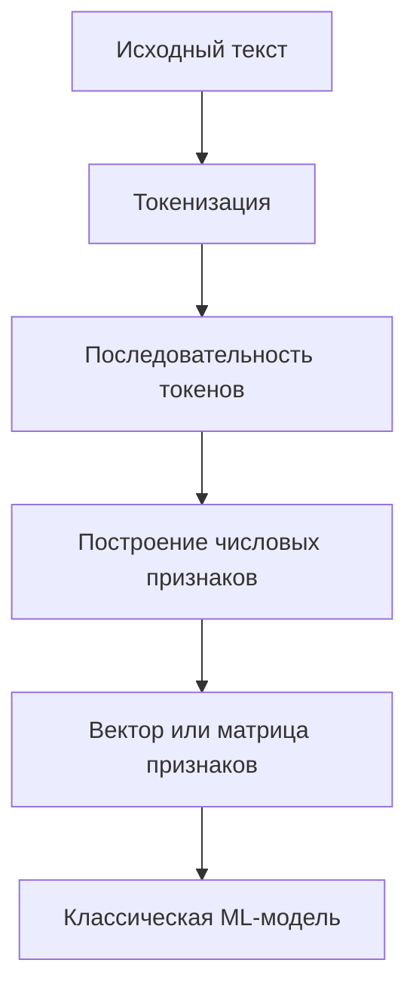
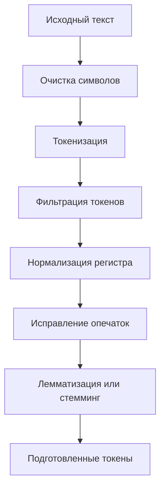
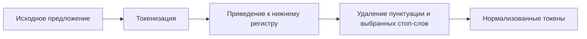
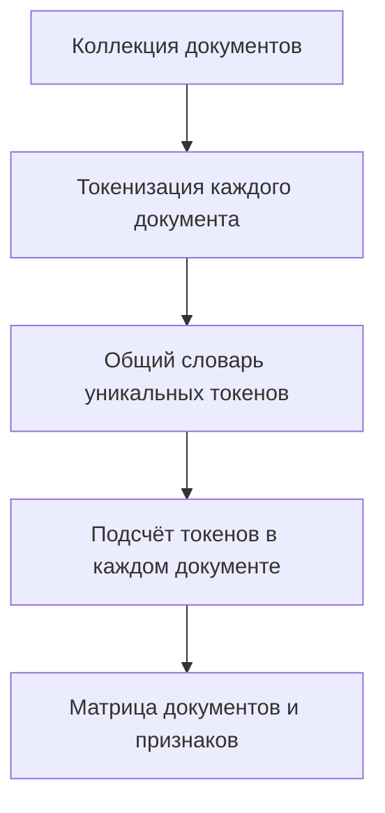
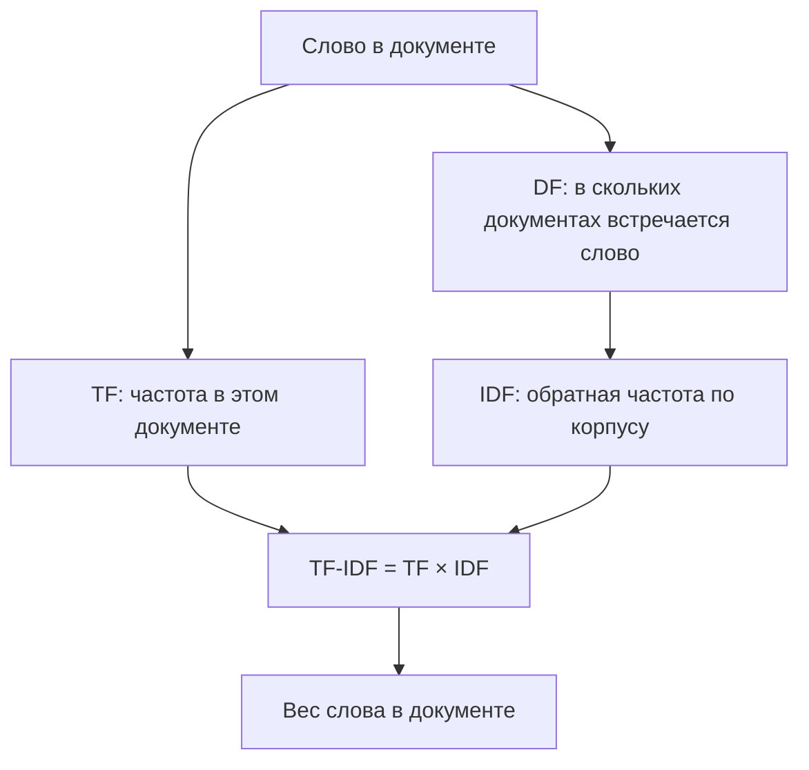
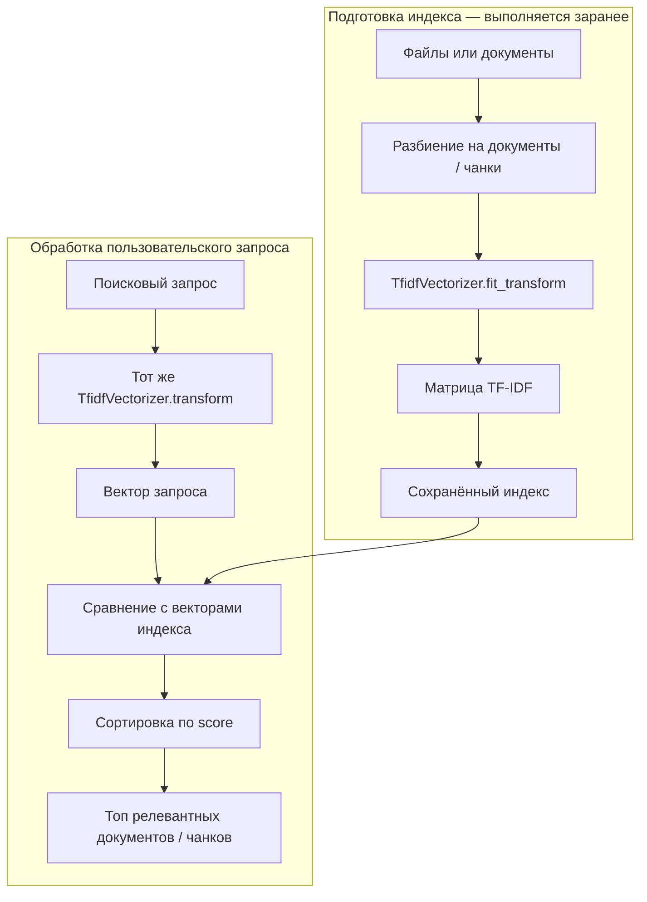
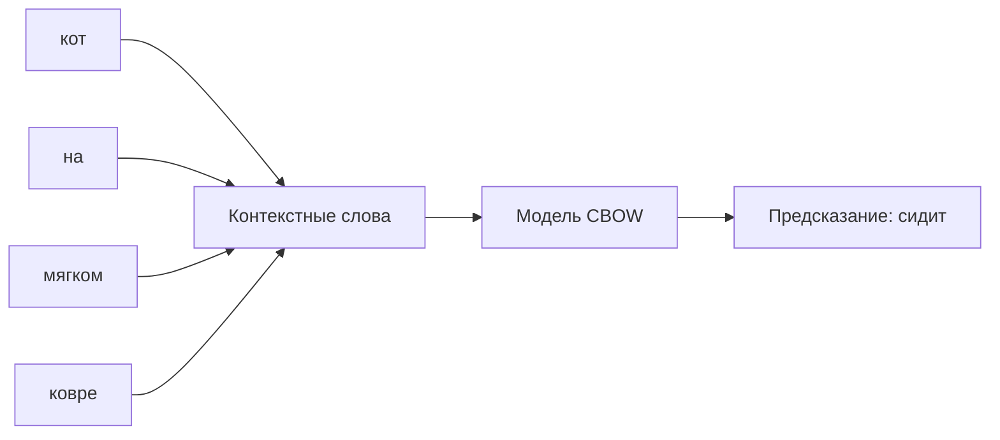
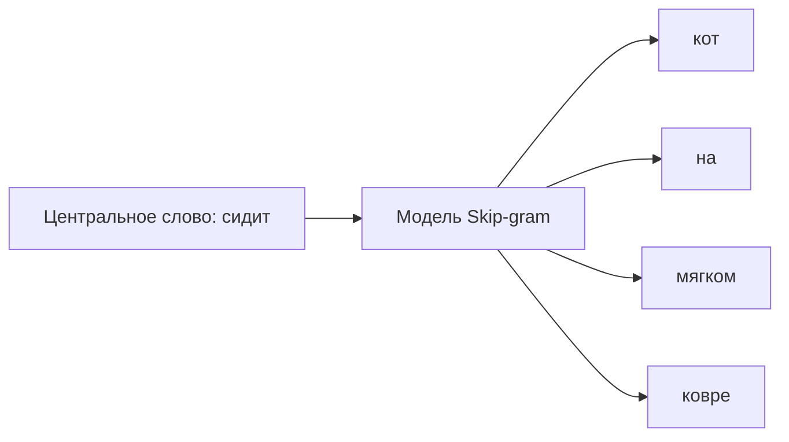
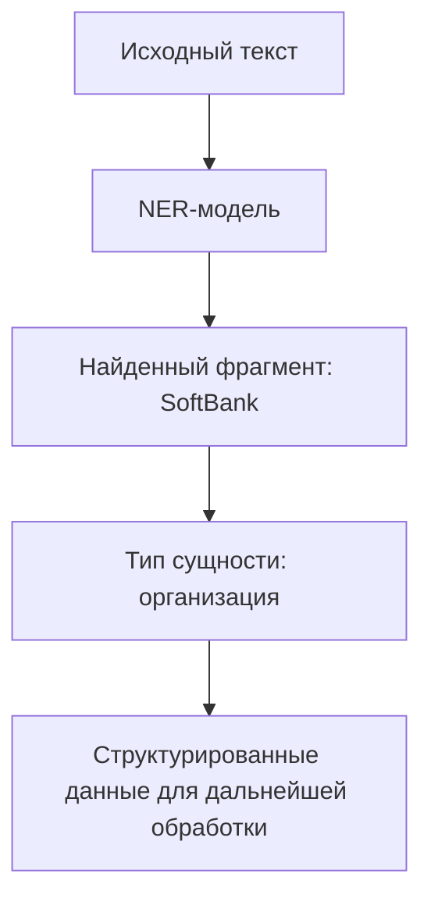

# Лекция 2: Обработка текстовых данных — от токенов до Word2Vec

## План лекции (общая длительность ≈ 1 ч 04 мин)

1. Введение и план `[00:00]`
2. Зачем машинному обучению обработка текста: задачи NLP `[01:05]`
3. Препроцессинг текста: зачем сокращать словарь `[09:32]`
4. Демо: препроцессинг в NLTK `[17:48]`
5. Bag of Words: текст как вектор `[27:02]`
6. От счётчиков к TF-IDF `[36:28]`
7. Практика: локальный поисковик на TF-IDF `[39:30]`
8. Word2Vec: векторы, учитывающие контекст `[49:50]`
9. NER и метрики качества текстовых моделей `[59:30]`
10. Итоги и анонс следующей лекции `[1:01:42]`

---

## 1. Введение `[00:00 – 01:05]`

Сегодня — короткое введение в обработку текстовых данных и демонстрация того, как сделать **супер простой поисковый движок, который работает локально**. Позже он пригодится, когда речь дойдёт до агентов.

Рассматриваем только самые базовые подходы к работе с текстом. На следующем занятии — лекция про большие языковые модели (LLM) и агентов.

---

## 2. Зачем нужна обработка текста: задачи NLP `[01:05 – 09:32]`

### Почему текст — отдельная тема `[01:05 – 03:34]`

- Обработка естественного языка (NLP) начала развиваться достаточно рано, и для неё адаптировали классические модели машинного обучения.
- Классический ML работает с **числовыми признаками**, а текст — это буквы и слова. Основная задача — **перевести текст в числовое представление**.
- Подходы развивались непрерывно: исторически основной объём информации в интернете — это текст. Сегодня датасет для обучения большой языковой модели — по сути весь интернет, а до появления LLM использовались гораздо меньшие наборы данных.
- **Главное продуктовое применение — поисковые движки.** Поиск в интернете всегда был важнейшей областью применения знаний, и большая часть инструментария для работы с текстом создавалась именно ради хорошего поиска.

### Классификация текстов `[03:34 – 04:33]`

- **Определение тональности** (sentiment): негативный или позитивный отзыв на товар.
- Классификация бывает разной: например, **спам-фильтр** в почте — внутри работает классификатор.

### Токены `[04:33 – 06:03]`

Перед тем как подать текст в классическую ML-модель, его обычно нужно превратить в числа. Модель не воспринимает слово «кошка» так, как его воспринимает человек: для неё это последовательность символов. Поэтому сначала текст разбивают на отдельные элементы, а затем представляют эти элементы числовыми признаками.

**Токен** — это единица, на которую токенизатор разбивает текст. В зависимости от выбранного метода токеном может быть:
- целое слово: `кошка`, `бежит`, `быстро`;
- часть слова или несколько символов;
- знак пунктуации или другой отдельный символ.

Например, предложение `Кошка быстро бежит!` при разбиении по словам может превратиться в три токена и отдельный токен `!`. Другой токенизатор может разбить некоторые слова на более мелкие части.

Важно различать **токен** и **слово**: это не одно и то же. Токенизация определяет, какие именно единицы алгоритм будет учитывать дальше. От этого зависит размер словаря и то, какие закономерности модель сможет заметить.

Общий путь от исходной строки к представлению, с которым может работать классическая ML-модель, выглядит так:



### Нейросетевые архитектуры `[06:03 – 07:06]`

Кроме подсчёта частот слов, для анализа текста применяют нейросети. Подробно — на следующем занятии. Идея в том, чтобы **запоминать контекст** и анализировать не отдельные слова, а то, как они складываются в предложение.

### Более сложные задачи `[07:06 – 09:32]`

Задачи, где простые эвристики не работали, а нейросети показали себя хорошо:

- **Named Entity Recognition (NER)** — распознавание и извлечение именованных сущностей. Модель не просто находит слова, а определяет, что именно они обозначают: например, `Москва` — географическое название, `SoftBank` — организация или компания, а `Марий Эл` — единое название региона, хотя оно состоит из двух слов. Обычно модель возвращает найденный фрагмент текста вместе с типом сущности.
- **Машинный перевод** — преобразование текста с одного языка на другой. Здесь важно не только заменить слова, но и сохранить смысл высказывания.
- **Speech recognition** — распознавание речи: на вход подаётся аудио, а на выходе получается текст. Задача связывает обработку звука и языка.
- **Natural language generation** — генерация текста. К этому направлению относятся большие языковые модели (LLM), включая ChatGPT. Подробно они рассматриваются на следующем занятии.

---

## 3. Препроцессинг текста `[09:32 – 17:48]`

### Особенность текстовых данных `[09:32 – 10:42]`

В классическом ML препроцессинг данных обычно достаточно тривиален (например, заполнение пропусков). В NLP же можно придумать много всего: исправлять опечатки, приводить весь текст к одному языку, извлекать именованные сущности. Основные приёмы — борьба с опечатками и извлечение сущностей.

> Важно: описанные этапы относятся в первую очередь к **классическим моделям** — например, если вы решаете с помощью CatBoost задачу предсказания тональности. Тогда над препроцессингом придётся «жёстко заморочиться».

### Этапы препроцессинга `[10:42 – 12:51]`

1. **Удаление нерелевантных символов** — например, смайликов, которые не несут смыслового значения.
2. После разбиения на токены — **удаление нерелевантных слов**: например, ссылок (для понимания текста они не нужны).
3. **Приведение к нижнему регистру** (если не стоит задача извлечения именованных сущностей).
4. **Исправление опечаток.**
5. **Лемматизация** — перевод слова в словарную форму.
6. **Стемминг** — оставляем от слова только корень.

Все эти приёмы **опциональны**: не нужно автоматически применять их все подряд. Например, удаление пунктуации может быть полезно для поиска по ключевым словам, но пунктуация может иметь значение в задаче, где анализируется структура предложения. Аналогично, приведение к нижнему регистру упрощает словарь, но может стереть различие между именем собственным и обычным словом.

Поэтому препроцессинг — это не обязательный список операций, а набор инструментов. Каждый шаг нужно выбирать исходя из задачи и проверять, не удаляет ли он полезную информацию.

Условный пайплайн может выглядеть так. Некоторые шаги можно пропустить или поменять местами в зависимости от данных и задачи:



### Зачем сокращать словарь `[12:51 – 15:59]`

Сложность обработки текста напрямую зависит от **количества токенов**.

Пример с регистром: если слова не приведены к одному виду, то «hello» в трёх написаниях — это **три разных токена**. Базовые алгоритмы считают статистику встречаемости токенов, и это основной признак. В итоге у модели получается более размытый сигнал: «hello» в нижнем регистре встречается, скажем, в 30% текстов, «Hello» — в 5%, «HELLO» — в 0,1%. Человек видит одно слово, а CatBoost — три разных токена с разными частотами и пытается строить выводы на этом.

Это лишь один пример. Представим, что в корпусе встречаются варианты `hello`, `Hello` и `HELLO`. Для человека это одно и то же слово, но без нормализации алгоритм может создать для них три отдельных признака. Частоты этих вариантов распределятся по разным колонкам, и каждый признак будет опираться на меньшее количество наблюдений.

Если подобные варианты встречаются по всему корпусу, словарь разрастается. Это влияет на работу модели:

- **Память и вычисления.** Для каждого уникального токена приходится хранить отдельный признак или статистику. Чем больше словарь, тем больше размер матрицы признаков и тем больше ресурсов требуется для работы с ней.
- **Качество признаков.** Частоты одного и того же по смыслу слова оказываются разделены между несколькими токенами. Модели сложнее увидеть общую закономерность, потому что данные раздроблены.

Таким образом, цель нормализации — не просто сделать текст аккуратнее, а объединить варианты записи, которые для конкретной задачи должны считаться одинаковыми.

### Когда это всё ещё актуально `[15:59 – 17:48]`

Несмотря на то, что LLM применяются повсеместно, часто приходится возвращаться к классическим алгоритмам — например, когда ML работает прямо на телефоне пользователя и важно занимать мало ресурсов. Поэтому эти правила знать нужно.

Если же вы обучаете генеративную нейросеть или трансформер, то там есть этап **токенизации**, и внутри **токенизатора** всё это уже учтено. Токенизатор — отдельная модель, которая учится разбивать текст на токены. Подробно — на следующем занятии. Сейчас важно понять смысл: более умное разделение на токены нужно, чтобы **снизить размер словаря** — то есть количество уникальных токенов в тексте.

---

## 4. Демо: препроцессинг в NLTK `[17:48 – 27:02]`

### Установка и модули `[17:48 – 19:45]`

- Используется библиотека **NLTK** — очень популярный пакет с большим количеством функций и модулей для обработки текста.
- Архитектурно она поддерживает **паттерн плагинов**: помимо библиотеки можно скачивать дополнительные модули — как правило, связанные с разными языками. В примере устанавливается модуль с пунктуацией.

### Токенизация `[19:45 – 22:04]`

- Функция `word_tokenize` из коробки принимает текст и возвращает массив токенов.
- Видно, что внутри у NLTK есть эвристики: слово `father` в кавычках он разбил на **три токена** (кавычка, слово, кавычка). Если бы разделение шло просто по пробелам, `father` в кавычках и без кавычек были бы разными токенами, и модель не поняла бы, что это одно и то же слово.

### Нижний регистр и пунктуация `[22:04 – 23:20]`

- Приводим к нижнему регистру.
- Проверяем каждый токен: если это символ пунктуации — выбрасываем. Точка и скобка в конце предложения успешно отфильтровались.
- Но кавычки (нетипичной кодировки) и тире почему-то остались — они не входят в набор `string.punctuation`. Это пример того, с какими нюансами сталкиваешься на практике.

### Стоп-слова `[23:20 – 25:00]`

- **Стоп-слова** — часто встречающиеся слова, которые в некоторых задачах дают мало полезной информации о содержании документа. Обычно это предлоги, союзы и местоимения. Например, в поиске по тематике документов слово `и` редко помогает отличить один документ от другого.
- В NLTK можно загрузить готовые списки стоп-слов для разных языков. В демонстрации используется английский список.
- Удаление таких слов сокращает количество токенов и уменьшает размерность признакового пространства. Модель меньше внимания уделяет словам, которые встречаются почти в каждом тексте.
- Важно: стоп-слова нельзя удалять бездумно. Например, частица `не` может полностью изменить смысл фразы: `мне нравится` и `мне не нравится`. Если удалить `не`, важная информация потеряется. Поэтому список стоп-слов зависит от задачи.
- В демонстрации удаление стоп-слов уменьшило количество токенов.

На практике этот процесс можно представить как последовательность преобразований:



### Датасет с твитами `[25:00 – 27:02]`

- Датасет с твитами из трёх колонок: **текст твита, бренд (извлечён заранее) и эмоция**. Такой датасет подходит для обучения классификатора тональности.
- Это полу-домашка: нужно добавить в пайплайн функции удаления стоп-слов и остальные шаги.
- Для лемматизации показан стемминг; для русского есть отдельная библиотека на Python — **pymorphy** (в демо не применялась).
- В итоге каждый текст приведён к набору токенов — осталось превратить эти наборы в числовые векторы, которые можно подать в CatBoost или другие модели.
 

### Визуализация частот слов с помощью WordCloud

После очистки и нормализации текстов можно посмотреть, какие слова чаще всего встречаются в выбранной группе документов. Для этого подходит библиотека `wordcloud`: она строит облако слов, в котором размер слова зависит от частоты его появления.

Такую визуализацию удобно использовать для предварительного анализа кластеров: например, чтобы понять, какие темы преобладают в текстах, отнесённых алгоритмом к одному кластеру. Облако слов помогает быстро увидеть характерные термины, но само по себе не доказывает, что кластер семантически однороден.

```python
from wordcloud import WordCloud
import matplotlib.pyplot as plt


def plot_cluster_word_cloud(text):
    wordcloud = WordCloud(max_font_size=40).generate(text)
    plt.figure()
    plt.imshow(wordcloud, interpolation="bilinear")
    plt.axis("off")
    plt.show()
    wordcloud = WordCloud().generate(text)


text = "\n".join(res_df["processed_txt"].values)

plot_cluster_word_cloud(text)
```

Здесь `res_df['processed_txt']` — колонка с предварительно обработанными текстами. `'\n'.join(...)` объединяет все тексты в одну строку, которую затем передают в `WordCloud`. Функция `plot_cluster_word_cloud` строит изображение и скрывает оси графика, чтобы на экране осталось только облако слов.

**Обратите внимание:** в исходном варианте вызов `plot_cluster_word_cloud(9)` не соответствует объявлению функции: параметр `text` должен содержать строку, а число `9` строкой с текстом не является. Поэтому здесь используется `plot_cluster_word_cloud(text)`. Если нужно построить облако именно для кластера с номером 9, сначала следует отфильтровать `res_df` по колонке с номером кластера, а затем объединить тексты этой группы.


---

## 5. Bag of Words `[27:02 – 36:28]`

### Идея `[27:02 – 28:22]`

Самый простой подход к векторизации — **Bag of Words («мешок слов»)**:

1. После получения токенов определяем **размер словаря** — сколько у нас всего токенов.
2. Считаем, сколько раз каждый токен встречается в тексте.

*(Короткая пауза в лекции — лектору нужно было ответить по работе.)*

### Матрица признаков `[28:26 – 30:22]`

Схема Bag of Words (BoW): **тексты → токены → общий словарь → числовые векторы**.

Рассмотрим два коротких документа:

- Документ 1: `кот ест рыбу`
- Документ 2: `кот любит молоко`

Общий словарь будет таким: `кот`, `ест`, `рыбу`, `любит`, `молоко`. Каждому слову соответствует своя позиция в векторе:

| Документ | кот | ест | рыбу | любит | молоко |
|---|---:|---:|---:|---:|---:|
| Документ 1 | 1 | 1 | 1 | 0 | 0 |
| Документ 2 | 1 | 0 | 0 | 1 | 1 |

Число `1` означает, что слово встретилось в документе, а `0` — что не встретилось. В другом варианте BoW вместо бинарного значения можно хранить количество вхождений слова. В обоих случаях порядок слов не учитывается: для модели важен сам набор токенов и их частоты.


Для всего корпуса получается матрица фиксированного размера:

- **строк** — столько, сколько документов в корпусе;
- **колонок** — столько, сколько токенов в общем словаре.

Иными словами, каждая строка — числовое описание одного документа, а каждая колонка отвечает за отдельный токен.

Схематично построение BoW выглядит так:



Отсюда видно, зачем бороться за исправление ошибок, лемматизацию и т. д. В английском порядка 200 тысяч разных слов (лектор называет цифру по памяти). Если добавить слова с опечатками, 200 тысяч легко превращаются в миллион. Если оставлять только корни, словарь схлопывается во много раз. Чем меньше словарь, тем короче строка и тем проще обучаться модели.

### Простой поисковый индекс `[30:22 – 31:30]`

Когда каждый документ представлен вектором, можно использовать эти векторы для простого поиска:

1. Пользователь вводит запрос, например `кот молоко`.
2. Запрос обрабатывается тем же способом, что и документы: из него выделяются токены и строится вектор в том же словаре.
3. Вектор запроса сравнивается с векторами документов.
4. Документы сортируются по степени сходства с запросом. Чем больше совпадающих и значимых признаков, тем выше документ в выдаче.

Это поиск по словам, а не полноценное понимание смысла. Например, запрос `автомобиль` не обязательно найдёт документ, в котором написано только `машина`: для BoW это разные токены, если заранее не объединить их каким-либо способом.

### CountVectorizer и разреженные матрицы `[31:30 – 33:12]`

- Формулы вручную реализовывать не нужно. В **scikit-learn** есть модуль `feature_extraction.text` с `CountVectorizer`, который считает вхождения токенов.
- На выходе — **разреженная матрица** (sparse matrix). Каждая строка имеет размерность всего словаря (например, 200 тысяч элементов), но заполнено лишь несколько десятков значений (в твите — порядка 50 слов), остальные нули.
- Разреженный формат хранения нужен, чтобы **экономить память**: в обычном массиве каждый ноль тоже занимал бы место.

### Косинусное сходство `[33:12 – 34:12]`

Для сравнения текстовых векторов используется **косинусное сходство**. Оно показывает, насколько похожи направления двух векторов, и поэтому позволяет сравнивать тексты независимо от абсолютной длины вектора.

Интуитивно: если два текста содержат похожий набор слов в похожих пропорциях, их векторы направлены примерно в одну сторону, а косинусное сходство будет высоким. Если общих признаков мало, сходство будет ниже.

В демонстрации есть 3900 твитов и словарь из 10 000 токенов. Для каждого твита вычисляется сходство со всеми остальными. В результате получается матрица `3900 × 3900`: строка соответствует одному твиту, а значение в столбце показывает его сходство с другим твитом. Такая матрица обычно плотная: значения сходства рассчитываются для каждой пары текстов.

### Пример поиска похожих твитов `[34:12 – 36:28]`

- Берём случайный твит с индексом 827 и строку матрицы, которая ему соответствует; сортируем по убыванию сходства (для удобства берём минус).
- Самый похожий на этот твит, логично, он сам (близость идеальна). Дальше — по убыванию.
- Исходный твит: «Google запускает свою социальную сеть…» с упоминанием выставки. У похожих твитов совпадают слова *Google*, *launch*, *social network* и название выставки.
- Так мы научились **находить похожие друг на друга тексты**.

---

## 6. От счётчиков к TF-IDF `[36:28 – 38:52]`

### Проблема простых счётчиков `[36:28 – 37:52]`

У простого подсчёта слов есть ограничение: частое повторение токена может искусственно повысить оценку документа. Представим, что пользователь ищет `iPhone`, а на одной странице это слово повторяется тысячу раз. Вектор документа получит очень большое значение по признаку `iPhone`, хотя сама страница может почти ничего полезного об устройстве не сообщать.

Проблема в том, что обычный счётчик учитывает, сколько раз слово встретилось в документе, но не учитывает, насколько это слово вообще характерно для корпуса. Если слово встречается почти в каждом документе, само по себе оно плохо помогает отличать релевантные документы от нерелевантных.

### Решение: TF-IDF `[37:52 – 38:52]`

Решение — **TF-IDF** (*Term Frequency — Inverse Document Frequency*). Эта оценка учитывает две вещи:

- **TF (Term Frequency)** — насколько часто слово встречается в конкретном документе. Чем чаще оно встречается в документе, тем больше его вклад.
- **IDF (Inverse Document Frequency)** — насколько редко слово встречается во всём корпусе. Слова, которые есть почти в каждом документе, получают меньший вес; редкие и более характерные для отдельных документов — больший.

Идея в балансе: слово должно быть заметным внутри конкретного документа, но при этом не быть настолько распространённым, чтобы почти ничего не говорить о его теме. Поэтому TF-IDF часто лучше простых счётчиков подходит для поиска по документам.

Можно представить расчёт так: сначала оцениваем частоту слова внутри документа (TF), затем уменьшаем вес слов, которые встречаются во многих документах (IDF), и объединяем эти две оценки:



Вручную рассчитывать веса не обязательно: в `scikit-learn` есть `TfidfVectorizer`, который строит словарь и преобразует документы в TF-IDF-векторы.

### Два варианта настройки TfidfVectorizer

`TfidfVectorizer` позволяет не только получить TF-IDF-представление документов, но и настроить правила обработки текста. Ниже показаны два варианта: простой — с базовыми параметрами токенизации, и более сложный — с собственной функцией токенизации и стеммингом.

#### Простой вариант

```python
from sklearn.feature_extraction.text import TfidfVectorizer

vectorizer = TfidfVectorizer(
    analyzer="word", lowercase=True, token_pattern=r"\b[\w\d]{3,}\b"
)

vectorizer.fit(df["text"].values)
print("vectorizer fitted")
```

В этом варианте:
- `analyzer='word'` означает, что признаки строятся на уровне слов;
- `lowercase=True` приводит текст к нижнему регистру;
- `token_pattern=r'\b[\w\d]{3,}\b'` задаёт правило отбора токенов: учитываются последовательности из букв и цифр длиной не менее трёх символов;
- `fit(...)` строит словарь по переданным документам и вычисляет статистики, необходимые для TF-IDF.

После вызова `fit` векторизатор знает словарь, но ещё не возвращает матрицу признаков. Для преобразования документов в TF-IDF-векторы используется `transform(...)`, а `fit_transform(...)` объединяет обучение словаря и преобразование в один шаг.

#### Более сложный вариант: собственная токенизация и стемминг

```python
from sklearn.feature_extraction.text import TfidfVectorizer
from nltk.stem.snowball import SnowballStemmer
from nltk.tokenize import word_tokenize


def tokenize(raw):
    return [w.lower() for w in word_tokenize(raw) if w.isalpha()]


class StemmedTfidfVectorizer(TfidfVectorizer):
    en_stemmer = SnowballStemmer("english")

    def build_analyzer(self):
        analyzer = super(StemmedTfidfVectorizer, self).build_analyzer()
        return lambda doc: (
            StemmedTfidfVectorizer.en_stemmer.stem(w) for w in analyzer(doc)
        )


tfidf = StemmedTfidfVectorizer(
    tokenizer=tokenize,
    analyzer="word",
    stop_words="english",
    ngram_range=(1, 1),
    min_df=40,  # limit of minimum number of counts: 3
)
print("Model fit")
tfidf = tfidf.fit(res_df["processed_txt"].values)
```

Здесь обработка текста настраивается подробнее:

1. `word_tokenize` из NLTK разбивает исходную строку на токены.
2. Функция `tokenize` оставляет только токены, состоящие из букв (`isalpha()`), и приводит их к нижнему регистру.
3. Класс `StemmedTfidfVectorizer` переопределяет `build_analyzer`: после стандартной обработки каждый токен дополнительно проходит стемминг с помощью `SnowballStemmer`.
4. `stop_words='english'` исключает английские стоп-слова.
5. `ngram_range=(1,1)` означает, что признаками будут отдельные слова, а не сочетания из нескольких слов.
6. `min_df=40` оставляет в словаре только те токены, которые встречаются как минимум в 40 документах. Это помогает убрать слишком редкие слова.

**Важно:** в комментарии к `min_df` в исходном сниппете указано значение `3`, но фактическое значение параметра — `40`. В коде действует именно `40`. Кроме того, `min_df` считает количество документов, в которых встретился токен, а не общее число его повторений во всём корпусе.

В конце `fit(...)` строит словарь и рассчитывает статистики TF-IDF на колонке `processed_txt`. Такой вариант даёт больше контроля над обработкой текста, но требует аккуратно согласовать токенизацию, стоп-слова и стемминг.


*(Далее объявлен перерыв.)*

---

## 7. Практика: локальный поисковик на TF-IDF `[39:30 – 49:50]`

### Как это выглядит `[39:30 – 41:34]`

Показано, как использовать `TfidfVectorizer` для построения поиска на реальном проекте. В `Makefile` есть раздел, который запускает файл `chat.py`. Это **полностью консольная утилита** для поиска по локальным файлам.

Поиск ведётся по директории с `.md`-файлами — они соответствуют разным темам курса. Файлов много, и лектор не помнит, что где лежит, поэтому написал небольшую поисковую утилиту. Утилита прочитала **70 файлов**.

### Демонстрация `[41:34 – 45:06]`

- Запрос **«bag of words»** (тема сегодняшней лекции). Всё работает очень быстро.
- Выдача разбита на две части: **топ-5 результатов** и отдельно **ссылки** (в ссылках иногда встречается полезная информация).
- Для каждого результата выводятся **score (TF-IDF)** документа и ссылка на него.
- Термин нашёлся в лекции про препроцессинг текста, в лекции про LLM и в вопросах к экзамену.
- Хотя утилита консольная, **все ссылки кликабельные**: клик ведёт прямо в секцию документа, которая называется «bag of words».
- Запрос **«MLflow»** (тема прошлой лекции): самый релевантный документ — `mlsystemdesign`; внутри действительно находится упоминание MLflow.

Вывод: это инструмент, в который можно закидывать ключевые слова, и он ищет по репозиторию. Его можно использовать самостоятельно, а также как **скилл для агента** — об этом на следующем занятии.

### Что внутри `[45:30 – 49:50]`

Здесь показано, как работает плюс-минус любая поисковая система, на игрушечном примере:

- **Индекс** — заранее подготовленная структура данных, которая позволяет быстро искать по коллекции документов. Вместо того чтобы каждый раз начинать обработку всех файлов с нуля, мы один раз читаем документы и строим для них числовые представления.
- Большие документы можно разбивать на небольшие фрагменты — **чанки**. Тогда поиск возвращает не просто большой файл, где где-то упоминается `MLflow`, а более конкретный фрагмент, в котором находится нужная информация.
- Общий принцип такой: сначала выполняется **индексация**, а затем по индексу обрабатываются пользовательские запросы.
- В этой демонстрации индексация основана на TF-IDF: для каждого документа или фрагмента вычисляются веса токенов.
- Вспомогательный метод `from_dir` читает текстовые файлы из директории и подготавливает индекс. Когда пользователь вводит запрос, вызывается `search`, которая ищет наиболее подходящие фрагменты.

**Функция `search` очень маленькая:**

1. **Векторизуем запрос.** Применяем к нему тот же `TfidfVectorizer`, который использовался при индексации документов. Благодаря этому запрос и документы представлены в одном и том же пространстве признаков.
2. **Сравниваем запрос с документами.** Для каждого документа рассчитывается оценка сходства с запросом. В реализации это можно сделать через матричное умножение нормализованных векторов; по смыслу результат соответствует косинусному сходству.
3. **Сортируем результаты.** Документы с наибольшей оценкой поднимаются в начало выдачи, после чего возвращаются пользователю.

Важно, что здесь нет генерации ответа и нет понимания текста на уровне LLM. Поисковик ранжирует документы по совпадению их TF-IDF-признаков с признаками запроса. Для небольшого локального корпуса такой подход может быть быстрым и вполне полезным.

Весь процесс поиска разделён на две фазы. Индекс строится заранее, а при каждом новом запросе используется уже готовый индекс:



**Сборка индекса:** инициализируем `TfidfVectorizer` и вызываем `fit_transform`, передавая корпус текстов. Внутри происходят токенизация и препроцессинг, о котором говорилось выше. На выходе — матрица: по строкам тексты, по столбцам счётчики токенов. Индекс строится очень быстро и работает тоже быстро.

Это поиск по ключевым словам — самый простой вариант.

---

## 8. Word2Vec `[49:50 – 59:30]`

### Недостаток Bag of Words `[49:50 – 51:02]`

У Bag of Words есть принципиальное ограничение: он рассматривает текст как набор слов и практически не учитывает отношения между ними. Например, предложения `я купил телефон` и `телефон купил я` будут представлены одинаковым набором токенов, хотя порядок слов в естественном языке может быть важен.

Кроме того, BoW не умеет самостоятельно связывать синонимы. Слова `телефон` и `смартфон` для него — два независимых признака. Даже если они часто используются в похожих ситуациях, простая модель счётчиков этого не узнает.

Но в текстах слова регулярно встречаются в определённых контекстах. Если два слова часто окружены похожими словами, это может быть признаком того, что их значения связаны. Word2Vec использует эту закономерность при обучении векторов.

### Идея эмбеддингов `[51:02 – 52:06]`

Вместо того чтобы описывать слово одним счётчиком, ему можно сопоставить **эмбеддинг** — компактный числовой вектор. Например, слово может быть представлено вектором из 100 чисел. Каждая координата сама по себе обычно не имеет понятного человеку значения; важна комбинация координат и положение вектора относительно других векторов.

В Word2Vec вектор обучается на контекстах, в которых встречается слово. Если два слова часто появляются в похожем окружении, их векторы могут оказаться близко друг к другу. Поэтому вектор отражает не только факт наличия слова, но и статистические связи с другими словами.

Например, если `iPhone` и `Android` часто встречаются в контекстах про телефоны, приложения и версии операционных систем, их векторы могут оказаться близкими. Это не означает, что слова являются синонимами: модель улавливает сходство контекстов, а не даёт словарное определение.

Подход называется **Word2Vec** и был представлен в **2013 году**.

### Как обучаются векторы `[52:06 – 54:14]`

Обучение Word2Vec можно представить как задачу предсказания слов по их окружению:

1. Сначала выполняется препроцессинг: текст разбивается на токены, после чего формируется словарь уникальных токенов.
2. Для каждого токена модель хранит обучаемый вектор. Все векторы вместе образуют матрицу эмбеддингов: строки соответствуют токенам, а столбцы — координатам вектора.
3. По обучающему тексту перемещается **скользящее окно**. Например, окно шириной 5 слов рассматривает небольшую последовательность вокруг текущей позиции. Затем окно сдвигается, и модель получает следующий обучающий пример.
4. В варианте **Continuous Bag of Words (CBOW)** модель получает окружающие слова и пытается предсказать центральное, пропущенное слово.

Например, для фразы `кот сидит на мягком ковре` модель может получить контекст `кот`, `на`, `мягком`, `ковре` и должна предсказать центральное слово `сидит`. Если предсказание отличается от правильного слова, функция потерь показывает величину ошибки, а градиентный спуск обновляет параметры модели. После множества таких примеров векторы настраиваются так, чтобы хорошо отражать повторяющиеся контексты.

В CBOW контекстные слова объединяются и используются для предсказания центрального токена:



### Skip-gram `[54:14 – 56:02]`

**Skip-gram** решает обратную задачу: модель получает центральное слово и пытается предсказать слова вокруг него.

Для той же фразы `кот сидит на мягком ковре` входом может быть слово `сидит`, а целевыми ответами — слова `кот`, `на`, `мягком` и `ковре`. Таким образом:

- **CBOW:** контекст → центральное слово;
- **Skip-gram:** центральное слово → контекст.

Те же данные в Skip-gram направляются в обратную сторону: центральное слово служит входом, а окружающие слова — целями предсказания.



Оба подхода учатся на соседстве слов, но формируют обучающие примеры по-разному. В лекции рассматривается, что оба варианта позволяют получить качественные векторы.

Архитектуру можно представить как небольшую нейросеть. На вход подаётся one-hot представление токена — вектор, где единица стоит на позиции этого токена, а остальные значения равны нулю. Слой эмбеддингов преобразует его в компактный обучаемый вектор. Затем модель предсказывает слово или слова контекста. Если правильные слова получают недостаточно высокие оценки, ошибка используется для обновления весов. Именно в процессе такого обучения и формируются эмбеддинги.

### Пример на Gensim `[56:02 – 58:10]`

- Для Word2Vec в Python можно использовать класс `Word2Vec` из библиотеки **Gensim**. В демонстрации обучение не запускалось, поскольку оно занимает время.
- Векторы обучаются на токенах тех же твитов. Для обучения не требуется заранее размечать каждый текст: модель использует сам текст и задачу предсказания контекстных слов.
- После обучения можно найти слова, векторы которых ближе всего к вектору `Android`. Это слова, которые модель считает похожими по контекстам употребления. В примере рядом с `Android` оказывается `iPhone`, а также слово `версия`: вероятно, в исходных твитах часто обсуждались версии Android.
- Это демонстрирует **семантическую близость**, которую модель извлекла из статистики контекстов. При этом близость не всегда означает синонимичность: слова могут быть связаны одной темой или часто встречаться в одинаковых ситуациях.
- Обучение называют **обучением без учителя (unsupervised)** в том смысле, что для каждого слова не нужно вручную задавать правильный смысл или категорию. Обучающий сигнал создаётся из самого текста: модель предсказывает соседние слова и корректирует векторы.

### Применение вне NLP: рекомендации `[58:10 – 59:30]`

Идею Word2Vec можно перенести с текста на последовательности товаров. Для этого:

- каждый товар рассматривается как отдельный токен;
- набор товаров в пользовательской корзине или последовательности покупок играет роль контекста;
- модель учится предсказывать один товар по другим товарам из того же контекста.

Например, если в заказах часто вместе встречаются кофе, фильтры и кофемолка, модель постепенно научится размещать эти товары близко в векторном пространстве. Затем по вектору одного товара можно искать другие товары с похожими контекстами покупок.

Так получается способ находить товары, которые часто покупают в похожих наборах. Это не готовая рекомендательная система целиком, а способ получить векторные представления товаров, которые можно использовать как один из сигналов в рекомендациях.

---

## 9. NER и метрики качества `[59:30 – 1:01:42]`

### Named Entity Recognition `[59:30 – 1:00:50]`

- Для NER можно взять готовую модель из **Hugging Face** — платформы, где публикуют и распространяют модели машинного обучения. Там можно найти уже обученные модели, в том числе для языков, для которых доступно меньше готовых решений.
- В демонстрации используется чужая предварительно обученная модель. На вход ей подаётся твит, а на выходе она находит фрагмент `SoftBank` и определяет его как именованную сущность.
- Практический смысл NER в том, что после обработки текста можно работать не только с исходной строкой, но и с извлечёнными объектами: например, отдельно собирать упоминания организаций, людей или географических названий.

Типичный результат NER — это найденный фрагмент текста и присвоенная ему категория:



### Метрики `[1:00:50 – 1:01:42]`

Остаток ноутбука посвящён **оценке качества текстовых моделей**. Для классификации часто можно сравнить предсказанную метку с правильной. Для генерации текста всё сложнее: один и тот же смысл можно выразить разными словами, поэтому точное совпадение строк не всегда означает хорошее качество.

В лекции упоминаются несколько метрик:

- **BLEU** — оценивает, насколько текст, сгенерированный моделью, совпадает с эталонным текстом по общим последовательностям слов. Часто применяется для оценки машинного перевода.
- **ROUGE** — также сравнивает сгенерированный текст с эталоном, уделяя внимание совпадению слов и фрагментов. Часто используется при оценке суммаризации.
- **Perplexity (перплексия)** — характеризует, насколько хорошо языковая модель предсказывает последовательность токенов. Чем ниже перплексия на одном и том же наборе данных и при сопоставимых условиях, тем лучше модель предсказывает этот текст.

У каждой метрики есть ограничения: автоматическая оценка не всегда полностью отражает смысловую точность и полезность результата для человека. Более подробно метрики будут рассматриваться на следующем занятии.

---

## 10. Итоги `[1:01:42 – 1:04:00]`

### Что нужно вынести из лекции `[1:01:58 – 1:03:02]`

1. **Ключевая идея препроцессинга текста — разбиение на токены.** От того, как разобьёте текст на токены, зависит качество решения задачи. Если токенов слишком много — это ненужный шум в модели.
2. **Простой способ превратить текст в признаки для ML** — Bag of Words: подсчитать счётчики слов.
3. **Продвинутый подход — Word2Vec.** Он позволяет каждому слову сопоставить не счётчик, а целый вектор, который хранит семантическую информацию: вектор слова *iPhone* близок к вектору слова *Android*, и с другими словами это тоже работает.

### Рекомендация `[1:03:02 – 1:03:34]`

Изучить файл `chat.py` — как работает чат-поиск, — и по возможности **самостоятельно запустить его локально** и убедиться, что поиск действительно работает.

### Анонс `[1:03:18 – 1:03:58]`

Эта лекция — **подготовительная** перед рассказом про большие языковые модели. В следующий раз будет более серьёзная лекция: демо про LLM и рассказ о том, как они обучаются.


# References

- [NLP CookBook: Yermakov](https://youtu.be/-2O0ODmnw1ohttps://youtu.be/-2O0ODmnw1o)
- [Ермаков и базовые NLP понятия](https://youtu.be/-2O0ODmnw1o)
- NLP на ODS [раз](https://ods.ai/hubs/nlp) и [два](https://ods.ai/tracks/nlp-df2020)
- [spacy POS tagging](https://medium.com/mlearning-ai/nlp-04-part-of-speech-tagging-in-spacy-dc3e239c2726)
- [NER with spacy](https://towardsdatascience.com/named-entity-recognition-ner-using-spacy-nlp-part-4-28da2ece57c6)
- [NLP in Yandex Browser](https://www.youtube.com/watch?v=vLDhXct-2lg&ab_channel=YfD)
- [spacy+gensim](https://www.shanelynn.ie/word-embeddings-in-python-with-spacy-and-gensim/) для тенировки Word2Vec
    - [spacy tools](https://spacy.io/usage/spacy-101#annotations-pos-deps)
    - [spacy POS tagging](https://spacy.io/usage/linguistic-features#mappings-exceptions) & [Spacy POS list](https://stackoverflow.com/questions/40288323/what-do-spacys-part-of-speech-and-dependency-tags-mean)
