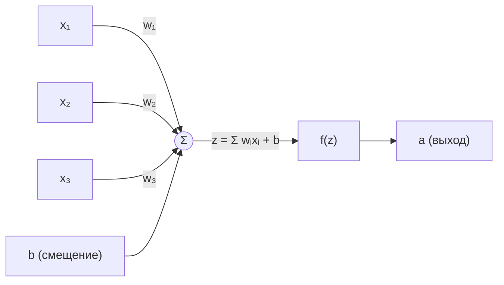
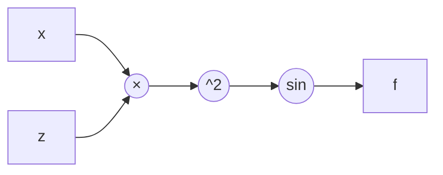

# Basics

Нейросеть — это функция с миллионами параметров, которая отображает вход в выход. Параметры подбираются так, чтобы минимизировать ошибку на обучающих данных.

Code examples

* [Binary classification with PyTorch](https://shivambaldha.medium.com/binary-classification-with-pytorch-85089b284940)
* [Deep Learning with PyTorch](https://github.com/rasbt/deeplearning-models)
* [PyTorch: rewind all](https://colab.research.google.com/drive/1p1aAaauy_LZlZ5ZKLvwc6cdYkVhbZ-8B?usp=sharing)
* [PyTorchUltimateMaterial](https://github.com/DataScienceHamburg/PyTorchUltimateMaterial)

# PyTorch layers

* [https://www.youtube.com/playlist?list=PLtBw6njQRU-rwp57C0oIVt26ZgjG9NI](https://www.youtube.com/playlist?list=PLtBw6njQRU-rwp57C0oIVt26ZgjG9NI)
* [https://introtodeeplearning.com/](https://introtodeeplearning.com/)

# Перцептрон

## Один нейрон



- $x_i$ — входы нейрона
- $w_i$ — веса: показывают, насколько важен каждый вход (чем больше вес по модулю, тем сильнее вход влияет на результат)
- $b$ — смещение (bias): сдвигает порог срабатывания нейрона независимо от входов
- $z = \sum_i w_i x_i + b$ — линейная комбинация входов
- $f$ — функция активации (нелинейность), $a = f(z)$ — выход нейрона

**Зачем нужна нелинейность.** Без неё сеть из любого числа слоёв — это просто одно линейное преобразование: композиция двух линейных слоёв $W_2(W_1 x) = (W_2 W_1)x$ сводится к одному слою с матрицей $W_2 W_1$. Именно нелинейные активации позволяют сети аппроксимировать сложные зависимости.

## Прямой проход

```python
# Один слой
z = W @ x + b  # линейная комбинация
a = relu(z)  # активация
```

Данные проходят слой за слоем: вход → скрытые слои → выход. Выход каждого слоя становится входом следующего.

### Функции активации

| Функция | Формула | Где применяется |
|---------|---------|-----------------|
| ReLU | $\max(0, x)$ | скрытые слои |
| Sigmoid | $\frac{1}{1+e^{-x}}$ | бинарная классификация (выход в диапазоне (0, 1) трактуется как вероятность) |
| Softmax | $\frac{e^{x_i}}{\sum_j e^{x_j}}$ | многоклассовая классификация (выходной слой; превращает вектор в распределение вероятностей, сумма равна 1) |
| GELU | $x \cdot \Phi(x)$, где $\Phi$ — функция распределения стандартного нормального закона | трансформеры |
| Tanh | $\frac{e^x - e^{-x}}{e^x + e^{-x}}$ | RNN (выход в диапазоне (−1, 1), центрирован относительно нуля) |

---

## Обратное распространение ошибки

Обратное распространение (backpropagation) — алгоритм, который эффективно вычисляет градиенты функции потерь по всем параметрам сети, двигаясь от выхода ко входу.

1. Считаем ошибку (loss) на выходе. Например, для бинарной классификации используется бинарная кросс-энтропия ($y$ — истинные метки, $\hat{y}$ — предсказания модели):

   $$L = -\sum \left[ y \cdot \log(\hat{y}) + (1 - y) \cdot \log(1 - \hat{y}) \right]$$

   Для многоклассовой классификации: $L = -\sum_k y_k \log \hat{y}_k$.
2. Берём производную loss по каждому параметру ($W, b$) через правило цепочки (chain rule).
3. Обновляем параметры ($W, b$) в сторону уменьшения loss.

**Правило цепочки.** Для одного веса $w$, где $z = wx + b$, $a = f(z)$:

$$\frac{\partial L}{\partial w} = \frac{\partial L}{\partial a} \cdot \frac{\partial a}{\partial z} \cdot \frac{\partial z}{\partial w}$$

Идея: влияние веса на loss складывается из цепочки «вес → $z$ → $a$ → loss», и производные по звеньям цепочки перемножаются.

### Пример

$$f(x, z) = \sin\left((x \cdot z)^2\right)$$

Схема вычислений (граф вычислений):



Разобьём функцию на шаги: $u = x \cdot z$, $v = u^2$, $f = \sin v$. Тогда частные производные по правилу цепочки:

$$\frac{\partial f}{\partial x} = \cos\left((x \cdot z)^2\right) \cdot 2(x \cdot z) \cdot z$$

$$\frac{\partial f}{\partial z} = \cos\left((x \cdot z)^2\right) \cdot 2(x \cdot z) \cdot x$$

Численная проверка при $x = 1,\ z = 2$ (тогда $u = 2$, $v = 4$):

$$\left.\frac{\partial f}{\partial x}\right|_{x=1,\, z=2} = \cos(4) \cdot 2(1 \cdot 2) \cdot 2 = 8\cos 4 \approx -5.23$$

$$\left.\frac{\partial f}{\partial z}\right|_{x=1,\, z=2} = \cos(4) \cdot 2(1 \cdot 2) \cdot 1 = 4\cos 4 \approx -2.61$$

Именно так работает backprop: сначала прямой проход вычисляет $u, v, f$ и запоминает их, затем обратный проход перемножает локальные производные каждого узла.

## Градиентный спуск и оптимизаторы

Шаг градиентного спуска:

$$W \gets W - \eta \frac{\partial L}{\partial W}$$

$$b \gets b - \eta \frac{\partial L}{\partial b}$$

где $\frac{\partial L}{\partial W}, \frac{\partial L}{\partial b}$ — градиенты (направление наибольшего роста loss, поэтому идём в обратную сторону), $\eta$ — скорость обучения (learning rate): размер шага. Слишком большой $\eta$ приводит к расходимости, слишком маленький — к очень медленному обучению.

**Метод оптимизации** — способ обновления весов по градиентам (градиентный спуск и его варианты: Momentum, AdaGrad, Adam и другие).

### Эпоха и пакеты

Перемешиваем набор данных и разбиваем его на пакеты (батчи). Для каждого пакета вычисляем градиенты и обновляем веса. Одна эпоха — один полный проход по всему набору данных. Обучение на пакетах (mini-batch) быстрее, чем на всём наборе сразу, и при этом даёт более устойчивую оценку градиента, чем обучение на одном примере.

### Momentum (моментум)

Сглаживает движение градиентного спуска: алгоритм накапливает направление предыдущих шагов, как катящийся шар с инерцией.

$$v_t = \beta v_{t-1} + g_t, \qquad \theta \gets \theta - \eta v_t$$

Это ускоряет движение вдоль устойчивых направлений и гасит колебания поперёк узких «оврагов» функции потерь.

### AdaGrad

Адаптирует скорость обучения отдельно для каждого параметра: увеличивает её для редко обновляемых параметров (например, связанных с редкими признаками) и уменьшает для часто обновляемых.

$$G_t = G_{t-1} + g_t^2, \qquad \theta \gets \theta - \frac{\eta}{\sqrt{G_t} + \varepsilon} g_t$$

Недостаток: накопленная сумма $G_t$ только растёт, поэтому шаг со временем затухает почти до нуля. Этот недостаток исправляет RMSProp, заменяя сумму скользящим средним.

### Adam

Объединяет идеи Momentum (скользящее среднее градиентов $m_t$) и AdaGrad/RMSProp (скользящее среднее квадратов градиентов $v_t$), поэтому широко используется в глубоком обучении.

$$m_t = \beta_1 m_{t-1} + (1-\beta_1) g_t, \qquad v_t = \beta_2 v_{t-1} + (1-\beta_2) g_t^2$$

$$\theta \gets \theta - \eta \frac{\hat{m}_t}{\sqrt{\hat{v}_t} + \varepsilon}$$

Здесь $\hat{m}_t, \hat{v}_t$ — оценки с поправкой на смещение в начале обучения.

Деление на $\sqrt{\hat{v}_t}$ отчасти играет роль учёта кривизны функции, как в методах второго порядка (там используется матрица вторых производных — гессиан). Но Adam остаётся методом первого порядка: он использует только градиенты и не вычисляет гессиан.

### Проблемы при обучении глубоких сетей

- **Затухающий градиент**: в глубоких сетях градиент многократно перемножается и стремится к 0. Возможные решения: ReLU, пакетная нормализация и остаточные связи (подробнее — в следующем разделе).
- **Взрывной градиент**: градиенты становятся очень большими, веса обновляются слишком сильно, обучение нестабильно.

### Общие причины плохого качества модели

Помимо проблем с градиентами, качество может страдать по причинам, не связанным с оптимизацией:

- **Недостаточно данных** — модель не может выучить закономерность и переобучается на немногочисленных примерах.
- **Недостаточно признаков или они малоинформативны** — в данных просто нет сигнала, по которому можно предсказать ответ; никакая оптимизация этого не исправит.
- **Слишком простая модель** — не хватает ёмкости (слоёв, нейронов), чтобы описать зависимость (недообучение, underfitting).

---

# Взрывающиеся и затухающие градиенты

Если градиенты становятся слишком большими или слишком маленькими, обучение нарушается. Причина общая: при обратном распространении градиенты перемножаются на каждом слое (правило цепочки), поэтому в глубокой сети малые множители дают затухание, а большие — взрыв.

## Затухающие градиенты

Что происходит:

- При обратном распространении градиент для каждого слоя получается перемножением производных всех слоёв, лежащих выше.
- Производные сигмоиды и tanh малы: у сигмоиды они не превышают 0.25, а в области насыщения (при больших по модулю входах) стремятся к 0.
- Многократное перемножение малых чисел приводит к экспоненциальному уменьшению градиентов — первые слои почти перестают обновляться.

Результат:

- Потеря способности сети обучать нижние слои (именно они отвечают за базовые признаки).
- Очень медленная сходимость.
- «Застревание» в неоптимальном решении: функция потерь перестаёт убывать, хотя качество модели ещё далеко от хорошего.

Причины: малые веса и функции активации sigmoid/tanh.

$$\sigma'(x) = \sigma(x)(1-\sigma(x)) \le 0.25$$

Множитель меньше 1 на каждом слое → градиент быстро стремится к 0. Например, для 10 слоёв с сигмоидой градиент уменьшается не менее чем в $4^{10} \approx 10^6$ раз.

## Взрывающиеся градиенты

Что происходит: градиенты становятся очень большими, веса обновляются слишком сильно, обучение нестабильно.

Причины:

- Большие начальные веса.
- Длинная сеть → многократное умножение больших матриц (если норма весовых матриц больше 1, градиент растёт экспоненциально).
- Неограниченные активации (например, ReLU не насыщается и не ограничивает значения сверху), из-за чего большие входы приводят к большим выходам и градиентам.

Симптомы:

- Функция потерь принимает значение NaN или бесконечность.
- Веса резко прыгают, обучение не сходится.

## Как бороться

### Для затухающих градиентов

**Использовать «хорошие» активации.** ReLU, LeakyReLU, GELU помогают уменьшить затухание: у ReLU производная равна 1 при положительных входах, поэтому градиент не уменьшается при прохождении через слой.

**Правильная инициализация весов.** Веса выбираются так, чтобы дисперсия сигнала и градиента не менялась от слоя к слою:

- Xavier/Glorot — для sigmoid/tanh: $\mathrm{Var}(w) = \frac{2}{n_{in} + n_{out}}$
- He — для ReLU: $\mathrm{Var}(w) = \frac{2}{n_{in}}$

**Нормализация.** BatchNorm стабилизирует распределение: нормализует активации внутри пакета, ускоряет обучение и снижает зависимость от инициализации.

Нормализация (здесь $\mu$ и $\sigma$ — среднее и стандартное отклонение по пакету; на практике к $\sigma$ добавляют малую константу, чтобы не делить на 0):

$$\hat{x} = \frac{x - \mu}{\sigma}$$

Масштабирование и сдвиг:

$$y = \gamma \cdot \hat{x} + \beta$$

где $\gamma$ и $\beta$ — обучаемые параметры. Они нужны, чтобы сеть при необходимости могла вернуть исходное распределение и не теряла выразительность из-за нормализации.

**Пропускающие (остаточные) связи.** В ResNet блок вычисляет $y = F(x) + x$, то есть вход добавляется к выходу блока. Градиент проходит через сложение без изменений, поэтому у него есть «короткий путь» к ранним слоям, минуя перемножение производных.

### Для взрывающихся градиентов

**Ограничение нормы градиента (gradient clipping).** Если норма градиента превышает порог, градиент масштабируется вниз до этого порога (направление сохраняется):

```python
torch.nn.utils.clip_grad_norm_(model.parameters(), max_norm=1.0)
```

**Уменьшить скорость обучения.** Меньший шаг не даёт огромному градиенту «выбросить» веса.

**Хорошая инициализация.** Те же Xavier/He: не слишком большие начальные веса.

**Использовать нормализацию.** BatchNorm, LayerNorm (пакетная и послойная нормализация) удерживают значения активаций в разумном диапазоне.

### Вывод

| Проблема | Симптом | Решение |
|----------|---------|---------|
| Затухание | Градиенты близки к 0, ранние слои не обучаются | ReLU, BatchNorm, остаточные связи, Xavier/He |
| Взрыв | Градиенты слишком велики, функция потерь → NaN | Ограничение нормы градиента, уменьшение скорости обучения, нормализация |

## Седловые точки, плоские области и проблемы оптимизации

Даже если градиенты не затухают и не взрываются, обучение может замедляться в седловых точках и на плоских участках функции потерь.

Что происходит:

- **Седловые точки**: градиенты близки к нулю, но это не локальные минимумы; в одних направлениях функция потерь растёт, в других — уменьшается. В пространстве высокой размерности (миллионы параметров) седловые точки встречаются намного чаще, чем настоящие локальные минимумы.
- **Плоские области**: участки, где градиенты временно становятся очень малыми, из-за чего обучение сильно замедляется (например, при неудачной инициализации весов).

Способы решения:

- Использовать адаптивные оптимизаторы (Adam, RMSProp): они увеличивают шаг там, где градиенты малы, и быстрее проходят плоские участки.
- Использовать оптимизаторы с моментумом (SGD с Momentum, Nesterov): накопленная «инерция» помогает проскочить седловую точку, где мгновенный градиент почти равен нулю.
- Использовать расписания изменения скорости обучения: косинусное затухание (плавное уменьшение $\eta$ по косинусу), перезапуски (периодический возврат $\eta$ к большому значению, чтобы выбраться из неудачной области) и разогрев (warmup — постепенное увеличение $\eta$ в начале обучения для стабильности).

---

# Вариационные автокодировщики (VAE)

Вариационные автокодировщики — генеративные модели, которые кодируют данные в сжатое представление, восстанавливают их и могут создавать новые похожие данные.

VAE состоит из двух основных частей:

- **Кодировщик**: преобразует входные данные (например, изображения) в представление меньшей размерности — в латентное пространство. В отличие от обычного автокодировщика, он выдаёт параметры распределения вероятностей (обычно среднее $\mu$ и дисперсию $\sigma^2$), а не одну фиксированную точку.
- **Декодировщик**: получает выборки из латентного пространства и восстанавливает данные в исходном формате.

**Почему они называются «вариационными»?** VAE отображает входные данные не в фиксированные точки латентного пространства, а в распределения вероятностей. Точное распределение $p(z \mid x)$ вычислить невозможно, поэтому оно приближается более простым распределением $q(z \mid x)$ (кодировщиком), а параметры подбираются методами вариационного вывода — отсюда название. Модель:

1. Отображает входные данные в распределения вероятностей в латентном пространстве.
2. Выбирает случайные значения из этих распределений во время обучения.
3. Формирует непрерывное и структурированное латентное пространство.

Для этого распределения приближаются к стандартному нормальному распределению (среднее 0, дисперсия 1) с помощью слагаемого KL-дивергенции в функции потерь.

**Трюк репараметризации.** Операция «взять случайную выборку» не дифференцируема, поэтому через неё нельзя пустить градиент. Решение: выбираем шум $\varepsilon \sim \mathcal{N}(0, I)$ отдельно и считаем

$$z = \mu + \sigma \cdot \varepsilon$$

Случайность теперь вынесена во внешний вход $\varepsilon$, а $\mu$ и $\sigma$ вычисляются сетью, и градиент проходит через них.

## Функция потерь

VAE одновременно оптимизирует две цели:

- **Ошибка реконструкции**: насколько точно декодировщик восстанавливает исходные данные (например, среднеквадратичная ошибка или кросс-энтропия).
- **KL-дивергенция**: насколько распределение в латентном пространстве близко к стандартному нормальному распределению.

$$L = \underbrace{\lVert x - \hat{x} \rVert^2}_{\text{реконструкция}} + \underbrace{D_{KL}\big(q(z \mid x) \,\Vert\, \mathcal{N}(0, I)\big)}_{\text{регуляризация}}$$

Для гауссовского кодировщика KL-слагаемое считается в явном виде: $-\tfrac{1}{2}\sum\left(1 + \log\sigma^2 - \mu^2 - \sigma^2\right)$.

Две цели конкурируют: одна только реконструкция даёт «рваное» латентное пространство (как у обычного автокодировщика), а один только KL — одинаковые распределения для всех входов (информация теряется). Баланс между ними и даёт гладкое пространство, пригодное для генерации.

Благодаря гладким и непрерывным латентным представлениям VAE могут:

- Генерировать новые данные, выбирая случайные точки в латентном пространстве и пропуская их через декодировщик.
- Плавно интерполировать между разными объектами (точки между двумя кодами дают осмысленные промежуточные объекты).
- Извлекать содержательные признаки без учителя.

Типичные области применения:

- Генерация изображений
- Сжатие данных
- Обнаружение аномалий (аномальные объекты плохо восстанавливаются, и ошибка реконструкции у них велика)
- Проектирование молекул лекарственных веществ
- Генерация музыки

---

# Свёрточные нейронные сети (CNN)

PyTorch предоставляет инструменты для создания свёрточных нейронных сетей (CNN). К основным слоям относятся Conv2d, Dropout, MaxPool2d и Linear (в других фреймворках — Conv2D, MaxPooling2D, Dense: полносвязный слой).

## Conv2d (двумерный свёрточный слой)

**Назначение:** извлекает пространственные признаки изображения с помощью скользящего ядра (фильтра).

**Формула.** Каждый элемент выходной карты признаков вычисляется так:

$$\text{Output} = \sum (\text{Kernel} \times \text{Patch}) + \text{Bias}$$

Ядро перемещается по входному изображению; в каждой позиции его значения поэлементно умножаются на соответствующий участок (patch) изображения и суммируются. Одно и то же ядро применяется ко всем позициям, поэтому параметров намного меньше, чем у полносвязного слоя, и слой находит признак независимо от его положения.

Пример кода на PyTorch:

```python
import torch
import torch.nn as nn

conv = nn.Conv2d(in_channels=3, out_channels=16, kernel_size=3, stride=1, padding=1)
```

- `in_channels = 3` — RGB-изображение с 3 каналами
- `out_channels = 16` — число фильтров, создаётся 16 карт признаков
- `kernel_size = 3` — фильтр 3×3
- `stride = 1` — шаг: ядро сдвигается на 1 пиксель
- `padding = 1` — добавляет рамку из нулей, чтобы размер выхода равнялся размеру входа

Размер выхода: $H_{out} = \left\lfloor \frac{H + 2p - k}{s} \right\rfloor + 1$ (для $k=3, p=1, s=1$ размер сохраняется). Число параметров слоя: $16 \cdot (3 \cdot 3 \cdot 3 + 1) = 448$.

**Эффект:** помогает находить такие признаки, как границы, текстуры и формы. Ранние слои выделяют простые признаки (линии, края), более глубокие — сложные (части объектов).

---

## MaxPool2d (слой уменьшения размерности)

**Назначение:** уменьшает пространственные размеры (высоту и ширину), чтобы:

- Снизить вычислительные затраты
- Выделить наиболее выраженные признаки
- Уменьшить переобучение (и добиться небольшой устойчивости к сдвигу объекта на изображении)

**Принцип работы:**

- Окно пулинга (например, 2×2) перемещается по изображению.
- Из каждой области выбирается максимальное значение.

Пример кода на PyTorch:

```python
pool = nn.MaxPool2d(kernel_size=2, stride=2)
```

- `kernel_size = 2` — окно 2×2
- `stride = 2` — окно сдвигается на 2 пикселя (окна не перекрываются, высота и ширина уменьшаются вдвое)

**Эффект:** уменьшает размер изображения, сохраняя важную информацию. У слоя нет обучаемых параметров.

---

## Dropout (слой регуляризации)

**Назначение:** предотвращает переобучение, случайным образом отключая часть нейронов во время обучения.

Пример кода на PyTorch:

```python
dropout = nn.Dropout(p=0.5)  # 50% нейронов случайным образом обнуляются
```

`p = 0.5` — во время обучения случайным образом отключается 50% элементов слоя (при каждом проходе — разные). Оставшиеся значения масштабируются на $1/(1-p)$, чтобы сохранить среднюю величину сигнала. При инференсе (`model.eval()`) Dropout не применяется.

**Эффект:** сеть учится извлекать более устойчивые признаки и не полагаться на отдельные нейроны (это можно рассматривать как обучение ансамбля из множества «урезанных» сетей).

---

## Linear (Dense, полносвязный слой)

**Назначение:** преобразует извлечённые признаки в итоговый результат (классификацию, регрессию и т. д.).

Пример кода на PyTorch:

```python
dense = nn.Linear(in_features=128, out_features=10)
```

- `in_features = 128` — число входных нейронов (длина вектора признаков)
- `out_features = 10` — число выходных нейронов, например 10 классов CIFAR-10

**Эффект:** объединяет изученные признаки и формирует предсказание. Каждый выход связан со всеми входами, поэтому слой может учитывать комбинации признаков из любых частей изображения.

---

## Пример архитектуры CNN

```python
import torch
import torch.nn as nn


class CNN(nn.Module):
    def __init__(self):
        super().__init__()
        self.conv1 = nn.Conv2d(3, 16, 3, padding=1)
        self.pool = nn.MaxPool2d(2, 2)
        self.conv2 = nn.Conv2d(16, 32, 3, padding=1)
        self.fc1 = nn.Linear(32 * 8 * 8, 128)  # полносвязный слой
        self.dropout = nn.Dropout(0.5)
        self.fc2 = nn.Linear(128, 10)  # 10 выходных классов

    def forward(self, x):  # вход: 3×32×32
        x = self.pool(torch.relu(self.conv1(x)))  # → 16×16×16
        x = self.pool(torch.relu(self.conv2(x)))  # → 32×8×8
        x = x.view(x.shape[0], -1)  # развёртка в вектор длиной 2048
        x = torch.relu(self.fc1(x))  # → 128
        x = self.dropout(x)
        x = self.fc2(x)  # → 10 (логиты классов)
        return x
```

Размер `32 * 8 * 8` в `fc1` соответствует входным изображениям 32×32 (как в CIFAR-10): после двух слоёв пулинга размер уменьшается с 32 до 8. Для другого размера входа это число нужно пересчитать. На выходе — логиты; Softmax обычно не добавляют в модель, так как `nn.CrossEntropyLoss` применяет его внутри.

## Главное

- Conv2d → извлечение признаков
- MaxPool2d → уменьшение размерности
- Dropout → регуляризация
- Linear (Dense) → формирование итогового результата

Это основа моделей классификации изображений на базе CNN.

## Типичная архитектура: CNN с BatchNorm

В реальных сетях после свёрток обычно добавляют BatchNorm: он ускоряет обучение и делает его устойчивее (см. раздел про затухающие градиенты). Порядок блока: свёртка → BatchNorm → активация → пулинг.

```python
import torch
import torch.nn as nn


class CNN(nn.Module):
    def __init__(self):
        super().__init__()
        self.conv1 = nn.Conv2d(3, 16, 3, padding=1)
        self.bn1 = nn.BatchNorm2d(16)
        self.conv2 = nn.Conv2d(16, 32, 3, padding=1)
        self.bn2 = nn.BatchNorm2d(32)
        self.pool = nn.MaxPool2d(2, 2)
        self.fc1 = nn.Linear(32 * 8 * 8, 128)
        self.dropout = nn.Dropout(0.5)
        self.fc2 = nn.Linear(128, 10)

    def forward(self, x):
        x = self.pool(torch.relu(self.bn1(self.conv1(x))))
        x = self.pool(torch.relu(self.bn2(self.conv2(x))))
        x = x.view(x.shape[0], -1)  # развёртка в вектор
        x = torch.relu(self.fc1(x))
        x = self.dropout(x)
        x = self.fc2(x)
        return x
```

## Кратко об известных архитектурах CNN

- **LeNet-5 (1998):** одна из первых успешных CNN; применялась для распознавания рукописных цифр.
- **AlexNet (2012):** показала эффективность ReLU, Dropout и обучения на GPU при классификации изображений.
- **GoogLeNet (2014):** ввела модули Inception для параллельного извлечения признаков разных масштабов; свёртки 1×1 уменьшают число каналов и тем самым снижают вычислительные затраты.
- **ResNet (2015):** использует остаточные связи, облегчающие обучение очень глубоких сетей (десятки и сотни слоёв).

| Архитектура | Год | Ключевая особенность | Применение |
|-------------|-----|----------------------|------------|
| LeNet | 1998 | Компактная CNN | Распознавание цифр |
| AlexNet | 2012 | ReLU, Dropout, GPU | Классификация изображений |
| GoogLeNet | 2014 | Модули Inception, свёртки 1×1 | Классификация изображений |
| ResNet | 2015 | Остаточные связи | Глубокие CNN |

Остаточные связи из ResNet стали стандартным приёмом и используются во многих современных архитектурах. Позднее появились компактные и эффективные модели MobileNet и EfficientNet, ориентированные на экономию вычислений.

---

# Рекуррентные нейронные сети (RNN)

Основная идея RNN — ячейка памяти, которая хранит информацию с предыдущих временных шагов и влияет на последующие выходы. Это позволяет обрабатывать последовательности произвольной длины (текст, звук, временные ряды).

Ячейка памяти включает:

- **Скрытое состояние:** хранит информацию с предыдущих шагов и обновляется на каждом временном шаге.
- **Рекуррентные связи:** скрытое состояние предыдущего шага подаётся на вход следующего. При этом на каждом временном шаге используются одни и те же веса, поэтому число параметров не зависит от длины последовательности.

На каждом временном шаге $t$ скрытое состояние $h_t$ вычисляется следующим образом:

```text
h_t = tanh(W_hh · h_(t-1) + W_xh · x_t + b_h)
y_t = W_hy · h_t
```

Здесь $x_t$ — вход на шаге $t$, $h_{t-1}$ — состояние с предыдущего шага, $y_t$ — выход.

## Затухание градиента в RNN

Обучение выполняется методом обратного распространения во времени (Backpropagation Through Time, BPTT): сеть «разворачивается» по времени в глубокую сеть с общими весами, и градиент проходит назад по всем шагам. Для последовательности длины $T$ одна и та же матрица весов $W_{hh}$ перемножается многократно. На длинных последовательностях это может приводить к затуханию градиента: информация с ранних шагов постепенно теряется, и сети становится трудно учитывать дальние зависимости.

Если наибольшее по модулю собственное (или сингулярное) значение $W_{hh}$ меньше 1, соответствующий множитель экспоненциально убывает с увеличением расстояния; к этому добавляется множитель $\tanh'(x) \le 1$ на каждом шаге. Например, к сотому шагу градиент, доходящий до $h_1$, может практически исчезнуть — модель перестаёт обучать дальние зависимости. Если же значение больше 1, наоборот, возникает взрыв градиента (с ним борются ограничением нормы градиента).

## Ограничение фиксированного размера состояния

Даже при отсутствии проблем с градиентами скрытое состояние $h_t$ имеет фиксированный размер. Поэтому всю историю последовательности приходится сжимать в вектор, например размерности 512, независимо от длины последовательности. Для длинных текстов такой «бутылочное горлышко» неизбежно приводит к потере информации.

## LSTM и GRU

Для решения проблемы затухания были разработаны LSTM и GRU: их механизмы управления потоками информации (вентили) создают для градиентов более прямой путь назад через состояние ячейки.

В LSTM состояние ячейки обновляется аддитивно (путём сложения), а не перемножением на матрицу, поэтому градиент может проходить через много шагов почти без затухания:

$$c_t = f_t \odot c_{t-1} + i_t \odot \tilde{c}_t$$

где вентиль забывания $f_t$ решает, что стереть из памяти, входной вентиль $i_t$ — что записать, а выходной вентиль управляет тем, что из памяти выдать наружу. GRU — упрощённый вариант с двумя вентилями (обновления и сброса) и без отдельного состояния ячейки; параметров меньше, обучается быстрее.

## Развитие архитектур RNN

- Долгая краткосрочная память (LSTM) — отдельная ячейка памяти и три вентиля
- Управляемый рекуррентный блок (GRU) — упрощённая версия LSTM
- Двунаправленная RNN (BiRNN) — две RNN читают последовательность слева направо и справа налево, поэтому в каждой позиции учитывается и прошлое, и будущее; подходит, когда доступна вся последовательность целиком (классификация, разметка), но не для генерации «на лету»
- Механизм внимания (Attention) — прямой доступ к любому шагу последовательности (см. ниже)

| Архитектура | Решает проблему затухания градиента? | Долговременная память | Сложность | Скорость |
|-------------|--------------------------------------|-----------------------|-----------|----------|
| Обычная RNN | Нет | Слабая | Низкая | Высокая |
| LSTM | Да | Хорошая | Высокая | Ниже |
| GRU | Да | Средняя | Средняя | Выше |
| BiRNN | Нет (зависит от типа ячейки: обычно строится на LSTM/GRU) | Хорошая | Средняя | Ниже |
| Attention | Да (прямые связи между далёкими шагами) | Очень хорошая | Высокая | Высокая при параллельной обработке |

## Механизм внимания (Attention)

В обычной модели seq2seq (кодировщик-декодировщик) декодировщик получает только последнее скрытое состояние кодировщика $h_T$ — один фиксированный вектор для всего предложения. Это то самое узкое место, описанное выше.

Механизм Attention позволяет декодировщику на каждом шаге обращаться к любому скрытому состоянию кодировщика, которое важно для текущего предсказания. Для этого на каждом шаге декодирования вычисляются веса важности $\alpha_{ti}$ (через Softmax, сумма равна 1), и строится контекстный вектор — взвешенная сумма всех состояний кодировщика:

$$c_t = \sum_i \alpha_{ti} h_i$$

Так информация с любого шага доступна напрямую, а градиент имеет короткий путь к далёким позициям — это решает обе проблемы: и «бутылочное горлышко», и затухание на дальних зависимостях.

# Refs

## DNN courses

* [DL Course](https://www.youtube.com/watch?v=Iiv9R6BjxHM&list=PLLHTzKZzVU9eaEyErdV26ikyolxOsz6mq&index=25)
* [HuggingFace Cookbook](https://github.com/huggingface/cookbook)
* [Lightning AI Course](https://lightning.ai/pages/courses/deep-learning-fundamentals/)
* [Pytorch-Deep-Learning](https://atcold.github.io/pytorch-Deep-Learning/) + [PyTorch profiler](https://pytorch.org/tutorials/recipes/recipes/profiler_recipe.html)
* [ODS (5)](https://ods.ai/tracks/ml-system-design-22/blocks/000e30e6-e467-46cb-a439-bb41e183bd19)
* [Deep Learning Interview Book](https://arxiv.org/pdf/2201.00650.pdf)
*    [Deep Learning Interviews book](https://arxiv.org/pdf/2201.00650.pdf)
* [Yandex ML handbook](https://ml-handbook.ru/)
* [Little Book of Deep Learning](https://fleuret.org/public/lbdl.pdf)
* [Google generative AI free courses](https://www.linkedin.com/feed/update/activity:7071215296698560512)
* [CV repository](https://www.linkedin.com/feed/update/urn:li:activity:7055779482715967489/)
* [vit-rugpt2-image-captioning](https://huggingface.co/tuman/vit-rugpt2-image-captioning)
* [Microsoft: Generative AI for beginners](https://github.com/microsoft/generative-ai-for-beginners/tree/main)
* [Interpretable ML book](https://christophm.github.io/interpretable-ml-book/cnn-features.html)

## VAE for recommendations

* [VAE for recommendations](https://arxiv.org/abs/1606.05908)
* [paperswithcode](https://paperswithcode.com/methods/category/likelihood-based-generative-models)
* [Using autoencoders for session‑based job recommendations](https://elisabethlex.info/docs/2020umuai-session.pdf)
* [rectorch](https://github.com/makgyver/rectorch#2)
* [PyTorch Code for Adversarial and Contrastive AutoEncoder for Sequential Recommendation](https://github.com/ACVAE/ACVAE-PyTorch/blob/main/model.py) 
* [Adversarial and Contrastive Variational Autoencoder for Sequential Recommendation](https://arxiv.org/pdf/2103.10693.pdf)
* [https://github.com/lacic/session-knn-ae/tree/master/ipython](https://www.notion.so/How-to-find-a-job-83abd9eeecd14af19c01d9be573d08f9?pvs=21)
* [github: Using autoencoders for session‑based job recommendations](https://github.com/lacic/session-knn-ae/tree/master)
* [Generating Sequences With Recurrent Neural Networks](https://arxiv.org/pdf/1308.0850.pdf)
* [variational_autoencoder.ipynb](https://colab.research.google.com/github/smartgeometry-ucl/dl4g/blob/master/variational_autoencoder.ipynb)
* [Conditioned Variational Autoencoder for top-N item recommendation](https://arxiv.org/abs/2004.11141)

## GNN: Graph Convolution Networks

* [LightGCN-Pytorch](https://github.com/gusye1234/LightGCN-PyTorch/blob/master/code/dataloader.py)
* [GCN-partitioning](https://github.com/saurabhdash/GCN_Partitioning)
* [Graph-partitioning](https://github.com/dwave-examples/graph-partitioning)
* [Ultra-GCN](https://paperswithcode.com/paper/ultragcn-ultra-simplification-of-graph)
* [Light-GCN](https://paperswithcode.com/method/lightgcn)
* [lightgcn with PyTorch Geometric](https://medium.com/stanford-cs224w/lightgcn-with-pytorch-geometric-91bab836471e)
* [Implement your own music Recommender With Graph Neural Networks LightGCN](https://medium.com/@benalex/implement-your-own-music-recommender-with-graph-neural-networks-lightgcn-f59e3bf5f8f5)
* [LightGCN for movie recommendation](https://medium.com/stanford-cs224w/lightgcn-for-movie-recommendation-eb6d112f1e8)
* [graph neural network based movie recommender system](https://medium.com/stanford-cs224w/graph-neural-network-based-movie-recommender-system-5876b9686df3)
* [Building a recommender system using graph neural networks](https://medium.com/decathlontechnology/building-a-recommender-system-using-graph-neural-networks-2ee5fc4e706d)
* [github.com:GNN-RecSys](https://github.com/je-dbl/GNN-RecSys/blob/main/main.py)
* [Graph networks in e-commerse](https://www.linkedin.com/posts/nikita-iserson_graph-graphneuralnetwork-ecommerce-activity-7036628834598690816-TPtf)
* [Creating a recommendation system with GNNs](https://medium.com/@bryancws/creating-a-recommendation-system-with-gnns-2e95e3bb454a)

## GNN for rec

- [recommender-systems-with-gnns-in-pyg](https://medium.com/stanford-cs224w/recommender-systems-with-gnns-in-pyg-d8301178e377)
- [buy-this-session-based-recommendation-using-sr-gnn](https://medium.com/stanford-cs224w/buy-this-session-based-recommendation-using-sr-gnn-d3415e393722)
- [lightgcn-with-pytorch-geometric](https://medium.com/stanford-cs224w/lightgcn-with-pytorch-geometric-91bab836471e)
- Link prediction in [Python Geometric](https://colab.research.google.com/drive/1r_FWLSFf9iL0OWeHeD31d_Opt031P1Nq?usp=sharing)
- [github: PyGCN](https://github.com/tkipf/pygcn)
- [github: pytorch geometric](https://github.com/pyg-team/pytorch_geometric)
- [Custom loss in PyTorch](https://stackoverflow.com/questions/73558840/build-a-custom-loss-to-evaluate-ranking-in-pytorch-on-a-graph-neural-network-wit)
- [CS 224 project](https://colab.research.google.com/drive/1VQTBxJuty7aLMepjEYE-d7E9kjo51CA1?usp=sharing)
- [Python geometric](https://pytorch-geometric.readthedocs.io/en/latest/notes/heterogeneous.html#hgtutorial)
- [Biggraph examples](https://github.com/sbalnojan/biggraph-examples/blob/master/scratch_1.py)
- [Embeds in LyFT](https://eng.lyft.com/lyft2vec-embeddings-at-lyft-d4231a76d219)
