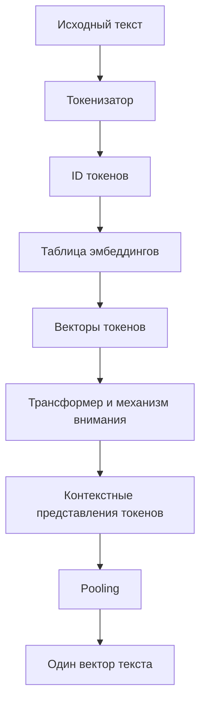
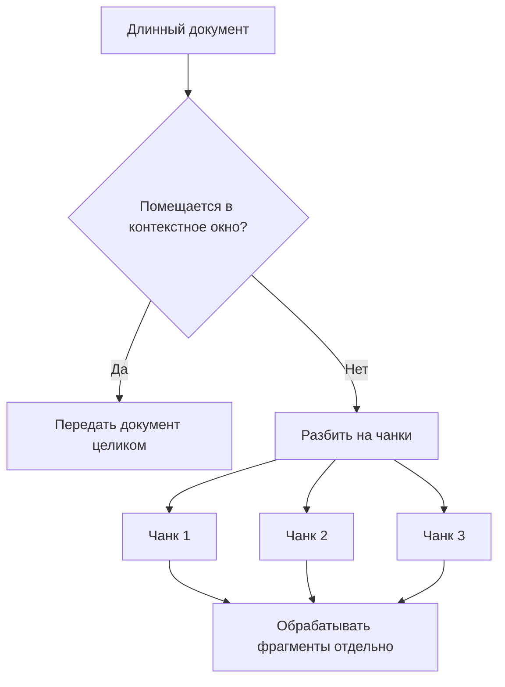
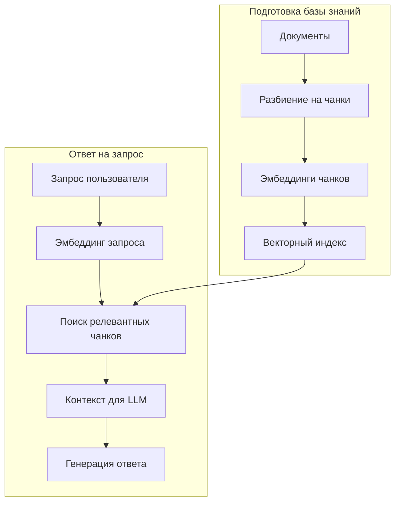
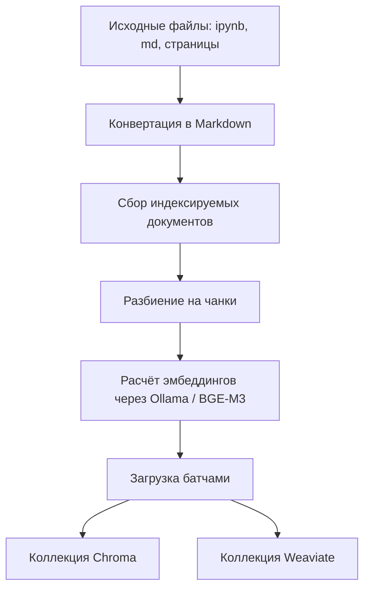
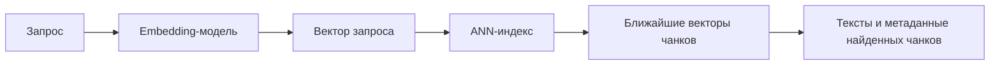
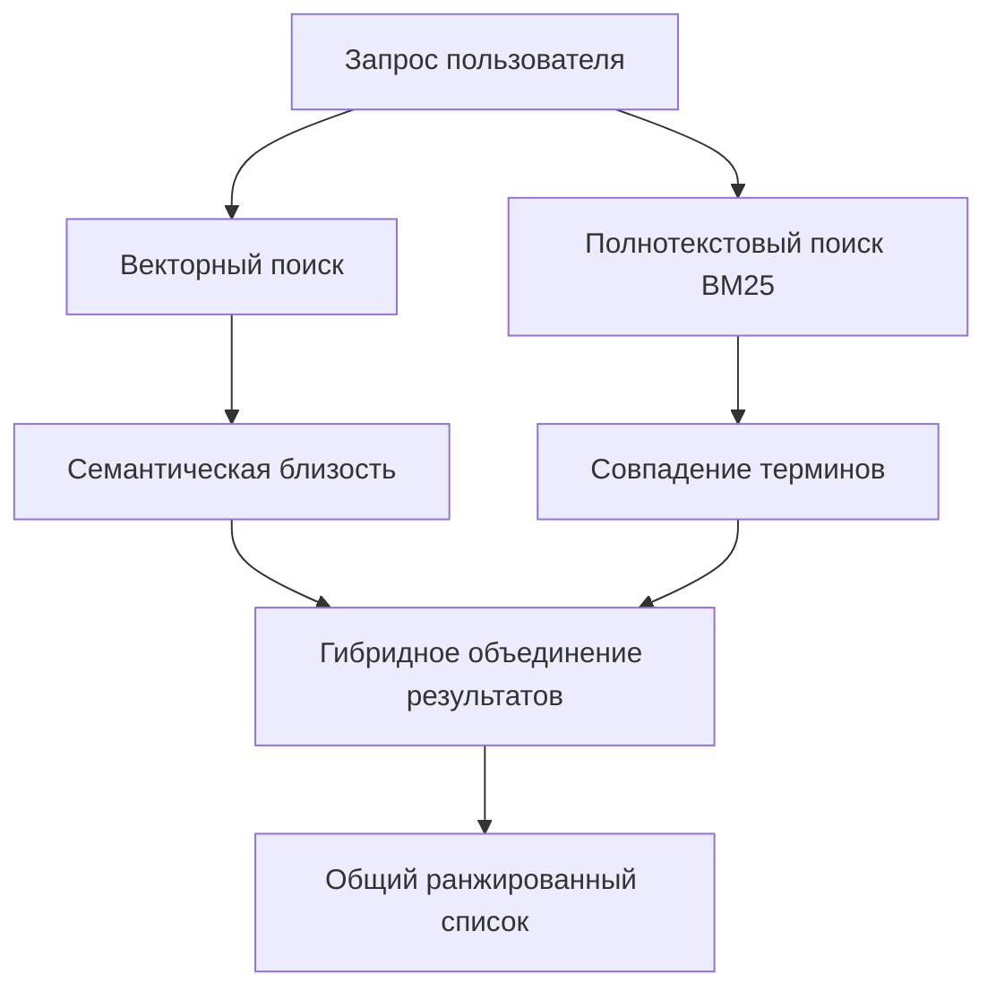
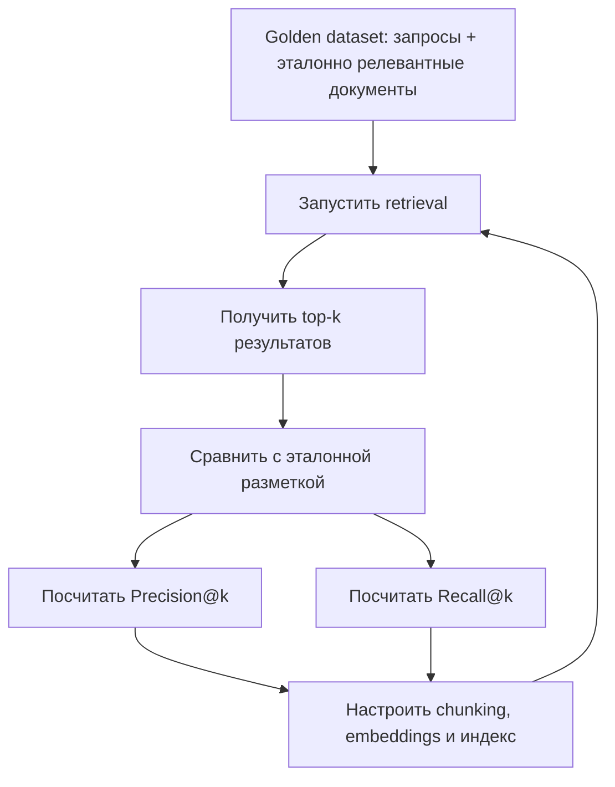
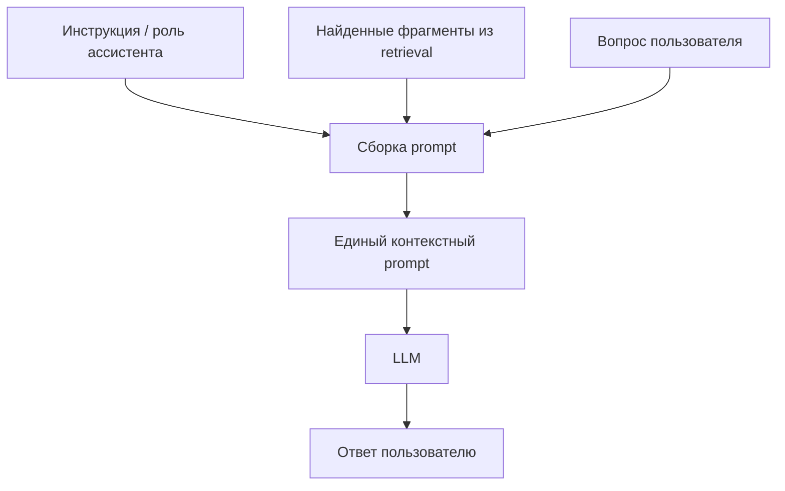
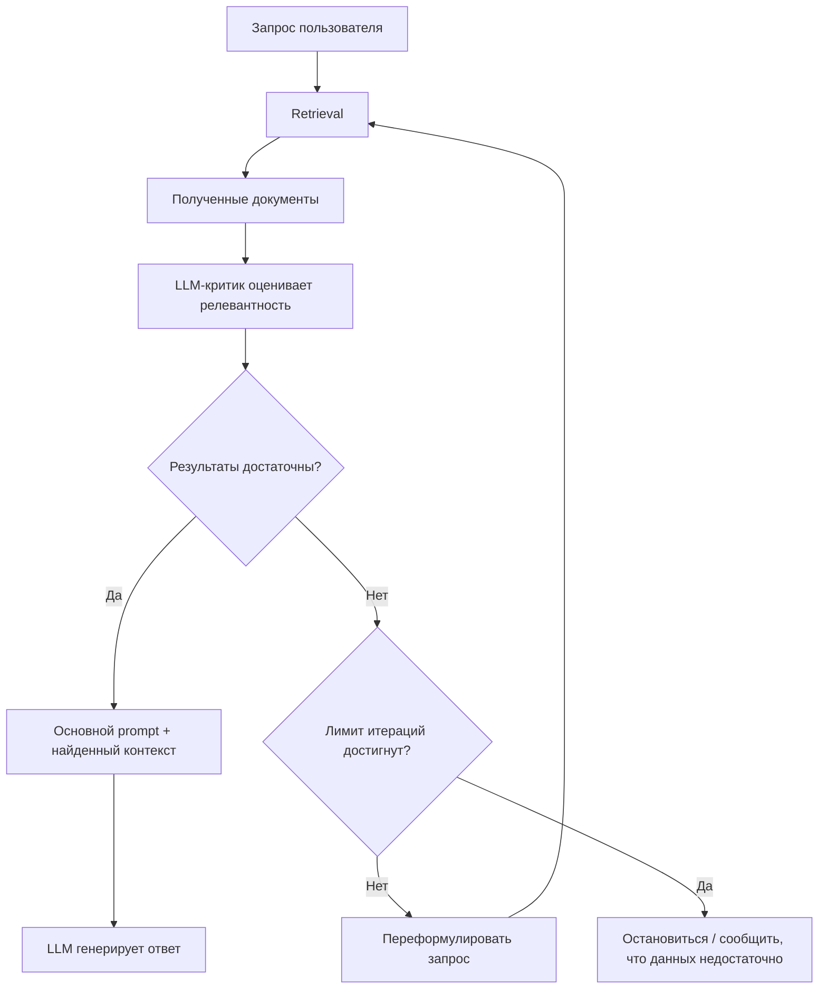

# Лекция: RAG, векторный поиск и Agentic RAG

---

## План лекции (общая длительность ≈ 1 ч 18 мин 40 с)

1. Повторение: как нейросеть обрабатывает текст
2. Ограничение контекстного окна
3. Идея RAG
4. Практика: превращаем репозиторий в базу знаний (ingestion)
5. Практика: поиск и сравнение Chroma и Weaviate
6. Векторный, полнотекстовый и гибридный поиск
7. Итоги по retrieval и где RAG может ломаться
8. Стадия генерации (пример с отзывами на товары)
9. Agentic RAG

---

## 1. Повторение: как нейросеть обрабатывает текст `[00:00 – 05:35]`

**Пайплайн обработки текста трансформером:**

1. **Токенизация.** Текст разбивается на отдельные токены, каждому токену соответствует ID.
2. **Эмбеддинги.** Каждому ID сопоставляется вектор. Изначально эти векторы случайные.
3. **Обучение.** С помощью метода обратного распространения ошибки (backpropagation) подбираются веса, и эмбеддинги начинают «впитывать» информацию о токене.
4. **Pooling.** Эмбеддинг всего текста (или фрагмента) получается из эмбеддингов отдельных токенов с помощью операции объединения (pooling).

**Размер выходного эмбеддинга** зависит от модели: чем сложнее модель, тем он больше, и тем больше ресурсов требуется — размер эмбеддинга напрямую влияет на память, расходуемую при обучении.

**Как обучаются модели.** Идея близка к word2vec (первая лекция): модель учится предсказывать следующее слово в цепочке, то есть учит совместное распределение вероятностей токенов. Для трансформеров есть два режима, в зависимости от модели:

- **авторегрессионные модели** — предсказание по предыдущим словам;
- **двунаправленные (bidirectional) модели** — учатся на контексте всего текста: часть текста заменяется специальным токеном, и модель восстанавливает её.

Модель обучена хорошо, когда вероятность правильного слова максимальна.

Путь текста через основные этапы можно представить так:

Важно различать два результата: языковая модель может предсказывать следующий токен, а embedding-модель — преобразовывать текст в вектор для сравнения с другими текстами. В лекции эти идеи связаны общим понятием эмбеддингов, но в прикладном RAG обычно используется отдельная модель для получения векторов.

> Подробнее об обучении моделей будет отдельная большая лекция.

---

## 2. Ограничение контекстного окна `[05:35 – 10:23]`

**Причина.** При вычислении матрицы внимания (attention) память растёт очень быстро с числом токенов: чем больше токенов мы хотим учитывать, тем больше памяти нужно. Поэтому у модели ограниченное число токенов, участвующих во внимании, — **размер контекстного окна**.

Схематично ограничение выглядит так: если документ длиннее доступного окна, его нельзя целиком передать модели за один раз.

**Почему нельзя просто сделать окно огромным.** Для длинного окна нужно строить более сложное обучение (чтобы, например, не «взрывался» градиент) и тратить больше ресурсов.

**Масштаб проблемы.** В ранних трансформерах было порядка 8000 токенов. «Войну и мир» целиком через такую модель не пропустить. Текст нужно делить на куски (chunks) по размеру окна — так, чтобы эмбеддинг каждого куска уловил максимум информации и при этом ничего не потерялось.

Сейчас окна у современных моделей достигают миллиона токенов и более благодаря разным инженерным приёмам. Но проблема остаётся актуальной для поисковых систем и случаев, когда нужно искать по очень большому корпусу.

---

## 3. Идея Retrieval-Augmented Generation (RAG) `[10:23 – 13:07]`

**Суть архитектурного паттерна:**

1. **Фрагментация.** Длинный контекст разбивается на фрагменты размером с контекстное окно.
2. **Retrieval.** Для запроса выбираются фрагменты, наиболее релевантные ему.
3. **Формирование контекста.** Из релевантных фрагментов собирается контекст.
4. **Generation.** Контекст передаётся в LLM, и формируется ответ.

Главный принцип: **не засорять контекстное окно мусором — подавать только релевантную информацию.**

**Релевантность** определяется близостью вектора эмбеддинга фрагмента и вектора эмбеддинга запроса.

**Векторные базы данных** нужны, чтобы быстро находить релевантные фрагменты среди миллионов документов: вместо попарного сравнения вектора запроса с каждым документом используется индекс.

Общая архитектура RAG состоит из двух независимых по времени процессов: подготовка базы знаний выполняется заранее, а поиск и генерация — при поступлении запроса.

---

## 4. Практика: превращаем репозиторий в базу знаний `[13:07 – 30:11]`

### Что на входе и на выходе `[13:07 – 13:48]`

- **Вход:** сырые ноутбуки (.ipynb), страницы и .md-файлы.
- **Выход:** поисковый индекс, загруженный в векторную базу данных.

### Шаги пайплайна `[13:48 – 17:05]`

1. **Конвертация** всех документов в единый формат `.md` (отдельный скрипт превращает ноутбуки в Markdown).
2. **Индексация файлов.** Скрипт собирает все текстовые документы из директории в один файл формата JSON Lines (`index`). В примере — 70 файлов.
3. **Нарезка на чанки** по размеру контекстного окна модели.
4. **Получение эмбеддингов** через Ollama.
5. **Загрузка** в векторную БД (Chroma и/или Weaviate).

### Идемпотентность пайплайна `[21:36 – 22:26]`

Список файлов для загрузки формируется заранее и сохраняется в промежуточный файл, который подаётся алгоритму параметром. Благодаря этому пайплайн можно перезапускать несколько раз и получать один и тот же результат. Если формировать список динамически, этого гарантировать нельзя.

### Ollama и модель эмбеддингов `[17:05 – 19:13]`

- **Ollama** — сервис для оптимального запуска (inference) моделей на CPU и GPU.
- Для эмбеддингов используется модель **BGE-M3**. Размер эмбеддинга — **1024**.
- Ollama используется **только для получения эмбеддингов**, не для генерации текста.
- Альтернатива — облачный эмбеддер (например, Gemini), но он платный; поэтому в примере используется локальный Ollama.

В коде эмбеддер реализован как абстрактный класс; его наследники — модели, дающие эмбеддинги (Ollama-эмбеддер, Gemini-эмбеддер).

### Загрузка в базу `[22:26 – 30:11]`

- Параметры запуска: путь к файлу индекса, **имя коллекции** и **бэкенд** (Chroma или Weaviate).
- **Коллекция** — аналог таблицы в реляционной БД (термин из нереляционных баз, например MongoDB).
- Каждый документ разбивается на чанки, для каждого считается эмбеддинг, и всё добавляется в базу батчами.
- В примере: 70 документов превратились в порядка 1,5 тысячи чанков (в общей базе, по словам лектора, около 13 000 чанков). Число чанков зависит от выбранной модели, так как размер определяется контекстным окном.
- Загрузка выполняется отдельно для Chroma и отдельно для Weaviate.

Весь ingestion-процесс можно изобразить как конвейер преобразования исходных файлов в записи векторной базы:

Каждый чанк в такой системе обычно хранится вместе с текстом и метаданными, а не только с числовым вектором. Это позволяет после поиска вернуть исходный фрагмент и, например, ссылку на файл.

---

## 5. Практика: поиск и сравнение Chroma и Weaviate `[30:11 – 39:03]`

Логика поиска реализована в отдельном файле (retrieve).

**Как работает поиск:**

1. Запрос пользователя превращается в эмбеддинг (через Ollama).
2. Векторная БД находит чанки, чьи векторы ближе всего к вектору запроса.
3. Если модель эмбеддингов выбрана хорошо и улавливает смысл текста, ближайшие векторы соответствуют релевантным документам.

### Наблюдения `[33:04 – 36:52]`

- Запрос на русском возвращает **англоязычные** документы — модель **мультиязычная**.
- Русскоязычный результат о поисковых системах оказался лишь на седьмом месте.
- Топ выдачи в Chroma и Weaviate примерно совпадает (первые документы одинаковые), но **хвост выдачи различается**. В Chroma все результаты пришли из одного файла, в Weaviate последний документ — из другого файла.
- Метрика **расстояния** тоже различается: в Chroma значения большие, в Weaviate — по-видимому, нормированы от 0 до 1.

### Почему результаты разные `[36:52 – 39:03]`

Эмбеддинги одни и те же, но внутри баз поиск по расстоянию выполняется **не точно, а приближённо**, с помощью **индексов** (approximate nearest neighbor). Точный перебор по десяткам миллионов векторов был бы слишком дорогим по памяти и времени. На прошлой лекции показывали наивный поиск: считаем TF-IDF-векторы и косинусное сходство со всеми документами — для маленького корпуса это работает, для реального не масштабируется. Поэтому в базах реализованы разные плотные индексы, и выдача слегка отличается.

Упрощённая схема поиска по уже построенному индексу:

ANN (Approximate Nearest Neighbors) — поиск ближайших соседей с допустимым приближением. Он ускоряет поиск на больших объёмах данных, но может вернуть немного иной набор результатов, чем полный точный перебор.

---

## 6. Векторный, полнотекстовый и гибридный поиск `[39:03 – 54:17]`

Демонстрация в ноутбуке на Chroma (развёрнута локально в Docker).

### Векторный поиск `[40:32 – 44:37]`

- Запрос (пример: «что такое антиградиент?») превращается в эмбеддинг размера 1024.
- Эмбеддинг отправляется в Chroma; указываем число нужных документов и поля, которые хотим получить.
- В результатах встречается слово «градиент» — не потому что искали по ключевым словам, а потому что **семантически «антиградиент» и «градиент» близки**. Поэтому выдача релевантна.
- Минус подхода: возможны и нерелевантные результаты.

### Фильтр по ключевым словам `[44:37 – 47:42]`

- В Chroma можно добавить фильтр по вхождению ключевых слов — он работает **поверх** векторной выдачи: оставляет только те документы, где слово есть в исходном тексте.
- Это поиск по точному совпадению. В примере первый документ оказался нерелевантным.
- Фильтры также полезны для **ограничения по метаданным**: например, если в поисковой системе лежат документы нескольких отделов компании, можно определить отдел, из которого пришёл запрос, и ограничить выдачу документами этого отдела.

### Полнотекстовый поиск (BM25) `[50:12 – 51:56]`

- BM25 — по сути развитие TF-IDF.
- Нужно явно указать поле, по которому будет работать BM25.
- Результат: вернулось **только два документа** (скор 4,4 и 2,9 «в условных попугаях»), но первый явно релевантный. Слово «антиградиент» редкое, поэтому и результатов мало.

### Гибридный поиск `[47:42 – 54:17]` (идея с 48:18, пример с 52:19)

- **Идея:** не фильтровать одну выдачу другой, а **смешать** результаты векторного поиска и BM25 по некоторой формуле.
- В локальной версии Chroma это не реализовано (доступно только в облачной версии); в Weaviate реализовано.
- Результат в примере: гибридный поиск возвращает гораздо больше документов (около 10–15). Документ с прямым упоминанием «антиградиента» попал в топ, а остальные найдены по семантической связи — все про градиенты. Благодаря мультиязычной модели «градиент» на русском и gradient на английском оказались связаны.

Три подхода отличаются тем, по какому сигналу они находят документы:

Векторный поиск помогает находить смысловые совпадения, даже если формулировки отличаются. BM25 особенно полезен, когда важно точное присутствие редкого термина. Гибридный подход использует оба сигнала.

---

## 7. Итоги по retrieval `[54:17 – 1:02:38]`

1. Модель может эффективно учитывать только информацию в пределах контекстного окна. Расширять окно дорого: нужно более эффективное предобучение и больше ресурсов.
2. Чтобы не засорять окно, в него добавляют **только релевантные фрагменты** — для этого и придуман RAG.
3. Для быстрого поиска по миллионам документов используют **векторные БД** с индексацией.
4. Релевантность определяется близостью эмбеддинга фрагмента и эмбеддинга запроса.

### Где RAG может сломаться `[57:46 – 1:00:52]`

Паттерн сложный, ошибки возможны на каждом этапе:

| Этап | Что может пойти не так |
|---|---|
| **Извлечение текста** (из email, PDF и т. д.) | PDF содержат картинки с полезной информацией; нечитаемые символы, «мусорные» эмодзи; всё ломается уже на первом шаге |
| **Нарезка на чанки** | Разная длина чанка, перекрытие (overlap), нарезка по точкам; длина зависит от модели эмбеддингов: «умная» модель обслуживает большие чанки, слабая (с малым окном) — только маленькие |
| **Эмбеддинг и загрузка** | Неудачная модель эмбеддингов |
| **Индекс векторной БД** | Плохо подобранные параметры индекса → низкое качество retrieval |

### Практическая рекомендация `[1:00:52 – 1:02:29]`

Сразу собирайте **«золотой» датасет** (golden dataset): набор потенциальных запросов с известными релевантными документами. Затем настраивайте все параметры:

- способ конвертации текста;
- размер чанка и стратегию нарезки;
- модель эмбеддингов;
- параметры индекса.

Качество оценивайте стандартными метриками поисковых систем — **precision и recall**, посчитанными не по всему корпусу, а **по верхушке выдачи** (top-k).

Для оценки retrieval заранее размечают, какие документы релевантны каждому тестовому запросу. Затем сравнивают релевантные документы с тем, что система вернула в первых `k` результатах:

- **Precision@k** отвечает на вопрос: какая доля документов в top-k действительно релевантна?
- **Recall@k** отвечает на вопрос: какую долю всех известных релевантных документов удалось найти в top-k?

---

## 8. Стадия генерации (Generation) `[1:02:38 – 1:12:51]`

До этого момента мы рассматривали только retrieval. Теперь — вторую половину RAG.

### Пример: e-commerce `[1:03:44 – 1:07:57]`

- Датасет: отзывы на товары, домен — Health (лекарства, добавки). У каждого отзыва есть заголовок и текст.
- Эмбеддинги в этом примере считаются **локально, без Ollama** — загрузкой модели с Hugging Face. Размерность эмбеддингов меньше 1000.
- Векторная БД здесь не нужна: объём небольшой, хватает обычного поиска по ближайшим соседям.
- На запрос «headache» в выдачу попадают отзывы, где слова «headache» может и не быть, но есть **близкое по смыслу** — это и есть семантический поиск.

### Что такое промпт `[1:07:57 – 1:10:21]`

Мы подошли к понятию **prompt** — это та единственная последовательность, которую мы подаём трансформеру, чтобы он продолжил текст. В RAG промпт собирается из:

1. **инструкции** модели (в примере: «ты — ассистент в аптечном магазине»);
2. **релевантных фрагментов** (отзывов), найденных на этапе retrieval;
3. **запроса пользователя** («headache»).

Сборка запроса к генеративной модели выглядит следующим образом:

### Результат `[1:10:21 – 1:12:51]`

Модель выдала рекомендации по товарам. Интересные наблюдения:

- Мы не задавали правил, но модель **сама поставила на первое место товар с двумя отзывами** — посчитав его более надёжным — и обосновала выбор.
- Для остальных рекомендаций она опиралась на содержание отзывов.
- В этом примере модель в основном **копировала отзывы**. Если бы отзывов было много, она бы **дистиллировала знания**, ужав их до одной строки и показав только суперрелевантное.

---

## 9. Agentic RAG `[1:12:51 – 1:18:15]`

### Проблема классического RAG `[1:12:51 – 1:14:19]`

Классическая схема: retrieval → фильтрация top-k → формирование контекста → ответ. Вся схема **сильно зависит от пользовательского запроса**. Если запрос непонятный или плохо сформулирован, векторный поиск вернёт плохие результаты, генерация будет плохой, и пользователь расстроится.

### Идея агента `[1:14:19 – 1:16:27]`

LLM, как мы увидели, **понимает суть текста**, поэтому можно доверить ей оценку качества:

1. Получив результаты поиска, LLM оценивает, насколько они соответствуют запросу.
2. Если результаты слабые — **переписывает запрос** и запускает поиск ещё раз.
3. Цикл повторяется. Можно ограничить число итераций (например, 5).

### Устройство `[1:16:27 – 1:18:15]`

В системе фактически **два промпта**:

- **основной** — генерирует ответ;
- **критик** — смотрит на выдачу, оценивает её качество и предлагает улучшенный запрос на основе предыдущего шага.

Так получается несколько итераций. Если после них агент приходит к выводу, что **нужной информации в базе нет**, он останавливается и не пытается дальше.

Такой подход называется **Agentic RAG**.

Цикл Agentic RAG можно представить как итеративную проверку качества поиска. Если найденных материалов недостаточно, критик предлагает улучшенный запрос; если достаточно — управление переходит к генерации ответа.

---

## Организационное `[1:18:15 – 1:18:39]`

- На следующем занятии будет подробный разбор того, как работают агенты.
- Запись прошлой лекции не была сделана, поэтому не опубликована; запись сегодняшней будет отправлена в общий канал.