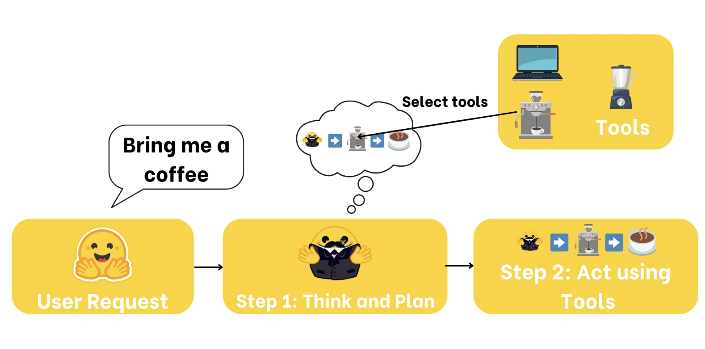
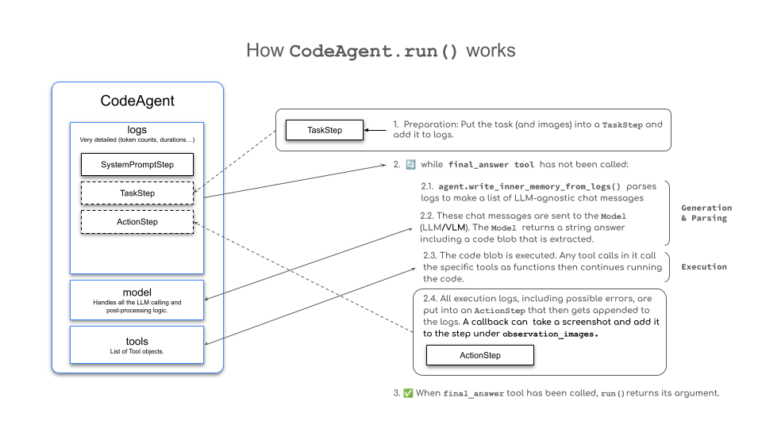
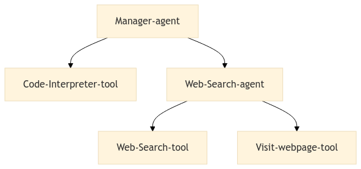

# AI Agents

### Рабочий цикл Agent

Когда Agent сформировал план, он **должен действовать**. Для выполнения плана он **может использовать инструменты из известного ему списка Tools**.

Именно это и представляет собой Agent: **AI-модель, способная рассуждать, планировать и взаимодействовать с окружающей средой**.



Agent — это система, которая использует AI-модель для взаимодействия с окружающей средой и достижения цели, заданной пользователем. Она объединяет рассуждение, планирование и выполнение действий (часто с помощью внешних Tools) для решения задач.

- **Понимание естественного языка:** интерпретация инструкций человека и осмысленный ответ на них.
- **Рассуждение и планирование:** анализ информации, принятие решений и разработка стратегий решения задач.
- **Взаимодействие с окружающей средой:** сбор информации, выполнение действий и наблюдение за их результатами.

### ReAct

Agents работают в непрерывном цикле: **размышление (Thought) → действие (Act) → наблюдение (Observe)**.

Разберём каждый из этих этапов:

1. **Thought:** LLM-компонент Agent определяет, каким должен быть следующий шаг.
2. **Action:** Agent выполняет действие, вызывая Tools с соответствующими аргументами.
3. **Observation:** модель анализирует ответ, полученный от Tool.

#### Примеры мыслей Agent

| **Тип мысли** | **Пример** |
| --- | --- |
| Планирование | «Нужно разделить задачу на три этапа: 1) собрать данные, 2) проанализировать тенденции, 3) подготовить отчёт» |
| Анализ | «Судя по сообщению об ошибке, проблема, вероятно, связана с параметрами подключения к базе данных» |
| Принятие решения | «Учитывая бюджет пользователя, следует рекомендовать вариант среднего ценового сегмента» |
| Решение проблем | «Чтобы оптимизировать этот код, сначала нужно профилировать его и найти узкие места» |
| Использование памяти | «Ранее пользователь упоминал, что предпочитает Python, поэтому я приведу примеры на Python» |
| Саморефлексия | «Предыдущий подход оказался неудачным — стоит попробовать другую стратегию» |
| Постановка цели | «Чтобы выполнить задачу, сначала нужно определить критерии приёмки» |
| Приоритизация | «Уязвимость безопасности нужно устранить до добавления новых функций» |

**Подход ReAct:** объединение «Reasoning» (Think, рассуждение) и «Acting» (Act, действие).

Observations — это **способ, с помощью которого Agent воспринимает последствия своих действий**.

Они предоставляют важную информацию, которая питает процесс рассуждения Agent и помогает определять дальнейшие действия.

На этапе наблюдения Agent:

- **Получает обратную связь:** получает данные или подтверждение того, что действие завершилось успешно (или нет).
- **Добавляет результаты:** интегрирует новую информацию в текущий контекст, фактически обновляя свою память.
- **Адаптирует стратегию:** использует обновлённый контекст, чтобы скорректировать последующие рассуждения и действия.

| **Тип наблюдения** | **Пример** |
| --- | --- |
| Обратная связь системы | Сообщения об ошибках, уведомления об успехе, коды состояния |
| Изменения данных | Обновления базы данных, изменения файловой системы, смена состояния |
| Данные об окружении | Показания датчиков, системные метрики, использование ресурсов |
| Анализ ответов | Ответы API, результаты запросов, результаты вычислений |
| События, связанные со временем | Наступление дедлайнов, выполнение запланированных задач |

После выполнения действия framework последовательно выполняет следующие шаги:

1. **Разбирает действие (Parse the action):** определяет, какую функцию или функции вызвать и какие аргументы использовать.
2. **Выполняет действие (Execute the action).**
3. **Добавляет результат** в качестве **Observation**.

### Ссылки

- [https://ai.pydantic.dev/](https://ai.pydantic.dev/)
- [PydanticAI: интеграция с Nebius (Token Factory)](https://docs.tokenfactory.nebius.com/integrations/agents/pydantic)
- [pydantic-deepagents](https://github.com/vstorm-co/pydantic-deepagents)

#### Пример: Agent с поиском через DuckDuckGo

Как настроить модель через `OpenAIChatModel` + `NebiusProvider` (OpenAI-совместимый API):

```python
from pydantic_ai import Agent
from pydantic_ai.models.openai import OpenAIChatModel
from pydantic_ai.providers.nebius import NebiusProvider

model = OpenAIChatModel(
    "Qwen/Qwen3-30B-A3B-Instruct-2507",
    provider=NebiusProvider(api_key=NEBIUS_API_KEY),
)


def duckduckgo_search(query: str) -> str:
    """Search the web via DuckDuckGo and return the top results."""
    from duckduckgo_search import DDGS

    results = DDGS().text(query, max_results=5)
    return "\n".join(r["body"] for r in results)


agent = Agent(model, tools=[duckduckgo_search])
```

# Function Calling

Function Calling — это **способ, с помощью которого LLM выполняет действия в окружающей среде**. Способность вызывать функции **усваивается самой моделью** и **в меньшей степени зависит от prompting**, чем другие техники создания Agents. При Function Calling Agent проходит fine-tuning (обучение) для использования Tools.

В chat template добавляются новые роли: **Action** и **Observation**.

- Пример из Mistral API

    ```python
    conversation = [
        {"role": "user", "content": "What's the status of my transaction T1001?"},
        {
            "role": "assistant",
            "content": "",
            "function_call": {
                "name": "retrieve_payment_status",
                "arguments": '{"transaction_id": "T1001"}',
            },
        },
        {
            "role": "tool",
            "name": "retrieve_payment_status",
            "content": '{"status": "Paid"}',
        },
        {
            "role": "assistant",
            "content": "Your transaction T1001 has been successfully paid.",
        },
    ]
    ```

Процесс обучения модели можно разделить на 3 этапа:

1. **Модель предварительно обучается на большом объёме данных (pre-training)**. Результатом этого этапа становится **pre-trained model**. Например, [**google/gemma-2-2b**](https://huggingface.co/google/gemma-2-2b). Это базовая модель, которая умеет лишь **предсказывать следующий token и пока не обладает развитыми способностями следовать инструкциям**.
2. Чтобы модель была полезна в диалоге, её необходимо **fine-tune** для следования инструкциям. На этом этапе обучение могут проводить создатели модели, open-source сообщество, вы или кто угодно. Например, [**google/gemma-2-2b-it**](https://huggingface.co/google/gemma-2-2b-it) — instruction-tuned модель, созданная командой Google, работающей над проектом Gemma.
3. Затем модель можно **aligned** — согласовать с предпочтениями её создателя. Например, модель для клиентской поддержки должна быть настроена так, чтобы никогда не грубить клиентам.

## Frameworks для создания Agents

Framework включает несколько компонентов:

- *LLM engine*, который обеспечивает работу системы.
- *Список Tools*, к которым Agent может обращаться.
- *Parser* для извлечения вызовов Tools из вывода LLM.
- *System prompt*, согласованный с parser.
- *Система памяти*.
- *Логирование ошибок и механизмы повторных попыток (retry)* для контроля ошибок LLM. Посмотрим, как эти задачи решаются в различных frameworks, включая…

Agent в PydanticAI выполняет последовательность шагов для решения задачи: LLM получает инструкции и схемы Tools, генерирует вызов Tool (JSON), framework валидирует аргументы через pydantic, выполняет функцию и возвращает результат модели как Observation. Цикл повторяется, пока Agent не сформирует итоговый ответ.

Наиболее популярные frameworks: `PydanticAI`, `LangGraph` и Microsoft Agent Framework.

PydanticAI построен на **нативном tool calling**: названия Tools и аргументы передаются в формате JSON, а **JSON-schema каждого Tool генерируется автоматически из type hints и docstring обычной Python-функции**. Такой подход даёт несколько важных преимуществ:

- **Типобезопасность (Type Safety):** схема Tool и валидация аргументов строятся на pydantic — рассинхронизация кода и схемы исключена.
- **Валидация (Validation):** некорректные аргументы от LLM перехватываются до выполнения Tool.
- **Композиционность (Composability):** Tools легко комбинировать, тестировать и повторно использовать — это обычные функции.
- **Провайдер-независимость (Provider-agnostic):** один и тот же Agent работает с OpenAI, Anthropic, Google, Groq, Nebius и любым OpenAI-совместимым API.



- Пример кода

    ```python
    from pydantic_ai import Agent
    from pydantic_ai.models.openai import OpenAIChatModel
    from pydantic_ai.providers.nebius import NebiusProvider

    model = OpenAIChatModel(
        "Qwen/Qwen3-30B-A3B-Instruct-2507",
        provider=NebiusProvider(api_key=NEBIUS_API_KEY),
    )

    agent = Agent(model, tools=[duckduckgo_search])
    result = agent.run_sync(
        """Search for the best music recommendations for a party
    at the Wayne's mansion."""
    )
    print(result.output)

    # create a tool using @agent.tool_plain decorator
    party_agent = Agent(model)


    @party_agent.tool_plain  # docstring = описание Tool, type hints = схема аргументов
    def suggest_menu(occasion: str) -> str:
        """
        Suggests a menu based on the occasion.
        Args:
            occasion: The type of occasion for the party.
        """
        if occasion == "casual":
            return "Pizza, snacks, and drinks."
        elif occasion == "formal":
            return "3-course dinner with wine and dessert."
        elif occasion == "superhero":
            return "Buffet with high-energy and healthy food."
        else:
            return "Custom menu for the butler."


    party_agent.run_sync("Prepare a formal menu for the party.")
    ```

    В PydanticAI **все Agents работают через нативный tool calling** — модель генерирует JSON-объекты, в которых указаны названия Tools и их аргументы.

```json
[
    {"name": "duckduckgo_search", "arguments": {"query": "Best catering services in Gotham City"}},
    {"name": "duckduckgo_search", "arguments": {"query": "Party theme ideas for superheroes"}}
]
```

Аргументы каждого вызова **валидируются pydantic по схеме, построенной из type hints**, и только затем выполняются.

```python
from pydantic_ai import Agent

agent = Agent(model, tools=[duckduckgo_search])

result = agent.run_sync(
    "Search for the best music recommendations for a party at the Wayne's mansion."
)
```

Чтобы взаимодействовать с Tool, LLM необходимо **описание интерфейса**, включающее следующие компоненты:

- **Name:** название Tool.
- **Tool description:** что делает Tool.
- **Input types and descriptions:** какие аргументы принимает Tool.
- **Output type:** что возвращает Tool.

В PydanticAI всё это **генерируется автоматически**: имя — из названия функции, описание — из docstring, схема — из type hints. Tools можно определять несколькими способами:

1. **Обычная функция в `tools=[...]`** — `Agent(model, tools=[my_func])`.
2. **Декоратор `@agent.tool_plain`** — регистрация Tool прямо на Agent.
3. **Декоратор `@agent.tool`** — как предыдущий, но первый аргумент `RunContext`: доступ к deps, usage и состоянию запуска.
4. **Класс `Tool`** — для полного контроля над схемой и поведением.

```python
from pydantic_ai import Agent


def catering_service_tool(query: str) -> str:
    """
    This tool returns the highest-rated catering service in Gotham City.

    Args:
        query: A search term for finding catering services.
    """
    services = {
        "Gotham Catering Co.": 4.9,
        "Wayne Manor Catering": 4.8,
        "Gotham City Events": 4.7,
    }
    best_service = max(services, key=services.get)

    return best_service


agent = Agent(model, tools=[catering_service_tool])
result = agent.run_sync(
    "Can you give me the name of the highest-rated catering service in Gotham City?"
)

print(result.output)  # Output: Gotham Catering Co.
```

# Agentic RAG

https://huggingface.co/learn/cookbook/agent_rag

- Развёрнутый пример кода

    ```python
    from langchain.docstore.document import Document
    from langchain.text_splitter import RecursiveCharacterTextSplitter
    from langchain_community.retrievers import BM25Retriever
    from pydantic_ai import Agent, RunContext

    # Simulate a knowledge base about party planning
    party_ideas = [
        {
            "text": "A superhero-themed masquerade ball with luxury decor, including gold accents and velvet curtains.",
            "source": "Party Ideas 1",
        },
        {
            "text": "Hire a professional DJ who can play themed music for superheroes like Batman and Wonder Woman.",
            "source": "Entertainment Ideas",
        },
        {
            "text": "For catering, serve dishes named after superheroes, like 'The Hulk's Green Smoothie' and 'Iron Man's Power Steak.'",
            "source": "Catering Ideas",
        },
        {
            "text": "Decorate with iconic superhero logos and projections of Gotham and other superhero cities around the venue.",
            "source": "Decoration Ideas",
        },
        {
            "text": "Interactive experiences with VR where guests can engage in superhero simulations or compete in themed games.",
            "source": "Entertainment Ideas",
        },
    ]

    source_docs = [
        Document(page_content=doc["text"], metadata={"source": doc["source"]})
        for doc in party_ideas
    ]

    text_splitter = RecursiveCharacterTextSplitter(
        chunk_size=500,
        chunk_overlap=50,
        add_start_index=True,
        strip_whitespace=True,
        separators=["\n\n", "\n", ".", " ", ""],
    )
    docs_processed = text_splitter.split_documents(source_docs)
    retriever = BM25Retriever.from_documents(
        docs_processed,
        k=5,  # Retrieve the top 5 documents
    )

    # deps_type описывает зависимости Agent; доступ к ним — через RunContext
    agent = Agent(model, deps_type=BM25Retriever)


    @agent.tool
    def party_planning_retriever(ctx: RunContext[BM25Retriever], query: str) -> str:
        """
        Uses semantic search to retrieve relevant party planning ideas
        for Alfred's superhero-themed party at Wayne Manor.

        Args:
            query: The query to perform. This should be a query related
                to party planning or superhero themes.
        """
        docs = ctx.deps.invoke(
            query,
        )
        return "\nRetrieved ideas:\n" + "".join(
            [
                f"\n\n===== Idea {str(i)} =====\n" + doc.page_content
                for i, doc in enumerate(docs)
            ]
        )


    response = agent.run_sync(
        "Find ideas for a luxury superhero-themed party, including entertainment, catering, and decoration options.",
        deps=retriever,
    )

    print(response.output)
    ```

# Multi-Agent Systems

Multi-Agent Systems позволяют **специализированным Agents совместно решать сложные задачи**, повышая модульность, масштабируемость и надёжность системы. Вместо одного Agent задачи распределяются между несколькими Agents с различными возможностями.

На схеме ниже показана простая multi-agent архитектура: **Manager Agent** координирует специализированных Agents, например **Web Search Agent**, который, в свою очередь, использует такие Tools, как `web_search` и `visit_webpage`, чтобы собирать нужную информацию.



#### Пример: Web Agent и Manager Agent (delegation)

В PydanticAI multi-agent системы строятся через **delegation**: один Agent регистрируется как Tool другого — модель-менеджер вызывает подчинённый Agent как обычную функцию.

```python
from pydantic_ai import Agent, RunContext


def duckduckgo_search(query: str) -> str:
    """Search the web via DuckDuckGo and return the top results."""
    ...


def visit_webpage(url: str) -> str:
    """Fetch a webpage and return its text content."""
    ...


web_agent = Agent(
    model,
    instructions="You search the web to get up-to-date results.",
    tools=[duckduckgo_search, visit_webpage],
)

manager_agent = Agent(
    model,
    instructions=(
        "You are a party planning coordinator. "
        "Delegate web research to the web_search tool."
    ),
    retries=5,
)


@manager_agent.tool
async def web_search(ctx: RunContext, query: str) -> str:
    """Delegate a research query to the web search agent."""
    result = await web_agent.run(query, usage=ctx.usage)
    return result.output


result = manager_agent.run_sync(
    "Find the best music recommendations for a party at the Wayne's mansion."
)
print(result.output)
```

Наблюдаемость и трассировка запусков: PydanticAI поддерживает OpenTelemetry-инструментацию из коробки (Logfire, Langfuse):

```python
from pydantic_ai.agent import InstrumentationSettings

# трассировать все запуски Agent, включая содержимое сообщений
Agent.instrument_all(InstrumentationSettings(include_content=True, version=1))
```

#### Результат запуска: output и usage

```python
result = agent.run_sync("Search for the best music recommendations for a party.")
print(result.output)  # итоговый ответ Agent

usage = result.usage()
print(f"requests={usage.requests} total_tokens={usage.total_tokens}")
```

#### Интеграция модели

```python
from openai import AsyncOpenAI
from pydantic_ai import Agent
from pydantic_ai.models.openai import OpenAIChatModel
from pydantic_ai.providers.nebius import NebiusProvider

# вариант 1: строка модели "provider:model"
agent = Agent("openai:gpt-4o")

# вариант 2: стандартный endpoint Nebius
model = OpenAIChatModel(
    "Qwen/Qwen3-30B-A3B-Instruct-2507",
    provider=NebiusProvider(api_key=NEBIUS_API_KEY),
)

# вариант 3: произвольный OpenAI-совместимый endpoint — свой AsyncOpenAI-клиент
provider = NebiusProvider(
    api_key=NEBIUS_API_KEY,
    openai_client=AsyncOpenAI(
        base_url="https://api.studio.nebius.com/v1",
        api_key=NEBIUS_API_KEY,
    ),
)
model = OpenAIChatModel("Qwen/Qwen3-30B-A3B-Instruct-2507", provider=provider)

agent = Agent(model)
result = agent.run_sync("Hello, how are you?")
print(result.output)
```

### PydanticAI

- [https://ai.pydantic.dev/](https://ai.pydantic.dev/)
- [PydanticAI: интеграция с Nebius (Token Factory)](https://docs.tokenfactory.nebius.com/integrations/agents/pydantic)
- [pydantic-deepagents](https://github.com/vstorm-co/pydantic-deepagents)

Основные элементы, из которых строятся Agents в PydanticAI:

- **Model + Provider:** LLM-движок. Поддерживаются OpenAI, Anthropic, Google, Groq, Mistral, а также любой OpenAI-совместимый API — например, Nebius через `NebiusProvider`.
- **Agent:** центральный объект системы: инструкции, Tools, dependencies и тип результата в одном месте.
- **Tools:** обычные Python-функции. JSON-schema и описание генерируются автоматически из type hints и docstring, аргументы валидируются через pydantic.
- **Dependencies:** типизированный контекст (`deps_type`) — клиенты API, retriever'ы, конфигурация. Доступны в Tools через `RunContext`.
- **Output type:** структурированный результат — вместо свободного текста Agent возвращает pydantic-модель.
- Создание и запуск Agent (run / run_sync / stream)

    ```python
    import asyncio
    from pydantic_ai import Agent
    from pydantic_ai.models.openai import OpenAIChatModel
    from pydantic_ai.providers.nebius import NebiusProvider

    model = OpenAIChatModel(
        "Qwen/Qwen3-30B-A3B-Instruct-2507",
        provider=NebiusProvider(api_key=NEBIUS_API_KEY),
    )

    agent = Agent(
        model,
        instructions=(
            "You are Alfred, the butler of Wayne Manor. "
            "Help plan parties and answer questions precisely."
        ),
    )

    # синхронный запуск
    result = agent.run_sync("Prepare a formal menu for the party.")
    print(result.output)


    # асинхронный запуск со стримингом
    async def main():
        async with agent.run_stream("Hello, how are you?") as response:
            async for chunk in response.stream_text(delta=True):
                print(chunk, end="", flush=True)


    asyncio.run(main())
    ```

- Структурированный вывод (output_type)

    ```python
    from pydantic import BaseModel
    from pydantic_ai import Agent


    class PartyPlan(BaseModel):
        menu: str
        entertainment: str
        decoration: str


    agent = Agent(model, output_type=PartyPlan)
    result = agent.run_sync("Plan a luxury superhero-themed party.")
    print(result.output.menu)
    ```

- Dependencies (внедрение зависимостей)

    ```python
    from dataclasses import dataclass
    from pydantic_ai import Agent, RunContext


    @dataclass
    class PartyDeps:
        budget: float
        guest_count: int


    agent = Agent(model, deps_type=PartyDeps)


    @agent.tool
    def get_budget(ctx: RunContext[PartyDeps], currency: str) -> str:
        """Return the party budget in the requested currency."""
        return f"{ctx.deps.budget} {currency}"


    result = agent.run_sync(
        "Can we afford a DJ?",
        deps=PartyDeps(budget=5000, guest_count=40),
    )
    print(result.output)
    ```

- Оценка (evaluation) — pydantic-evals

    ```python
    from pydantic_evals import Case, Dataset
    from pydantic_evals.evaluators import LLMJudge

    case = Case(
        name="formal_menu",
        inputs="Prepare a formal menu for the party.",
        expected_output="3-course dinner with wine and dessert.",
    )
    dataset = Dataset(cases=[case], evaluators=[LLMJudge()])

    # task — функция, которая вызывает agent.run_sync(inputs)
    report = dataset.evaluate_sync(task)
    print(report)
    ```

Мы подключили **retriever и другие компоненты как Tools для Agent** — именно так в PydanticAI строятся Agentic RAG и multi-agent системы.

#### Tools в PydanticAI

1. `Обычные функции` и `@agent.tool_plain`: любая Python-функция становится Tool — schema и описание генерируются автоматически.
2. `@agent.tool` + `RunContext`: доступ к dependencies, usage и retry-логике запуска.
3. **Agent как Tool (delegation):** один Agent можно вызвать из другого — так строятся multi-agent системы.
4. **MCP-серверы как Tools:** `MCPServerStdio` / `MCPServerHTTP` подключают внешние MCP-инструменты напрямую к Agent.
- Создание Tool

    ```python
    from pydantic_ai import Agent


    def get_weather(location: str) -> str:
        """Useful for getting the weather for a given location."""
        print(f"Getting weather for {location}")
        return f"The weather in {location} is sunny"


    agent = Agent(model, tools=[get_weather])

    # Tool остаётся обычной функцией — его можно тестировать напрямую
    get_weather("New York")
    ```

- Tool на основе другого Agent (delegation)

    ```python
    from pydantic_ai import Agent, RunContext

    web_agent = Agent(
        model,
        instructions="You search the web to get up-to-date results.",
        tools=[duckduckgo_search],
    )

    manager_agent = Agent(model, instructions="You coordinate research tasks.")


    @manager_agent.tool
    async def web_search(ctx: RunContext, query: str) -> str:
        """Delegate a research query to the web search agent."""
        result = await web_agent.run(query, usage=ctx.usage)
        return result.output
    ```

`RunContext` даёт Tool'у доступ к **dependencies, usage и состоянию текущего запуска** — глобальная конфигурация не нужна.

Типы Tools в PydanticAI

1. **Plain tools** (`@agent.tool_plain`, обычные функции) — не зависят от состояния запуска.
2. **Context tools** (`@agent.tool`) — принимают `RunContext`: deps, usage, retry-счётчик.
3. **Delegation tools** — вызывают других Agents как Tool.
4. **MCP tools** — Tools из внешних MCP-серверов.

#### Workflows в PydanticAI (pydantic-graph)

**pydantic-graph даёт несколько важных преимуществ:**

- Чёткая организация кода в виде отдельных узлов (nodes).
- Типобезопасные переходы: следующий узел определяется типом, который возвращает `run()`.
- Встроенное управление состоянием (state).
- Полная интеграция с Agents: узел графа может вызывать `agent.run()`.
- Поддержка как простых последовательностей, так и сложных multi-agent сценариев.

    ```python
    from pydantic_graph import BaseNode, End, Graph, GraphRunContext


    class Research(BaseNode):
        """Узел: делегируем поиск web-агенту."""

        async def run(self, ctx: GraphRunContext) -> "Summarise":
            result = await web_agent.run("Search party music trends")
            return Summarise(text=result.output)


    class Summarise(BaseNode):
        """Узел: подводим итог и завершаем граф."""

        async def run(self, ctx: GraphRunContext) -> End:
            return End("Party plan ready")


    # run() каждого узла возвращает следующий узел или End —
    # так формируется типобезопасный workflow
    ```
