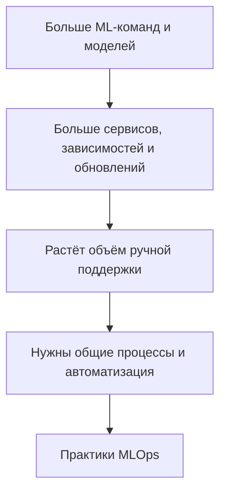
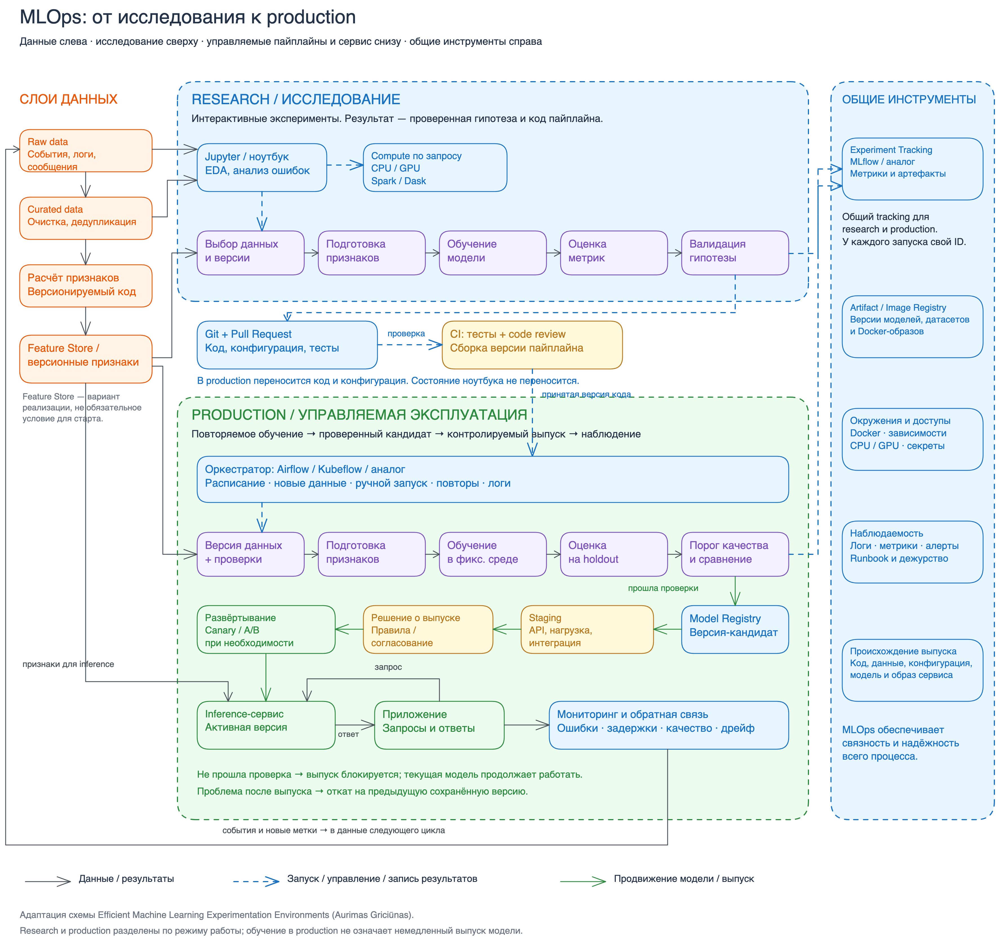
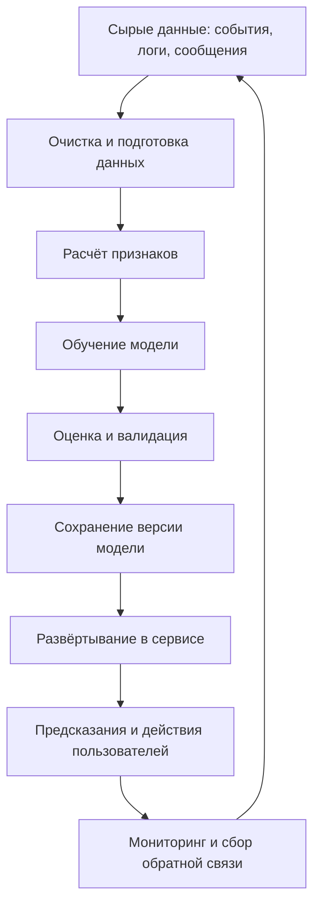
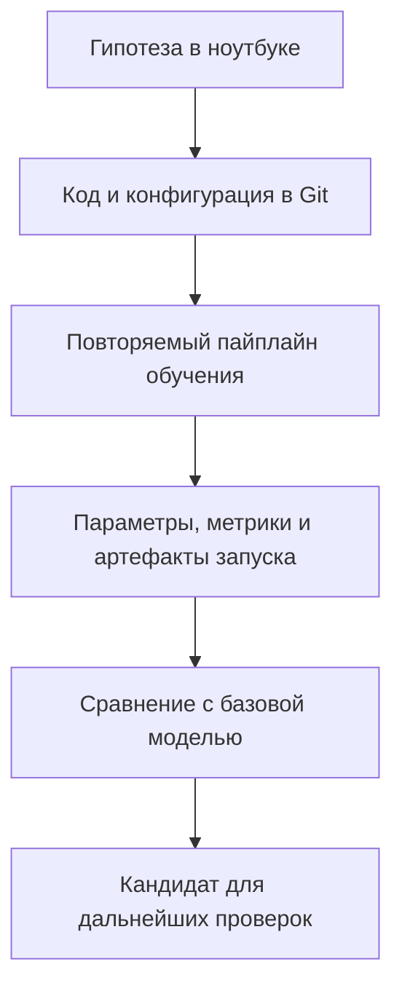
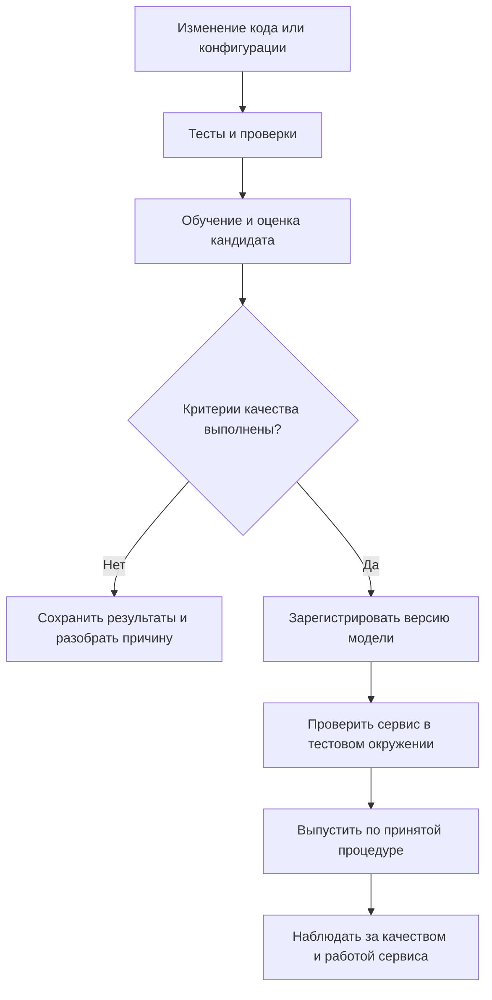

# Лекция: введение в MLOps

## Ноутбуки и порядок практики

| Шаг | Ноутбук | Что сделать |
| --- | --- | --- |
| 1 | [Классификатор с MLflow](https://github.com/aleksandr-dzhumurat/ai_product_engineer/blob/main/jupyter_notebooks/vol_01_ml_products_02_mflow_powered_classifier.ipynb) | Разберите обучение классификатора и отслеживание экспериментов с помощью MLflow. |

---

## План лекции (общая длительность ≈ 44 мин 16 с)

1. Зачем появился MLOps
2. Жизненный цикл модели и разделение ответственности
3. Модель зрелости MLOps: уровни 0–4
4. Зачем компании ML-платформа
5. Материалы для самостоятельного изучения
6. Практикум: подготовка модели к эксплуатации
7. Итоги

Таймкоды относятся к субтитрам записи. После конспекта приведены дополнительные пояснения к среде экспериментов, CI/CD и проектированию ML-систем.

---

## 1. Зачем появился MLOps `[00:00 – 05:37]`

**Обученная модель — только часть работающего ML-продукта.** Чтобы пользователь получил предсказание, нужно подготовить данные, сохранить модель, запустить сервис и следить за его работой. Со временем требуется обновлять и данные, и саму модель.

В начале лекции приводится пример того, как эта работа была устроена без выделенных MLOps-специалистов. ML-инженер самостоятельно:

1. Готовил признаки и обучал модель, например градиентный бустинг.
2. Упаковывал модель в Docker и разворачивал на сервере.
3. Настраивал мониторинг и дашборды в Grafana.
4. Писал **runbook** — инструкцию для дежурного инженера: как обнаружить проблему и восстановить работу сервиса.

DevOps-инженер следил за инфраструктурой: доступностью серверов, памятью, диском и процессами. Если сервис падал, он мог перезапустить его по инструкции. Но исправить ошибку подготовки признаков или разобраться в ухудшении качества модели одного перезапуска недостаточно.

### Что изменилось с ростом числа моделей

Пока у компании одна модель, ручные действия ещё можно координировать. Когда команд и моделей становится больше, растёт число окружений, зависимостей, обновлений и способов развёртывания. Одну модель также может потребоваться запускать на нескольких экземплярах сервиса.

**Проблема масштаба:** каждая команда создаёт собственный процесс эксплуатации, а поддержке приходится разбираться во всём этом разнообразии.



**MLOps (Machine Learning Operations)** — практики организации разработки, доставки и эксплуатации ML-систем. Они помогают воспроизводить результаты, надёжно обновлять модели, обнаруживать проблемы и сокращать путь от эксперимента до работающего продукта.

В лекции появление MLOps объясняется через выделение специалистов, которые сопровождают весь цикл модели. Конкретное распределение задач зависит от компании: MLOps — это также процессы и инструменты, а не только название должности.

---

## 2. Жизненный цикл модели и разделение ответственности `[05:37 – 11:11]`

### Из чего состоит ML-система

На схеме разделены два режима работы: исследование гипотез и управляемая эксплуатация. Сохранены основные компоненты исходной иллюстрации, а переходы между ними показаны явно.



[Редактируемая схема Excalidraw](img/mlops_research_prod.excalidraw) · [Векторная версия SVG](img/mlops_research_prod.svg)

**Как читать схему:**

- **Слева — данные:** сырые события, очищенные наборы и признаки.
- **Сверху — research:** интерактивный анализ, эксперименты и проверка гипотез.
- **Между контурами — Git и CI:** в production передают проверенный код и конфигурацию пайплайна. Состояние ноутбука не переносится.
- **Снизу — production:** воспроизводимое обучение создаёт кандидата; проверки, staging и решение о выпуске отделяют его от активной модели в сервисе.
- **Справа — общие инструменты:** tracking, хранилища артефактов, окружения, наблюдаемость и связь версий.

Серые стрелки показывают данные и результаты, синий пунктир — запуск и управление, зелёные стрелки — продвижение модели к выпуску. Пользовательские события и новые метки возвращаются в данные следующего цикла.

**Важно:** production здесь включает управляемые процессы обучения и эксплуатации. Новая обученная модель не заменяет работающую автоматически: она должна пройти процедуру выпуска.

Схема адаптирована по исходной иллюстрации Aurimas Griciūnas «Efficient Machine Learning Experimentation Environments».

Упрощённо полный цикл выглядит так:



Обратная связь замыкает цикл. Например, рекомендательная система показывает фильмы, а клики пользователей становятся данными для оценки и последующего обучения.

### Три представления данных

- **Raw data — сырые данные.** Исходные события приложений, логи и другие записи.
- **Curated data — подготовленные данные.** Данные после очистки, удаления дубликатов и согласования форматов.
- **Features — признаки.** Величины, которые использует модель: например, число просмотров пользователя за неделю.

На исходной схеме признаки доступны через **Feature Store** — систему хранения и предоставления признаков для обучения и получения предсказаний. Это один из вариантов архитектуры; необходимость отдельного Feature Store зависит от задач команды.

### Кто за что отвечает

Лектор предлагает полезную метафору: **Data Scientist реализует отдельные блоки, а MLOps помогает сделать так, чтобы работали стрелки между ними.**

| Участник | Пример ответственности |
|---|---|
| **Data Scientist / ML-инженер** | Проверить гипотезу, написать код признаков и обучения, выбрать метрики, оценить модель |
| **Data Engineer** | Подготовить надёжные потоки и наборы данных для использования другими командами |
| **MLOps-инженер** | Настроить запуск пайплайнов, доставку моделей, окружения, наблюдаемость и восстановление после сбоев |
| **DevOps / инфраструктурная команда** | Обеспечить работу вычислительной инфраструктуры и общих средств эксплуатации |

Границы могут пересекаться. Выделенная MLOps-команда не снимает с автора модели ответственности за корректность её кода и качество предсказаний.

**Пример из лекции:** ML-инженер пишет расчёт полезного признака. Затем этот расчёт запускается регулярно через оркестратор, например Airflow. Нужно обеспечить расписание, доступ к данным, обработку ошибок и возможность повторного запуска.

Инструменты решают разные задачи: **experiment tracking** хранит параметры и результаты запусков; **model registry** управляет версиями моделей и связанными метаданными; оркестратор управляет выполнением шагов. В одной платформе эти возможности могут быть объединены.

---

## 3. Модель зрелости MLOps `[11:11 – 24:11]`

**Модель зрелости** помогает оценить текущие процессы и выбрать следующий шаг автоматизации. В рассматриваемой [модели Microsoft](https://learn.microsoft.com/en-us/azure/architecture/ai-ml/guide/mlops-maturity-model) пять уровней — **от 0 до 4**.

### Что меняется от уровня к уровню

| Уровень | Основная характеристика |
|---|---|
| **0. Нет MLOps** | Обучение, проверки и развёртывание выполняются вручную; отслеживание качества разрознено |
| **1. DevOps без MLOps** | Автоматизированы сборки и тесты кода, но выпуск моделей всё ещё зависит от ручной работы ML-команды |
| **2. Автоматизированное обучение** | Обучение воспроизводимо, результаты отслеживаются централизованно; выпуск модели ещё может быть ручным |
| **3. Автоматизированное развёртывание моделей** | Проверки и доставка моделей связаны в автоматизированный процесс выпуска |
| **4. Полная автоматизация MLOps-процессов** | Обучение, проверка и выпуск образуют согласованный цикл с обратной связью из эксплуатации |

### Пример: ручной выпуск модели `[15:19 – 18:24]`

На уровне 0 специалист обучает модель на своей или удалённой машине. Результат — файл модели или checkpoint нейросети. Затем он подключается к серверу, копирует файл в нужную директорию и перезапускает процесс.

Пока всё работает, такой путь кажется простым. Но при проблеме возникают вопросы: какой код создал этот файл, на каких данных обучалась модель и можно ли воспроизвести результат?

Отдельная проблема — сбор метрик. В рекомендательной системе сначала оценивают модель на подготовленном наборе данных, затем собирают пользовательские события из работающего продукта. Если для каждой модели это отдельная ручная процедура, поддерживать оценку всё труднее.

### Что автоматизируют дальше `[18:24 – 22:20]`

1. **Сборку и проверки.** Изменение кода запускает тесты и подготовку артефактов.
2. **Обучение.** Пайплайн получает данные, обучает модель, оценивает результат и сохраняет артефакты запуска.
3. **Доставку модели.** Проверенная версия поступает в целевое окружение через воспроизводимый процесс.
4. **Обратную связь и решения.** Метрики эксплуатации помогают определить, требуется ли обновление и можно ли принять новую модель.

В лекции также обсуждается автоматизация **A/B-тестирования**: часть пользователей получает результаты одной модели, часть — другой; система собирает метрики и сравнивает варианты. Такой эксперимент требует достаточного трафика и заранее выбранных правил оценки.

**Автоматизация решения** означает наличие явных критериев. Например, новая модель проходит проверки качества, затем ограниченный эксперимент, после которого оценивают бизнес-метрику. Сам факт успешного обучения ещё не означает, что модель готова к выпуску.

### Почему не стоит сразу строить максимальный уровень `[12:57 – 15:19]`

Лектор приводит пример стартапа, в котором специалист с опытом крупных компаний построил очень надёжную, но слишком тяжёлую для команды систему. Разработка и доставка изменений замедлились.

**Вывод:** сложность инфраструктуры должна соответствовать масштабу и текущим проблемам. Каждый следующий шаг требует времени, инструментов и людей.

Модель зрелости удобно использовать для обсуждения конкретного улучшения: какие действия сейчас выполняются вручную, сколько времени они занимают и какую проблему устранит автоматизация. Разные части системы могут быть автоматизированы в разной степени.

---

## 4. Зачем компании ML-платформа `[24:11 – 25:15]`

**ML-платформа** объединяет общие возможности для работы с данными, запуска экспериментов, обучения, хранения моделей и их доставки в продукт.

Главный аргумент из лекции — сокращение **time-to-market**, времени от идеи до её использования в продукте. Когда окружения и процессы подготовлены, команда быстрее проверяет гипотезы и выпускает удачные изменения.


Платформа полезна, если снимает повторяющуюся работу с нескольких команд. При оценке её ценности нужно учитывать и затраты: разработку, поддержку, обучение пользователей. Ускорение экспериментов создаёт больше возможностей найти полезное решение, но само по себе не гарантирует бизнес-результат.

---

## 5. Материалы для самостоятельного изучения `[25:15 – 34:40]`

Значительная часть занятия посвящена тому, где продолжить изучение MLOps.

| Материал | Для чего использовать |
|---|---|
| [MLOps maturity model — Microsoft](https://learn.microsoft.com/en-us/azure/architecture/ai-ml/guide/mlops-maturity-model) | Оценить текущие процессы и спланировать последовательную автоматизацию |
| [Designing Machine Learning Systems — материалы к книге Chip Huyen](https://github.com/chiphuyen/dmls-book/blob/main/resources.md) | Разобраться в данных, признаках, оценке, развёртывании и мониторинге ML-систем |
| [Бесплатный курс по MLOps — Evidently](https://www.evidentlyai.com/mlops-tutorials) | Изучить практики оценки и мониторинга моделей и закрепить их на примерах |
| [Building a Generative AI Platform — Chip Huyen](https://huyenchip.com/2024/07/25/genai-platform.html) | Проследить, как приложение с вызовом модели постепенно обрастает компонентами платформы |
| [ML и LLM System Design — кейсы Evidently](https://www.evidentlyai.com/ml-system-design) | Найти описания реальных систем и изучить решения компаний с похожими задачами |

**Уточнение к записи:** Building a Generative AI Platform — статья, а репозиторий Designing Machine Learning Systems содержит материалы к книге, а не её полный текст.

При изучении курса Evidently полезно воспроизводить отдельные проверки своими руками.

**Как читать кейс:** начните с задачи и ограничений компании, затем разберите данные, оценку качества, способ развёртывания и мониторинг. Это поможет понять причины архитектурных решений и определить, подходят ли они вашей системе.

---

## 6. Практикум: подготовка модели к эксплуатации `[34:40 – 41:27]`

### Цель практикума

Пройти путь от сохранённой модели до HTTP-сервиса в Docker. Используем **RTB-классификатор** из [src/train.py](../src/train.py). Каркас API подготовлен в [dockerfiles/api/src/main.py](../dockerfiles/api/src/main.py); загрузку модели и предсказание нужно реализовать самостоятельно.

### Шаг 1. Подготовить данные и обучить модель

В директории `data` должен находиться датасет `rtb_classification_data.csv.gz`. Если его нет, получите учебный RTB-датасет у преподавателя. Все команды выполняются из корня репозитория; файл `.env` должен существовать.

```shell
make build-sagemaker
make run-sagemaker-train
```

В текущем скрипте обучение выполняется на первых **1000 строках**, а модель сохраняется в `data/model_dockerized.cb`. В обучающем контейнере эта директория доступна как `/opt/ml/data`.

**Обратите внимание:** скрипт пока не выделяет отложенную выборку и не считает F1. Успешное завершение обучения подтверждает создание артефакта, но не качество модели на новых данных.

### Шаг 2. Запустить каркас API

```shell
make build-api
make run-service
```

Сервис доступен на [localhost:8002](http://localhost:8002), документация Swagger — на [localhost:8002/docs](http://localhost:8002/docs).

```shell
curl http://localhost:8002/ping
```

Ожидаемый ответ: `{"message":"pong"}`. Эта проверка подтверждает работу HTTP-сервиса; она не проверяет готовность модели.

В API-контейнере директория `data` смонтирована в `/srv/data`, поэтому путь к тому же артефакту — `/srv/data/model_dockerized.cb`. Цель `run-service` явно задаёт соответствующий `DATA_DIR`. Для запуска каркаса не нужны поисковый сервис, MLflow или отдельная Docker-сеть.

### Шаг 3. Реализовать загрузку модели и предсказание

В [main.py](../dockerfiles/api/src/main.py) подготовлены схема запроса, схема ответа, `GET /ping` и заглушка `POST /predict`.

1. В функции `lifespan` загрузите `CatBoostClassifier` из `MODEL_PATH` и сохраните в `app.state.model`. Загрузка должна происходить один раз при старте сервиса. Определите понятное поведение при отсутствии или повреждении файла модели.
2. В обработчике `predict` получите модель через `request.app.state.model`.
3. Соберите вход для одного предсказания. **Используйте состав и порядок признаков из `model.feature_names_`:** при обучении `get_valuable_columns` может исключить часть категориальных признаков. Типы категориальных значений должны соответствовать обучению.
4. Верните предсказанный класс и вероятность класса `target=1` как обычные Python `int` и `float`.

Пример запроса (значения иллюстративные; для проверки модели используйте также реальную строку датасета):

```shell
curl -X POST http://localhost:8002/predict \
  -H 'Content-Type: application/json' \
  -d '{"request_context_device_type":"phone","dsp":"example_dsp","ssp":"example_ssp","hour":12,"price":0.5}'
```

До реализации обработчика корректный запрос возвращает **HTTP 501** с сообщением `Implement model inference in /predict`. После реализации ожидается **HTTP 200** с полями `prediction` (0 или 1) и `probability` (от 0 до 1, вероятность `target=1`). Невалидный запрос, например `hour=25`, должен возвращать **HTTP 422**.

### Что проверить перед отправкой PR

- Контейнер запускается, `/ping` отвечает, Swagger отображает контракт API.
- Модель загружается один раз и используется для нескольких запросов.
- Предсказание API совпадает с прямым вызовом модели на той же строке и с теми же признаками.
- Некорректные входные данные отклоняются, ошибки загрузки модели понятны.
- В PR включены код и инструкция запуска; датасет и обученный артефакт не добавляются в Git.


---

## 7. Итоги `[41:27 – 44:16]`

1. **MLOps охватывает жизненный цикл модели:** данные, обучение, проверки, выпуск и наблюдение за работой.
2. **Надёжность и скорость разработки связаны.** Воспроизводимые процессы помогают быстрее вносить изменения и разбираться в сбоях.
3. **Разделение ответственности требует общей работы.** Автор модели отвечает за её логику и качество, а инфраструктура должна обеспечивать устойчивое выполнение процессов.
4. **Автоматизацию развивают постепенно.** Сначала определяют конкретные проблемы, затем выбирают инструменты и процессы для их решения.
5. **Работающий сервис ещё не гарантирует хорошую модель.** Нужно наблюдать за техническим состоянием системы и качеством предсказаний.

На следующем занятии планируется демонстрация Telegram-бота, использующего ML-сервис: Telegram выступит интерфейсом для пользователя.

---

## Дополнение 1. Как устроить среду экспериментов

Этот и следующие разделы дополняют конспект записи и развивают темы исходных слайдов.

**Среда экспериментов (experimentation environment)** — место, где команда исследует данные, строит признаки и сравнивает модели. Её задача — обеспечить быстрый переход от гипотезы к проверяемому результату, который можно воспроизвести и перенести в рабочий пайплайн.

### Данные, вычисления и воспроизводимость

| Возможность | Зачем она нужна |
|---|---|
| **Доступ к сырым и подготовленным данным** | Понять качество источников и найти полезные сигналы |
| **Согласованная подготовка признаков** | Избежать различий между признаками при обучении и в сервисе |
| **Вычисления по запросу** | Запускать задачи с подходящим объёмом CPU, GPU и памяти |
| **Запуск общего пайплайна из ноутбука** | Проверять эксперимент в условиях, близких к целевому окружению |
| **Отслеживание экспериментов** | Сопоставлять параметры, данные, метрики и артефакты запусков |
| **Код и конфигурация в Git** | Проследить изменения и повторить эксперимент |
| **Совместимые окружения** | Снизить число ошибок при переносе кода из исследования в сервис |

**Feature Store** может помочь переиспользовать признаки и согласовать их расчёт. Для небольшого проекта достаточно более простого решения, если известны версии данных и воспроизводится подготовка признаков.

**Контейнеризация** фиксирует окружение выполнения, но сама по себе не обеспечивает воспроизводимость: также нужны версии кода, данных, конфигурации и используемых артефактов.



---

## Дополнение 2. CI/CD для ML-систем

**CI (Continuous Integration)** — автоматические проверки при изменениях кода. **CD (Continuous Delivery / Deployment)** — подготовка к выпуску или автоматическое развёртывание изменений. В ML-системе к проверкам программы добавляются проверки данных и модели.

### Что проверяют перед выпуском

- **Код:** тесты подготовки признаков, обучения и получения предсказаний.
- **Данные:** наличие обязательных полей, допустимые типы и значения, пропуски.
- **Модель:** качество на отложенных данных и сравнение с принятой базовой версией.
- **Сервис:** загрузку артефакта, контракт API, потребление ресурсов и время ответа.

Типовая последовательность может выглядеть так:



Это пример процесса: обучение не обязательно запускать на каждое изменение репозитория. Триггерами могут быть расписание, появление новых данных или отдельный запуск.

### Версии и восстановление

Для каждого выпуска полезно связать **версию кода, данные обучения, конфигурацию, артефакт модели и образ сервиса**. Тогда можно установить происхождение предсказаний и вернуть предыдущую рабочую версию при проблеме.

Git-тег отмечает версию кода, а запись в model registry — конкретный артефакт модели. Они решают разные задачи. Предыдущие версии сохраняют: создание нового выпуска не требует удаления старого тега или перезаписи старой модели.

Makefile может объединять команды разработчика, но автоматизация отдельных команд ещё не образует полный CI/CD-процесс. Важны порядок проверок, сохранение результатов и правила перехода к следующему этапу.

---

## Дополнение 3. Проектирование ML-систем и компромиссы

**ML System Design** — проектирование компонентов ML-системы, их интерфейсов, потоков данных и способов эксплуатации с учётом требований продукта.

[Дополнительный материал: ML System Design (PDF)](img/ml_system_design.pdf)

### Сначала требования

До выбора базы данных или оркестратора нужно понять:

1. **Задачу:** какое действие пользователя или бизнес-процесс улучшает модель?
2. **Нагрузку:** сколько запросов и данных ожидается, как они будут расти?
3. **Время ответа:** требуется немедленное предсказание или достаточно пакетного расчёта?
4. **Свежесть:** насколько быстро новые события должны влиять на признаки и модель?
5. **Качество:** какими метриками проверяют пользу модели и системы в целом?
6. **Отказы:** что должен получить пользователь, если модель или источник признаков недоступны?
7. **Ограничения:** каковы бюджет, доступные компетенции и требования к данным?

**Функциональные требования** описывают действия системы, например классификацию сообщения. **Нефункциональные требования** задают условия работы: время ответа, доступность, масштабирование и удобство сопровождения.

### Компромиссы выбирают под задачу

| Решение | Что сопоставляют |
|---|---|
| **Доступность и свежесть данных** | Допустимо ли вернуть результат на устаревших признаках или лучше временно отказаться от предсказания? |
| **Хранение** | Какие данные нужны немедленно, а какие можно хранить в более дешёвом архиве? |
| **Потоковая или пакетная обработка** | Оправдывает ли требование свежести стоимость и сложность потока событий? |
| **Кэширование** | Сколько вычислений удастся сэкономить и как долго результат остаётся актуальным? |
| **Масштабирование** | Какая нагрузка ожидается, сколько времени занимает запуск нового экземпляра с загруженной моделью? |
| **Вычислительные ресурсы** | Можно ли прерывать и повторять задачу, сохраняет ли она промежуточный результат? |

Например, резервная подборка популярных фильмов может сохранить полезность рекомендательного сервиса при сбое персонализации. Для другой задачи устаревшее предсказание может оказаться неприемлемым — поведение при отказе определяют заранее.

**Наблюдаемость должна охватывать два слоя:** технические метрики показывают ошибки, задержки и потребление ресурсов; метрики данных и модели помогают обнаружить изменения входных данных и ухудшение качества. Сервис может отвечать быстро и без ошибок, но давать всё менее полезные предсказания.

При проектировании полезно двигаться от общей схемы к деталям: сначала определить потоки данных и ответственности компонентов, затем выбирать конкретные технологии. Архитектура должна объяснять, как система выполняет требования и что происходит при сбое.
