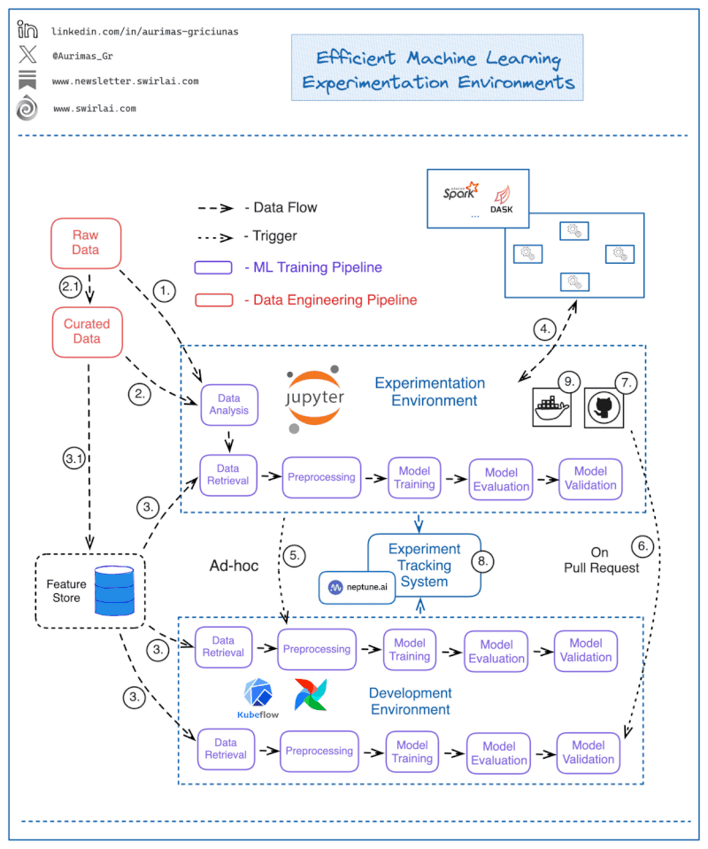

# Введение в MLOps



Источники
* [genai-platform](https://huyenchip.com/2024/07/25/genai-platform.html)
* [ml system design](https://www.linkedin.com/feed/update/activity:7274347641138728961)
* [MLOps maturity model](https://www.linkedin.com/feed/update/activity:7229381328490622976)

## Шаг 1: среда разработки

Скачайте дамп [messages.db](https://drive.google.com/file/d/1Ej6pV_GAXFDGxMk45Dntn2pnSlnn6IRs/view?usp=sharing) и поместите его в директорию [data](./data).

Соберите Docker-контейнер для разработки:

```shell
make build
```

## Шаг 2

Этап EDA (Exploratory Data Analysis): запускаем Jupyter, чтобы исследовать данные.

```shell
make notebook
```

Откройте в браузере ссылку [localhost:8888](http://localhost:8888/).

После EDA сохраните файл [scored_corpus.csv](https://drive.google.com/file/d/1lRpQOCwxwt0JAU9wDUOvhJ3CaYZMYFO_/view?usp=share_link) в директорию `data` (или скачайте его из Google Drive по ссылке).

# Шаг 3: эксплуатация модели

Скачайте размеченный датасет [по ссылке](https://drive.google.com/file/d/1MrxsEbeeJnIMdjL_GjsYysdKADyF5EQo/view?usp=sharing).

Добавьте модель в микросервис.

* [__main__](../src/train.py) — обучить модель с метрикой F1 выше 0.86106:
    * Bert для feature extraction;
    * более сложная модель (бустинг?).
* [pridict_labell](../src/service.py) — загрузить модель в сервис и реализовать API:
    * `feed`
    * `/messages/<string:identifier>'`
* Отправьте PR в репозиторий.

# Experimentation environment

Как выглядит эффективная среда для Machine Learning Experimentation?

Практики MLOps направлены на повышение скорости разработки Machine Learning Product. Основные узкие места возникают, когда Experimentation Environments и другие элементы инфраструктуры плохо интегрированы друг с другом.

Рассмотрим свойства, которыми должна обладать эффективная Experimentation Environment. Как MLOps engineer, вы должны стремиться предоставить пользователям такие возможности. А как Data Scientist — понимать, чего следует требовать от своей среды.

**1. Доступ к raw data.** Хотя обработка raw data относится к зоне ответственности Data Engineering, Data Scientists должны иметь возможность исследовать и анализировать доступные raw data, а также определять, какие из них необходимо переместить выше по Data Value Chain (2.1).

**2. Доступ к curated data.** Curated data могут храниться в Data Warehouse, но при этом не быть доступны через Feature Store. Такие данные не следует использовать для обучения моделей в production environments. Data Scientists должны иметь возможность исследовать curated data и определять, какие данные нужно передать дальше по цепочке (3.1).

**3.** Если ML Training pipeline готов к переходу в production, данные для обучения Machine Learning models должны поступать из Feature Store.

**4.** Data Scientists должны иметь возможность легко запускать compute clusters разных типов — например, Spark, Dask или другие технологии — для эффективного исследования Raw и Curated Data.

**5.** Data Scientists должны иметь возможность по запросу запускать из Notebook удалённый Machine Learning Training pipeline в development environment, максимально близкий к production. Это значительно ускоряет итерации.

**6.** Необходимо настроить автоматизированный процесс тестирования и promotion в среду более высокого уровня при создании определённого набора Pull Requests. Например, PR из ветки `feature/*` в ветку `release/*` может запускать процесс CI/CD, который тестирует и развёртывает ML Pipeline в pre-prod environment.

**7.** Notebooks и любой дополнительный boilerplate code для CI/CD должны быть частью Git integration. Необходимо чётко определить, где должен находиться каждый тип кода. Популярный подход — предоставлять templates репозиториев с понятной документацией.

**8.** Experiment/Model Tracking System должна быть доступна как для local, так и для remote pipelines.

**9.** Notebooks должны работать в той же environment, что и production code. Несовместимые dependencies не должны создавать проблем при переносе приложений в production. Этого можно добиться, запуская Notebooks в containers.

### Основные trade-offs, которые нужно учитывать

| Trade-off | Что следует учитывать |
|---|---|
| **Availability vs Consistency** | CAP theorem. Для ML serving обычно приоритетнее availability: устаревший prediction лучше, чем отсутствие prediction. Для feature stores используйте eventual consistency. |
| **Storage** | Уровни хранения hot/warm/cold: Redis (hot, < 1 ms) → Cassandra/DynamoDB (warm, < 10 ms) → S3/BigQuery (cold, секунды–минуты). По мере старения данных перемещайте их на более низкие уровни. |
| **Messaging** | Kafka подходит для надёжного event streaming с высокой пропускной способностью. Используйте consumer groups для parallel processing. Выполняйте partitioning по user/entity ID, чтобы гарантировать порядок обработки внутри группы. |
| **Caching** | Используйте caching на нескольких уровнях: API response cache, feature cache, embedding cache. TTL должен обеспечивать баланс между актуальностью данных и экономией вычислительных ресурсов. |
| **Autoscaling** | Масштабируйте inference replicas на основе P95 latency или QPS. Учитывайте стоимость cold start, если загрузка модели занимает много времени: поддерживайте warm pool. |
| **Compute** | Для batch jobs выгодно использовать spot/preemptible instances (они дешевле, но их работу могут прервать — проектируйте процессы с учётом idempotency). Для real-time serving нужны on-demand instances, обеспечивающие надёжность. |

# CI/CD

Makefile

```python
tag:
	assets/set_git_tag.sh

make pep8:
	autopep8 --in-place --aggressive --aggressive --recursive .

version:
	assets/increment_version.sh && \
	git add setup.py

clean-cache:
	find . | grep -E "(/__pycache__$|\.pyc$|\.pyo$)" | xargs rm -rf

```

Скрипт Assets set git tag

```python
#!/bin/bash

# Get the current tag name
current_tag=$(git describe --abbrev=0 --tags)

# Parse the current tag and increment the version
old_version=$(echo "$current_tag" | sed -E 's/v([0-9]+\.[0-9]+\.[0-9]+)/\1/')
IFS='.' read -ra version_parts <<< "$old_version"
((version_parts[2]++))
new_version="${version_parts[0]}.${version_parts[1]}.${version_parts[2]}"
new_tag="v$new_version"

# Update the Git tag
git tag -d "$current_tag"           # Delete the old tag locally
git push origin --delete "$current_tag" # Delete the old tag on the remote repository
git tag "$new_tag"                  # Create the new tag locally
git push origin "$new_tag"          # Push the new tag to the remote repository

echo "Git tag updated from $current_tag to $new_tag"
```

Обновление версии

```python
#!/bin/bash

# Input code file
filename="$(pwd)/setup.py"

# Read the current version
current_version=$(grep -o "version='[0-9.]\+'" "$filename" | cut -d"'" -f2)

# Increment the version
IFS='.' read -ra version_parts <<< "$current_version"
((version_parts[2]++))
new_version="${version_parts[0]}.${version_parts[1]}.${version_parts[2]}"

# Escape slashes in the version string for sed (macOS version)
escaped_current_version=$(echo "$current_version" | sed -E 's/\//\\\//g')
escaped_new_version=$(echo "$new_version" | sed -E 's/\//\\\//g')

# Update the version in the file using sed (macOS version)
sed -i '' "s/version='$escaped_current_version'/version='$escaped_new_version'/g" "$filename"

echo "Version updated from $current_version to $new_version"
```

# ML system design

[PDF: ML system design](img/ml_system_design.pdf)

**System design** — это процесс определения компонентов системы, способов их интеграции, API и data models для построения крупномасштабных систем, отвечающих заданному набору функциональных и нефункциональных требований.

- computer networking
- parallel computing
- distributed systems

Цель System design — создавать системы, которые, помимо прочих характеристик, являются надёжными, эффективными и удобными в сопровождении.

- **Reliable systems** обрабатывают сбои, отказы и ошибки.
- **Effective systems** удовлетворяют потребности пользователей и бизнес-требования.
- **Maintainable systems** отличаются гибкостью и легко масштабируются как вверх, так и вниз. Возможность добавлять новые функции также относится к maintainability.

**Abstraction** — это искусство скрывать детали, которые нам не нужны. Это позволяет сосредоточиться на общей картине. Такой взгляд важен, поскольку он помогает не отвлекаться на внутренние сложности, лучше понимать поставленные цели и сохранять фокус на их достижении.

### Процесс интервью

**Задавайте уточняющие вопросы**

- Требования, которые клиент формулирует напрямую. Например, возможность отправлять сообщения друзьям практически в real-time (functional).
- Требования, которые необходимы косвенно. Например, производительность messaging service не должна ухудшаться при росте пользовательской нагрузки (non-functional).

**Работа с данными**

- Каков текущий объём данных?
- С какой скоростью, как ожидается, будут расти данные со временем?
- Как другие подсистемы или конечные пользователи будут использовать эти данные?
- Преобладают ли операции чтения или записи?
- Нужна ли строгая consistency данных или достаточно eventual consistency?
- Каковы требования к durability данных?
- Какие требования к privacy и регулированию необходимо учитывать при хранении или передаче пользовательских данных?

**Обсудите компоненты**

Front-end components, load balancers, caches, databases, firewalls и CDNs — лишь некоторые примеры компонентов системы.

**Обсудите trade-offs**

В большой системе всегда что-то выходит из строя. При проектировании необходимо закладывать fault tolerance и security.
