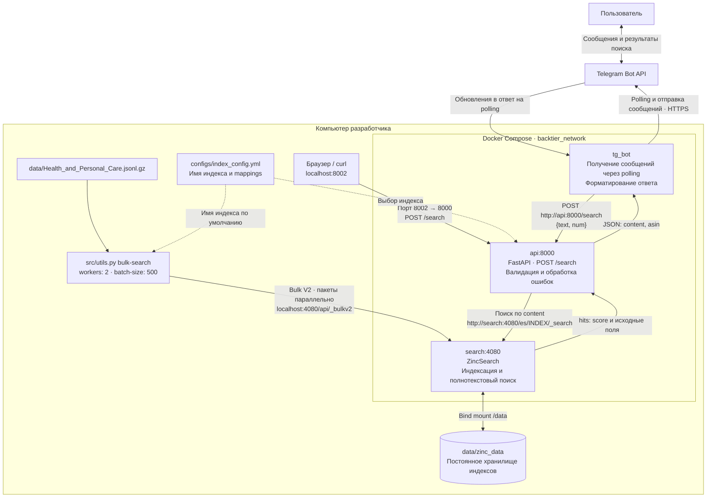
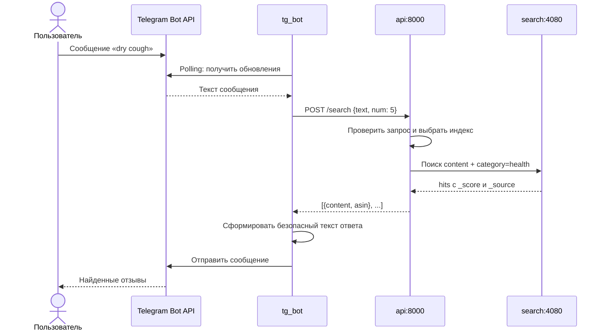

# Лекция: Telegram-бот как интерфейс поисковой системы

---

## План лекции

1. Задача и архитектура системы
2. Контракт между ботом и FastAPI
3. Как FastAPI обращается к ZincSearch
4. Как Telegram-бот обрабатывает сообщения
5. Подготовка индекса: многопоточный пакетный загрузчик
6. Практика: запуск системы по шагам
7. Диагностика и самостоятельная работа

**Результат занятия:** пользователь отправляет боту запрос, например `dry cough`, и получает найденные отзывы на товары.

Используем датасет отзывов `Health_and_Personal_Care.jsonl.gz` из [урока про лексический поиск](../jupyter_notebooks/vol_02_ml_products_01_search.ipynb). Бот возвращает найденные тексты.

---

## 1. Задача и архитектура системы

FastAPI проверяет запрос, обращается к поисковому движку и возвращает результат в формате, понятном боту.



### За что отвечает каждый компонент

| Компонент | Ответственность | Реализация |
|---|---|---|
| `search` — ZincSearch | Хранит индекс, находит и ранжирует документы | [docker-compose.yml](../docker-compose.yml) |
| `api` — FastAPI | Проверяет запрос, вызывает движок, возвращает результаты | [main.py](../dockerfiles/api/src/main.py) |
| `tg_bot` — Telegram-бот | Получает сообщения и показывает ответы | [app.py](../dockerfiles/tg_backend/src/app.py) |
| Консольный загрузчик | Готовит документы и отправляет пакеты в индекс | [utils.py](../src/utils.py) |
| Конфигурация индекса | Mappings, анализатор и имя индекса по умолчанию | [index_config.yml](../configs/index_config.yml) |

**`search` — имя сервиса ZincSearch, `/search` — маршрут FastAPI.**

### Адреса внутри Docker и на компьютере

| Откуда | Куда | Адрес |
|---|---|---|
| Компьютер: браузер, curl, загрузчик | ZincSearch | `http://localhost:4080` |
| Компьютер: браузер или curl | FastAPI | `http://localhost:8002` |
| Бот в контейнере | FastAPI | `http://api:8000/search` |
| FastAPI в контейнере | ZincSearch | `http://search:4080` |

Имена `api` и `search` разрешаются через DNS общей сети `backtier_network`. Внутри контейнера `localhost` означает сам контейнер. Публикация `8002:8000` связывает внешний порт 8002 с внутренним портом 8000; бот использует внутренний адрес и порт.

Индекс хранится в `data/zinc_data` и сохраняется при перезапуске контейнера.

---

## 2. Контракт между ботом и FastAPI

**Контракт API** определяет формат запроса, ответа и ошибок. Благодаря этому боту не нужно знать устройство `hits` в ответе ZincSearch.

```http
POST /search
Content-Type: application/json

{"text": "dry cough", "num": 5}
```

| Поле | Ограничение | По умолчанию |
|---|---|---|
| `text` | Непустая строка до 2000 символов после удаления пробелов по краям | Обязательное |
| `num` | Целое число от 1 до 20 | `5` |

Pydantic проверяет эти правила до обращения к движку. Запрос `{"text":"cough"}` использует `num=5`.

Ответ — массив объектов:

```json
[
  {"content": "Фрагмент найденного отзыва…", "asin": "B003UWD92Q"}
]
```

`content` — фрагмент отзыва до 1000 символов, `asin` — идентификатор товара.

| Ситуация | Результат |
|---|---|
| Найдены документы | HTTP 200 и массив результатов |
| Совпадений нет | HTTP 200 и `[]` |
| Неверные входные данные | HTTP 422 |
| Движок недоступен, не ответил вовремя или вернул серверную ошибку | HTTP 503 |
| Неуспешный запрос к движку другого типа или неожиданный формат ответа | HTTP 502 |

**Пустая выдача и ошибка сервиса различаются.** В первом случае имеет смысл изменить запрос, во втором — повторить попытку позже.

---

## 3. Как FastAPI обращается к ZincSearch

При старте API читает адрес и учётные данные движка из окружения. Имя индекса берётся из `SEARCH_INDEX`, а если оно не задано — из `configs/index_config.yml`. Для Compose по умолчанию используется `index12`.

Обработчик `/search`:

1. Получает проверенный запрос.
2. Вызывает `search` из `ml_tools.utils` с `limit=num` и явной конфигурацией авторизации.
3. Отправляет текстовый запрос по полю `content` и фильтр `category=health`.
4. Извлекает `hits.hits[*]._source`, проверяет поля и формирует ответ.
5. Превращает ошибки движка в понятные HTTP-статусы.

Индекс не создаётся и документы не загружаются при старте API. Если загружен другой индекс или в документах нет `category=health`, поиск не даст ожидаемую выдачу.

Обработчик использует синхронный `requests` и объявлен обычным `def`: FastAPI выполняет его в пуле потоков.

`GET /ping` проверяет работу HTTP-сервиса. Он не проверяет наличие индекса. Для проверки всей поисковой цепочки нужен запрос `/search` по известным документам.

---

## 4. Как Telegram-бот обрабатывает сообщения

### Polling

Бот сам обращается к Telegram Bot API за обновлениями через **long polling**. Поэтому для локальной демонстрации не требуется публичный адрес сервера или webhook.



В [app.py](../dockerfiles/tg_backend/src/app.py) зарегистрированы `/start`, `/help` и обработчик текстовых сообщений.

### Асинхронный вызов API

Бот вызывает FastAPI через `httpx.AsyncClient`: отправляет `{"text": message, "num": 5}` и проверяет ответ. Асинхронный клиент позволяет ожидать сеть без блокировки event loop.

### Формирование ответа

- Для найденных документов показываются идентификаторы товаров и фрагменты отзывов.
- При `[]` бот сообщает «Ничего не найдено».
- При ошибке HTTP или формата ответа — «Поиск временно недоступен».
- Отзывы отправляются обычным текстом; длинный ответ разбивается на несколько сообщений.

Для одного токена запускайте один polling-процесс: второй может вызвать конфликт получения обновлений.

---

## 5. Подготовка индекса: многопоточный пакетный загрузчик

**Если документы уже загружены и поиск работает, повторять этот этап не нужно.** Проверьте имя индекса и используйте его при запуске FastAPI.

Для нового окружения скачайте [датасет отзывов](https://drive.google.com/file/d/12N52kB4D1iqgzSuoWEfNSY3KqVRp10wL/view?usp=drive_link) в `data/Health_and_Personal_Care.jsonl.gz`. Создайте индекс с нужными mappings, например ячейкой из [ноутбука про поиск](../jupyter_notebooks/vol_02_ml_products_01_search.ipynb). Она печатает уникальное имя: подставьте его вместо `index12` в командах ниже и в `SEARCH_INDEX`.

Загрузчик очищает отзывы, присваивает стабильные `_id` и отправляет пакеты через `POST /api/_bulkv2`. Два потока обрабатывают пакеты параллельно; очередь ограничена `2 × workers` пакетами. Прогресс-бар показывает обработанные записи и ошибки. При ошибках команда завершается с ненулевым кодом.

### Запуск `src/utils.py bulk-search`

Запустите из корня репозитория при работающем ZincSearch. В примере используется индекс `index12`; замените его своим.

**Загрузка всего датасета: два потока, пакеты по 500 документов.**

```shell
uv run python src/utils.py bulk-search \
  --data-path data/Health_and_Personal_Care.jsonl.gz \
  --env-file .env \
  --url http://localhost:4080 \
  --index index12 \
  --workers 2 \
  --batch-size 500
```

Справка по параметрам: `uv run python src/utils.py bulk-search --help`.

При повторной загрузке одинаковые `_id` обновляются. Поэтому число обработанных записей может превышать число уникальных документов. Исходный датасет пока читается в память целиком.

Документация: [ZincSearch Bulk V2](https://zincsearch-docs.zinc.dev/api/document/bulkv2/).

---

## 6. Практика: запуск системы по шагам

Нужны Docker Compose, `.env` и заполненный индекс. Для загрузчика — Python-окружение с зависимостями репозитория. **Все команды выполняются из корня репозитория.**

### Шаг 1. Создать бота и настроить `.env`

В Telegram найдите **BotFather**, отправьте `/newbot`, выберите имя и username с окончанием `bot`. Сохраните токен в файле **`.env` в корне репозитория**:

```dotenv
TG_BOT_TOKEN=ЗАМЕНИТЕ_НА_ТОКЕН_ОТ_BOTFATHER
ZINCSEARCH_USERNAME=admin
ZINCSEARCH_PASSWORD=ПАРОЛЬ_ВАШЕГО_ZINCSEARCH
ZINCSEARCH_URL=http://localhost:4080
SEARCH_API_URL=http://api:8000/search
SEARCH_INDEX=index12
```

В `SEARCH_INDEX` укажите имя заполненного индекса, а в `ZINCSEARCH_PASSWORD` — действующий пароль ZincSearch. Compose передаёт токен контейнеру бота и задаёт внутренние адреса сервисов. `.env` с токеном не добавляйте в Git.

После изменения токена пересоздайте контейнер: `docker compose --env-file .env up -d --force-recreate tg_bot`.

### Шаг 2. Запустить движок и проверить данные

```shell
docker compose --env-file .env up -d search
docker compose ps search
docker compose logs --tail=50 search
```

Откройте [ZincSearch UI](http://localhost:4080), проверьте имя индекса, документы и выдачу по `cough`. Если индекс пуст, выполните загрузку из раздела 5. Если данные уже есть, сразу переходите к API.

### Шаг 3. Собрать API и бота

```shell
docker compose --env-file .env build api tg_bot
```

После изменения зависимостей или Dockerfile повторите сборку.

### Шаг 4. Запустить FastAPI

```shell
docker compose --env-file .env up -d api
docker compose logs --tail=50 api
curl --fail-with-body http://localhost:8002/ping
```

Ожидается `{"message":"pong"}`. Swagger: [localhost:8002/docs](http://localhost:8002/docs).

`depends_on` задаёт порядок запуска контейнеров, но не гарантирует готовность API. Поэтому проверяем `/ping` отдельно.

Не запускайте одновременно `make run-service` и Compose `api`: оба занимают внешний порт 8002. Для Telegram-цепочки используйте Compose — его сервисы подключены к общей сети.

### Шаг 5. Проверить `/search` с компьютера

Запрос с ограничением выдачи:

```shell
curl --fail-with-body http://localhost:8002/search \
  -H 'Content-Type: application/json' \
  -d '{"text":"dry cough","num":3}'
```

Ожидается массив до трёх результатов. Сравните его с прямым поиском в UI по тому же индексу. Для проверки валидации отправьте `num=0` или строку из пробелов: ожидается HTTP 422.

### Шаг 6. Проверить связь из сети бота

```shell
docker compose run --rm --no-deps tg_bot python3.12 -c \
  'import os, httpx; r = httpx.post(os.environ["SEARCH_API_URL"], json={"text":"cough","num":3}, timeout=40); r.raise_for_status(); print(r.json())'
```

Одноразовый клиент проверяет доступ к API из сети бота, не запуская Telegram polling.

### Шаг 7. Запустить бота

```shell
docker compose --env-file .env up -d tg_bot
docker compose logs -f tg_bot api
```

В Telegram отправьте `/start`, затем `cough`. Должны прийти найденные фрагменты. `Ctrl+C` останавливает просмотр логов, а контейнеры продолжают работать.

Для остановки только этой цепочки:

```shell
docker compose stop tg_bot api search
```

---

## 7. Диагностика и самостоятельная работа

| Симптом | Что проверить |
|---|---|
| API не запускается | Логи, `command: serve`, зависимости, доступность `src.main` и `ml_tools.utils` |
| Бот не подключается к API | `http://api:8000/search`, общая сеть, готовность API; `http://api/search` использует порт 80 |
| API не видит движок | В API должен быть `http://search:4080`, а не `localhost:4080` |
| HTTP 404 на `/search` | Запущен ли контейнер с актуальным `main.py` |
| HTTP 422 | Непустой `text`, допустимый `num`, корректный JSON |
| HTTP 503/502 | Доступность движка, пароль, имя индекса, формат ответа |
| Выдача пуста | Совпадает ли `SEARCH_INDEX` с загруженным индексом, есть ли `content` и `category=health` |
| Порт 8002 занят | Не работает ли одновременно standalone `make run-service` |
| Polling conflict | Не запущен ли второй бот с тем же токеном |
| Ошибки пакетной загрузки | Ответ движка, ресурсы, размер пакета, число потоков и учётные данные |

### Задания

1. Проследите один запрос в коде: обработчик Telegram → `dialog_router` → `/search` → `utils.search`. Объясните, где используется каждый адрес.
2. Сравните ответы для запроса без `num`, с `num=1` и с `num=20`.
3. Найдите пример нерелевантного совпадения и объясните, почему лексический поиск его вернул.
4. В тестовом окружении остановите `search`, проверьте сообщение бота и восстановление после запуска движка.
5. Сравните время загрузки одним и двумя потоками на отдельном учебном индексе. Корпус и размер пакета должны совпадать.

## Итоги

Telegram отвечает за интерфейс, FastAPI — за контракт и обработку запроса, ZincSearch — за индекс и поиск. Индексация выполняется заранее. Проверяйте систему по звеньям: индекс → API → сеть контейнера бота → Telegram.

Дополнительный материал: [презентация с общей архитектурой](https://docs.google.com/presentation/d/1S-5vpi4DNdCQTRBHH-12M4ACZDnJosqM7MQFJdNOqZE/edit?usp=sharing).
