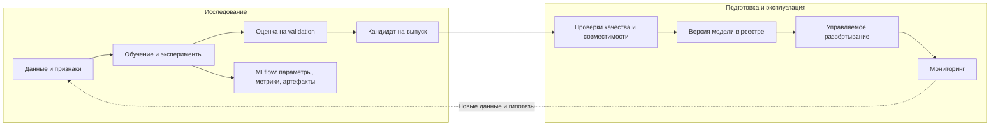
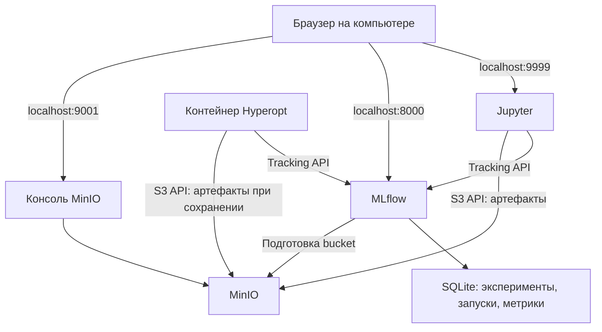
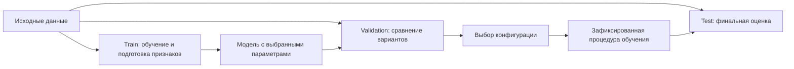
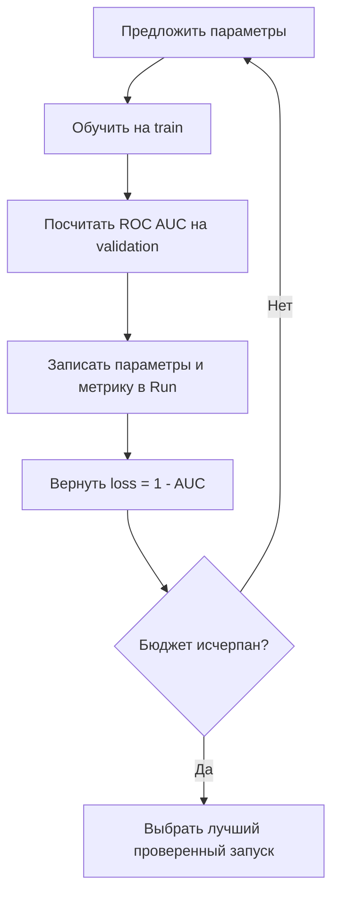

# Лекция: MLflow и Hyperopt — от эксперимента к версии модели

## Ноутбуки и порядок практики

| Шаг | Материал | Что сделать |
| --- | --- | --- |
| 1 | [Классификатор с MLflow](../jupyter_notebooks/vol_01_ml_products_02_mflow_powered_classifier.ipynb) | Поднять локальное окружение, изучить данные RTB и обучить CatBoost. |
| 2 | [Подбор гиперпараметров](../src/parameters_tuning.py) | Разобрать пространство поиска, целевую функцию и запись результатов в MLflow. |
| 3 | [Регистрация модели](../src/register_model.py) | Проследить выбор запуска, сохранение артефакта и создание версии в реестре. |

**После занятия вы сможете** объяснить различия между Experiment, Run и версией модели; организовать сравнение экспериментов; задать поиск гиперпараметров и проверить, что сохранённая модель соответствует выбранному результату.

## План лекции и таймкоды

Общая длительность записи — **1 ч 24 мин 53 с**. Таймкоды относятся к исходной записи; организационное начало и техническая пауза примерно **27:02–40:14** не включены в содержательный разбор.

1. ML-платформа: исследования и эксплуатация — **04:12–15:39**.
2. Зачем отслеживать эксперименты — **15:39–20:48**.
3. Локальный стенд: MLflow, MinIO и Jupyter — **20:48–45:29**.
4. Базовая модель CatBoost на данных RTB — **45:29–56:51**.
5. Автоматизация обучения и Hyperopt — **56:51–1:11:57**.
6. Выбор запуска, регистрация и получение модели — **1:11:57–1:24:53**.

Конспект следует записи, а методологические уточнения и замечания к текущему коду выделены явно. Команды ниже воспроизводят учебный стенд; исправления целевой функции и регистрации в этой лекции показаны как задания и примеры, а не как уже внесённые изменения в Python-файлы.

---

## 1. Где MLflow находится в ML-платформе `[04:12 – 15:39]`

Между исследованием гипотезы и работающим продуктом есть несколько переходов: подготовка данных, обучение, оценка, сохранение модели, проверка совместимости и выпуск. На каждом переходе необходимо понимать, какие данные и настройки привели к результату.

В исследовательском окружении команда быстро меняет признаки, параметры и способы обучения. В production важны повторяемость процедуры, проверка качества и управляемый выпуск. Подробная схема этих окружений разобрана в [лекции о MLOps](lecture_09_mlops_intro.md).



**MLflow помогает сохранить историю и связать результат с запуском.** Сам по себе он не гарантирует корректность разбиения данных, полезность модели для бизнеса или безопасность её выпуска.

В записи также обсуждается feature store. Это инфраструктура управления признаками: их определениями, вычислением и предоставлением для обучения и/или обслуживания запросов. Обычная таблица с признаками может быть частью такого решения, но наличие таблицы ещё не обеспечивает согласованность offline- и online-признаков. В этом практикуме отдельный feature store не разворачивается.

---

## 2. Зачем отслеживать эксперименты `[15:39 – 20:48]`

Представьте, что вчера модель показала лучший ROC AUC, а сегодня результат не воспроизводится. Одного файла `model.cb` недостаточно: нужны версия данных, список признаков, параметры обучения и точное определение метрики.

Таблица с результатами и ручная передача файлов работают до тех пор, пока команда может надёжно сопоставлять все эти сущности. С ростом числа запусков такое сопоставление становится источником ошибок.

### Основные сущности MLflow

| Сущность | Что означает | Пример в практикуме |
| --- | --- | --- |
| Experiment | Группа связанных запусков | `catboost-params-1` |
| Run | Одна попытка обучения и оценки | CatBoost с конкретными `depth` и `learning_rate` |
| Parameters | Настройки запуска | Число итераций, глубина дерева |
| Metrics | Измеренные числовые результаты | ROC AUC на validation |
| Tags | Дополнительный контекст | Commit, версия датасета, назначение запуска |
| Artifacts | Файлы, связанные с запуском | Модель, список признаков, график ошибок |
| Registered model | Именованная модель в реестре | Классификатор RTB |
| Model version | Конкретная версия зарегистрированной модели | Версия со ссылкой на артефакт выбранного запуска |

**Experiment объединяет запуски, а Run фиксирует одну попытку.** Регистрация создаёт запись о версии модели; она не запускает API и не направляет на модель пользовательский трафик.

### Что необходимо сохранять

Для осмысленного сравнения нужны не только метрика и гиперпараметры:

- источник и версия данных, правила фильтрации;
- состав признаков, обработка пропусков и категорий;
- способ разбиения и временные границы выборок;
- версия кода, зависимости и random seed;
- определение метрики и выборка, на которой она рассчитана;
- артефакт модели и схема её входа.

MLflow сохраняет то, что вы передали через API или поддерживаемый механизм автоматического логирования. Вызов `log_params()` не сохраняет автоматически датасет и весь процесс подготовки признаков.

---

## 3. Локальный стенд `[20:48 – 45:29]`

В практикуме используются три сервиса:

| Компонент | Назначение | Адрес с компьютера |
| --- | --- | --- |
| MLflow | Tracking API, интерфейс и реестр | [localhost:8000](http://localhost:8000/) |
| MinIO | S3-совместимое хранилище артефактов | API: `localhost:9000`; [консоль: localhost:9001](http://localhost:9001/) |
| Jupyter | Выполнение учебного ноутбука | [localhost:9999](http://localhost:9999/) |

Метаданные MLflow сохраняются в SQLite, файлы моделей — в MinIO. Это два разных хранилища: база метаданных отвечает на вопрос «какой запуск?», объектное хранилище — «где его файлы?».



В текущей конфигурации используется S3 URI артефактов, поэтому клиентам, сохраняющим или скачивающим файлы напрямую, нужны доступ к MinIO и соответствующие переменные окружения. Не следует считать, что любой доступ к файлам обязательно проходит через Tracking API.

### Адрес зависит от места запуска

| Клиент | Tracking URI | S3 endpoint |
| --- | --- | --- |
| Jupyter или контейнер обучения в сети Compose | `http://mlflow_container_ui:8000` | `http://minio:9000` |
| Python на вашем компьютере | `http://localhost:8000` | `http://localhost:9000` |

`localhost` внутри контейнера указывает на сам контейнер. Имена сервисов Docker не предназначены для обращения из браузера на компьютере.

### Подготовка `.env`

Если `.env` ещё нет, создайте его на основе [env.template](../env.template). Существующий файл не перезаписывайте. Для этого стенда проверьте следующие настройки:

```dotenv
DATA_DIR=/opt/ml/data
MLFLOW_HOME=/srv/mlflow
MLFLOW_PORT=8000
MLFLOW_NUM_WORKERS=3
MLFLOW_S3_ENDPOINT_URL=http://minio:9000
AWS_BUCKET_NAME=mlflow
AWS_ACCESS_KEY_ID=<ваш логин MinIO>
AWS_SECRET_ACCESS_KEY=<ваш пароль MinIO>
MINIO_ROOT_USER=<тот же логин MinIO>
MINIO_ROOT_PASSWORD=<тот же пароль MinIO>
MINIO_ADDRESS=:9000
MINIO_CONSOLE_ADDRESS=:9001
```

Замените значения в угловых скобках. Настройки доступа клиента и сервера MinIO должны совпадать. Секреты храните в локальном `.env`, а не в ноутбуке или коммитах.

**Особенность репозитория:** в шаблоне `DATA_DIR=/srv/data`, но Jupyter и контейнер подбора монтируют данные в `/opt/ml/data`. Для этого практикума нужен второй путь. Имя bucket `mlflow` также согласовано с жёстко заданным `s3://mlflow` в скрипте подбора.

### Порядок запуска

Команды выполняются из корня репозитория:

```bash
make prepare-dirs
make build-sagemaker
make run-mlflow
```

Последняя команда занимает терминал и выводит логи. По [docker-compose.yml](../docker-compose.yml) вместе с MLflow запускаются зависимости MinIO и Jupyter. Открывайте интерфейсы после готовности сервисов; `depends_on` сам по себе не проверяет их готовность.

В Jupyter откройте `vol_01_ml_products_02_mflow_powered_classifier.ipynb`. Если сервер запросит токен, используйте ссылку из его логов. Убедитесь, что файл `data/rtb_classification_data.csv.gz` существует на компьютере и виден в контейнере как `/opt/ml/data/rtb_classification_data.csv.gz`.

В записи значительное время занимает конфликт портов. Если порт 8000 уже использует другой учебный сервис, освободите его либо согласованно измените проброс порта и адрес клиента. Переменная `MLFLOW_MAPPED_PORT` из шаблона сейчас не меняет жёстко заданное `8000:8000` в Compose.

Практикум использует API MLflow 2.x: в зависимостях сервера указана версия 2.12.2, клиента — 2.16.2. При обновлении окружения проверяйте совместимость версий; примеры для MLflow 3 могут использовать другие сущности и сигнатуры.

---

## 4. Базовый классификатор RTB `[45:29 – 56:51]`

RTB — аукцион покупки рекламного показа в реальном времени. В учебном датасете есть бинарный `target`, цена и категориальные признаки, среди которых тип устройства, DSP, SSP и час. Смысл целевого события и доступность каждого признака в момент предсказания необходимо проверить до обучения.

### Что делает ноутбук

1. Загружает сжатый CSV и показывает распределение `target`.
2. Отбирает столбцы через `get_valuable_columns()`.
3. Формирует числовые и категориальные признаки.
4. Обучает `CatBoostClassifier` и сохраняет `model.cb`.
5. Показывает важности признаков и вероятности класса 1 через `predict_proba()`.

Функция `get_valuable_columns()` исключает столбцы, у которых одно значение занимает более 95% наблюдений. Это эвристика удаления почти постоянных столбцов, **а не оценка предсказательной ценности**. Редкий признак может быть полезен; решение о его исключении требует проверки. Правила отбора нужно определять по обучающей части.

Важность признака тоже не означает причинного влияния. Например, сильный признак может оказаться утечкой информации, которая появилась только после целевого события.

### Где должна появиться честная оценка

В ноутбуке оставлен `TODO` на train/test split, а в текущем подборе качество считается на данных обучения. Поэтому полученную метрику нельзя использовать как оценку работы на новых данных.



Для временного процесса предпочтительно проверять на более поздних данных. Если у одного пользователя или устройства много событий, подумайте также о группировке: случайное разбиение строк может сделать оценку слишком оптимистичной. Способ разбиения должен соответствовать будущим запросам модели.

ROC AUC оценивает ранжирование положительных и отрицательных объектов. Он не определяет рабочий порог, калибровку вероятностей или экономический эффект. При дисбалансе полезно дополнительно смотреть PR AUC, precision/recall и стоимость ошибок при выбранном пороге.

---

## 5. Hyperopt и автоматизация обучения `[56:51 – 1:11:57]`

После базовой модели возникает вопрос: какие настройки стоит попробовать следующими? Число комбинаций дискретной сетки равно произведению числа вариантов каждого параметра. При добавлении параметров полный перебор быстро становится дорогим.

| Подход | Как выбирает следующую конфигурацию |
| --- | --- |
| Grid search | Перебирает точки заранее заданной сетки |
| Random search | Сэмплирует конфигурации из распределений |
| TPE в Hyperopt | После начального исследования использует историю результатов для предложения следующих конфигураций |

TPE не гарантирует глобальный оптимум. `max_evals=12` означает бюджет в 12 испытаний, а не 12 моделей, оставшихся после отбрасывания ветвей. При таком малом бюджете важно проверить настройки начальной случайной фазы: поиск может завершиться до содержательной адаптации к результатам.

### Контракт целевой функции

**Hyperopt минимизирует `loss`.** Если мы хотим максимизировать validation ROC AUC, возвращаем `1 - auc` либо `-auc`, а в MLflow отдельно сохраняем сам положительный ROC AUC.



Ниже — исправленный шаблон функции для самостоятельной работы. Предполагается, что `train_pool`, `valid_pool` и `y_valid` уже получены из раздельных выборок, а Tracking URI и Experiment настроены. Здесь модель сохраняется в каждом запуске, чтобы её можно было однозначно связать с метрикой.

```python
import mlflow
from catboost import CatBoostClassifier
from hyperopt import STATUS_OK
from sklearn.metrics import roc_auc_score


def objective(sampled_params):
    params = {
        **sampled_params,
        "iterations": int(sampled_params["iterations"]),
        "depth": int(sampled_params["depth"]),
        "loss_function": "Logloss",
        "random_seed": 42,
        "verbose": False,
    }
    with mlflow.start_run():
        mlflow.log_params(params)
        model = CatBoostClassifier(**params)
        model.fit(train_pool)
        probabilities = model.predict_proba(valid_pool)[:, 1]
        auc = roc_auc_score(y_valid, probabilities)
        mlflow.log_metric("roc_auc_valid", auc)
        mlflow.catboost.log_model(model, artifact_path="model")
    return {"loss": 1.0 - auc, "status": STATUS_OK}
```

В текущем [пространстве поиска](../src/parameters_tuning.py) меняются `iterations`, `learning_rate`, `depth` и `l2_leaf_reg`. `hp.quniform()` возвращает числовые значения с заданным шагом, но для целочисленных параметров CatBoost требуется явное приведение типа. Seed генератора поиска фиксирует последовательность предложений; для воспроизводимости нужны также настройки модели, разбиение и версия данных.

### Запуск существующего скрипта

Во втором терминале:

```bash
make run-param-tuning
```

Цель Makefile запускает `param_search` в [entrypoint контейнера](../dockerfiles/sagemaker/docker-entrypoint.sh), который вызывает [src/parameters_tuning.py](../src/parameters_tuning.py). Название образа `sagemaker:latest` здесь обозначает локальный контейнер с соглашениями о каталогах; облачный AWS SageMaker этой командой не запускается.

**Перед интерпретацией результата исправьте две ошибки текущего скрипта:** оценку на обучающей выборке и возврат положительного ROC AUC как минимизируемой функции. Иначе MLflow будет показывать историю методологически неверного поиска. Проверьте также типы `iterations` и `depth`.

Текущий скрипт читает только первые 1000 строк и выполняет 12 испытаний. Это демонстрационный бюджет, а не полноценный поиск по всему датасету. После изменения имени метрики на `roc_auc_valid` нужно согласованно обновить код выбора лучшего запуска.

---

## 6. От запуска к версии модели `[1:11:57 – 1:24:53]`

### Сравнение в интерфейсе

Откройте Experiment и выберите несколько запусков. Сопоставьте параметры и метрики, затем проверьте, одинаковы ли данные, разбиение и определение метрики. Высокий ROC AUC на train нельзя напрямую сравнивать с более низким ROC AUC на validation.

«Лучший запуск» означает **лучший среди завершённых сопоставимых испытаний по выбранному критерию**. Это не доказательство глобального оптимума и не автоматическое разрешение на выпуск.

### Выбор через SDK

Пример для исправленного шаблона выше использует `roc_auc_valid`. Для исходного скрипта имя метрики другое — `roc_auc`.

```python
from mlflow.tracking import MlflowClient

client = MlflowClient()
experiment = client.get_experiment_by_name("catboost-params-1")
if experiment is None:
    raise RuntimeError("Эксперимент не найден")

runs = client.search_runs(
    experiment_ids=[experiment.experiment_id],
    filter_string="attributes.status = 'FINISHED' AND metrics.roc_auc_valid >= 0",
    order_by=["metrics.roc_auc_valid DESC"],
    max_results=1,
)
if not runs:
    raise RuntimeError("Нет завершённых запусков с validation-метрикой")

best_run = runs[0]
model_uri = f"runs:/{best_run.info.run_id}/model"
```

MLflow возвращает параметры запуска строками. При повторном обучении восстанавливайте типы по схеме: `depth` и `iterations` — целые, `learning_rate` и `l2_leaf_reg` — вещественные. Приведение всех параметров к `float` недостаточно.

### Почему важно сохранять именно выбранную модель

У реестра должна быть проверяемая цепочка:

**версия модели → артефакт → run ID → параметры, данные и метрика**.

В текущем [src/register_model.py](../src/register_model.py) находится важная ошибка: скрипт выбирает лучший запуск, но затем обучает модель с параметрами из [configs/model_config.json](../configs/model_config.json). Параметры выбранного запуска не передаются в обучение. Поэтому прикреплённая модель может не соответствовать метрике этого запуска.

Есть два корректных варианта:

1. Сохранить модель при каждом испытании и зарегистрировать артефакт выбранного запуска.
2. Создать отдельный финальный запуск, восстановить выбранные параметры, обучить модель по зафиксированной процедуре и записать собственные метрики и артефакты. Сохранить ссылку на исходный HPO-запуск.

Для первого варианта, если модель уже сохранена через `mlflow.catboost.log_model()`:

```python
registered_version = mlflow.register_model(
    model_uri=model_uri,
    name="rtb-catboost-classifier",
)
```

Обычный `mlflow.log_artifact()` сохраняет файл `.cb`. Он не создаёт автоматически MLflow Model с файлом `MLmodel` и описанием flavor. Для загрузки через MLflow и дальнейшего обслуживания используйте соответствующий flavor; дополнительно задайте и проверьте схему входа и пример данных.

### Команда регистрации из записи

```bash
make run-model-register
```

Эта команда запускает существующий скрипт и демонстрирует механизм регистрации. **До исправления передачи параметров её результат нельзя считать подтверждённой лучшей моделью.** Текущее имя в реестре `rf-best-model` тоже стоит заменить: в практикуме обучается CatBoost, а не Random Forest.

### Получение артефакта

В записи файл модели просматривается в MinIO и скачивается через boto3. Для программного получения удобнее использовать URI запуска:

```python
local_model_dir = mlflow.artifacts.download_artifacts(
    artifact_uri=model_uri,
)
```

Для S3-артефактов клиенту нужны корректный endpoint и доступ к bucket. Если сохранена MLflow-модель CatBoost, её можно загрузить через `mlflow.catboost.load_model(model_uri)`. Если сохранён только `.cb`, используйте загрузку файла средствами CatBoost.

Получение файла, создание версии в реестре и развёртывание сервиса — отдельные действия. После регистрации ещё нужны проверки входных данных, качества, задержки и процедура выпуска.

---

## Практикум: что проверить и исправить

| Шаг | Критерий готовности |
| --- | --- |
| Поднять стенд | Доступны MLflow и MinIO; ноутбук видит датасет |
| Подготовить выборки | Train, validation и test разделены с учётом времени и связанных объектов |
| Обучить baseline | Есть validation-метрики и воспроизводимый список признаков |
| Исправить objective | Минимизируется `1 - validation AUC`, параметры имеют нужные типы |
| Запустить поиск | Каждому испытанию соответствует Run с параметрами и метрикой |
| Выбрать модель | Сравниваются завершённые запуски с одинаковой процедурой оценки |
| Сохранить и зарегистрировать | Артефакт соответствует выбранным параметрам; цепочка до run ID проверяется |
| Проверить загрузку | Модель загружается заново и выдаёт те же предсказания на фиксированном примере |

### Типичные проблемы

| Симптом | Что проверить |
| --- | --- |
| Не найден CSV | Наличие файла на хосте, volume и `DATA_DIR=/opt/ml/data` |
| Порт 8000 занят | Другие API и стенды; согласованность Compose и адресов клиентов |
| Не разрешается имя MLflow | Запущен ли клиент в Docker-сети; на хосте используйте `localhost` |
| Не найдена Docker-сеть | Makefile ожидает `ai_product_engineer_backtier_network`; другое имя проекта Compose меняет префикс |
| Ошибка доступа к MinIO | Endpoint, совпадение credentials, наличие bucket `mlflow` и готовность сервиса |
| Нет подходящих запусков | Имя Experiment, статус Run и имя метрики в фильтре |
| У Run нет модели | Исходная objective логирует параметры и метрику, но не артефакт модели |
| AUC растёт, а Hyperopt выбирает худшее | Направление оптимизации: `fmin` минимизирует loss |
| Зарегистрированная модель не повторяет результат | Параметры финального обучения, данные, признаки и соответствие артефакта запуску |

## Вопросы для самопроверки

1. Почему одного файла модели недостаточно для воспроизведения эксперимента?
2. Чем Experiment отличается от Run и версии модели в реестре?
3. Почему метрика на train не подходит для выбора гиперпараметров?
4. Как превратить максимизацию ROC AUC в задачу минимизации Hyperopt?
5. Почему 12 испытаний не гарантируют ни лучший набор параметров, ни работу адаптивной фазы TPE?
6. Как доказать, что артефакт в реестре соответствует метрике выбранного запуска?
7. Что нужно сделать после регистрации, чтобы модель начала обслуживать запросы?

## Самостоятельная работа

Исправьте разбиение и целевую функцию, проведите небольшой поиск и сохраните модель каждого испытания. Выберите лучший validation-запуск, загрузите его модель в новом процессе и сравните предсказания на фиксированном примере. Test используйте после фиксации решения, а не для повторного подбора настроек.

Добавьте в запуск версию данных, commit, список признаков и способ разбиения. Объясните, какие из этих сведений понадобятся коллеге для повторения результата через месяц.

## Материалы

- [Практический ноутбук](../jupyter_notebooks/vol_01_ml_products_02_mflow_powered_classifier.ipynb).
- [Обучение модели](../src/train.py), [подбор параметров](../src/parameters_tuning.py), [регистрация](../src/register_model.py).
- [Makefile](../Makefile), [Docker Compose](../docker-compose.yml), [запуск MLflow](../dockerfiles/mlflow/docker-entrypoint.sh).
- [MLflow 2.12.2: Tracking](https://mlflow.org/docs/2.12.2/tracking.html).
- [MLflow 2.12.2: Model Registry](https://mlflow.org/docs/2.12.2/model-registry.html).
- [Hyperopt: минимизация целевой функции](https://hyperopt.github.io/hyperopt/getting-started/minimizing_functions/).
