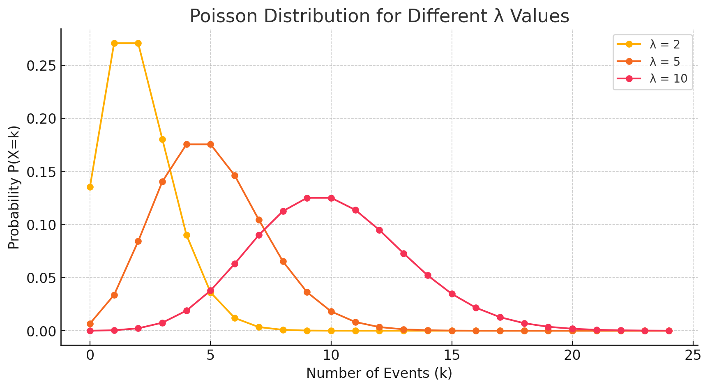
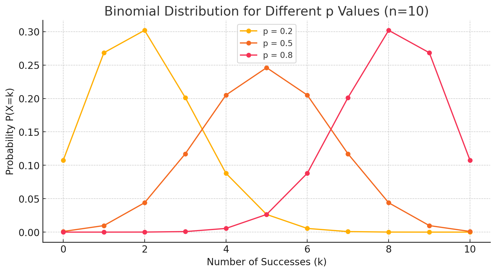
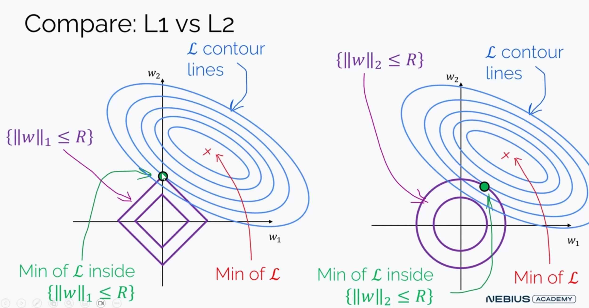

# Machine Learning & Statistics: 39 Questions and Practical Cases

Этот файл — банк вопросов для самопроверки и обсуждения. **Q1–Q29** покрывают основные темы, **Q30–Q39** проверяют решения в практических ситуациях, в конце — две расчётные задачи.

Как готовиться: сначала дайте ответ за 30–60 секунд без подсказок, затем назовите необходимые предположения и разберите контрпример. Длинные пояснения ниже — опорные ответы, а не текст для заучивания.

* [Q30–Q39: практические ситуации](#practical-cases)
* [Расчётные задачи](#bonus-tasks)

## Q1 Probability distributions


### Normal distribution

#### Role of Sigma (σ)

- **σ (Standard Deviation)** tells how much the data deviates from the mean.
- **A smaller σ** → The data is closely packed around the mean.
- **A larger σ** → The data is more spread out.

#### Empirical Rule (68-95-99.7 Rule)

For a normal distribution:

- **68%** of data lies within **1σ** of the mean (μ ± 1σ).
- **95%** of data lies within **2σ** of the mean (μ ± 2σ).
- **99.7%** of data lies within **3σ** of the mean (μ ± 3σ).

---

### Poisson Distribution

The **Poisson distribution** is a probability distribution that models the number of **events occurring in a fixed interval** (time, space, area) when these events happen **independently** and at a **constant average rate (λ)**.

#### 1. Poisson Distribution Formula

$$
P(X = k) = \frac{e^{-\lambda} \lambda^k}{k!}
$$

Where:

- $k$ = Number of occurrences (0, 1, 2, …)
- $\lambda$ = Expected number of occurrences per interval
- $e$ = Euler's number (≈2.718)
- $k!$ = Factorial of k

#### 2. Key Characteristics

- ✅ **Discrete:** Poisson is used for count data (e.g., customer arrivals, defects in manufacturing).
- ✅ **λ is the Mean & Variance:** The average and variance of a Poisson distribution are both equal to λ.
- ✅ **No Upper Bound:** Theoretically, any number of events can occur.
- ✅ **Used when Events are Independent:** One event happening does not affect another.

#### 3. Poisson Distribution Graphs

Poisson distribution graphs for different values of **λ** (expected occurrences per interval): **λ = 2, 5, 10**.



- **λ = 2:** The distribution is skewed to the left, meaning most events happen around 2 times per interval.
- **λ = 5:** The distribution shifts right, and the peak moves around 5.
- **λ = 10:** The distribution is more spread out, with most events occurring around 10.

As **λ increases**, the Poisson distribution starts looking more like a **normal distribution** due to the **Central Limit Theorem**.

---

### Binomial distribution

The **Binomial distribution** models the number of successes in a fixed number of independent trials, each with the same probability of success.

#### 1. Binomial Distribution Formula

$$
P(X = k) = \binom{n}{k} p^k (1-p)^{n-k}
$$

Where:

- $n$ = Total number of trials
- $k$ = Number of successes
- $p$ = Probability of success in each trial
- $\binom{n}{k}$ = Combination formula, which calculates the number of ways to get k successes in n trials



- **p = 0.2** (Low success probability): Most outcomes cluster around **fewer successes**.
- **p = 0.5** (Fair coin flip): The distribution is **symmetrical**, centered around **n/2**.
- **p = 0.8** (High success probability): The distribution skews **towards higher values**.

#### 2. Key Characteristics

- ✅ **Discrete:** The binomial distribution is used for counting the number of successes.
- ✅ **Two Possible Outcomes:** Each trial is either a **success** or a **failure** (e.g., heads or tails in a coin flip).
- ✅ **Fixed Number of Trials:** Unlike the Poisson distribution, where events happen randomly over time, binomial experiments have a **fixed n**.
- ✅ **Independent Events:** One trial's outcome does not affect another.


## Q2 — Law of Large Numbers vs Central Limit Theorem

**Question:** What does each theorem say about a sample mean, and what assumptions are needed?

**Short answer:** LLN describes convergence of the sample mean to a constant. CLT describes the limiting distribution of the **centered and scaled** sample mean. Neither theorem says the original observations become normally distributed.

### Law of Large Numbers (LLN)

A standard sufficient setting is i.i.d. observations with finite absolute expectation:

$$
\bar X_n\xrightarrow{P}\mu,\qquad E[|X|]<\infty.
$$

For example, the observed fraction of heads stabilizes around the probability of heads. LLN alone does not specify a convergence rate or prove convergence of a model-training algorithm.

### Central Limit Theorem (CLT)

For i.i.d. observations with finite, nonzero variance:

$$
\frac{\sqrt n(\bar X_n-\mu)}{\sigma}\xrightarrow{d}N(0,1),
\qquad 0<\sigma^2<\infty.
$$

There is **no universal sample-size cutoff of 30**. Approximation quality depends on tails, skewness and, for rare events, the effective number of observed events. Dependence between observations requires other conditions or a different analysis.

| Question | LLN | CLT |
| --- | --- | --- |
| What converges? | Sample mean | Centered and scaled sample mean |
| To what? | Constant μ | A standard normal distribution |
| Finite variance needed in this standard statement? | No; finite absolute expectation suffices | Yes, and variance is positive |
| Typical use | Consistency of averages | Approximate uncertainty of averages |

### Practical applications and limits

At a **fixed** parameter vector, an average of independently sampled, integrable stochastic gradients can approach the expected gradient as batch size grows. Convergence of SGD iterates additionally depends on the objective, sampling, step sizes and other assumptions. It does not follow from LLN alone.

Asymptotic normality of suitably averaged SGD iterates is an advanced result under additional assumptions, not a general consequence of the elementary CLT for arbitrary neural-network training.

For an i.i.d. sample with suitable moments, an approximate two-sided interval for a mean is:

$$
\bar X\pm z_{1-\alpha/2}\frac{s}{\sqrt n}.
$$

This is not valid for every distribution at every large n. Repeated measurements, clusters and heavy tails can invalidate the usual standard-error calculation. Bootstrap also needs a resampling scheme appropriate to the data and statistic; resampling individual rows is not universally valid.

**Follow-up:** A million events come from only 100 users. Can the standard error always be divided by the square root of a million? No: within-user dependence may make the effective information much smaller; consider user-level analysis or cluster resampling.

---

## Q3 — EDA on Single Feature Dataset

### Metrics to Calculate For Numerical Feature:


- Mean: $\bar{x} = \frac{1}{n}\sum x_i$
- Median: Middle value when sorted
- Mode: Most frequent value
- Variance: $s^2 = \frac{1}{n-1}\sum(x_i - \bar{x})^2$
- Standard Deviation: $s = \sqrt{s^2}$
- IQR (Interquartile Range): $Q_3 - Q_1$
- Min, Max, Range
- Skewness: Measures asymmetry
- Kurtosis: Measures tail heaviness

**Simple case 1**: Effect of Multiplying by Constant k on Variance

If all values multiplied by k:

$$
\text{Var}(kX) = k^2 \cdot \text{Var}(X)
$$

Example: Multiply by 2 → variance increases by 4×

### Comparing Two Datasets

**Statistical Tests:**
- **Welch t-test:** Compare independent-group means; exact small-sample assumptions and large-sample approximation must be checked. Normality of all raw observations is not a universal prerequisite for every large-sample use.
- **Mann–Whitney U:** Compare relative ordering / distributions. It is not automatically a test of equality of medians; that interpretation needs additional shape assumptions.
- **KS test:** Compare empirical distributions; the standard continuous-distribution version needs care with ties and discrete data.
- **Chi-square:** Test categorical counts with appropriate expected counts and independence assumptions.

Choose the test for the estimand and sampling design. Statistical significance alone does not establish a practically meaningful difference.

**Visual Comparison:**
- Overlaid histograms
- Box plots side-by-side
- Q-Q plot (one dist vs another)

If Dataset Contains Only 0s and 1s (CTR - Click-Through Rate) - this is Binary/Bernoulli data (What sort of data distribution would be relevant to flipping heads or tails on a coin), metrics for this case:

- Mean: $p$ (proportion of 1s, CTR rate)
- Variance: $p(1-p)$

**References:**
- [Exploratory Data Analysis - Wikipedia](https://en.wikipedia.org/wiki/Exploratory_data_analysis)
- [Statistical Hypothesis Testing](https://en.wikipedia.org/wiki/Statistical_hypothesis_testing)

---

## Q4 — Correlation Types

| Type X | Type Y | Method to Use |
|--------|--------|---------------|
| **Numerical** | **Numerical** | **Pearson** (linear), **Spearman** (monotonic) |
| **Categorical** | **Categorical** | **Cramér's V**, χ² test |
| **Categorical** | **Numerical** | **Correlation Ratio (η)**, ANOVA |
| **Binary (0/1)** | **Numerical** | **Point-Biserial** |
| **Ordinal** | **Numerical** | **Spearman**, **Kendall** |
| **Categorical** | **Binary target** | **Mutual Information**, **WoE** |

### Pearson Correlation

Use when both variables numerical, relationship is linear

$$
r = \frac{\sum(x_i - \bar{x})(y_i - \bar{y})}{\sqrt{\sum(x_i - \bar{x})^2 \sum(y_i - \bar{y})^2}}
$$

**Range:** [-1, 1]
- 1 = perfect positive linear relationship
- 0 = no linear relationship
- -1 = perfect negative linear relationship

**Spearman Correlation**: Use when: Non-linear monotonic relationship, Outliers present, Ordinal data

### Cramér's V (Categorical ↔ Categorical)

$$
V = \sqrt{\frac{\chi^2}{n \cdot \min(k-1, r-1)}}
$$

**TO DO**: add chi-squared formula

Where:
- χ² = Chi-square statistic
- n = sample size
- k = number of columns
- r = number of rows

**Range:** [0, 1]: 0 = no association, 1 = perfect association


**References:**
- [Point-Biserial Correlation - Wikipedia](https://en.wikipedia.org/wiki/Point-biserial_correlation_coefficient)
- [Cramér's V Tutorial](https://www.spss-tutorials.com/cramers-v-what-and-why/)
- [Correlation and Dependence - Wikipedia](https://en.wikipedia.org/wiki/Correlation_and_dependence)

---

## Q5 — Entropy

Entropy = Measure of Uncertainty

Simple test: How hard is it to guess the next element?
```
Sequence: AAAAAA
Easy to predict → Low uncertainty → Low entropy
---
Sequence: AG4l9Pq!D8...
Hard to predict → High uncertainty → High entropy
```

[deep dive to entropy](https://github.com/aleksandr-dzhumurat/ai_product_engineer/blob/main/jupyter_notebooks/vol_04_deep_dive_09_trees_boosting.ipynb)

### Shannon Entropy Formula

For discrete random variable X:

$$
H(X) = -\sum_{x \in \mathcal{X}} p(x) \log p(x) = E[-\log p(X)]
$$

**Convention:** $0 \log 0 = 0$

Units:
- log₂ → **bits**
- ln → **nats**
- log₁₀ → **dits**

**Why Logarithm?**

1. Additivity Property: for independent events A and B: $I(A \cap B) = I(A) + I(B)$

Only logarithm satisfies: $\log(p_A \cdot p_B) = \log p_A + \log p_B$

2. Information Content:
Rare event → High information: $I(x) = -\log p(x)$

3. Bits Interpretation: $\log_2(n)$ = minimum bits needed to distinguish n outcomes

**Properties**

- Non-negative: $H(X) \ge 0$
- Maximum: $H(X) \le \log_2(n)$ for $n$ outcomes
  - Maximum when uniform distribution
- Minimum: $H(X) = 0$ when deterministic
- Conditioning reduces entropy: $H(X|Y) \le H(X)$

### Binary Entropy

For coin flip with p(heads) = p: $H(X) = -p\log_2 p - (1-p)\log_2(1-p)$

Maximum at $p = 0.5$ → 1 bit of entropy

### Applications in ML

**Decision Trees** (Information Gain)

Node Entropy: $H(t) = -\sum p_c \log_2 p_c$

Information Gain:

$$
IG(S, A) = H(S) - \sum_{v \in Values(A)} \frac{|S_v|}{|S|} H(S_v)
$$

Select attribute maximizing IG for each split - Greedy algorithm builds tree

**Random Forest**: Uses entropy in individual tree splits, aggregates for variance reduction

**Gradient Boosting** Loss functions often related to cross-entropy (classification)

**LLMs (Cross-Entropy Loss)**

$$
H(p, q) = -\sum_x p(x) \log q(x)
$$

Where:
- $p$ = true distribution (one-hot encoded token)
- $q$ = model prediction (softmax output)

Minimizing cross-entropy = Minimizing KL divergence:

$$
D_{KL}(P \| Q) = \sum_x P(x) \log \frac{P(x)}{Q(x)}
$$

Fundamental Relationship:

$$
H(p, q) = H(p) + D_{KL}(p \| q)
$$

Since $H(p)$ is constant (true labels), minimizing H(p,q) = minimizing KL divergence

---

## Q6 — Type I and Type II Errors

Definitions

Type I Error (False Positive):
- Reject true $H_0$
- Probability = $\alpha$ (significance level)
- **Example:** Healthy patient diagnosed as sick

Type II Error (False Negative):
- Fail to reject false $H_0$
- Probability = $\beta$
- **Example:** Sick patient diagnosed as healthy

Confusion Matrix Analogy

|  | $H_0$ True | $H_0$ False |
|--|---------|----------|
| **Reject $H_0$** | Type I Error ($\alpha$) | Correct ✓ |
| **Fail to Reject $H_0$** | Correct ✓ | Type II Error ($\beta$) |


**Power of a Test** = Probability of correctly rejecting false $H_0$: $\text{Power} = 1 - \beta$

#### Which Error is More Serious - it depends on context.

Type I more serious

Criminal Justice - Convicting innocent person
- "Better 10 guilty go free than 1 innocent convicted"
- **Solution:** High burden of proof (beyond reasonable doubt)

Spam Filter - Marking important email as spam
- Might miss critical communication
- **Solution:** Conservative threshold


Type II more serious

Medical Screening - missing a sick patient
- Disease progresses untreated
- **Solution:** Set low threshold (high sensitivity/recall)

Security Screening - Missing a threat
- Security breach
- **Solution:** Sensitive detection (accept more false alarms)


Tradeoff: fundamental relationship:
- Decreasing $\alpha$ (Type I) → Increases $\beta$ (Type II)
- More strict threshold → Fewer false positives, more false negatives

How to decrease both:
- **Increase sample size** n
- Use more powerful test
- Reduce noise in data

### Optimal Threshold Selection

**ROC Curve:** Plots TPR vs FPR at various thresholds
- Helps visualize tradeoff
- Choose threshold based on cost of errors

Cost-Sensitive Learning: set threshold to minimize total cost.

$$
\text{Cost} = C_{FP} \cdot FP + C_{FN} \cdot FN
$$

---

## Q7 — Linear Regression

Model in Matrix Form

$$
\mathbf{y} = \mathbf{X}\boldsymbol{\beta} + \boldsymbol{\epsilon}
$$

Assumptions for classical inference (LINE)

| Assumption | Description | Diagnostic |
|------------|-------------|------------|
| **L**inearity | Linear relationship | Residual vs fitted plot |
| **I**ndependence | Independent observations | Durbin-Watson test |
| **N**ormality | Normal errors | Q-Q plot |
| **E**qual variance | Homoscedasticity | Breusch-Pagan test |

These assumptions serve different purposes. Computing an OLS fit does not require normal errors. Classical standard errors and tests need additional assumptions; Durbin–Watson diagnoses a specific form of residual autocorrelation, not all possible dependence.

Coefficient Interpretation

- $\beta_0$ (Intercept): Expected y when all predictors = 0
- $\beta_j$ (Slope): Expected change in y for one-unit increase in x_j, holding others constant

### Optimization Methods

#### OLS (Closed-Form)

$$
\hat{\boldsymbol{\beta}} = (\mathbf{X}^T\mathbf{X})^{-1}\mathbf{X}^T\mathbf{y}
$$

Complexity: O(np² + p³)

The inverse formula requires full column rank. Use stable least-squares solvers such as QR/SVD rather than manually forming the inverse. There is no universal n/p cutoff: consider sparsity, conditioning, memory and solver cost.

#### Gradient Descent

Use when: Very large datasets. Variants: Batch GD, Stochastic GD, Mini-batch GD

$$
\boldsymbol{\beta}^{(t+1)} = \boldsymbol{\beta}^{(t)} - \eta \nabla_{\boldsymbol{\beta}} J
$$

where $J = \|\mathbf{y} - \mathbf{X}\boldsymbol{\beta}\|^2$ (Sum of Squared Errors):

$$
\nabla_{\boldsymbol{\beta}} J = -2\mathbf{X}^T(\mathbf{y} - \mathbf{X}\boldsymbol{\beta})
$$

*(Note: In practice, libraries often optimize Mean Squared Error $J = \frac{1}{n}\|\mathbf{y} - \mathbf{X}\boldsymbol{\beta}\|^2$ so the learning rate $\eta$ does not need scaling by $n$, which introduces a $\frac{1}{n}$ factor to the gradient.)*


## Q8 — Regularization: L1 vs L2

Why Regularization - **without regularization, models can:**
- Memorize training data (overfitting)
- Learn noise instead of patterns
- Have unstable, large weights
- Poor generalization to new data

**Note**: Adding many new features to the model makes it more likely to overfit the training set (polynomic features in linear regression).


### L1 (Lasso) Regularization

Loss Function:

$$
\min \|\mathbf{y} - \mathbf{X}\boldsymbol{\beta}\|^2 + \lambda\|\boldsymbol{\beta}\|_1 \quad \text{or} \quad \text{Loss} + \lambda \sum_j |\beta_j|
$$

Gradient Penalty:

$$
\frac{\partial}{\partial \beta_j} = \lambda \cdot \text{sign}(\beta_j)
$$

Constant gradient (magnitude $\lambda$) regardless of weight size.

Effect:
- Produces sparse solutions (some $\beta_j = 0$)
- Automatic feature selection
- Interpretability: Fewer features in final model
- No closed-form solution (Iterative optimization required)

### L2 (Ridge) Regularization

Loss Function:

$$
\min \|\mathbf{y} - \mathbf{X}\boldsymbol{\beta}\|^2 + \lambda\|\boldsymbol{\beta}\|_2^2 \quad \text{or} \quad \text{Loss} + \lambda \sum_j \beta_j^2
$$

Gradient Penalty:

$$
\frac{\partial}{\partial \beta_j} = 2\lambda \beta_j
$$

Proportional gradient (decreases as $\beta_j \to 0$).

Closed-form solution:

$$
\hat{\boldsymbol{\beta}}_{ridge} = (\mathbf{X}^T\mathbf{X} + \lambda\mathbf{I})^{-1}\mathbf{X}^T\mathbf{y}
$$

Effect:
- Shrinks coefficients toward zero
- Rarely exactly zero
- Handles multicollinearity well
- All features remain in model

### ElasticNet (L1 + L2)

Loss Function:

$$
\min \|\mathbf{y} - \mathbf{X}\boldsymbol{\beta}\|^2 + \lambda_1\|\boldsymbol{\beta}\|_1 + \lambda_2\|\boldsymbol{\beta}\|_2^2
$$

Best of both worlds - combines:
- Feature selection (L1)
- Stability and multicollinearity handling (L2)
- Groups correlated variables

### WHY L1 Produces Sparsity, L2 Doesn't

**Algebraic Intuition**

L1: Constant "push" toward zero: $\lambda \cdot \text{sign}(\beta_j)$ - Even tiny weights get same push $\to$ reach zero.

L2: Proportional "pull": $2\lambda \beta_j$ - Small weights get tiny pull $\to$ rarely reach zero.

**Geometric Intuition**

Constraint regions:
- L1: Diamond shape (has corners at axes)
- L2: Circle shape (smooth, no corners)

Optimization:
- Contours of loss function intersect L1 diamond **often at corners** (where $\beta_j=0$ for some dimensions)
- Contours rarely hit exactly on an axis for L2 circle

Visual: L1's sharp corners encourage solutions where many weights = 0




### Comparison Table

| Property | L1 (Lasso) | L2 (Ridge) |
|----------|------------|------------|
| **Sparsity** | Yes (zeros out weights) | No (shrinks, rarely zero) |
| **Feature Selection** | Yes | No |
| **Multicollinearity** | Poor | Excellent |
| **Interpretability** | High (fewer features) | Lower |
| **Optimization** | Iterative (no closed form) | Closed form solution |
| **Gradient** | Constant magnitude | Proportional to weight |

Use L1 when:
- Want automatic feature selection
- Many irrelevant features
- Interpretability is crucial
- Sparse models needed (memory/speed)

Use L2 when:
- All features potentially useful
- Multicollinearity present
- Smooth weight distribution preferred

Use ElasticNet when:
- Best of both needed
- High-dimensional data with groups of correlated features

**References:**
- [Regularization in Machine Learning - Wikipedia](https://en.wikipedia.org/wiki/Regularization_(mathematics))
- [Lasso vs Ridge - Towards Data Science](https://towardsdatascience.com/ridge-and-lasso-regression-a-complete-guide-with-python-scikit-learn-e20e34bcbf0b)

### Follow-up: change the units of one feature

**Case:** Price is changed from rubles to thousands of rubles. What changes for OLS and Ridge?

For unregularized OLS, rescaling a feature can be compensated by its coefficient, preserving fitted predictions under equivalent model assumptions. With a fixed Ridge penalty on unscaled coefficients, units affect the penalty and can change predictions. Fit the scaler only on train; standardization does not make coefficients causal effects.

---

## Q9 — Linear Regression Metrics

For deeper understanding: [linear regression: models, metrics and validation](lecture_02_vol_01_linear_regression.md)

### Mean Absolute Error (MAE)

When outliers should not dominate, want interpretable metric

$$
\text{MAE} = \frac{1}{n}\sum_{i=1}^{n}|y_i - \hat{y}_i|
$$

Advantages:
- Easy to interpret (same units as target)
- Robust to outliers
- All errors weighted equally

Disadvantages:
- Not differentiable at zero (optimization harder)
- Less sensitive to large errors


### Root Mean Squared Error (RMSE)

Mean Squared Error (MSE)

$$
\text{MSE} = \frac{1}{n}\sum_{i=1}^{n}(y_i - \hat{y}_i)^2
$$

Advantages:
- Differentiable everywhere
- Penalizes large errors heavily
- Widely used, well-understood
- Differentiable

Disadvantages:
- Units are squared (hard to interpret)
- Sensitive to outliers

***Root Mean Squared Error (RMSE)*** - Most common regression metric

$$
\text{RMSE} = \sqrt{\text{MSE}}
$$

Advantages: Same units as target (interpretable)

### Mean Absolute Percentage Error (MAPE)

When relative error matters more than absolute

$$
\text{MAPE} = \frac{100\%}{n}\sum_{i=1}^{n}\left|\frac{y_i - \hat{y}_i}{y_i}\right|
$$

Advantages:
- Scale-independent (can compare across datasets)
- Easy to interpret (percentage)

Disadvantages:
- Undefined when $y=0$
- At a fixed positive actual y, predictions y − d and y + d have equal absolute percentage error.
- Swapping actual and prediction changes the denominator; observations with small actual values receive greater weight.
- Optimizing MAPE can favor lower predictions than MAE/MSE; this is not a universal unequal penalty for equal ±d deviations.

### Huber Loss (Robust Alternative)

$$
L_\delta(y, \hat{y}) = \begin{cases}
\frac{1}{2}(y - \hat{y})^2 & \text{if } |y - \hat{y}| \leq \delta \\
\delta(|y - \hat{y}| - \frac{1}{2}\delta) & \text{otherwise}
\end{cases}
$$

Behavior:
- Quadratic for small errors (like MSE)
- Linear for large errors (like MAE)
- **Robust to outliers** while still differentiable

### Metric Selection Guide

| Decision / objective | Candidate measure | Caveat |
| --- | --- | --- |
| Typical error in target units | MAE | Its population optimum is a conditional median, within model-capacity limits |
| Large errors deserve extra weight; need conditional mean | MSE / RMSE | Sensitive to large residuals; monetary costs are not automatically quadratic |
| Reduce influence of large target residuals relative to MSE | Huber | Threshold matters; not immunity to all feature outliers |
| Compare relative errors across objects | MAPE, with explicitly defined handling of zeros | Small actual values dominate; may exceed 100% |
| Assess error relative to a mean predictor | R² | Can be negative; not a replacement for a deployment-relevant baseline |
| Asymmetric under-/overprediction cost | Quantile or explicit cost loss | Specify the cost ratio and decision policy |

Choose the metric before comparing candidates on the final test. Adjusted R² is an in-sample complexity correction, not a substitute for out-of-sample validation.

**References:**
- [Regression Validation Metrics - scikit-learn](https://scikit-learn.org/stable/modules/model_evaluation.html#regression-metrics)

---

## Q10 — Classification Algorithms

Algorithm Comparison


| Algorithm | Training Speed | Interpretability | Noise Resistance | Data Requirements |
|-----------|---------------|------------------|------------------|-------------------|
| Logistic Regression | Fast | High | Medium | Low |
| Decision Tree | Fast | Very High | Low | Low |
| Random Forest | Medium | Medium | High | Medium |
| Gradient Boosting | Slow | Medium | Medium | Medium-High |
| Neural Networks | Very Slow | Very Low | Medium | Very High |
| KNN | None | Medium | Low | Low |
| Naive Bayes | Very Fast | High | Medium | Low |
| SVM | Slow | Low | Low | Medium |


### Logistic Regression

Advantages:
- Highly interpretable (coefficients = log-odds)
- Probability estimates whose calibration must be checked on held-out data
- Robust with regularization (L1/L2)
- Efficient for many tabular/sparse settings; a prediction costs O(p) for p features, while training cost depends on samples, features, solver and iterations

Models probability using sigmoid function:

$$
P(y=1|x) = \frac{1}{1 + e^{-(\beta_0 + \beta_1x_1 + ... + \beta_nx_n)}}
$$

Loss Function (Log-Loss):

$$
J(\beta) = -\frac{1}{n}\sum_{i=1}^{n}\left[y_i \log(p_i) + (1-y_i)\log(1-p_i)\right]
$$

Regularized Versions:
- L2 (Ridge): $J(\beta) + \lambda\|\beta\|_2^2$ - shrinks coefficients, handles multicollinearity
- L1 (Lasso): $J(\beta) + \lambda\|\beta\|_1$ - produces sparse solutions, feature selection
- ElasticNet: $J(\beta) + \lambda_1\|\beta\|_1 + \lambda_2\|\beta\|_2^2$ - combines both
Disadvantages:
- Linear log-odds in the supplied features; nonlinear feature transformations can extend the model
- Sensitive to outliers without regularization
- Scaling is often useful for optimization and consistent regularization; learn it only from train

Best For binary classification with interpretability requirements, high-dimensional sparse data

### Decision Trees

Splitting Criteria:

- Gini: $G = 1 - \sum p_i^2$
- Entropy: $H = -\sum p_i \log_2(p_i)$

Advantages:
- Highly interpretable (visual tree)
- No feature scaling needed
- Handles mixed data types (numerical and categorical)
- Captures non-linear relationships

Disadvantages:
- Prone to overfitting (high variance)
- Unstable (small data change = different tree)
- Cannot extrapolate
- Greedy algorithm (may not find global optimum)

### Random Forest

Advantages:
- Reduces overfitting vs single tree (variance reduction)
- Feature importance scores
- Works well "out of the box"
- Robust to outliers
- Handles missing values
- Parallelizable

Disadvantages:
- Less interpretable than single tree
- Slower inference than linear models
- Memory intensive

#### Gradient Boosting (XGBoost, LightGBM, CatBoost)

Advantages:
- Often achieves best accuracy
- Built-in regularization
- Handles missing values
- Feature importance

Disadvantages:
- Prone to overfitting without tuning
- Sequential training (slower, not parallelizable)
- Many hyperparameters to tune
- Less interpretable

### KNN (K-Nearest Neighbors)

Advantages:
- Simple, intuitive
- No training phase
- Non-parametric (no assumptions)

Disadvantages:
- Slow prediction O(n×d)
- Curse of dimensionality
- Sensitive to irrelevant features
- Requires distance metric choice

### Naive Bayes

Advantages:
- Very fast training and inference
- Works well with small datasets
- Good for text classification
- Handles high dimensions well

Disadvantages:
- Strong independence assumption (rarely true)
- Poor probability estimates

### Neural Networks

Advantages:
- Universal function approximator
- Automatic feature learning
- State-of-the-art on unstructured data (images, text, audio)
- Transfer learning possible

Disadvantages:
- "Black box" - low interpretability
- Requires large datasets
- Computationally expensive
- Many hyperparameters
- Prone to overfitting without regularization


### SVM (Support Vector Machine)

Advantages:
- Effective in high dimensions
- Memory efficient (uses only support vectors)
- Kernel trick for non-linear boundaries

Disadvantages:
- Slow training O(n² to n³)
- Scaling is often useful for optimization and consistent regularization; learn it only from train
- Kernel selection is tricky
- Not well-calibrated probabilities

**Best For:** Text classification, high-dimensional data with clear margins

---


## Q11 — Classification Metrics, Calibration and Thresholds

**Question:** Which quantities evaluate ranking, probabilities and decisions at a fixed threshold?

### Decisions at a fixed threshold

Define the positive class and decision rule first. Rows are actual classes, columns are predictions:

| Actual / predicted | 0 | 1 |
| --- | --- | --- |
| 0 | TN | FP |
| 1 | FN | TP |

$$
\mathrm{Precision}=\frac{TP}{TP+FP},\qquad
\mathrm{Recall}=\frac{TP}{TP+FN},\qquad
\mathrm{FPR}=\frac{FP}{FP+TN}.
$$

Precision asks how many flagged objects are truly positive; recall asks how many actual positives were found. Specificity is 1 − FPR. Neither optimizing precision alone nor optimizing recall alone encodes the full business cost.

$$
\mathrm{Accuracy}=\frac{TP+TN}{TP+TN+FP+FN},\qquad
F_1=\frac{2TP}{2TP+FP+FN}.
$$

With 99% negatives, predicting all negatives gets 99% accuracy but zero positive recall. This is a baseline, not evidence of successful detection. Precision is undefined if there are no positive predictions; define and report the software convention for zero denominators.

$$
F_\beta=(1+\beta^2)\frac{PR}{\beta^2P+R},
\qquad P=\mathrm{Precision},\ R=\mathrm{Recall}.
$$

β > 1 emphasizes recall, β < 1 emphasizes precision. F1 ignores TN and does not express a monetary FP/FN cost ratio. Class imbalance alone is not a sufficient reason to optimize F1.

### Ranking versus probability quality

ROC plots TPR against FPR. ROC-AUC is the probability that a random positive receives a larger score than a random negative, plus half the probability of a tie. It is not a uniform average over numerical thresholds and does not measure calibration.

PR plots precision against recall. **Average Precision (AP)** aggregates precision weighted by recall increments; it differs from trapezoidal PR-AUC. Report which definition is used. PR/AP depend on positive prevalence, so a change in AP across populations can have a different interpretation from a model improvement on the same population.

| Question | Measure / diagnostic |
| --- | --- |
| Rank positives above negatives | ROC-AUC; relevant low-FPR region if needed |
| Precision at the recall required by operations | PR curve and a specified working point |
| Quality of probability estimates | LogLoss / Brier score together with calibration analysis |
| Decisions under resource constraints | FP/FN counts, precision/recall, number of alerts, cost |

ROC remains meaningful under imbalance; it may not summarize the working region you care about. PR is also valid for balanced data. There is no universal “positive < 10%” rule or “AUC > 0.9 is excellent” cutoff.

### Multiclass averaging

- **Macro:** compute the metric per class, then average with equal class weights.
- **Weighted:** average per-class metrics with weights equal to class support.
- **Micro:** sum TP/FP/FN across the included classes before computing the metric.

For ordinary single-label multiclass prediction evaluated over all classes, micro precision, micro recall and micro F1 equal accuracy. This equivalence need not hold for multilabel data or a restricted class subset.

### Choosing a threshold

Choose on validation by cost or a constraint, such as maximizing recall while checking at most 100 alerts a day. Evaluate the frozen policy on test. Changing the threshold changes labels and costs, not ROC-AUC/AP for fixed scores and data.

**Trap:** A model with higher AUC need not have better precision at the available alert budget or better-calibrated probabilities.

Подробнее: [лекция по классификации](lecture_02_vol_02_classification.md), [калибровка](https://scikit-learn.org/stable/modules/calibration.html), [настройка порога](https://scikit-learn.org/stable/modules/classification_threshold.html).

---


## Q12 — Handling Class Imbalance

**Question:** A rare-event model has poor useful recall. What should you check before oversampling?

1. Verify label quality, prevalence, observation window, delayed outcomes and the split. Compare with constant and simple operational baselines.
2. Inspect per-class errors, probability scores and the current threshold. A threshold of 0.5 is not automatically appropriate or inappropriate just because the class is rare.
3. Specify FP/FN costs, review capacity and the required quality. Tune the decision rule on validation.
4. Compare class weights, suitable losses and sampling strategies if they solve the diagnosed problem. Changing weights is an intervention in training, not the same operation as changing the decision threshold.
5. If resampling is used, apply it **only inside each training fold**, never before splitting and never to alter the final test prevalence.
6. Recheck calibration and decision costs under the real deployment distribution: reweighting/resampling can change the interpretation of the scores.

SMOTE and undersampling are tools, not defaults. SMOTE can interpolate across unsuitable neighborhoods or categories; a randomly undersampled majority can discard valuable information. No particular F1 improvement follows from a fixed recipe.

**Follow-up:** Class weights increased recall at 0.5, but the same unweighted model can reach similar recall by changing its threshold. Compare both across working points and probability quality rather than treating a single threshold as the whole model.

---

## Q13 — Handling Unknown Categories in Production

Problem: Model encounters category it never saw during training.

Example:
- Training: categories [A, B, C]
- Production: new category D appears

Training
- Monitor: Track frequency of unknown categories  
- Retrain: Periodically retrain with new categories  
- Alert: Set up alerts when unknowns exceed threshold  
- A/B Test: Compare different handling strategies  

### 1. OneHotEncoder with `handle_unknown='ignore'`

```python
from sklearn.preprocessing import OneHotEncoder

encoder = OneHotEncoder(handle_unknown='ignore')
```

Behavior: Unknown category → all zeros vector
- The feature group becomes zero; this is a chosen representation, not inherently “neutral”.
- With a dropped reference category, an unknown may be indistinguishable from that reference encoding. Check the downstream model and unknown-category rates.

### 2. Fallback to Most Frequent Category

During inference:
```python
if category not in known_categories:
    category = most_frequent_category
```

When to use: When categories are similar enough

### 3. Add 'Unknown' Category During Training

Strategy:
- During training, add synthetic "unknown" category
- Assign small fraction of training data to it
- OR: Hold out some categories as "unknown"

Benefit: Model learns to handle unknowns explicitly

### 4. Target Encoding with Global Mean Fallback

Target Encoding:
```python
category_means = df.groupby('category')['target'].mean()
```

For unknown category:
```python
if category in category_means:
    value = category_means[category]
else:
    value = global_mean  # Fallback
```

### 5. Embedding-Based Approach

For high-cardinality categoricals:
- Use entity embeddings (neural networks)
- Approximate unknown with nearest known embedding
- OR: Use hash trick to map to fixed space

### 6. Hierarchical Categories

If categories have hierarchy:
```
Product → Category → Subcategory
"New Phone Model" → "Electronics" → "Phones"
```

Fallback to parent category if specific subcategory unknown


**References:**
- [OneHotEncoder Documentation - sklearn](https://scikit-learn.org/stable/modules/generated/sklearn.preprocessing.OneHotEncoder.html)
- [Entity Embeddings of Categorical Variables](https://arxiv.org/abs/1604.06737)

### Follow-up: does smoothing prevent target leakage?

**Case:** Compute a category's mean target on the full dataset and smooth it toward the global mean. Is cross-validation now valid?

No. Smoothing reduces variance but does not remove access to held-out labels. Compute the encoding within each training fold; use out-of-fold / cross-fitted encodings for training rows and train-only statistics for validation/test. Time-aware tasks must additionally respect feature availability. The global fallback mean must also come from the applicable training data.

An unknown category has no learned entity embedding just because known categories have them. Use a trained unknown vector, side information, hashing or a defined fallback; a nearest known embedding is not available without a representation for the new entity.

---

## Q14 — Gradient Boosting

[Gradient boosting recap](https://github.com/aleksandr-dzhumurat/ai_product_engineer/blob/main/jupyter_notebooks/vol_04_deep_dive_09_trees_boosting.ipynb)

The gradient descent update rule is:

$$
\theta_{new} = \theta_{old} - \eta \cdot \nabla L(\theta)
$$

Where:
- $\theta_{new}$ is the updated parameter value
- $\theta_{old}$ is the current parameter value
- $\eta$ is the learning rate
- $\nabla L(\theta)$ is the gradient of the loss function with respect to $\theta$

Если функция потерь зависит от нескольких параметров $L(\theta_1, \ldots, \theta_n)$ то градиент - это вектор


$$
\nabla L = \left(\frac{\partial L}{\partial \theta_1}, \frac{\partial L}{\partial \theta_2}, \ldots, \frac{\partial L}{\partial \theta_n}\right)
$$

Каждая компонента показывает, насколько чувствительна ошибка к изменению конкретного параметра

The **gradient** is a mathematical concept that indicates the direction and rate of steepest increase of a function.

Now about boosting: core principle - **Sequentially add weak learners**, each correcting errors of previous ensemble, Additive Model Principle

$$
F_m(x) = F_{m-1}(x) + \eta \cdot h_m(x)
$$

Where:
- $F_m$ = ensemble after m trees
- $\eta$ = learning rate (shrinkage)
- $h_m$ = new tree fitted to pseudo-residuals

Algorithm

**1. Initialize:** $F_0(x) = \text{constant}$ (e.g., mean for regression)

For MSE:

$$
F_0(x) = \mathbb{E}[y]
$$

For log-loss:

$$
F_0(x) = \log\left(\frac{p}{1 - p}\right), \quad \text{where } p = \mathbb{E}[y]
$$

**2. For m = 1 to M:**
   - **Compute pseudo-residuals:** 

$$
r_{im} = -\frac{\partial L(y_i, F(x_i))}{\partial F(x_i)}\bigg|_{F=F_{m-1}}
$$

   
   - Fit tree $h_m$ to residuals $r_{im}$
   - Update: $F_m = F_{m-1} + \eta \cdot h_m$

**3. Output:** $F_M(x)$

### Losses

**For MSE Loss**

Loss: $L(y, F) = \frac{1}{2}(y - F)^2$

Pseudo-residual: $r = y - F_{m-1}(x)$ (ordinary residual)

Intuition: Fit next tree to what we got wrong so far

**For Log-Loss (Classification)**

Loss: $L(y, F) = -[y\log(p) + (1-y)\log(1-p)]$ where $p = \sigma(F)$

Pseudo-residual: $r = y - \sigma(F_{m-1}(x))$

### Gradient boosting Regularization Techniques

#### 1. Learning Rate (Shrinkage)

$$
F_m = F_{m-1} + \eta \cdot h_m, \quad 0 < \eta \leq 1
$$

Smaller $\eta$:
- Need more trees
- May improve generalization when paired with a suitable number of trees; not guaranteed
- **Typical:** 0.01 - 0.3

#### 2. Tree Constraints

- Max depth: 3-8 (shallow trees prevent overfitting)
- Min samples per leaf
- Max leaf nodes

#### 3. Subsampling (Stochastic GB)

 Reduces overfitting, adds randomness

- Row sampling: Use random 50-80% of data per tree
- Column sampling: Use random features per tree/split

#### 4. XGBoost Regularization

$$
\Omega(h) = \gamma T + \frac{1}{2}\lambda \sum_{j=1}^{T} w_j^2
$$

Where:
- $T$ = number of leaves, penalizes tree size
- $w_j$ = leaf weights
- $\gamma$ = complexity penalty, discourages adding new leaves: split must reduce loss by at least $\gamma$
- $\lambda$ = L2 on weights, shrinks predictions and prevents extreme leaf outputs

### Gradient Boosting vs Random Forest

| Aspect | GB | RF |
|--------|----|----|
| **Training** | Sequential trees; work within a tree may be parallel | Trees can train separately and in parallel |
| **Typical mechanism** | Adds flexibility through sequential corrections | Stabilizes unstable trees through averaging |
| **Base learners** | Shallow trees (3-8) | Deep trees |
| **Overfitting risk** | Higher | Lower |
| **Accuracy** | Must be compared on the task | Must be compared on the task |
| **Speed** | Depends on data, implementation, hardware and settings | Depends on data, implementation, hardware and settings |

* When to use GB: Maximum accuracy, willing to tune  
* When to use RF: Quick baseline, less tuning needed

### Modern Implementations

XGBoost:
- Uses gradient + Hessian (2nd derivative)
- Regularized objective
- Handles missing values
- Histogram-based splits

LightGBM:
- Leaf-wise growth (faster but riskier)
- GOSS (Gradient-based One-Side Sampling)
- EFB (Exclusive Feature Bundling)

CatBoost:
- Ordered methods address specific prediction-shift / categorical-statistic issues; they do not prevent arbitrary leakage in the dataset or pipeline
- Native categorical handling
- Symmetric trees

---

## Q15 — Bias-Variance Tradeoff

* [bias-variance decomposition](https://education.yandex.ru/handbook/ml/article/bias-variance-decomposition)
* [bias-variance tradeoff explained](https://www.linkedin.com/feed/update/groupPost:961087-7266231655042838528)

**Mathematical Decomposition:**

$$
\text{Expected Error} = \text{Bias}^2 + \text{Variance} + \text{Irreducible Error}
$$

For squared error loss, the expected prediction error decomposes as:

$$
\text{EPE}(x) = \underbrace{(f(x) - E[\hat{f}(x)])^2}_{\text{Bias}^2} + \underbrace{E[(\hat{f}(x) - E[\hat{f}(x)])^2]}_{\text{Variance}} + \underbrace{\sigma^2}_{\text{Irreducible}}
$$

Where:
- **Bias²:** Error from **wrong assumptions** (how far average prediction is from the true function).
- **Variance:** Error from **sensitivity to small changes** (how much predictions vary across different training sets).
- **Irreducible Error:** Inherent noise in the data ($\sigma^2$).

### High Bias vs High Variance

**High Bias (Underfitting):**
- Model is too simple to capture patterns.
- Poor performance on **both training and test sets**.
- *Examples:* Linear regression on non-linear data, logistic regression with insufficient features, naive bayes, shallow decision trees.

**High Variance (Overfitting):**
- Model is too complex and fits noise in the training data.
- Very good performance on **training data**, but poor generalization on **test data**.
- *Examples:* Deep decision trees without pruning, KNN with k=1, neural networks without regularization.

| Model Complexity | Bias | Variance |
|------------------|------|----------|
| Simple model     | High | Low      |
| Complex model    | Low  | High     |

The goal is to minimize expected error. This table is a common heuristic, not a universal monotone law of model complexity; one train/test run does not identify the full bias–variance decomposition.

### Managing Tradeoff

| Goal | Techniques |
|------|-----------|
| **Reduce Bias** | Add features, increase model capacity/complexity, reduce regularization. |
| **Reduce Variance** | Add regularization (L1/L2), reduce features, get more training data, use ensemble methods (e.g., bagging). |

**In practice:**
- Use **cross-validation** to estimate generalization error.
- Visualization tools like **learning curves** can show if you're dealing with high bias or high variance.
- *Note:* A single deep decision tree has low bias but high variance. A **Random Forest** uses bagging to dramatically lower this variance while keeping bias low.

### Ensemble Methods

#### Bagging (Reduces Variance)

Train multiple models on bootstrap samples, average predictions

$$
\hat{f}_{bag}(x) = \frac{1}{B}\sum_{b=1}^{B} \hat{f}_b(x)
$$

Variance Reduction:

$$
\text{Var}(\hat{f}_{bag}) = \rho\sigma^2 + \frac{1-\rho}{B}\sigma^2
$$


Key insight: Averaging can reduce variance when base-model errors are not perfectly correlated. Bootstrap changes the training procedure, so bias is not guaranteed unchanged. Deep, unstable trees are a common use case.

**Random Forest** enhancement:
- Feature subsampling at each split reduces correlation ρ between trees
- Tune `max_features`; textbook heuristics are not universal defaults for every library/version
- May further reduce variance by changing the strength/correlation balance; verify on held-out data

Out-of-bag (OOB): A size-n bootstrap sample contains about 63.2% unique objects for large n. Evaluate each object using only trees that did not include it. Ordinary row-level OOB does not substitute for a future-period or group-held-out test when observations are dependent.


#### Boosting (Reduces Bias)

Sequentially train models, each correcting previous errors. Primarily reduces bias; can increase variance if over-boosted.

Examples: Gradient Boosting, AdaBoost


Bias Reduction Mechanism:
- Start with high-bias model (shallow tree)
- Each iteration fits pseudo-residuals (errors of current ensemble)
- Systematically corrects where current model performs poorly
- Gradually builds complex decision boundary


Key Difference from Bagging:
- Bagging: Separately trained models whose errors can remain correlated; averaging often reduces variance.
- Boosting: Sequentially dependent corrections; both bias and variance depend on capacity, regularization and data.


#### Stacking

Train meta-learner on predictions of base models

Architecture:
- Level-0: Train multiple diverse base models h₁(x), ..., h_K(x)
- Level-1: Train meta-learner g on Level-0 predictions

$$
\hat{y}_{stack} = g(h_1(x), h_2(x), ..., h_K(x))
$$

Avoiding Overfitting:
Use K-Fold cross-validation to generate out-of-fold predictions for meta-learner training.

**Critical:** A training row’s meta-features must be generated by base models that did not fit that row’s target. Respect time/group boundaries and fit preprocessing inside the folds.

Process:
1. Split training data into K folds
2. For each base model:
   - Train on K-1 folds, predict on holdout fold
   - Repeat K times to get out-of-fold predictions for entire training set
3. Train meta-learner on concatenated out-of-fold predictions
4. At inference, generate base-model features using a defined strategy (fold-model averaging or refitted base models), then pass them to the trained meta-learner. Averaging fold predictions alone is not the final stacking prediction.

Base Model Selection:
Diverse models (different algorithms, hyperparameters) work best. Common combinations:
- Linear model + Tree model + Neural network
- XGBoost + LightGBM + CatBoost

Meta-Learner:
Usually simple model (Logistic Regression, Ridge) to avoid overfitting.

### When to Use Each

| Scenario | Recommended Method | Reasoning |
|----------|-------------------|-----------|
| High-variance base models (deep trees) | Bagging / Random Forest | Variance reduction |
| High-bias base models (linear, shallow trees) | Boosting | Bias reduction |
| Diverse model types available | Stacking | Combines different strengths |
| Strong tabular candidate with tuning budget | Gradient Boosting, optionally stacking | Compare against simpler models and serving constraints |
| First nonlinear tabular baseline | Random Forest | Often useful with modest tuning; still needs validation |
| Need parallel tree training | Random Forest / bagging | Trees train separately; actual speed depends on workload and implementation |


---

## Q16 — Recommendation Systems

Goal: Predict user preference for items not yet interacted with

Interaction Matrix R:
- Rows: Users (m users)
- Columns: Items (n items)
- Entries: Ratings, clicks, purchases, or implicit feedback

Implicit Feedback

| Aspect | Description |
|--------|-------------|
| **Positives** | All interactions (clicks, views, purchases) |
| **Negatives** | Absent — we don't know true negatives |

**Key insight**: In implicit feedback, a "negative" is everything the user did **not** interact with.

- No explicit dislikes or ratings
- Absence of interaction ≠ dislike (user may not have seen the item)
- This is why models like ALS use **confidence weighting** and BPR uses **pairwise ranking**

Challenges:
- Sparsity: Typically >99% missing values
- Cold start: New users/items with no history
- Scalability: Millions of users × items

### Core Approaches

Collaborative Filtering
- User-based: Find similar users
- Item-based: Find similar items
- Matrix Factorization: Latent factor models

Content-Based
- Recommend items similar to those user liked
- Based on item features

Method: Cosine similarity between item feature vectors

Advantages:
- Can use the current item or stated preferences, but a completely new user without context still needs a fallback
- Transparent explanations
- Does not require a user-item interaction history for a new item if useful metadata exist; quality still depends on data and preference changes

Disadvantages:
- Limited diversity (filter bubble)
- Requires item features

Hybrid: Combine collaborative + content-based

### Key RecSys Algorithms

#### Wilson Score Lower Bound

Wilson Score Lower Bound — ranking formula that accounts for sample size uncertainty (better than raw CR for small n_views)

For ranking by **action rate** (e.g., CTR, conversion rate):

$$
\text{rank} = \frac{p + \frac{z^2}{2n}} {1 + \frac{z^2}{n}} - \frac{z}{1 + \frac{z^2}{n}} \sqrt{\frac{p(1-p)}{n} + \frac{z^2}{4n^2}}
$$

Example form with $z = 2.32$ (approximately a 99% one-sided lower bound):

$$
\text{rank} = \frac{p + \frac{2.32^2}{2n_{\text{views}}} - 2.32\sqrt{\frac{p(1-p)}{n_{\text{views}}} + \frac{2.32^2}{4n_{\text{views}}^2}}}{1 + \frac{2.32^2}{n_{\text{views}}}}
$$

Where:
- **p** — observed action rate (conversions / views)
- **n_views** — number of views (sample size)
- **z** — chosen normal quantile: about 2.326 for a one-sided 99% lower bound; a two-sided 99% interval uses about 2.576

> **Note**: For a small number of views, this is better than ranking by raw CR (conversion rate), as it accounts for uncertainty.

#### K-Nearest Neighbors (KNN)

* User-based: Find K most similar users, predict rating as weighted average
* Item-based: Find K most similar items user rated, predict as weighted average
* Similarity: Cosine, Pearson correlation, Jaccard

Pros: Simple, interpretable  
Cons: Doesn't scale, sensitive to sparsity


#### Matrix Factorization

$$
\hat{r}_{ui} = \mu + b_u + b_i + \mathbf{p}_u^T \mathbf{q}_i
$$

Where:
- μ = global mean
- b_u, b_i = user/item bias
- p_u, q_i = latent factors

Loss:

$$
\min \sum_{(u,i) \in observed} (r_{ui} - \hat{r}_{ui})^2 + \lambda(||p_u||^2 + ||q_i||^2)
$$

#### ALS (Alternating Least Squares)

Algorithm:
1. Fix Q, solve for P (closed-form)
2. Fix P, solve for Q (closed-form)
3. Alternate until convergence

Pros: Parallelizable, handles implicit feedback  
Cons: Assumes all missing = negative

Preference Indicator

$$
p_{ui} = \begin{cases} 
1, & \text{if } r_{ui} > 0 \\
0, & \text{if } r_{ui} = 0 
\end{cases}
$$

Where:
- **r** — feedback (implicit signal, e.g., clicks, views, purchases)
- **p_ui** — preference (binary indicator: did user interact with item?)

Confidence

$$
c_{ui} = 1 + \alpha \cdot r_{ui}
$$

Where:
- **c_ui** — confidence (how confident are we in the preference?)
- **α** — confidence scaling parameter

Latent Factors

- **x_u** — user factors (latent vector for user *u*)
- **y_i** — item factors (latent vector for item *i*)

Loss Function

$$
\mathcal{L} = \sum_{u,i} c_{ui} \left( p_{ui} - x_u^T y_i \right)^2 + \lambda \left( \sum_u \|x_u\|^2 + \sum_i \|y_i\|^2 \right)
$$

Where:
- First term: weighted squared error between predicted and actual preferences
- Second term: L2 regularization to prevent overfitting
- **λ** — regularization parameter

#### BPR (Bayesian Personalized Ranking)

Objective: Maximize pairwise ranking

$$
\max \sum_{(u,i,j)} \log \sigma(\hat{r}_{ui} - \hat{r}_{uj})
$$

Where:
- i = positive item (observed)
- j = negative item (unobserved)

Better for implicit feedback (clicks, views)

BPR (Bayesian Personalized Ranking)

Ranking optimization over **pairs of items** using a pairwise log-sigmoid surrogate. It is related to pairwise ranking / AUC, but does not directly optimize the nondifferentiable empirical AUC; sampling and regularization matter.


Training Dataset

**Triplets**: $(u, i, j) \in D_S$

Where:
- **u** — user
- **i** — positive item (user interacted with)
- **j** — negative item (user did not interact with)

Core Assumption

$$
p(i >_u j \mid \Theta) = \sigma\left( \hat{x}_{uij}(\Theta) \right)
$$

Where:
- $i >_u j$ — correct order for pair $(i, j)$ for user $u$ (user prefers item $i$ over item $j$)

Sigmoid Function

$$
\sigma(x) = \frac{1}{1 + e^{-x}}
$$

User Preference Difference

$$
\hat{x}_{uij}(\Theta) = \hat{x}_{ui} - \hat{x}_{uj}
$$

Where:
- $\hat{x}_{ui}$ — predicted score for user $u$ and item $i$
- $\hat{x}_{uj}$ — predicted score for user $u$ and item $j$
- Computed using **user factors** (matrix factorization)

Loss Function (BPR-OPT)

$$
\mathcal{L} = \sum_{(u,i,j) \in D_S} \ln \sigma\left( \hat{x}_{uij} \right) - \lambda_\Theta \|\Theta\|^2
$$

Where:
- First term: log-likelihood of correct pairwise rankings
- Second term: L2 regularization (**matrix factorization**)
- $\Theta$ — model parameters (user and item latent factors)
- $\lambda_\Theta$ — regularization parameter


#### Session-Based

Predict next action based on current session sequence

Method: 
- RNNs (GRU, LSTM) for sequence modeling
- Transformers (self-attention over session)
- Graph Neural Networks (session as graph)

Use Cases:
- E-commerce browsing
- Music streaming (next song)
- Video recommendations

Advantages:
- Captures short-term intent
- No user profile needed
- Works for anonymous users

### Cold Start Solutions

| Problem | Approach |
|---------|----------|
| **New users** | Popularity-based recommendations |
| | Ask for initial preferences |
| | Use demographic information |
| **New items** | Content-based features |
| | Expert curation |
| | Explore-exploit strategies |
| **Both** | Hybrid systems |
| | Transfer learning from related domains |


### Metrics


**Precision@K**, interpretation: Of K recommendations, what fraction user liked?

$$
\text{Precision@K} = \frac{|\text{Relevant items in top K}|}{K}
$$

**Recall@K**, Interpretation: Of all items user would like, what fraction did we recommend?

$$
\text{Recall@K} = \frac{|\text{Relevant items in top K}|}{|\text{All relevant items}|}
$$

**MAP (Mean Average Precision)**, Interpretation: Rewards placing relevant items higher in ranking

$$
\text{MAP@K} = \frac{1}{|U|}\sum_{u=1}^{|U|} \frac{1}{\min(m_u, K)} \sum_{k=1}^{K} P(k) \cdot \text{rel}(k)
$$

Where $P(k)$ = precision at position k, rel(k) = 1 if item k is relevant

**NDCG (Normalized Discounted Cumulative Gain)**, Normalized to [0, 1], Penalizes relevant items appearing lower

$$
\text{DCG@K} = \sum_{i=1}^{K} \frac{2^{rel_i} - 1}{\log_2(i+1)}
$$

$$
\text{NDCG@K} = \frac{DCG@K}{IDCG@K}
$$

Where IDCG = ideal DCG (perfect ranking)

### Follow-up: what is a negative?

No interaction is not a confirmed dislike: the user may never have seen the item. Distinguish shown-but-skipped, explicit dislike and unobserved pairs. Negative sampling defines a training comparison distribution and can substantially alter offline ranking metrics.

**Case:** The same model improves NDCG when evaluated with 100 random negatives instead of the full catalog. Does this prove a better recommender? No: the candidate set and task difficulty changed. Keep evaluation protocols comparable and discuss exposure/selection bias.

---

## Q17 — Text Preprocessing (Sparse Retrieval)

### Preprocessing Pipeline

#### 1. Tokenization
Split text into tokens (words, subwords, characters)
- Whitespace splitting
- Rule-based (language-specific)
- Subword: BPE, WordPiece

#### 2. Lowercasing
`"Python" → "python"`

Tradeoff: Loses information (Apple company vs apple fruit)

#### 3. Cleaning
- Remove HTML tags
- Remove special characters
- Normalize whitespace
- Remove/normalize numbers

#### 4. Stop Words Removal
Remove common words: "the", "is", "a", "an"

Tradeoff:
- ✅ Reduces index size
- ❌ Can hurt phrase queries ("to be or not to be")

#### 5. Stemming / Lemmatization

Stemming (Porter, Snowball):
```
running → run
happiness → happi  # Not a real word!
```

Lemmatization (WordNet):
```
running → run
better → good
geese → goose  # Real words
```

| Aspect | Stemming | Lemmatization |
|--------|----------|---------------|
| Method | Rule-based | Dictionary + POS |
| Speed | Fast | Slow |
| Output | May not be word | Always valid word |
| Accuracy | Lower | Higher |

### Bag of Words (BoW)

Document as word frequency vector

**Properties:**
- Ignores word order
- Ignores semantics
- High-dimensional, sparse
- Simple baseline

### TF-IDF

$$
\text{TF-IDF}(t, d, D) = \text{TF}(t, d) \times \text{IDF}(t, D)
$$

Term Frequency:

$$
\text{TF}(t, d) = \frac{f_{t,d}}{\sum_{t'} f_{t',d}}
$$

Or: $\text{TF} = \log(1 + f_{t,d})$ (sublinear)

Inverse Document Frequency:

$$
\text{IDF}(t) = \log\frac{N}{|\{d : t \in d\}|}
$$

Intuition: High TF-IDF = term frequent in doc, rare in corpus

### BM25 (Best Matching 25)

Formula:

$$
\text{score}(D, Q) = \sum_{i=1}^{n} \text{IDF}(q_i) \cdot \frac{f(q_i, D) \cdot (k_1 + 1)}{f(q_i, D) + k_1 \cdot (1 - b + b \cdot \frac{|D|}{\text{avgdl}})}
$$

Where:
- $q_i$: Query terms
- $f(q_i, D)$: Term frequency of q_i in document D
- $\|D\|$: Document length
- avgdl: Average document length in corpus
- $k_1$: Term frequency saturation parameter (typical: 1.2-2.0)
- $b$: Length normalization parameter (typical: 0.75)

**IDF Component:**

$$
\text{IDF}(q_i) = \log \frac{N - n(q_i) + 0.5}{n(q_i) + 0.5}
$$

Where N = total documents, $n(q_i)$ = documents containing $q_i$

Key Features:

1. Term Saturation: Diminishing returns for repeated terms
   - 1 occurrence: contributes a lot
   - 100 occurrences: doesn't contribute 100× more

2. Length Normalization: Penalizes long documents
   - Prevents long documents from dominating
   - b=0: No normalization
   - b=1: Full normalization

Improvements over TF-IDF:
- Non-linear term frequency (saturation)
- Better length normalization
- Tunable parameters

Use Case: Standard baseline for text search, used in Elasticsearch, Lucene

For  High-dimensional sparse data Cosine Similarity works good

### Inverted Index

Structure: Term → List of (DocID, metadata)

Example:
```
"cat": [(Doc1, TF=2, positions=[5,12]), (Doc3, TF=1, positions=[7])]
"dog": [(Doc2, TF=1, positions=[3]), (Doc3, TF=3, positions=[2,8,15])]
```

Query Processing:
1. Look up query terms in index
2. Retrieve posting lists
3. Compute scores (BM25, TF-IDF)
4. Rank and return top-K

Optimizations:
- Skip pointers: Jump over documents that can't match
- Compression: Varbyte encoding, delta encoding
- Caching: Frequently queried terms

**Complexity:**  
- Without index: $O(N \times M)$, where $N$ = number of documents and $M$ = average document length
- With index: $O(K \times L)$, where $K$ = number of query terms and $L$ = average posting list length

---

## Q18 — Word2Vec


| Aspect | CBOW | Skip-gram |
|--------|------|-----------|
| **Input** | Context words | Target word |
| **Output** | Target word | Context words |
| **Speed** | Faster to train | Slower |
| **Rare words** | Underperforms | Better representation |
| **Data needs** | Works with less data | Needs more data |
| **Use case** | Large corpus | Small-medium corpus |


**CBOW:** Predict target word from context  
**Skip-gram:** Predict context from target word

Mnemonic: CBOW is like fill-in-the-blank — "The ___ sat on the mat." Skip-gram is the reverse — given "cat", predict "The", "sat", "on", etc.

Key difference from BoW:
- BoW: Sparse, high-dimensional, no semantics
- Word2Vec: Dense (50-300d), captures semantic similarity

Semantic properties:
```
king - man + woman ≈ queen
Paris - France + Italy ≈ Rome
```

Limitations:
- Single vector per word (no polysemy)
- Trained on static corpus
- No handling of out-of-vocabulary words

Training Tricks:
- Negative sampling: Instead of softmax over full vocabulary, sample K negative words
- Hierarchical softmax: Binary tree structure for efficient training

| Method | Pros | Cons |
|---|---|---|
| **Word2vec** (e.g. CBOW, Skip-gram) | Very simple, yet powerful; Intuitive embeddings | Word order does not count; Embeddings not context aware |
| **Recurrent Neural Networks** (e.g. RNN, LSTM) | Sequence order matters; useful for some sequence tasks | Sequential computation; optimization depends on architecture |

---

## Q19 — Vector Search

Map text/images/other data to dense vectors that capture semantic similarity

### Pretrained Models

Text Embeddings:
- Sentence-BERT (SBERT): Siamese architecture, fine-tuned BERT for sentence similarity
- OpenAI embeddings: text-embedding-ada-002, text-embedding-3-small/large
- BGE (BAAI General Embedding): an example family of open embedding models; compare the specific checkpoint on the task
- E5: Multilingual, instruction-tuned
- Cohere embed-v3: Supports task-specific compression

Multimodal:
- CLIP: Joint text-image embedding
- BLIP-2: Visual question answering


### Fine-tuning Methods

Contrastive Learning: Loss encourages similar pairs close, dissimilar pairs far

Triplet Loss:

$$
L = \max(0, d(a, p) - d(a, n) + \text{margin})
$$

Where a=anchor, p=positive, n=negative

Hard Negative Mining: Select challenging negatives (high similarity but irrelevant) for better discrimination

Domain Adaptation: Fine-tune on domain-specific data (medical, legal, scientific)

### Distance metrics and high-dimensional geometry

Euclidean distance:

$$
d_2(a,b)=\sqrt{\sum_j(a_j-b_j)^2}.
$$

Cosine similarity for nonzero vectors:

$$
\operatorname{cos}(a,b)=\frac{a^\top b}{\|a\|_2\|b\|_2}.
$$

Cosine lies in [−1, 1]; nonnegative values are not guaranteed for arbitrary semantic embeddings. Inner product equals cosine only after appropriate normalization. Magnitude may carry a useful signal for models trained for maximum inner product, so normalizing is a modeling choice, not always a harmless optimization.

For unit vectors:

$$
\|a-b\|_2^2=2-2a^\top b=2-2\operatorname{cos}(a,b).
$$

Thus cosine, inner product and negative squared L2 give the same ranking on unit vectors, apart from numerical effects and ties. ANN implementations may still differ in approximation behavior.

Distance concentration can occur for particular high-dimensional distributions, sample sizes and noise structures. It is not a theorem that every 100-dimensional embedding becomes useless or that cosine automatically fixes the problem. Learned structure, intrinsic dimensionality, normalization and the retrieval objective matter.

PCA can remove low-variance directions, including possibly useful signals; UMAP/t-SNE visualizations are not evidence that neighborhoods remain suitable for production retrieval. Measure task relevance and exact-search / ANN quality rather than choosing by a 2D picture.

### Follow-up: replace the query encoder only?

**Case:** Deploy a new embedding model for queries but retain the old document index. Both produce 768-dimensional vectors. Is this compatible?

Not necessarily. Equal dimension does not imply a shared space. Unless the model pair was explicitly trained to be compatible, re-embed documents, version encoders/preprocessing/index together and evaluate before switching. See also Q37 for isolating ANN approximation from embedding relevance.

### Vector Databases

| Database | Key Features | Best For |
|----------|-------------|----------|
| **Milvus** | Distributed, GPU support, 10+ indexes | Production, billions of vectors |
| **Pinecone** | Fully managed, serverless | Quick deployment, no ops |
| **Weaviate** | GraphQL API, hybrid search | Complex queries |
| **Qdrant** | Rust-based, payload filtering | High performance, filtering |
| **Redis Vector** | In-memory, low latency | Real-time applications |
| **Chroma** | Embedded, developer-friendly | Prototyping, small scale |

Key Capabilities:
- CRUD operations on vectors
- Metadata filtering
- Hybrid search (dense + sparse)
- Sharding and replication
- ACID transactions (some)

### ANN (Approximate Nearest Neighbor) Indices

For large datasets evalute cosine leads to a high compute costs

#### HNSW (Hierarchical Navigable Small World)

Multi-layer graph, $O(log n)$ average complexity

- Top layer: Sparse, long-range connections
- Bottom layer: Dense, full graph


Parameters:
- M: Max connections per node (typical: 16-64)
- efConstruction: Search depth during build (typical: 200-400)
- efSearch: Search depth during query (typical: 100-500)

Search Algorithm:
1. Start at top layer
2. Greedily navigate to nearest neighbor
3. Drop to next layer
4. Repeat until bottom layer

Pros:
- Excellent recall (>95% with proper parameters)
- Fast queries
- Supports incremental updates

Cons:
- High memory usage (stores full graph)
- Build time can be long


#### IVF (Inverted File Index)

K-means clustering + inverted index, $O(K + nprobe × N/K)$ Complexity


Parameters:
- **K:** Number of clusters (typical: √N to N/100)
- **nprobe:** Clusters to search (typical: 10-100)

1. Cluster vectors into K partitions (k-means)
2. Assign each vector to nearest cluster
3. Create inverted index: ClusterID → VectorList

Search: Only search top-nprobe clusters
1. Find nprobe nearest cluster centroids to query
2. Search only vectors in those clusters
3. Return top-K overall

Pros:
- Good recall-speed tradeoff
- Lower memory than HNSW
- Supports GPU acceleration

Cons:
- Requires training phase
- Sensitive to clustering quality
- Not ideal for updates (need retraining)


#### LSH (Locality Sensitive Hashing)

Similar vectors hash to same bucket

Common LSH Families:
- **Random projection:** For cosine similarity
- **MinHash:** For Jaccard similarity
- **p-stable:** For L_p distances

Algorithm:
1. Create L hash tables with K hash functions each
2. For query, hash into all L tables
3. Retrieve candidates from matching buckets
4. Rank candidates

Pros:
- Sublinear query time O(N^ρ) where ρ < 1
- Constant update time
- Works in very high dimensions

Cons:
- Lower recall than HNSW/IVF
- Needs many hash tables for good recall
- Hash function design is tricky


| Index | Recall | Speed | Memory | Build Time | Updates |
|-------|--------|-------|--------|-----------|---------|
| **HNSW** | Excellent | Excellent | High | Medium | Good |
| **IVF** | Good | Good | Medium | Fast | Poor |
| **LSH** | Moderate | Moderate | Medium | Very Fast | Excellent |
| **Flat (Exact)** | Perfect | Slow | Low | Instant | Excellent |

Guidelines:
- Static data, best recall: HNSW
- Dynamic data, frequent updates: LSH
- Large scale, GPU available: IVF with GPU
- <100K vectors: Consider flat search

### Embedding Optimization Techniques

#### 1. Dimensionality Reduction

* PCA (Principal Component Analysis): Project to top-k principal components
* UMAP/t-SNE: primarily exploratory neighborhood visualizations; out-of-sample behavior and retrieval quality require separate validation. No universal percentage of preserved quality follows from the target dimension.


#### 2. Quantization

Scalar quantization: INT8/INT4 instead of FP32:
- 2-8× size reduction
- Computation may be faster with appropriate kernels; dequantization and unsupported operations can offset gains.
- Quality change depends on vectors, calibration, index and retrieval task; measure rather than assuming <1%.

Process:
1. Find min/max of each dimension
2. Map range to [0, 255]
3. Store quantization parameters

Compression: 4× smaller  
Speed: Faster dot products (int8 SIMD)  
Quality: Evaluate against the uncompressed baseline; there is no universal bound on recall degradation.

Methods:
- Post-training quantization (PTQ)
- Quantization-aware training (QAT)

Separate embedding-index compression (for example, Faiss scalar/PQ encodings) from LLM-weight quantization tooling such as GPTQ or bitsandbytes. GGUF is a file format, not a quantization algorithm.

**Product Quantization (PQ):**
1. Split d-dimensional vector into m subvectors
2. Quantize each subvector independently (k-means with 256 centroids)
3. Store centroid IDs (1 byte each)

Compression: d × 4 bytes → m bytes (often 32× or 64×)  
Quality: depends on codebooks, number of subquantizers, data and search settings; measure recall/relevance at the chosen memory budget.

**Binary Quantization:**
Convert to binary: x_i → sign(x_i)

Compression: 32× smaller  
Speed: Hamming distance = POPCNT instruction  
Quality: Significant degradation (use for filtering, then rerank)

Yes, but it's not a direct one-step conversion. The typical workflow is:

**PyTorch → Hugging Face format → GGUF**

Here's the general process:

1. **Save your PyTorch model in Hugging Face format** (safetensors or standard PyTorch bins with proper config.json)

2. **Use llama.cpp conversion scripts** to convert to GGUF:
```bash
# Clone llama.cpp
git clone https://github.com/ggerganov/llama.cpp
cd llama.cpp

# Install dependencies
pip install -r requirements.txt

# Convert (example for LLaMA-style models)
python convert_hf_to_gguf.py /path/to/your/model --outtype f16
```

3. **Optionally quantize** to reduce size:
```bash
./llama-quantize model.gguf model-q4_0.gguf q4_0
```

**Important caveats:**

- **Architecture matters**: GGUF works best with LLaMA-based architectures (LLaMA, Mistral, Qwen, etc.). If your model uses a different architecture, you may need to check if llama.cpp supports it or modify the conversion script
- **Not all models are sup`ported**: Check the llama.cpp documentation for supported architectures
- **Custom architectures**: If you built a custom PyTorch model, you'd likely need to write custom conversion logic

Is your model based on a standard architecture like LLaMA, or is it a custom architecture? That will determine how straightforward the conversion will be.

**References:**
- [Approximate Nearest Neighbor - Wikipedia](https://en.wikipedia.org/wiki/Nearest_neighbor_search)
- [vector similarity](https://redis.io/blog/vector-similarity/)
- [HNSW params](https://www.linkedin.com/posts/sarthakrastogi_ai-genai-aiagents-activity-7377665823470968832--0WB)
- [DataBricks scaled vector search](https://www.databricks.com/blog/decoupled-design-billion-scale-vector-search)
- [Qdrant](https://qdrant.tech/course/essentials/day-3/sparse-retrieval-demo/)

---

## Q20 — Transformers

[transformer deep dive](cracking_llm/cracking_llm_basics.md)

Recurrent Neural Networks:

$$
h_t = f(W_{hh} h_{t-1} + W_{xh} x_t)
$$

Problems:

1. Vanishing Gradients:
   - Gradients decay exponentially with distance
   - Practical context length: ~100-500 tokens
   - LSTM/GRU help but don't fully solve

2. Sequential Processing:
   - Cannot parallelize: h_t depends on h_{t-1}
   - Training time O(T) for sequence length T
   - GPU underutilized

3. Limited Context:
   - Information compressed into fixed-size hidden state
   - Struggles with long-range dependencies Can handle ~100-500 tokens
   - Attention mechanisms added as patch

LSTM Improvements:
- Gates (forget, input, output) help gradient flow
- Limited context: Can handle ~1000 tokens
- Still fundamentally sequential

**Transformer Solutions:**

Key Innovation: Replace recurrence with self-attention

- Parallel processing (all positions at once)
- Direct connections (attention)
- Residual connections and normalization can help optimization; vanishing/exploding gradients are not categorically impossible
- Longer context (1000s of tokens)
- Training positions within a layer can be processed in parallel; this is not O(1) total compute.
- Standard dense self-attention costs roughly $O(T^2d)$ arithmetic, plus projections / feed-forward work often of order $O(Td^2)$. A naive implementation stores an attention matrix quadratic in T; memory-efficient kernels change memory traffic without turning the computation into constant time.
- Autoregressive generation remains sequential across output tokens; distinguish training, prefill and decode.

---

## Q21 — Temperature in LLM Sampling

Temperature Formula

$$
P(x_i) = \frac{e^{z_i/\tau}}{\sum_j e^{z_j/\tau}}
$$

Where:
- z_i = logits from model
- τ = temperature

Effect of Temperature

τ < 1 (Low temperature):
- Sharper distribution
- More deterministic
- Less creative

τ = 1:
- Original model probabilities

τ > 1 (High temperature):
- Flatter distribution
- More random
- More creative

τ → 0:
- Mass concentrates on maximum-logit tokens; a unique maximum gives the greedy limit. Exact τ = 0 is not valid in the division formula: serving APIs that accept it typically implement a special greedy mode.

### Practical Guidelines

| Temperature | Use Case |
|-------------|----------|
| 0.0 - 0.3 | Factual Q&A, code, math |
| 0.4 - 0.7 | Balanced, general chat |
| 0.8 - 1.2 | Creative writing, brainstorming |
| 1.5+ | Experimental, highly random |

### Other Sampling Methods

Top-k: Keep only k most probable tokens

Algorithm:
1. Sort tokens by probability
2. Keep top k
3. Renormalize
4. Sample

Effect: Eliminates long tail of unlikely tokens

Typical k: 40-50


Top-p (Nucleus): Keep smallest set with cumulative probability ≥ p
- Adaptive to model confidence
- Typical p = 0.9-0.95

Algorithm:
1. Sort tokens by probability
2. Keep adding until sum ≥ p
3. Renormalize
4. Sample

Advantage over Top-k:
- Adaptive to confidence
- High confidence → fewer tokens
- Low confidence → more tokens

Example:
- High confidence: "The capital of France is ___" → nucleus ≈ 1-2 tokens
- Low confidence: "Once upon a time ___" → nucleus ≈ 50+ tokens

Repetition Penalty: Reduce probability of already-generated tokens
Frequency Penalty: Reduce based on overall frequency in response  
Presence Penalty: Reduce if token appeared at all

**References:**
- [Temperature Sampling - Hugging Face](https://huggingface.co/blog/how-to-generate)

---

## Q22 — Context Window

Definition: Maximum number of tokens model can process

Limitations:
- Memory: O(n²) for attention
- Computation: O(n² × d) per layer
- Positional encodings may not extrapolate

Evolution
- GPT-3: 2048 tokens
- GPT-3.5: 4096 tokens
- GPT-4: 8K → 32K → 128K tokens
- Claude 3: 200K tokens
- Gemini 1.5 Pro: 1M tokens

### Extension Methods

#### RoPE (Rotary Position Embedding)

Encode position by rotating Q/K (query/key) vectors

$$
f_q(x_m, m) = (W_q x_m) e^{im\theta}
$$

Where θ is frequency parameter

Benefits:
- Relative position preserved in inner products
- Better extrapolation than learned embeddings

Rotary Positional Embeddings (RoPE) quietly power most modern LLMs.
They’re one of the reasons long-context models actually work.

Why this matters
- Attention cares about relative distance, not absolute position
- RoPE makes long-context generalization far more stable than learned position embeddings

How RoPE works
- Queries and keys are split into pairs of dimensions
- Each pair is treated as a 2D vector
- These vectors are rotated by an angle based on token position
- Rotation preserves magnitude but changes direction
- Tokens close together have similar rotations
- Tokens far apart have larger phase differences
- During Q·K attention, these phase differences encode relative distance naturally

Why RoPE beats absolute positional embeddings
- No fixed lookup table for positions
- Encodes relative offsets directly inside attention
- Extrapolates better to longer sequences
- Adds a strong inductive bias aligned with how attention works

* [RoPe explain](https://www.linkedin.com/posts/hoang-van-hao_machinelearning-llm-llama3-activity-7408475024220835840-7M7Y)
* [How RoPE work](https://www.linkedin.com/posts/sarthakrastogi_ai-llms-genai-activity-7423159922256809984-ou9b)
* [Rotary embeddings visualizations](https://blog.eleuther.ai/rotary-embeddings/)

**Extension Techniques:**

Position Interpolation (PI):
- Compress positions during fine-tuning
- Train on 2048, compress to use 4096
- Maintains relative distances

YaRN (Yet another RoPE extensioN method):
- Frequency-aware interpolation
- Different frequencies extended differently
- Better extrapolation than PI

#### ALiBi (Attention with Linear Biases)

Add linear bias to attention scores based on distance

$$
\text{softmax}(QK^T + m \cdot [-1, -2, -3, ..., -n])
$$

Benefits:
- No positional embeddings needed
- Superior extrapolation
- Can train on 2K, inference on 10K+

References:
- [RoPE - Paper](https://arxiv.org/abs/2104.09864)

---

## Q23 — Tokenization: BPE

### Byte Pair Encoding (BPE)

Algorithm:
1. Start with character vocabulary
2. Count all adjacent pairs
3. Merge most frequent pair
4. Add to vocabulary
5. Repeat until desired vocab size

Doesn't learn morphology explicitly — BPE is purely statistical, it finds frequent byte pairs, not linguistically meaningful stems/prefixes

Example:
```
Initial: ["l", "o", "w", "e", "r"]
Merge "e"+"r" → "er"
Merge "er"+" " → "er "
...
Final vocab: ["low", "er", " ", "wide", "st"]
```

Advantages:
- Balances vocab size and sequence length
- Handles rare words (breaks into subwords)
- Unknown-token behavior depends on the base vocabulary, normalization and byte/character fallback; not every BPE implementation covers every possible input.

Used by: GPT-2, GPT-3, RoBERTa

### WordPiece

Merges based on **likelihood increase**, not frequency

Used by: BERT, DistilBERT

### SentencePiece

Language-agnostic, treats whitespace as character

Algorithms: BPE or Unigram LM

Benefits:
- Works for languages without spaces (Chinese, Japanese)
- Reconstruction depends on tokenizer normalization and whitespace settings; do not assume arbitrary preprocessing is reversible.

Used by: T5, XLNet, multilingual models

**References:**
- [BPE - Neural Machine Translation](https://arxiv.org/abs/1508.07909)

---

## Q24 — GPT vs BERT

### GPT (Generative Pre-trained Transformer)

Architecture: Decoder-only with causal (masked) attention

Attention: Can only attend to previous tokens

$$
\text{Mask}_{ij} = \begin{cases} 0 & \text{if } i \geq j \\ -\infty & \text{if } i < j \end{cases}
$$

Training Objective:

$$
\mathcal{L} = -\sum_{t=1}^{T} \log P(x_t | x_1, ..., x_{t-1})
$$

Next token prediction (left-to-right language modeling)

Strengths:
- Text generation
- Autoregressive tasks
- Few-shot learning (in-context)
- Dialogue/chat

Weaknesses:
- Can't look ahead
- Less effective for understanding tasks

Used for: ChatGPT, GPT-4, text generation, dialogue

### BERT (Bidirectional Encoder Representations from Transformers)

Architecture: Encoder-only with bidirectional attention

Attention: Can attend to all tokens (past and future)

Training Objectives:

1. MLM (Masked Language Modeling):
   - Randomly mask 15% of tokens
   - Predict masked tokens using context

$$
\mathcal{L}_{MLM} = -\sum_{i \in \text{masked}} \log P(x_i | x_{\backslash i})
$$

2. NSP (Next Sentence Prediction):
   - Given [CLS] Sent_A [SEP] Sent_B [SEP]
   - Predict if Sent_B follows Sent_A
   - Dropped in RoBERTa (didn't help much)

Strengths:
- Classification (sentiment, NER, QA)
- Understanding bidirectional context
- Transfer learning for NLP tasks

Weaknesses:
- Cannot generate text naturally
- Mismatch: [MASK] in pretraining, not in fine-tuning

Used for:
- Classification (sentiment, NER)
- Question answering
- Sentence similarity
- Understanding bidirectional context

### Architectural Comparison

| Aspect | GPT (Decoder) | BERT (Encoder) |
|--------|---------------|----------------|
| **Attention** | Causal (unidirectional) | Bidirectional |
| **Training** | Next token prediction | Masked LM + NSP |
| **Primary Use** | Generation | Understanding |
| **Context** | Left-to-right | Full sequence |
| **Tasks** | Text generation, chat, completion | Classification, NER, QA, embeddings |
| **Architecture** | Decoder stack | Encoder stack |
| **Output** | One token at a time | All tokens simultaneously |

**Encoder-Decoder Models:** T5, BART combine both

**References:**
- [BERT Paper](https://arxiv.org/abs/1810.04805)
- [GPT-2 Paper](https://d4mucfpksywv.cloudfront.net/better-language-models/language_models_are_unsupervised_multitask_learners.pdf)

---

## Q25 — SFT, RLHF, DPO (Instruct Training)

### Training Pipeline

#### 1. Pretraining

Learn language patterns from massive text corpora

Data:
- Web crawl (Common Crawl)
- Books, Wikipedia
- Code repositories (GitHub)
- Total: Trillions of tokens

Loss: Next-token prediction

$$
\mathcal{L} = -\sum_{t=1}^{T} \log P_\theta(x_t \mid x_{< t})
$$

Result: Base model with strong language understanding but:
- Doesn't follow instructions
- Unpredictable behavior
- May continue user query rather than answer

Example:
- User: "Write a poem about AI"
- Base model: "Write a poem about robotics Write a poem about..." (completion, not instruction following)

#### 2. SFT (Supervised Fine-Tuning)

Objective: Teach model to follow instructions

Data Format: (instruction, output) pairs
```
{
  "instruction": "Translate to French: Hello, how are you?",
  "output": "Bonjour, comment allez-vous?"
}
```

Training: Standard supervised learning

$$
\mathcal{L}_{SFT} = -\sum_i \log P_\theta(y_i | x_i)
$$

Dataset Size: 10K - 100K high-quality examples

Example:
```json
{
  "instruction": "Translate to French: Hello",
  "output": "Bonjour"
}
```

Key Insight: Quality >> Quantity
- 1,000 excellent examples > 100,000 mediocre ones
- Diversity matters (cover many task types)

Sources:
- Human demonstrations
- Distillation from strong models (GPT-4, Claude)
- Self-instruct (model generates its own training data)

Result: Model that follows instructions but:
- May be verbose, overly apologetic
- Not aligned with human preferences
- Doesn't know when to refuse


#### 3. RLHF (Reinforcement Learning from Human Feedback)

Two-Stage Process:

**Stage 1: Train Reward Model**

- Collect preference pairs (response A > response B)
- Train classifier to predict human preference

Data Collection:
1. Sample prompts from dataset
2. Generate multiple responses from SFT model
3. Humans rank responses (A > B > C)

Model: Classifier predicting human preference

$$
r_\theta(x, y) \in \mathbb{R}
$$

Loss (Bradley-Terry Model):

$$
\mathcal{L}_r = -E \left[\log \sigma(r_\theta(x, y_w) - r_\theta(x, y_l))\right]
$$

Where y_w = preferred (winner), y_l = less preferred (loser)

Intuition: Reward model scores how "good" a response is

**Stage 2: RL Fine-tuning (PPO)**

Objective:

$$
\mathcal{J}(\theta) = E_{x \sim D, y \sim \pi_\theta}[r_\theta(x, y)] - \beta \cdot D_{KL}(\pi_\theta || \pi_{ref})
$$

Components:
- Reward: r_θ(x, y) from reward model
- KL penalty: Prevents model from diverging too far from reference (SFT) model
  - Without KL: Model might "hack" reward model
  - β controls regularization strength (typical: 0.01-0.1)

PPO (Proximal Policy Optimization):
- Stable RL algorithm
- Clips updates to prevent large policy changes
- Multiple epochs per batch

Result: Model aligned with human preferences

Challenges:
- Computationally expensive (4 models in memory)
- Unstable training
- Reward hacking (model finds shortcuts)

#### 4. DPO (Direct Preference Optimization)

Key Insight: Bypass reward model, optimize policy directly from preferences

Mathematical Foundation:
The optimal policy for RLHF satisfies:

$$
\pi^*(y|x) \propto \pi_{ref}(y|x) \exp\left(\frac{r(x,y)}{\beta}\right)
$$

Rearranging:

$$
r(x,y) = \beta \log \frac{\pi^*(y|x)}{\pi_{ref}(y|x)} + \beta \log Z(x)
$$

DPO Loss:

$$
\mathcal{L}_{DPO} = -E\left[\log \sigma\left(\beta \log \frac{\pi_\theta(y_w|x)}{\pi_{ref}(y_w|x)} - \beta \log \frac{\pi_\theta(y_l|x)}{\pi_{ref}(y_l|x)}\right)\right]
$$

Intuition:
- Increase probability of preferred response y_w
- Decrease probability of dispreferred response y_l
- Relative to reference policy

Advantages over RLHF:
- No reward model needed
- More stable training
- Only 2 models instead of 4 (policy + reference)
- Simpler implementation

Data: Same preference data as RLHF

Result: Similar quality to RLHF with simpler training

### Comparison

| Aspect | SFT | RLHF | DPO |
|--------|-----|------|-----|
| **Data** | Demonstrations | Preferences | Preferences |
| **Training** | Supervised | RL | Supervised |
| **Models** | 1 | 4 | 2 |
| **Stability** | High | Low | Medium |
| **Compute** | Low | Very High | Medium |

Typical Pipeline:
1. Pretrain on trillions of tokens
2. SFT on 10K-100K demonstrations
3. RLHF or DPO on 100K-1M preference pairs

Recent Trends:
- RLAIF: Replace human feedback with AI feedback
- Constitutional AI: Model critiques its own outputs
- Multi-objective RLHF: Optimize for helpfulness, harmlessness, honesty
- Iterative DPO: Multiple rounds with updated reference

References:
- [InstructGPT Paper](https://arxiv.org/abs/2203.02155)
- [DPO Paper](https://arxiv.org/abs/2305.18290)

---

## Q26 — LLM Inference Optimization

[deep dive into LLM operations](cracking_llm/cracking_llm_ops.md)

### Pruning

Remove low-magnitude weights:
- Structured pruning (entire layers/channels)
- Unstructured pruning (individual weights)

Potential result: fewer effective parameters; speedups require hardware and kernels that can exploit the resulting structure/sparsity.

### Batching

Process multiple requests simultaneously:
- Amortize fixed costs
- Better GPU utilization

Dynamic batching: Group requests on-the-fly

### KV-Cache

Cache key/value tensors for autoregressive models:
- Avoid recomputing for already-generated tokens
- Essential for efficient generation
- Memory vs computation

### Flash Attention

Optimized CUDA kernels:
- Memory-efficient exact attention
- Speedup depends on sequence lengths, dtype, hardware and baseline
- No approximation

Sparse Attention: Attend to subset of tokens  
Sliding Window: Local + global attention  
Landmark Tokens: Special tokens summarize context


### Speculative Decoding

Use small model to propose, large model to verify:
- Generate multiple tokens in parallel
- Benefit depends on draft acceptance, verification cost and serving load; benchmark rather than assuming a fixed multiplier

### Hardware Optimization

Specialized accelerators:
- TensorRT (NVIDIA)
- ONNX Runtime
- A100, H100 GPUs
- Custom ASICs (TPUs, Inferentia)

### Models optimization

Distinguish artifacts from runtimes: GGUF is a model-file format; Ollama and vLLM are software for running/serving models. Check the artifact format and quantization supported by the selected runtime.

Optimization Stack: **Model → Quantization → Compilation → Hardware**

**Example pipeline:**
1. Quantize to INT8
2. Compile with TensorRT
3. Deploy on A100 GPU
4. Use dynamic batching
5. Enable KV-cache

Measure the result against a defined baseline at equal quality, input/output lengths and concurrency. These techniques do not provide a universal 10–100× speedup.

**References:**
- [Flash Attention Paper](https://arxiv.org/abs/2205.14135)
- [GPTQ - Quantization](https://arxiv.org/abs/2210.17323)
- [vLLM - Inference Engine](https://github.com/vllm-project/vllm)
- [scaled dot-product attention](https://medium.com/@maxwbuckley/is-attention-all-you-need-to-prepare-for-ml-interviews-830742f6d2ba)
- [KV cache](https://www.linkedin.com/posts/sarthakrastogi_ai-llms-genai-activity-7416260128800280576-BshQ)

---

## Q27 — ML Project Stages

### 1. Problem Definition
- Understand business objective
- Define success metrics
- Assess feasibility

### 2. Data Collection
- Identify data sources
- Collect and consolidate
- Document provenance

Key Techniques/Tools:
- SQL databases, NoSQL (MongoDB), data lakes (AWS S3, Azure Data Lake)
- Web scraping (BeautifulSoup, Scrapy)
- APIs (REST, GraphQL)
- Data labeling tools (Labelbox, Amazon Mechanical Turk)
- ETL pipelines (Apache Airflow, Luigi)

Common Pitfalls:
- **Selection bias**: Collecting non-representative samples
- **Insufficient data volume**: Inadequate samples for model generalization (how many samples do you need for model training)
- **Poor data quality**: Missing values, duplicates, inconsistent formats
- **Legal/ethical issues**: Violating privacy regulations (GDPR, HIPAA)

Best Practices:
- Document data sources, collection methods, and timestamps
- Implement data versioning (DVC, MLflow)
- Preserve or explicitly account for the deployment prevalence; do not rebalance validation/test merely to make classes equal

EDA is the process of analyzing datasets to summarize main characteristics, detect anomalies, discover patterns, and form hypotheses using statistical and visual methods.

Key Techniques/Tools:
- Statistical analysis: Mean, median, standard deviation, correlation matrices
- Visualization: Histograms, box plots, scatter plots, heatmaps
- Tools: Pandas, Matplotlib, Seaborn, Polars


### 3. EDA (Exploratory Data Analysis)

- Statistical summaries
- Visualizations
   - Histogram
   - Box and Whisker plot - for outliers
   - Q-Q plot (normality check)
   - Violin plot

- Identify patterns, anomalies
- Formulate hypotheses

### 4. Preprocessing
- Cleaning: Handling missing values (imputation, deletion), outlier treatment
- Encoding:
   - One-hot encoding - creates binary column per category; best for nominal (unordered) features with low cardinality
   - Label encoding - assigns integer per category; suitable for ordinal features or tree-based models
   - Target encoding - replaces category with mean of target variable; powerful for high-cardinality but prone to data leakage (use smoothing/regularization)
   - Frequency encoding - replaces category with its occurrence count; simple and efficient with tree-based models, but does not account for target variable directly
   - Leave-one-out encoding - target mean per category excluding current observation to reduce leakage; works well with high-cardinality but computationally more expensive
   - Hashing encoding - applies hash function to create fixed-length vectors; memory-efficient for very high-cardinality features but loses interpretability and can have hash collisions
- Scaling: StandardScaler, MinMaxScaler, RobustScaler
- Feature creation: Polynomial features, binning, log transformations
- Feature selection: Filter methods, wrapper methods (RFE), embedded methods (L1 regularization)

**Critical Pitfall - Data Leakage:**
Using test data information during preprocessing invalidates evaluation.

### 5. Feature Engineering
- Create new features
- Feature selection
- Dimensionality reduction

### 6. Model Selection
- Choose candidate algorithms
- Train baselines
- Compare performance


### 7. Training & Hyperparameter Tuning

Cross-Validation Methods:
- K-Fold, Stratified K-Fold (for classification)
- Time Series Split (for temporal data)
- Leave-One-Out (small datasets)

Hyperparameter Tuning:
- Grid Search: Exhaustive but computationally expensive
- Random Search: Often more efficient
- Bayesian Optimization (Optuna): Most efficient for expensive evaluations


### 8. Evaluation
- Test on holdout set
- Error analysis
- Compare to business metrics

Go deep
- Analyze misclassifications by category
- Report confidence intervals
- Assess fairness across demographic groups

### 9. Deployment
- Containerization (Docker)
- API development (FastAPI, Flask)
- CI/CD pipeline
- A/B testing

### 10. Monitoring
- Track performance metrics
- Detect data/concept drift
- Set up alerts
- Plan retraining

Best Practices:
- Define SLAs for model performance
- Implement automated drift detection
- Establish retraining triggers and schedules

### Repository Structure

```
project/
├── data/
│   ├── raw/           # Original data (immutable)
│   ├── processed/     # Cleaned data
├── notebooks/         # EDA, experiments
├── src/
│   ├── data/          # Data processing
│   ├── features/      # Feature engineering
│   ├── models/        # Model definitions
│   ├── evaluation/    # Metrics, validation
├── models/            # Saved models
├── configs/           # Config files (YAML, JSON)
├── tests/             # Unit tests
├── requirements.txt
├── Dockerfile
└── README.md
```

**References:**
- [Cookiecutter Data Science](https://drivendata.github.io/cookiecutter-data-science/)

---

## Q28 — RAG (Retrieval-Augmented Generation)


Problems with Vanilla LLMs:
- Knowledge cutoff: Can't access recent information
- Hallucinations: Generate plausible but incorrect information
- Domain specificity: Lack specialized knowledge

RAG Benefits:
- Up-to-date information (retrieve from current docs)
- Reduced hallucinations (grounded in retrieved evidence)
- Domain adaptation without fine-tuning
- Verifiable: Can inspect retrieved sources
- Cost-effective: Cheaper than retraining
- Source attribution: Can cite sources


Pipeline: Retrieval → Ranking → Generation

```
User Query → Embedding → Vector Search → Top-K Retrieval 
           ↓
    Reranking → Context + Query → LLM → Answer
```


### 1. Chunking

**Chunking:**  Documents too long for context window, Split documents into chunks (512-1024 tokens)


Chunking Strategies

Fixed-Size Chunking
- Split every N characters/tokens
- Simple but may break mid-sentence/paragraph
- Typical: 512-1024 tokens with 50-100 token overlap

Semantic Chunking
- Split on topic boundaries
- Use sentence embeddings to detect topic shifts
- Better coherence but more complex

Recursive Chunking
- Hierarchical splitting: chapters → sections → paragraphs
- Preserves document structure
- Good for structured documents

Sentence Window
- **Index:** Individual sentences
- **Retrieve:** Surrounding sentences (window)
- Best precision/context balance

### 2. Embedding

**Embedding:** sentence-transformers, OpenAI embeddings, BGE, using **Bi-encoder:** Encode query and documents separately

**Storage:** Vector DB (Pinecone, Weaviate, FAISS, Milvus, Qdrant)

### 3. Retrieval

Retrieve top-20 to top-100. Methods: Dense (Semantic), Sparse (BM25 for exact keyword matching) or hybrid: Combine both with weighted sum

$$
\text{score}_{hybrid} = \alpha \cdot \text{score}_{dense} + (1-\alpha) \cdot \text{score}_{sparse}
$$

**Pre-generation filtering:**
- Remove low-relevance documents (score threshold)
- Check for contradictions between sources
- Prioritize recent/authoritative sources


### 4. Reranking

**Purpose:** Improve precision of top results using **Cross-encoder:** Jointly encode [query; document]. Reduce top-100 → top-10.

- More accurate than bi-encoder
- Slower - Must encode each pair (only for top-K)

**Popular Rerankers:**
- Cohere rerank
- bge-reranker
- Cross-encoder models (SBERT)
- ColBERT: late-interaction, multi-vector — keeps per-token embeddings, scores via MaxSim; near cross-encoder precision at lower latency (doc tokens precomputed/indexed)

#### 4. Generation

**Prompt:**
```
Context:
{retrieved_doc_1}
{retrieved_doc_2}
...

Question: {user_query}

Answer based on context. If not in context, say "I don't know."
```

### Reducing Hallucinations

1. Citation Requirements:
- Require model to cite sources
- Verify citations support claims

2. Evidence and abstention:
- Validate source support, answerability and uncertainty signals on labeled examples.
- A self-reported confidence of 0–10 is not a calibrated probability and is insufficient as the sole abstention rule.

3. Self-Consistency:
- Generate multiple responses (different temperature/sampling)
- Check agreement
If responses differ significantly, investigate uncertainty. Agreement can still repeat the same hallucination; it is not proof of factuality.

4. Entailment Checking:
- Use NLI model to verify claims

**Example:**
- Claim: "The company was founded in 2015"
- Context: "Since its founding in 2015..."
- Entailment: TRUE ✓

### Advanced: 

#### HyDE (Hypothetical Document Embeddings)

Process:
1. Generate hypothetical answer to query (without retrieval)
2. Use hypothetical answer as search query
3. Retrieve documents similar to hypothetical answer
4. Generate final answer from retrieved docs

Benefit: Bridges vocabulary gap (query vs document language)

#### Query Decomposition

Process:
1. Break complex query into simpler sub-queries
2. Retrieve for each sub-query
3. Synthesize final answer

Example:
- Query: "Compare revenue growth of Apple and Microsoft 2020-2023"
- Sub-queries:
  - "Apple revenue 2020-2023"
  - "Microsoft revenue 2020-2023"

### Follow-up: retrieval succeeded, answer failed

**Case:** The correct document appears in the retrieved top-K, but the final answer is wrong. What next?

Check whether reranking retained the relevant passage, whether truncation removed it, whether the prompt preserved its meaning, whether the document is current and whether the answer’s claims are supported. Retrieval success is not equivalent to generation success; evaluate stages separately.

---

## Q29 — Agents, Tool Calling, ReAct

### What Are Agents?

[agents: architecture, tools and execution](lecture_08_vol_02_ai_agents.md)

**Definition:** Autonomous systems that can:
1. **Perceive:** Understand environment/task
2. **Reason:** Plan and decide actions
3. **Act:** Execute using tools/APIs
4. **Observe:** Use tool outcomes to choose subsequent actions; online weight updates or learning from feedback are optional, not definitional

**Contrast with Standard LLMs:**
- A language model generates outputs from its supplied context; an application may keep conversation state.
- An agent system adds an execution/control loop around model and tool calls. Multi-turn interaction alone does not establish autonomy or learning.

### Agentic RAG vs Regular RAG

**Dynamic process with reasoning:**

```text
Query → Agent decides:
        ├─ Need retrieval? → Vector search
        ├─ Can answer directly? → Answer
        ├─ Need web search? → Web API
        └─ Need calculation? → Calculator

Retrieved context → Evaluate quality
                  → Reformulate if needed
                  → Generate & verify → Return
```

#### Actor-Critic for RAG

**Actor:** Generates retrieval queries  
**Critic:** Evaluates retrieved document quality

Here these names describe a retrieval-and-evaluation workflow, not necessarily an actor–critic reinforcement-learning algorithm.

Iterative refinement:
1. Actor retrieves documents
2. Critic scores relevance
3. If low score: Actor refines query, retrieves again
4. Repeat until satisfactory

Key difference from basic RAG:
- Decides WHEN to retrieve (dynamic pipeline)
- Uses MULTIPLE tools (search, calculate, API calls)
- ITERATIVE refinement (self-correcting)
- Explicit control flow and observable tool results; publishing a model’s private reasoning trace is not a requirement

| Aspect | Regular RAG | Agentic RAG |
|--------|-------------|-------------|
| **Pipeline** | Fixed (retrieve → generate) | Dynamic (decides when to retrieve) |
| **Retrieval** | Single-shot | Multi-step, iterative |
| **Tools** | Retrieval calls are scheduled by a fixed pipeline | A controller can select tools and subsequent steps |
| **Control flow** | Predefined steps | Dynamically chosen steps with observable actions/results |
| **Adaptation** | None | Self-corrects based on results |

Example:
- **Regular RAG:** "What's the weather?" → Retrieve → Answer
- **Agentic RAG:** "What's the weather?" → Use weather API → Parse result → Answer in user's preferred units

Tool Calling: LLM invokes external functions/APIs. Agent may call multiple tools in sequence or parallel (Web search, Database queries, Code execution, Send email, Create calendar event, API calls).

#### Process

**1. Define Tools (JSON Schema)**
```json
{
  "name": "get_weather",
  "description": "Get current weather for a location",
  "parameters": {
    "type": "object",
    "properties": {
      "location": {"type": "string"},
      "unit": {"type": "string", "enum": ["celsius", "fahrenheit"]}
    },
    "required": ["location"]
  }
}
```

**2. LLM Generates Function Call**
```json
{
  "tool": "get_weather",
  "arguments": {
    "location": "Paris",
    "unit": "celsius"
  }
}
```

**3. Application Executes Function**
```python
result = get_weather(location="Paris", unit="celsius")
# Returns: {"temperature": 15, "condition": "cloudy"}
```

**4. Result Added to Context**
LLM continues with function result

**5. LLM Generates Final Response**
"The current weather in Paris is 15°C and cloudy."

### ReAct (Reasoning + Acting) Pattern

**Structure:** Interleave reasoning traces with actions

**Format:**
```text
Thought: [Reasoning about what to do next]
Action: [Tool to use + arguments]
Observation: [Result from tool]
Thought: [Reasoning about observation]
Action: [Next tool call]
Observation: [Result]
...
Thought: [Final reasoning]
Answer: [Final response]
```

**Example:**
```text
User: "What's the capital of the country where the 2024 Olympics were held?"

Thought: I need to find where the 2024 Olympics were held
Action: Search["2024 Olympics location"]
Observation: Paris, France

Thought: Now I know it was in France, I need to confirm the capital
Action: Search["capital of France"]
Observation: Paris

Thought: I have the answer
Answer: The capital is Paris, which is also where the 2024 Olympics were held.
```

**Advantages:**
- **Transparent:** Can trace reasoning
- **Debuggable:** See where agent fails
- **Self-correcting:** Can revise plan based on observations
- May work without weight fine-tuning, but tool correctness, prompts, permissions and task success still require evaluation

**Implementation:** Prompt engineering—provide examples in few-shot format

### Planning Approaches

#### Plan-and-Execute

**Process:**
1. Create complete plan upfront
2. Execute steps sequentially
3. Handle errors if any step fails

**Example:**
```text
Plan:
1. Search for "2023 Nobel Prize Physics"
2. Extract winner names
3. Search for "{winner} current position"
4. Summarize findings
```

Pros: Clear structure  
Cons: Rigid, can't adapt if intermediate results unexpected

#### Tree of Thoughts (ToT)

Process:
1. Generate multiple reasoning paths
2. Evaluate each path
3. Prune low-quality paths
4. Explore most promising
5. Backtrack if needed

Example:
```text
        [Initial Query]
       /      |      \
   Path A   Path B  Path C
    /|\       |      /|\
   ...       ...    ...
```

Evaluation: LLM rates each thought (1-10) or external evaluator
Use Case: Complex reasoning, math problems, puzzles

#### Reflection

Process:
1. Generate initial solution
2. Critique solution
3. Refine based on critique
4. Iterate until satisfactory

Prompt:
```text
Task: {task}
Solution: {current_solution}

Critique this solution. What's wrong? What's missing?
```

Use Case: Writing, code generation, complex analysis

### Memory Types

Short-term (Working Memory): Current conversation context, Recent tool outputs, Intermediate results

**Implementation:** In-context (part of prompt)

Long-term Memory
- **Episodic (Event Memory):** Past interactions, Historical tool use, User feedback
- **Semantic (Knowledge Memory):** Facts learned about user, Preferences, Domain knowledge
- **Procedural (Skill Memory):** Learned workflows, Successful strategies, Instructions

**Implementation:**: Vector database (semantic search), Structured storage (SQLite, Redis)

### Agentic RAG Design

**Architecture:** LLM as orchestrator with access to multiple tools

**Tools:**
- **Vector search:** Semantic document retrieval
- **Keyword search:** BM25 for exact matches
- **Web search:** External knowledge
- **SQL database:** Structured data
- **Calculator:** Numerical computations
- **Code execution:** Complex transformations

**Multi-tool orchestration:**
```python
tools = [
    VectorSearch(),      # Semantic retrieval
    BM25Search(),        # Keyword search
    WebSearch(),         # External knowledge
    SQLQuery(),          # Structured data
    Calculator()         # Numerical computations
]

agent = Agent(llm=llm, tools=tools)
```

#### Example Flow

**Query:** "Compare our Q3 sales to industry average and explain variance"

**Agent Execution:**
```text
Thought: Need our Q3 sales data
Action: sql_query("SELECT sales FROM company_data WHERE quarter='Q3'")
Observation: $5.2M

Thought: Need industry average
Action: web_search("Q3 2024 industry sales average")
Observation: Industry average is $6.1M

Thought: Calculate variance
Action: calculate("(5.2 - 6.1) / 6.1 * 100")
Observation: -14.75%

Thought: Search for potential reasons
Action: vector_search("factors affecting Q3 sales")
Observation: [Market slowdown in region X, delayed product launch]

Thought: I have enough information
Answer: Our Q3 sales of $5.2M are 14.75% below the industry average 
of $6.1M. Key factors: [synthesized explanation]
```

#### Challenges

- **Reliability:** Tool calling errors, Hallucinated tool arguments, Infinite loops.
  **Solutions:** Retry logic with exponential backoff, Argument validation, Maximum iteration limits.
- **Cost:** Multiple LLM calls → higher cost
- **Latency:** Sequential tool calls → slower response

### Agent Frameworks

#### LangChain
- **Features:** Modular components (agents, tools, memory, chains), 100+ integrations, Expression language for workflows.
- **Strengths:** Comprehensive, mature ecosystem.  
- **Weaknesses:** Can be complex, verbose.

#### LlamaIndex
- **Features:** Data-focused (connectors to 160+ data sources), Strong RAG primitives, Query engines, agents.
- **Strengths:** Best-in-class RAG, data integration.  
- **Weaknesses:** Less general than LangChain.

#### CrewAI
- **Features:** Multi-agent orchestration, Role-based agents with specific expertise, Collaborative workflows.

**Example:**
```python
researcher = Agent(role="Researcher", goal="Find information")
writer = Agent(role="Writer", goal="Write article")
crew = Crew(agents=[researcher, writer], process="sequential")
```

**Strengths:** Multi-agent coordination.  
**Use Case:** Complex tasks requiring multiple specialized agents.

#### Comparison

| Framework | Best For | Complexity | Focus |
|-----------|----------|------------|-------|
| **LangChain** | General-purpose agents | High | Orchestration, tools |
| **LlamaIndex** | RAG systems | Medium | Data, retrieval |
| **CrewAI** | Multi-agent workflows | Medium | Agent collaboration |

**References:**
- [RAG - Paper](https://arxiv.org/abs/2005.11401)
- [ReAct Paper](https://arxiv.org/abs/2210.03629)
- [LangChain Documentation](https://python.langchain.com/)

---

<a id="practical-cases"></a>

## Q30 — Validation Gap: Is It Leakage?

**Ситуация:** прогнозируем повторную покупку. При случайном разделении ROC-AUC = 0.92, при временном — 0.68. Это обязательно утечка? Как проверить?

**Короткий ответ:** нет. Изменились условия оценки: возможны утечка, повторные объекты, сдвиг данных или более трудная задача прогноза будущего. Разница метрик не устанавливает причину.

**Порядок проверки:**

1. Уточнить применение: будущие покупки известных клиентов или покупки совершенно новых клиентов? Для этих вопросов могут понадобиться разные временные и групповые ограничения.
2. Проверить момент доступности признаков. «Продажи за месяц» не должны включать дни после момента прогноза; учитывать задержки обновления источников.
3. Проверить одинаковые события, дубликаты и связанные объекты по разные стороны split. Само наличие одного клиента в прошлом train и будущем test не всегда является утечкой, если так устроено применение.
4. Обучить все преобразования внутри train: scaler, target encoding, отбор признаков. Сравнить один baseline на обоих протоколах.
5. Исследовать изменения продуктов, аудитории, доли положительного класса, горизонта и зрелости меток. Повторить оценку на нескольких будущих окнах.

**Ловушка:** объявить случайный split всегда неправильным или удалить идентификаторы, считая, что это автоматически устраняет утечку.

**Углубление:** как получить feature value «как он был известен на дату прогноза», если таблица содержит только последнее обновлённое значение? Нужны история и point-in-time корректное соединение.

Подробнее: [утечки и преобразования](https://scikit-learn.org/stable/common_pitfalls.html), [процесс ML-проекта](lecture_01_ML_project_flow.md).

---

## Q31 — Same Ranking, Different Probabilities

**Ситуация:** вероятности бинарного классификатора возвели в квадрат. Какие метрики и решения изменятся?

**Короткий ответ:** на [0, 1] квадрат строго возрастает, поэтому в точной арифметике сохраняются порядок и ничьи. ROC-AUC и AP на тех же объектах не меняются. LogLoss, Brier score, калибровка и метки при прежнем пороге могут измениться.

При p = 0.7 и пороге 0.5 исходная метка — 1, но после преобразования p² = 0.49 и метка — 0. Для сохранения исходных меток преобразуем также порог: t → t², используя то же правило сравнения.

**Что проверить:**

1. Какая характеристика нужна бизнесу: порядок, вероятности или действия при пороге?
2. Были ли исходные вероятности откалиброваны? По одной AUC это неизвестно.
3. Как меняются затраты и число действий после преобразования?

**Ловушка:** считать, что одинаковая AUC означает одинаковое качество вероятностей. Произвольный квадрат не обязан ухудшить LogLoss на любой конечной выборке: эффект зависит от исходных оценок и данных.

Подробнее: [классификация: вероятность, метрика и действие](lecture_02_vol_02_classification.md).

---

## Q32 — A/B Testing and Optional Stopping

**Ситуация:** команда ежедневно смотрела p-value и остановила A/B-тест в первый день, когда получила 0.04. Можно ли объявить победу при уровне значимости 5%?

**Короткий ответ:** номинальный уровень фиксированного теста обычно не сохраняется при таком правиле остановки. Это не доказательство отсутствия эффекта, но результат нельзя интерпретировать как заранее запланированный однократный тест.

**Что обсудить:**

- Заранее определить основную метрику, практически значимый эффект, единицу рандомизации, объём/длительность и правило остановки.
- При необходимости промежуточных решений использовать подходящую последовательную процедуру, например с контролем расходования α, а не ежедневно повторять обычный тест без поправок.
- Учесть множество метрик, сегментов и вариантов, по которым искали значимость.
- Проверить корректность разбиения трафика, зависимость событий одного пользователя, сезонность и созревание конверсий.
- Сообщить оценку эффекта и интервал, корректные для выбранного дизайна; p-value не равна вероятности истинности нулевой гипотезы.

**Ловушка:** продолжать тест только при неудобном результате и остановить при удобном, а затем сообщить только последнюю проверку.

**Углубление:** статистически значимые +0.01% конверсии могут не покрывать стоимость новой системы. Как определить минимально полезный эффект до запуска?

Подробнее: [A/B-тесты и статистика](ml_projects/ab_tests.md).

---

## Q33 — Drift Before Labels Arrive

**Ситуация:** распределение признаков изменилось, метки приходят через месяц. Нужно ли немедленно переобучать модель?

**Короткий ответ:** drift — сигнал для диагностики, а не доказательство падения качества и не готовое указание на переобучение.

**Порядок проверки:**

1. Проверить схему и свежесть данных, единицы измерения, пропуски, дубликаты, категории и версии преобразований. Смена рублей на копейки — проблема данных, которую переобучение может замаскировать.
2. Сравнить подходящие базовый и текущий периоды, объём выборок, состав аудитории и сезонные сегменты.
3. Посмотреть распределение scores, долю решений, нагрузку на операции, ошибки API и доступные ранние бизнес-сигналы. Сохранить predictions и версии для последующего сопоставления с метками.
4. По мере созревания исходов оценить качество на сопоставимых когортах. Отличать изменение P(X), P(Y) и P(Y|X); один тест распределения признака не различает все эти случаи.
5. Выбрать действие по установленным критериям: починить источник, ограничить проблемный сегмент, откатить версию, скорректировать политику или обучить кандидата и проверить его.

**Ловушка:** автоматически переобучить модель на ещё не созревших метках или считать отсутствие feature drift гарантией неизменного качества.

**Углубление:** как отличить отрицательную метку от исхода, который пока не успел наступить?

Подробнее: [MLOps и мониторинг](lecture_09_mlops_intro.md).

---

## Q34 — Selective Labels and the Feedback Loop

**Ситуация:** fraud-модель обучается и оценивается только на транзакциях, проверенных аналитиками. Что не так с такой оценкой?

**Короткий ответ:** данные отобраны прежней политикой проверок. Качество на этой выборке не обязательно переносится на весь поток, а непроверенные транзакции нельзя автоматически считать легитимными.

**Что проверить:**

- Почему объект получил метку: старый score, ручное правило, жалоба или независимый источник? Различать «не проверен» и подтверждённый отрицательный исход.
- Есть ли группы, которые почти никогда не проверяются? По ним может не быть информации для оценки новой политики.
- Можно ли организовать ограниченную контрольную разметку, независимый аудит или разрешённое исследование в рамках допустимого риска?
- Записываются ли причина отбора, время решения, версия политики и вероятность отбора?

Поправки на вероятность отбора применимы только при необходимых предположениях и достаточном покрытии. Если для некоторой области вероятность наблюдения исхода равна нулю, простое взвешивание не создаст отсутствующие данные. Задержки и ошибки самой разметки также остаются.

**Ловушка:** «Мы обучаемся на новых данных каждый день, значит смещение само исчезнет». Новые данные могут каждый день воспроизводить прежнюю политику отбора.

**Углубление:** сравните эту проблему с рекомендателем, который получает клики только по уже показанным товарам.

---

## Q35 — NDCG Up, Purchases Down

**Ситуация:** offline NDCG рекомендателя выросла, но в A/B снизились покупки. Как локализовать причину?

**Короткий ответ:** offline-метрика оценивает конкретные метки и протокол, а покупки — результат всей системы. Противоречия может не быть.

**Порядок проверки:**

1. Проверить A/B: разбиение аудитории, экспозицию, зрелость покупок, размер эффекта, ошибки логирования и guardrail-метрики.
2. Сопоставить цели: релевантность в offline — клик, просмотр или покупка? Не выросла ли метрика за счёт популярных объектов или прежнего position bias?
3. Проверить одинаковость каталога, candidate set, фильтров, доступности товаров и правил исключения просмотренного. Сравнение со случайными sampled negatives может не отражать реальную выдачу.
4. Проверить serving: версии модели/признаков, latency, таймауты, fallback, дедупликацию и итоговый порядок после бизнес-правил.
5. Посмотреть сегменты, разнообразие, повторяемость и усталость пользователя. Проверять гипотезы на независимых данных, не подбирая объяснение только под агрегированный результат.

**Ловушка:** сразу заменить NDCG на другую метрику и переобучить модель, не убедившись, что пользователям вообще показывали проверенную offline-версию.

Подробнее: [рекомендательные системы и практика](lecture_05_recommender_system.md).

---

## Q36 — Likes, Exposure and Multi-Armed Bandits

**Ситуация:** у тега A есть 100 лайков, у B — 20. Достаточно ли этого, чтобы всегда выбирать A?

**Короткий ответ:** нет. Нужны числа показов, условия отбора и неопределённость. Если A показали 10 000 раз, а B — 25, сырые количества лайков дают совсем другую картину, чем доли отклика. Даже доли могут быть несопоставимы из-за разной аудитории и контекста.

**Что обсудить:**

- Определить руку/действие, награду и момент её наблюдения. Пропуск или задержанный ответ не обязательно равен награде 0.
- Разделить exploration и exploitation. В классическом ε-greedy случайная ветка исследует, а другая выбирает действие с максимальной текущей оценкой ожидаемой награды.
- Сохранять показы, ответы и вероятности выбора действий. Количество положительных событий без знаменателя не является оценкой вероятности отклика.
- Учитывать изменение вкусов, повторные показы, ограничения каталога и обратную связь политики с данными.

**Связь с кодом:** [`sample_content`](../src/recsys/content_api.py#L108) смешивает случайный тег с выбором записи из истории лайков. Это упрощённая эвристика по принципу бандитов: здесь нет оценки награды на показ и выбора её максимума. Параметр `eps=0.3` не гарантирует ровно три исследующих показа из каждых десяти.

**Ловушка:** считать тег с наибольшим числом лайков лучшим, хотя сама система показывала его намного чаще остальных.

Подробнее: [сэмплинг ArtSwipe](lecture_05_recommender_system.md#следующая-карточка-сэмплинг-и-многорукие-бандиты).

---

## Q37 — ANN Search Got Faster, RAG Got Worse

**Ситуация:** после замены точного поиска на ANN ответы RAG ухудшились. Как понять, виноват ли индекс?

**Короткий ответ:** сравнить ANN с exact search при одинаковых embeddings, запросах, метрике, фильтрах и каталоге, затем отдельно оценить релевантность и генерацию.

**Порядок проверки:**

1. Проверить версии query/document encoder, нормализацию, размерность, distance metric и обновление индекса. Одинаковое число координат не гарантирует совместимость моделей.
2. На тестовом наборе запросов построить exact top-K. Измерить долю этих соседей, найденных ANN, вместе с latency и памятью; явно определить обработку ничьих и размер candidate set.
3. Отдельно измерить релевантность по размеченным запросам. Высокая ANN recall относительно exact не доказывает, что сами embeddings находят нужные документы.
4. Проверить фильтрацию до/после поиска, overfetch, reranker, дубликаты и обрезку контекста перед LLM.
5. Менять параметры индекса по одному; сравнивать компромисс latency–качество при одинаковой нагрузке.

**Ловушка:** улучшать prompt, когда нужные документы перестали доходить до генерации, или считать exact top-K истинной разметкой релевантности.

Подробнее: [метрики и индексы Faiss](https://github.com/facebookresearch/faiss/wiki/MetricType-and-distances), [лекция о RAG](lecture_08_vol_01_rag.md).

---

## Q38 — Throughput Up, User Latency Worse

**Ситуация:** после увеличения batch size throughput LLM вырос, но пользователи жалуются на задержку. Почему?

**Короткий ответ:** система может эффективнее обрабатывать общий поток, но дольше ждать формирования batch или свободного места в очереди. Throughput и latency одного запроса — разные цели.

**Что измерить:**

- **TTFT:** время до первого токена, включая оговорённые границы измерения и очередь.
- **ITL / TPOT:** задержки между выходами и среднее время на выходной токен; это не обязательно одинаковые способы агрегации.
- Полное время ответа, длины входа/выхода, concurrency, очередь, отмены, таймауты, загрузку памяти и KV-cache.
- p50/p95/p99 по сопоставимым длинам и типам запросов. Общая средняя может скрыть деградацию длинных запросов или одного сегмента.

Разделить prefill и decode: длинные входы и длинная генерация создают разную нагрузку. Сравнивать настройки при одинаковом качестве, лимитах и распределении запросов; искать допустимый компромисс, а не максимальный tokens/sec любой ценой.

**Ловушка:** показать только throughput завершённых запросов, исключив таймауты, и объявить ускорение сервиса.

Подробнее: [LLM operations](cracking_llm/cracking_llm_ops.md), [определения метрик vLLM](https://docs.vllm.ai/en/stable/usage/metrics/).

---

## Q39 — Tool Timeout and Duplicate Side Effects

**Ситуация:** агент вызвал инструмент создания заказа, получил timeout и повторил вызов. Как избежать двух заказов?

**Короткий ответ:** timeout не означает, что первая операция не выполнилась. Повтор с новым идентификатором может создать второй заказ; нужна поддержка идемпотентности и проверка состояния на стороне сервиса.

**Порядок действий:**

1. До отправки создать устойчивый idempotency key для одного логического намерения и сохранить его вместе с параметрами.
2. Повторять ту же операцию с тем же ключом. Сервер должен атомарно распознавать повторы, проверять совпадение параметров и возвращать результат первой операции.
3. После неопределённого ответа запрашивать статус по ключу/идентификатору, а не считать заказ отсутствующим.
4. Если получатель не поддерживает такую семантику, использовать доступную сверку/очередь и остановить автоматические повторы до выяснения результата. Одного совета в prompt «не повторять» недостаточно.
5. Разделять инструменты чтения и записи; задать лимиты повторов, права, подтверждения по значимости действия и аудит. Backoff полезен для нагрузки, но сам по себе не устраняет дубликаты.

**Ловушка:** безусловно повторять все HTTP-запросы после timeout или обещать exactly-once только благодаря записи локального флага.

**Углубление:** чем различаются идемпотентный результат операции и отсутствие повторной оплаты, отправки письма или другого побочного эффекта внутри неё?

Подробнее: [агенты и выполнение инструментов](lecture_08_vol_02_ai_agents.md).

---

## Bonus Tasks

### Task 1: Fair Coin Predictions

Dataset:
- 1000 samples
- 90 positive (9%)
- 910 negative (91%)

Prediction: Fair coin flip (50/50)

Expected outcomes:
- E[TP] = 90 × 0.5 = 45
- E[FN] = 90 × 0.5 = 45
- E[TN] = 910 × 0.5 = 455
- E[FP] = 910 × 0.5 = 455

Precision:

$$
\text{Precision} = \frac{TP}{TP + FP} = \frac{45}{45 + 455} = \frac{45}{500} = 0.09 = 9\%
$$

Recall:

$$
\text{Recall} = \frac{TP}{TP + FN} = \frac{45}{45 + 45} = \frac{45}{90} = 0.5 = 50\%
$$

Answer:
- Precision = 9% (same as base rate!)
- Recall = 50% (random guessing catches half)

---


### Task 2: Order Acceptance Probability

Setup:
- 10 drivers
- Each driver: 50% marginal probability of accepting
- For the calculation below, decisions are independent
- Order "burns" if NOBODY accepts

Question: P(order burns)?

Solution:

P(driver declines) = 0.5

P(all 10 decline) = (0.5)^10

$$
P(\text{burn}) = 0.5^{10} = \frac{1}{1024} \approx 0.000977 = 0.0977\%
$$

**Answer: ~0.1%** (very low probability)

**Follow-up:** If decisions are dependent, the marginals alone do not determine this probability. Under perfect positive dependence, all accept or all decline together, so the burn probability is 50%. With the same 50% marginals, other dependence structures can even make it zero. Ask about shared conditions and the dispatch policy before multiplying probabilities.

**Alternatively:**

$$
P(\text{at least one accepts}) = 1 - 0.5^{10} = 1 - \frac{1}{1024} = \frac{1023}{1024} \approx 99.9\%
$$

---
