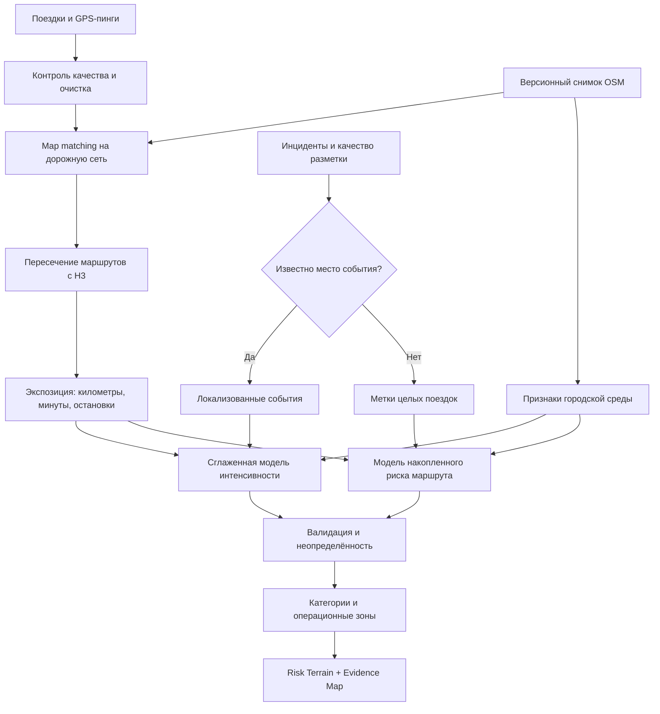

# Terrain Risk Modeling: географический риск инцидентов в поездках по Буэнос-Айресу

## Назначение документа

Пошаговая методология расчёта статических зон риска по GPS-трекам поездок, зарегистрированным инцидентам и OpenStreetMap. Итоговый продукт — проверяемая модель дорожного риска, операционные зоны и интерактивная карта с презентационным режимом Risk Terrain.

**Исходные данные:** миллионы поездок за год, все GPS-пинги маршрутов, координаты начала и конца, несколько тысяч инцидентных поездок, дорожная сеть и объекты OSM.

**Основной результат:** оценка риска на единицу движения или нахождения в зоне. Большой поток поездок не должен автоматически делать участок опасным.

Модель статическая: у зоны нет отдельного дневного и ночного значения. Даты и timestamps сохраняются для восстановления движения, контроля качества и проверки на будущих периодах. Статическая оценка отражает условия и состав поездок за выбранный период, а не неизменное свойство территории.

Документ описывает проектирование; расчёты на фактических данных ещё не выполнены. Размеры пакетов, пороги и разрешения ниже — исходные варианты для проверки, а не результаты измерений.

---

## 1. Что именно называем риском

### 1.1. Целевая формулировка

> Оценённая интенсивность зарегистрированных инцидентов при движении или остановке в данной зоне для поездок исследуемого сервиса.

Это не оценка общей преступности города. Карта ограничена территорией, маршрутами, пользователями и правилами регистрации событий в исходном сервисе.

Перед расчётом согласовать:

| Вопрос | Что зафиксировать |
|---|---|
| Территория | CABA, агломерация или фактическая зона обслуживания |
| Событие | Какие инциденты включены и как подтверждается событие |
| Единица исхода | Хотя бы один инцидент в поездке или число отдельных событий |
| Типы событий | ДТП, кражи, нападения, конфликты и другие — отдельные определения |
| Действие бизнеса | Предупреждение, выбор точки посадки, операционная поддержка, анализ маршрутов |
| Цена ошибки | Последствия пропуска риска и ложного предупреждения |
| Период | Интервал поездок и крайняя дата поступления сообщений об инцидентах |

Сначала строить отдельные слои по типам событий. Общий показатель возможен после согласования весов или функции потерь: ДТП и конфликт с пассажиром не обязаны иметь одинаковые причины и экспозицию.

### 1.2. Три разных показателя

| Показатель | Что означает | Где используется |
|---|---|---|
| **Intensity** | Частота события на единицу экспозиции | Сравнение участков |
| **Route probability** | Вероятность хотя бы одного события на конкретной поездке | Сравнение маршрутов при выполнении предпосылок модели |
| **Expected burden** | Ожидаемое число событий при существующем потоке | Распределение поддержки и ресурсов |

Риск участка и ожидаемое число событий — разные слои. Умеренный риск при огромном потоке может создавать большую операционную нагрузку.

### 1.3. Две постановки в зависимости от разметки

| Доступная разметка | Основной метод |
|---|---|
| Есть координаты инцидента или достаточно точный момент события | Привязка события к маршруту и оценка интенсивности с учётом экспозиции |
| Известен только факт инцидента в поездке | Модель накопленного риска по всему маршруту, с явной неопределённостью локализации |
| Часть событий локализована, часть нет | Смешанная постановка: использовать оба источника в согласованной модели |

**Полный GPS-трек не превращает метку всей поездки в координату события.** Нельзя ставить инцидент во все пройденные гексы или автоматически присваивать его месту завершения.

---

## 2. Общая архитектура расчёта



Первая версия должна включать baseline и отчёт о качестве. Красивый рельеф строится после проверки оценок, а не используется для выбора наиболее эффектной модели.

---

## 3. Подготовка данных и схемы таблиц

### 3.1. Поездки: `trips`

| Поле | Назначение |
|---|---|
| `trip_id` | Уникальный идентификатор поездки |
| `started_at`, `ended_at` | Время начала и завершения |
| `start_lon`, `start_lat`, `end_lon`, `end_lat` | Координаты концов маршрута |
| `trip_status` | Завершена, отменена, прервана и т. п. |
| `incident_flag` | Хотя бы одно событие выбранного типа |
| `incident_type` | Тип события или ссылка на таблицу событий |
| `label_mature_at` | Момент, после которого отсутствие события можно считать наблюдённым |
| `vehicle_id`, `driver_id` | Псевдонимизированные идентификаторы, если доступны и нужны для проверки |

Если типов инцидентов несколько, предпочтительнее хранить события отдельно, а бинарные цели формировать под конкретный расчёт.

### 3.2. GPS-пинги: `gps_pings`

```text
trip_id
ping_timestamp
longitude
latitude
accuracy_m          # если измеряется устройством
speed_mps           # если доступно; отдельно от рассчитанной скорости
source              # приложение / устройство / другой источник
```

Полные траектории нужны в защищённом расчётном контуре. В бизнес-интерфейс публикуются агрегаты и обезличенные примеры, а не история перемещений конкретного пользователя.

### 3.3. Инциденты: `incidents`

```text
incident_id
trip_id
incident_type
severity
reported_at
occurred_at         # если известно
longitude, latitude # если известны
location_accuracy_m
location_source     # GPS / сообщение / адрес / ручная проверка
confirmation_status
```

Дата регистрации жалобы не равна времени события. Финальная точка трека после обращения за помощью также не обязательно является местом инцидента.

### 3.4. Проверки качества

1. Удалить дубли поездок, пингов и повторные обращения об одном событии.
2. Проверить диапазоны координат и порядок longitude/latitude.
3. Отсортировать пинги внутри поездки; обработать одинаковые timestamps.
4. Найти GPS-скачки, невозможные скорости, длинные разрывы и несовместимые с поездкой точки.
5. Проверить наличие начала и конца маршрута, покрытие треком и совпадение длительностей.
6. Определить правила работы с отменёнными и прерванными поездками.
7. Проверить, не отличаются ли качество GPS и полнота маршрута у инцидентных поездок.
8. Исключить из оценки «нулевых исходов» поездки, для которых ещё не прошёл срок регистрации события.
9. Зафиксировать изменения процесса регистрации инцидентов за год.

Не удалять автоматически все необычные остановки и отклонения: часть может быть связана с исследуемым событием. Сохранять причины исключения и сравнивать состав исключённых поездок.

**Артефакт:** data quality report с долями исключений, длиной разрывов и покрытием маршрутов отдельно для положительных и отрицательных исходов.

---

## 4. Восстановление маршрутов на OSM

### 4.1. Зафиксировать дорожную сеть

Подготовить снимок OSM для исследуемой территории с буфером вокруг границы: поездки могут начинаться, завершаться или проходить за её пределами.

Сохранить дату снимка, границу, транспортный профиль, ограничения проезда и версию обработки. Если доступны исторические изменения дорог, проверить значимые расхождения с периодом поездок.

### 4.2. Выполнить map matching

Map matching выбирает последовательность дорог, согласованную с GPS-наблюдениями, связностью сети и ограничениями движения. Простого притягивания каждого пинга к ближайшей дороге недостаточно: рядом могут идти параллельные улицы и развязки.

Для первого прототипа можно проверить OSRM Match Service. Его интерфейс принимает координаты, timestamps и радиусы точности; результат может содержать несколько сопоставленных фрагментов. Это нужно обрабатывать явно. [Документация OSRM](https://project-osrm.org/docs/v5.24.0/api/#match-service).

Порядок обработки:

1. Разбить трек на фрагменты по разрывам и нарушениям непрерывности.
2. Передать пинги с timestamps и информацией о точности, если она есть.
3. Восстановить направленные дорожные сегменты и их последовательность.
4. Сохранить несопоставленные пинги и неоднозначные фрагменты.
5. Проверить выборку маршрутов вручную: плотная застройка, развязки, мосты, длинные остановки.
6. Сравнить длину восстановленного пути с исходной геометрией и доступной длиной поездки из приложения.

Confidence map matcher — диагностический показатель, а не автоматически откалиброванная вероятность правильного маршрута.

### 4.3. Не восстанавливать неизвестное как достоверное

Через длинный разрыв может проходить несколько маршрутов. Возможные решения:

- исключить неуверенный фрагмент из локального расчёта и учесть потерю покрытия;
- проверить несколько возможных путей и чувствительность оценки;
- объединить участок до более крупного коридора.

Если инцидентная поездка имеет значительный неизвестный участок, нельзя уверенно приписывать её риск только известной части пути. Для модели целой поездки нужна отдельная политика исключения или моделирования неопределённой экспозиции.

**Артефакт:** `matched_route_segments`, показатели покрытия и флаги качества по поездке.

---

## 5. Сетка H3 и пространственная экспозиция

### 5.1. Стартовые разрешения

| H3 resolution | Средняя площадь гекса | Предлагаемое использование |
|---|---:|---|
| 7 | ≈5,16 км² | Контекст и оценка на крупном масштабе |
| 8 | ≈0,74 км² | Основной кандидат для первого релиза |
| 9 | ≈0,11 км² | Детализация на хорошо наблюдаемых участках |

Площади средние, отдельные ячейки отличаются. Выбор масштаба должен учитывать число инцидентов, различимость маршрутов и неопределённость; миллионы GPS-точек не заменяют независимые события. [Статистика ячеек H3](https://h3geo.org/docs/core-library/restable/).

Не смешивать разные разрешения как независимые наблюдения. Для разных уровней либо рассчитывать экспозицию отдельно, либо применять согласованную иерархию. Геометрические границы H3-родителей не являются точным объединением границ их детей: это важно при клиппинге и переходах масштаба. [Устройство иерархии H3](https://h3geo.org/docs/).

### 5.2. Пересекать геометрию маршрута, а не считать точки

Для каждого восстановленного отрезка вычислить пересечения с H3-полигонами и длину внутри каждой ячейки.

**Число GPS-пингов не является экспозицией.** Оно зависит от частоты записи, пропусков и остановок. Аналогично, простая последовательность H3-индексов пингов может пропустить пересечённые между ними ячейки.

Длины и площади считать в подходящей метрической системе координат или геодезическим методом, а не в градусах.

Сохранять повторные посещения: поездка может несколько раз проехать один гекс. Для километров и времени экспозиция суммируется; для числа уникальных поездок одна поездка учитывается в гексе один раз.

### 5.3. Таблица `trip_hex_exposure`

```text
trip_id
h3_index
h3_resolution
moving_distance_km
moving_duration_min
stopped_duration_min
stop_count
pickup_flag
dropoff_flag
observed_fraction
map_match_quality
```

Отдельно хранить упорядоченные отрезки маршрута с временем входа и выхода: они нужны для локализации события и расчёта риска до первого инцидента. Агрегат `trip × hex` не сохраняет последовательность посещений.

### 5.4. Выбрать знаменатель по механизму события

| Механизм | Кандидат на основную экспозицию |
|---|---|
| События во время движения | Километры пути |
| Риск накапливается с длительностью нахождения | Минуты присутствия |
| События при остановке | Минуты остановки или число остановок |
| События посадки / высадки | Число соответствующих операций |

Если timestamps отсутствуют, можно оценивать расстояние, но надёжно восстановить время нахождения и остановки нельзя.

Для модели со временем экспозиции итоговая карта тоже остаётся статической: минуты нахождения — мера воздействия, а не время суток. Однако длительность и остановки после инцидента могут быть его следствием. Для прогнозного продукта не использовать их как заранее известные характеристики маршрута.

**Артефакт:** разреженная матрица экспозиций поездок по гексам и агрегаты покрытия территории.

---

## 6. Моделирование: место инцидента известно

### 6.1. Привязать событие к маршруту

Если есть время события, выбрать соответствующий отрезок трека. Если есть координаты, проверить расстояние до восстановленного маршрута и точность места.

На границе гексов или при большой ошибке геолокации использовать более крупную ячейку либо модель неопределённого места. Не создавать несколько «реальных» событий из одной неточной координаты.

### 6.2. Baseline с учётом экспозиции

Для гекса `h`:

- `K_h` — число локализованных событий;
- `E_h` — экспозиция;
- `lambda_h` — интенсивность на единицу экспозиции.

Для полного наблюдения процесса событий стартовая модель:

$$
K_h \sim Poisson(E_h\lambda_h).
$$

Например, если `E_h` измеряется в километрах, `lambda_h` имеет единицы «событий на километр». Для интерфейса можно умножить её на 10 000.

Если целевая задача — **первый инцидент**, экспозиция поездки заканчивается в момент события. Для поездок без события — при завершении наблюдения. Иначе участки, пройденные после инцидента, попадут в знаменатель для события, которое уже произошло.

Если моделируются все отдельные события, нужна полнота регистрации повторных событий и соответствующая постановка. Из одной бинарной метки поездки нельзя получить их число.

### 6.3. Сглаживание редких событий

Сырая частота `K_h / E_h` нестабильна при малой экспозиции. Использовать гамма-пуассоновскую модель:

$$
\lambda_h \sim Gamma(a,b),
$$

где `b` — параметр rate. Тогда:

$$
\lambda_h\mid K_h,E_h \sim Gamma(a+K_h,b+E_h),
$$

$$
\mathbb{E}[\lambda_h\mid K_h,E_h] = \frac{a+K_h}{b+E_h}.
$$

Параметры сглаживания оценивать на обучающей части данных. Нулевое число событий не означает нулевой риск.

### 6.4. Пространственная модель

Следующая версия:

$$
\log\lambda_h = \beta_0 + x_h^\top\beta + u_h,
$$

где `x_h` — признаки среды, `u_h` — пространственный эффект. При избытке вариации относительно Poisson проверить более гибкую модель, но не добавлять сложность без сравнения на отложенных данных.

Предположение постоянной интенсивности внутри гекса — упрощение. При устойчивой разнице между дорогами внутри одной ячейки рассмотреть модель на дорожных сегментах с агрегацией в H3 для карты.

---

## 7. Моделирование: известна только метка поездки

### 7.1. Почему обычная классификация гексов некорректна

Поездка с инцидентом могла пройти десятки ячеек. Если присвоить каждой метку 1, один инцидент превратится в десятки положительных примеров. Длинные маршруты будут выглядеть опаснее из-за способа разметки.

Обучающая единица — **целая поездка**, описанная её экспозицией в гексах. Это постановка со слабой пространственной разметкой.

### 7.2. Накопленный риск

Пусть `E_ih` — экспозиция поездки `i` в гексе `h`, а `lambda_h >= 0` — локальная интенсивность. Тогда:

$$
H_i = \sum_h E_{ih}\lambda_h,
$$

$$
p_i = P(Y_i=1) = 1-\exp(-H_i).
$$

Величина `H_i` безразмерна: например, километры умножаются на интенсивность на километр.

Модель предполагает накопление риска с экспозицией. Поездки с одинаковыми участками, но разной длиной нахождения в них могут иметь разные вероятности. Предположение необходимо проверить на данных.

Обучение минимизирует отрицательный log likelihood бинарных исходов:

$$
\mathcal{L} = -\sum_i\left[y_i\log p_i + (1-y_i)\log(1-p_i)\right] + R.
$$

`R` — регуляризация интенсивностей и пространственных эффектов. Для реализации нужны численно устойчивые вычисления выражений с `exp` и `log` при очень малых вероятностях.

### 7.3. Параметризация и признаки

Использовать положительную интенсивность:

$$
\lambda_h = \exp(\beta_0+x_h^\top\beta+u_h).
$$

Для больших датасетов удобно выполнять произведение разреженной матрицы экспозиций на вектор интенсивностей.

Если есть независимые механизмы движения, остановок и посадки, модель можно расширить:

$$
H_i = \sum_h\left(
L_{ih}\lambda_h^{move}
+ T_{ih}^{stop}\lambda_h^{stop}
+ P_{ih}\lambda_h^{pickup}
+ D_{ih}\lambda_h^{dropoff}
\right).
$$

Каждое слагаемое имеет собственные единицы. Такое разложение имеет смысл только при достаточных данных и различимости механизмов. Не пытаться одновременно оценить несколько тысяч эффектов остановки и движения по нескольким тысячам событий без сильных ограничений.

### 7.4. Основное ограничение: идентифицируемость

Если гексы A и B почти всегда проезжают вместе, метки поездок могут объясняться повышенным риском в любом из них. Модель хорошо предсказывает исходы маршрутов, но не знает, где находится источник риска.

Что делать:

1. Проверить совместную встречаемость и корреляцию столбцов матрицы экспозиций.
2. Найти группы почти неразличимых участков.
3. Сравнить оценки на разных разбиениях, bootstrap-выборках и силах регуляризации.
4. При нестабильной локализации объединять гексы в коридор или переходить на крупный масштаб.
5. Показать неопределённость, а не одну уверенную красную ячейку.
6. Использовать независимо локализованные события для проверки, если они есть.

**Уверенность локализации нельзя подменять качеством предсказания поездки.** Без внешней пространственной разметки истинное место события остаётся ненаблюдаемым.

### 7.5. Смешанная разметка

Локализованные события дают информацию о месте, остальные поездки — о накопленном риске маршрута. При совместном обучении строить согласованный likelihood: одна поездка не должна одновременно попасть в два независимых набора как два события.

Сначала реализовать и проверить отдельные baseline, затем объединять их. Убедиться, что локализованные события не являются только особым типом жалоб или узким набором районов.

---

## 8. Пространственное сглаживание и OSM

### 8.1. Соседство по городской структуре

Стандартное соседство H3 — геометрическое. Для риска поездок важно также дорожное соединение:

- река может разделять близкие гексы;
- мост соединяет далеко расположенные участки;
- железная дорога и автомагистраль могут создавать барьеры;
- доступность улиц может различаться по направлению.

Строить несколько вариантов графа соседства: геометрический, дорожный, комбинированный. Проверять результат на устойчивость. Вес связи должен отражать доступность соединения, а не саму наблюдённую метку риска.

Для первого прототипа можно использовать штраф:

$$
R_{space} = \tau\sum_{(h,g)\in\mathcal E}w_{hg}(u_h-u_g)^2.
$$

Его нужно дополнить ограничениями масштаба и/или prior для эффектов, чтобы модель была определена. Пространственное сглаживание — предположение о похожести, а не доказательство одинакового риска соседей.

Более формальный вариант — CAR-модель. [Пример CAR в PyMC](https://www.pymc.io/projects/examples/en/latest/spatial/conditional_autoregressive_priors.html).

### 8.2. Кандидаты признаков OSM

| Группа | Примеры |
|---|---|
| Дороги | Длина по классам, плотность перекрёстков, ограничения скорости при наличии тегов |
| Транспорт | Станции, остановки, пересадочные узлы |
| Использование территории | Жилая, коммерческая, промышленная застройка |
| Барьеры и доступность | Железнодорожные коридоры, водоёмы, мосты, связность сети |
| Объекты городской среды | Парки, парковки, коммерческие POI |
| Полнота описания | Доля дорог с известными нужными атрибутами |

Отсутствие тега `lit` не означает отсутствие освещения. Отсутствие POI может означать неполноту карты. Не превращать пропуски OSM в утверждения о территории.

Признаки проверять на добавочную пользу относительно модели без OSM. Связь признака с риском не доказывает причинность. Исключить чувствительные характеристики населения и их ненужные заменители: задача — риск поездок и дорожного окружения.

---

## 9. Как получить статическую карту без времени суток

1. Не использовать час суток как переключатель карты или отдельный локальный эффект в первом релизе.
2. Сохранить timestamps для экспозиции, map matching и контроля данных.
3. Обучать и проверять модель по реальной хронологии года.
4. Описать карту как средний профиль за конкретный период для наблюдаемого состава поездок.
5. Проверить устойчивость по кварталам: статическая публикация не отменяет сезонных изменений.
6. Отдельно зафиксировать, когда карту требуется пересчитывать.

Если районы наблюдаются в разное время и это связано с риском, статическая оценка смешивает пространственные различия с составом поездок. В первой версии это ограничение нужно явно указать. Стандартизация по общей структуре поездок — отдельная расширенная задача, требующая достаточного перекрытия наблюдений.

Не называть карту «чистым эффектом территории» без соответствующих проверок и предпосылок.

---

## 10. Валидация и сравнение моделей

### 10.1. Разделение данных

- Обучение — ранняя часть года; финальная проверка — более поздняя.
- Границы периодов выбирать с учётом числа событий и задержки регистрации меток.
- Для настройки параметров использовать внутреннюю validation, не финальный тест.
- Пинги и отрезки одной поездки не должны оказаться в разных частях.
- Проверить зависимость между поездками одного водителя или автомобиля; при необходимости добавить grouped-проверку.
- Пространственные проверки выполнять целыми коридорами или территориями, а не случайными соседними гексами.

Пространственное исключение — проверка переносимости, а хронологическая проверка на уже обслуживаемой территории — основной сценарий обновления карты. Это разные задачи, их результаты показываются отдельно.

### 10.2. Baseline и последовательность усложнения

| Версия | Что проверяет |
|---|---|
| Общая вероятность инцидента в поездке | Минимальный классификационный baseline |
| Единая интенсивность на километр | Объясняет ли длина маршрута значимую часть риска |
| Сглаженная пространственная модель | Есть ли полезный пространственный сигнал |
| Пространственная модель с OSM | Улучшает ли описание среды качество и переносимость |
| Несколько механизмов экспозиции | Можно ли различить движение, остановки и операции посадки |

Для локализованных событий дополнительно сравнивать сглаженную частоту и пространственную count-модель.

### 10.3. Метрики

- **Log loss:** качество вероятностей относительно baseline.
- **Brier score:** средняя квадратичная ошибка вероятностей; интерпретировать с учётом сильного дисбаланса.
- **Калибровка:** соответствует ли фактическая частота предсказанной в группах поездок; показывать интервалы.
- **PR-AUC:** качество ранжирования редких положительных исходов; сравнивать при сопоставимой доле событий.
- **Lift при фиксированной доле поездок / экспозиции:** насколько модель концентрирует риск относительно baseline.
- **Устойчивость зон:** насколько меняются выделенные зоны при изменении обучающего периода и выборки.

Один ROC-AUC не подтверждает ни качество вероятностей, ни точность пространственной локализации.

### 10.4. Правильное измерение концентрации событий

Если координаты событий известны, можно считать долю событий, попавших в выделенные зоны, при фиксированной доле экспозиции.

Если координаты неизвестны, можно считать долю инцидентных поездок, связанных с выделенными маршрутами или зонами, но нельзя называть её долей событий, произошедших внутри зон. Любое пересечение длинного маршрута с выделенной зоной само по себе не доказывает её опасность.

Сравнивать варианты при одинаковом покрытии поездок или экспозиции. Сравнение только по площади может награждать модель за выбор самых загруженных дорог.

### 10.5. Дополнительные проверки

- Bootstrap по независимым единицам: поездкам, группам водителей или блокам дней в зависимости от зависимости данных.
- Искусственные события с известной географией: проверить способность метода восстанавливать очаги при текущей структуре маршрутов. Это проверка метода, не доказательство истинности реальной карты.
- Чувствительность к H3 resolution, качеству GPS и выбору знаменателя.
- Проверка полноты регистрации инцидентов и недоступных участков.
- Для count-моделей — posterior predictive checks по гексам и экспозиции.

**Критерий перехода:** модель улучшает заранее выбранные метрики относительно baseline, не имеет грубых ошибок калибровки и даёт достаточно устойчивые для действия зоны. Численные пороги согласуются до финальной проверки.

---

## 11. Неопределённость и присвоение категорий

Для каждой зоны публиковать не только точечную оценку, но и её надёжность.

### 11.1. Поля расчёта по гексу

```text
h3_index
resolution
exposure_value
exposure_unit
unique_trips
localized_incident_count     # null, если локализация неизвестна
estimated_intensity
intensity_lower
intensity_upper
relative_risk
probability_above_threshold
risk_band
confidence_band
model_supported             # достаточно ли информации для публикации оценки
model_version
data_period
```

`intensity_lower/upper` — байесовский интервал или bootstrap-интервал в зависимости от метода. Название и интерпретацию фиксировать в metadata, не смешивать разные типы интервалов.

При неизвестном месте инцидента не публиковать модельное распределение событий как фактический `incident_count` гекса.

### 11.2. Категории

- Обычный уровень.
- Повышенный уровень.
- Высокий уровень.
- Недостаточно данных / неразличимая локализация.

Категории определять по бизнес-порогам и неопределённости. Например, высокий уровень требует не только большого среднего риска, но и достаточно убедительного превышения порога, устойчивости и подходящей экспозиции.

Не объявлять верхние 10% гексов опасными автоматически: такой подход всегда создаёт «опасные зоны», даже при слабых различиях. Перцентили допустимы как отдельный относительный рейтинг, явно так и обозначенный.

Большой поток при нуле событий — полезная информация; отсутствие поездок — отсутствие наблюдений. Эти два случая должны выглядеть по-разному.

---

## 12. Из гексов в операционные зоны

1. Сохранить исходные оценки на фиксированном H3 resolution.
2. Выбрать гексы по согласованному правилу риска и уверенности.
3. Объединить связанные гексы в зоны с учётом дорожных барьеров.
4. Проверить узкие соединения, мосты, дырки и малые фрагменты.
5. Не переносить зону на противоположный берег только ради гладкой геометрии.
6. Рассчитать площадь, дорожную экспозицию и список входящих ячеек.
7. Назначить стабильный `zone_id`, сохранить версию и историю изменений.

Геометрическое упрощение для интерфейса не меняет модельные оценки. Оригинальные гексы сохраняются для аудита.

Зоны предназначены для конкретного действия: например, предложить более наблюдаемую точку посадки или усилить поддержку. Нельзя автоматически трактовать их как запрет на обслуживание территории.

---

## 13. Визуализация: Risk Terrain и Evidence Map

### 13.1. Концепция продукта

**Terrain Risk Modeling — Buenos Aires**

Подзаголовок: «Оценка риска зарегистрированных инцидентов на маршрутах сервиса».

Главный визуальный принцип: риск, трафик и уверенность — разные слои. Эффектный рельеф не должен скрывать отсутствие данных.

### 13.2. Режим Risk Terrain: презентация

- Графитовая или глубокая синяя подложка.
- Светлые, ненавязчивые названия районов и транспортных ориентиров.
- Приглушённая дорожная сеть и выразительная береговая линия.
- Гексы с последовательной палитрой: нейтральный → янтарный → коралловый.
- Наклонная камера и умеренная экструзия риска.
- Плавное появление слоя, аккуратный свет и тонкие границы зон.
- Отдельный стиль для недостатка данных: серый или штриховка.
- Ограниченное число акцентов на стартовом экране.

**Высота — модельная интенсивность риска, не реальная высота местности и не число событий.** Это должно быть написано в легенде.

Если высота использует логарифм или ограничение экстремумов ради читаемости, преобразование указывается в легенде; tooltip показывает исходное значение. Переход масштаба не должен менять смысл цвета без обновления легенды.

Гладкая поверхность и изолинии допустимы как дополнительная презентационная интерполяция. Они не дают оценок с точностью до улицы и не должны создавать поверхность над водой или в необслуживаемой зоне.

### 13.3. Режим Evidence Map: аналитика

- Плоская H3-карта без перспективных искажений.
- Переключатели риска, экспозиции, неопределённости и качества GPS.
- Переключение типов инцидентов и поддерживаемых разрешений.
- Просмотр состава операционных зон.
- Явное обозначение «нет наблюдений» и «модельная экстраполяция».
- Сравнение версии модели с предыдущей без изменения шкалы между панелями.

Карта статическая по времени суток. Период наблюдений и дата обновления всегда видны; отдельный выбор дневного и ночного риска не добавляется.

### 13.4. Карточка гекса / зоны

```text
Название / ID зоны
Тип инцидента
Оценённая интенсивность и единицы
Интервал неопределённости
Отношение к общему уровню
Километры / минуты экспозиции
Число уникальных поездок
Фактические локализованные события — только если известны
Оценка качества и устойчивости
Период данных и версия модели
```

Для модельных факторов использовать формулировки «связано с оценкой модели», а не «причина опасности». Грубые объяснения по OSM не заменяют проверку локальных событий.

### 13.5. Риск на стандартизованной дистанции

Если бизнесу неудобны единицы интенсивности, можно показать:

$$
p_h^{1km}=1-\exp(-\lambda_h\cdot1km).
$$

Это вероятность при гипотетическом километре экспозиции в данных условиях, а не вероятность любого пересечения гекса. Подпись должна сохранять эту интерпретацию. Для риска остановки требуется своя стандартизованная длительность.

### 13.6. Стартовый экран для бизнеса

Показать три показателя:

1. Покрытие: доля поездок / экспозиции с поддержанной моделью оценкой.
2. Концентрация инцидентов или инцидентных поездок — с корректной подписью по доступной разметке.
3. Число устойчивых зон повышенного риска и связанная операционная нагрузка.

Не показывать «предотвращённые события» или экономию как факт без отдельного исследования эффекта вмешательства.

### 13.7. Пользовательский сценарий демонстрации

1. Обзор города и объяснение легенды.
2. Переключение Risk / Exposure: показать, почему самые загруженные места не всегда самые рискованные.
3. Выбор зоны и открытие карточки с неопределённостью.
4. Переход в Evidence Map с исходными гексами.
5. Просмотр маршрута и его модельного риска.
6. Показ предлагаемого операционного действия и способа проверки его эффекта.

### 13.8. Технологии

Кандидат для веб-интерфейса — MapLibre для подложки и deck.gl для H3, маршрутов и интерактивных слоёв. `H3HexagonLayer` поддерживает цвет, экструзию и выбор ячеек. [Документация deck.gl](https://deck.gl/docs/api-reference/geo-layers/h3-hexagon-layer).

Для больших объёмов готовить серверные агрегаты и тайлы; не передавать в браузер миллионы траекторий. Детальные маршруты загружать по выбору и с обезличиванием.

Для коммерческого интерфейса выбрать поставщика OSM-производных тайлов или собственную инфраструктуру, сохранить attribution. Публичный стандартный сервер OSM имеет отдельные ограничения и не является бесплатным SLA-сервисом для продукта. [Политика тайлов OSM](https://operations.osmfoundation.org/policies/tiles/).

---

## 14. Оценка маршрута и возможные действия

Для заданного пути вычислить экспозицию в тех же гексах и единицах, затем получить `H_route` и `1-exp(-H_route)`.

Сравнивать альтернативы при учёте общей длины и длительности: более безопасная на километр дорога может дать больший суммарный риск из-за длинного объезда.

Если модель использует фактическое время нахождения, для будущего маршрута нужны прогнозные длительности. Не подставлять неизвестные постфактум величины.

Интервалы маршрутного риска получать из совместных выборок параметров модели или полного bootstrap-пересчёта. Нельзя просто сложить верхние границы интервалов отдельных гексов и назвать результат калиброванным интервалом маршрута.

Рекомендации маршрутов вводить отдельным этапом. Наблюдательная модель не доказывает, что перенаправление поездок причинно уменьшит число событий. Изменение маршрутов меняет экспозицию и со временем данные, на которых строится следующая карта.

---

## 15. Реализация пайплайна и хранение

### 15.1. Предлагаемый стек

- Parquet для промежуточных и итоговых таблиц.
- Polars или DuckDB для табличных агрегаций.
- GeoPandas / Shapely для прототипа геометрических операций.
- Локальный сервис map matching на версионном графе OSM.
- Разреженные матрицы для `trip × hex` и модели маршрутов.
- PyMC или другой подходящий инструмент для байесовских пространственных моделей; регуляризованная оптимизация для более простого baseline.
- MapLibre + deck.gl для интерфейса.

Выбор между инструментами делать после измерения объёма пингов, геометрий и времени обработки. Для миллионов поездок не требуется заранее объявлять весь проект распределённым: начинать с партиционированных данных и профилирования узких мест.

### 15.2. Слои данных

```text
raw/
  trips/
  gps_pings/
  incidents/
  osm_snapshot/

processed/
  cleaned_trips/
  matched_route_segments/
  trip_hex_exposure/
  localized_incidents/
  osm_hex_features/

models/
  baseline/
  spatial/
  validation/

published/
  hex_risk/
  operational_zones/
  map_tiles/
  metadata/
```

### 15.3. Воспроизводимость

Сохранять версии:

- данных и правил зрелости меток;
- границы территории и OSM-снимка;
- map matching и критериев его качества;
- H3 resolution и геометрических преобразований;
- определения экспозиции;
- признаков и разбиения обучения / проверки;
- модели, параметров и категорий риска;
- визуальных шкал и опубликованных зон.

Переобработка должна позволять объяснить, почему зона изменила цвет: новые данные, другая модель, изменения экспозиции или изменение порогов.

---

## 16. Этапы проекта и критерии завершения

| Этап | Основные действия | Проверяемый результат |
|---|---|---|
| **A. Постановка** | Определить типы событий, единицы экспозиции, территорию и бизнес-действие | Согласованная спецификация риска |
| **B. Аудит** | Проверить поездки, разметку, GPS и доступность локализации | Отчёт о качестве и пригодности данных |
| **C. Геометрия** | Map matching, H3, разрывы, повторные посещения | Проверенная таблица экспозиций |
| **D. Baseline** | Общая интенсивность и сглаженные оценки / модель маршрутов | Воспроизводимый расчёт и первые интервалы |
| **E. Пространственная модель** | Регуляризация, граф, OSM | Измеримое улучшение или обоснованный отказ от усложнения |
| **F. Валидация** | Временные и пространственные проверки, калибровка, устойчивость | Отчёт с ограничениями локализации |
| **G. Зоны** | Пороги, уверенность, объединение гексов | Версионные операционные зоны |
| **H. Интерфейс** | Risk Terrain, Evidence Map, карточки и сценарий демонстрации | Карта, читаемая и проверяемая бизнесом |
| **I. Пилот действия** | Выбрать меру поддержки и дизайн оценки её эффекта | Данные о пользе вмешательства, а не только о красоте карты |

### Состав первого релиза

1. Один согласованный тип инцидента или отдельные слои без произвольного объединения.
2. Основная H3-сетка resolution 8; более крупный уровень для неразличимых участков.
3. Экспозиция в километрах либо другая обоснованная единица.
4. Модель, соответствующая доступности места события.
5. Интенсивность, неопределённость и признак поддержки оценки данными.
6. Статическая карта за указанный период с двумя режимами отображения.
7. Операционные зоны и отчёт на отложенных поездках.

### Что не включать в первый релиз без дополнительной проверки

- Уверенный риск до отдельной улицы там, где различим только коридор.
- Дневные / ночные слои, если цель — статическая карта.
- Произвольный интегральный балл из несопоставимых типов событий.
- Автоматический запрет обслуживания по цвету гекса.
- Заявления о причинности факторов или предотвращённых событиях.

---

## 17. Основные риски проекта

| Риск | Как обнаружить / уменьшить |
|---|---|
| Карта показывает трафик вместо опасности | Считать экспозицию и сравнивать с единой интенсивностью |
| Событие размножается по всему маршруту | Использовать поездку как единицу разметки при неизвестном месте |
| Хорошая маршрутная модель даёт произвольные локальные очаги | Проверять идентифицируемость, регуляризацию и устойчивость |
| GPS обрывается именно после инцидента | Сравнить качество треков по исходу, отдельно обработать неизвестные участки |
| Остановка после события становится «причиной» события | Учитывать последовательность и доступность характеристик |
| Разные районы по-разному сообщают об инцидентах | Аудит каналов регистрации, зрелости меток и состава поездок |
| Результат зависит от масштаба сетки | Анализ чувствительности на нескольких resolution |
| Сглаживание пересекает барьеры | Граф дорожной связности и ручная проверка ключевых мест |
| OSM-пропуски интерпретируются как отсутствие инфраструктуры | Моделировать полноту описания и проверять альтернативы |
| Убедительная картинка скрывает неопределённость | Отдельный Evidence Map и обязательная маркировка неподдержанных зон |

---

## 18. Источники и границы интерпретации

- [H3: статистика размеров ячеек](https://h3geo.org/docs/core-library/restable/).
- [H3: географическая индексация и иерархия](https://h3geo.org/docs/).
- [OSRM Match Service](https://project-osrm.org/docs/v5.24.0/api/#match-service).
- [Пример пространственной CAR-модели в PyMC](https://www.pymc.io/projects/examples/en/latest/spatial/conditional_autoregressive_priors.html).
- [deck.gl H3HexagonLayer](https://deck.gl/docs/api-reference/geo-layers/h3-hexagon-layer).
- [Правила использования стандартных тайлов OSM](https://operations.osmfoundation.org/policies/tiles/).

Формулы и архитектура в этом документе — предлагаемая методология для проверки на исходных данных. Их предпосылки, пригодность и калибровка должны быть подтверждены пилотом. При неизвестном месте события основная честно проверяемая величина — риск целой поездки; детализация карты должна соответствовать тому, что данные действительно позволяют различить.
