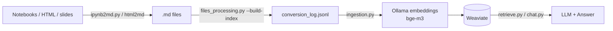
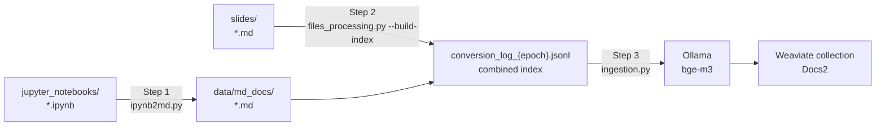

# RAG Pipeline



### Prerequisites

Activate the project virtualenv:
```bash
source .venv/bin/activate
```

Prepare index for ingestion

```shell
python src/rag/files_processing.py --build-index --input-dir slides
```

Install Ollama. Check available models:
```bash
ollama list
```

Pull embedding model:
```bash
ollama pull bge-m3
```

Point the pipeline at it (config defaults live in src/rag/agent/config.py)
```bash
export EMBEDDING_MODEL=bge-m3
export EMBEDDING_SIZE=1024
```

Launch Weaviate (for local vector storage):
```bash
make run-weaviate
```

ingest: vectors from a new model have a different dimensionality, so the collection must be reset (existing collections can't mix vector sizes)

```shell
DATA_DIR="$(pwd)" python src/rag/ingestion.py --backend weaviate --log-path slides/conversion_log_<epoch>.jsonl --collection docs2 --reset-collection
```

Flow:



---

# Retrieval

Query the collection:
```bash
DATA_DIR="$(pwd)" python src/rag/retrieve.py "поисковые системы" --backend weaviate --collection docs2 --limit 10
```

# Chat

Interactive RAG chat with verify+revise loop (uses `VECTOR_DB_BACKEND` to pick the vector store):
```bash
DOTENV_FILE="$(pwd)/.env" DATA_DIR="$(pwd)" python src/rag/chat.py --retrieval-top 10 --collection docs2
```

Key flags: `--retrieval-top` (number of top chunks to retrieve, default: 5).


# Data conversion

## Notebook → Markdown

Convert a single notebook or a directory of notebooks:
```bash
python src/rag/ipynb2md.py path/to/notebook.ipynb
python src/rag/ipynb2md.py path/to/notebooks/
python src/rag/ipynb2md.py path/to/notebook.ipynb --output-dir /tmp/md_output
```
Each conversion appends a JSON entry with `source_dir`, `source_file_name`, and `desctination_file` to `data/md_docs/conversion_log.jsonl`. Use `files_processing.py --build-index` to regenerate a clean, deduplicated epoch-suffixed log instead.

## PDF -> markdown

Convert PDFs to Markdown with docling (tables, layout, images) via `mindbase_layer.tools.pdf_to_md`:

```bash
PYTHONPATH="$(pwd)" python src/rag/pdf2md.py path/to/document.pdf --output-dir /tmp/md_output
```

# Interface: Telegram Bot

RAG-powered Telegram bot with image OCR support (Qwen2.5-VL via Nebius API):
```bash
TG_BOT_TOKEN="..." TG_BOT_DATA="/tmp/tg_images" VECTOR_DB_BACKEND=weaviate DATA_DIR="$(pwd)" python src/rag/tg_bot.py
```

Environment variables: `TG_BOT_TOKEN`, `TG_BOT_DATA`, `DATA_DIR`, `LLM_BASE_URL`, `NEBIUS_API_KEY`, `DOTENV_FILE`, `VECTOR_DB_BACKEND`.

# Example: Nebius Docs Scraping Pipeline

Step 1 – Extract links from MHTML and crawl to discover all sub-pages:
```bash
python src/scraping/scrape_nebius.py --input data/nebius_site/nebius_main_page.mhtml --max-depth 4
```
Use `--max-depth` to control how deep the crawler follows sidebar links (default: 1). Higher values discover nested sub-pages (e.g. `/kubernetes/gpu/set-up` at depth 2, `/kubernetes/gpu/topology-aware-scheduling` at depth 3). The JSONL output includes a `depth` field for each discovered URL.

Step 2 – Download HTML pages listed in the JSONL index:
```bash
python src/scraping/scrape_nebius.py --input data/nebius_site/nebius_main_page.jsonl --download
```

Step 3 – Convert downloaded HTML to Markdown:
```bash
DATA_DIR="$(pwd)" python src/rag/nebius_html2md.py --input data/nebius_site/
```

### HTML → Markdown

Convert downloaded Nebius HTML pages:
```bash
DATA_DIR="$(pwd)" python src/rag/nebius_html2md.py --input data/nebius_site/
```
Conversion log is saved at the top level of `--input` directory (e.g. `data/nebius_site/conversion_log_811e314c.jsonl`).


# Example: TokenFactory docs

Prepare TokenFactory
```shell
python src/scraping/scrape_nebius.py --input data/tokenfactory_docs/tokenfactory_docs.jsonl --download

DATA_DIR="$(pwd)" python src/rag/nebius_html2md.py --input data/tokenfactory_docs/
```

Prepare Tavily

```shell
python src/scraping/scrape_tavily.py --input data/scraping/tavily_docs/tavily_docs.jsonl --download

 DATA_DIR="$(pwd)" python src/rag/tavily_html2md.py --input data/scraping/tavily_docs/
  ```

Then

```shell
DATA_DIR="$(pwd)" python src/rag/ingestion.py --backend weaviate --log-path data/scraping/tavily_docs/conversion_log_8b23aad2.jsonl

DATA_DIR="$(pwd)" python src/rag/ingestion.py --backend weaviate --log-path data/tokenfactory_docs/conversion_log_d996ed3f.jsonl   
```

# Appendix

## Weaviate full-text & hybrid search

Weaviate supports **BM25 lexical search** and **hybrid (dense + BM25) search** natively on a local instance (unlike Chroma). The pipeline's `WeaviateConnection` wires up `near_vector` retrieval; the examples below show how to query the same collections directly with the `weaviate-client` v4 package.

#### 1. Connect and get the collection

```python
import weaviate

client = weaviate.connect_to_local(host="localhost", port=8080, grpc_port=50051)
collection = client.collections.get("Docs2")  # collection names are capitalized
```

#### 2. Run BM25 (lexical) search

```python
from weaviate.classes.query import MetadataQuery

results = collection.query.bm25(
    query="antigradient optimization",
    query_properties=["text"],  # search the document property
    limit=5,
    return_metadata=MetadataQuery(score=True),
)
for obj in results.objects:
    print(obj.properties["text"][:80], obj.metadata.score)
```

#### 3. Run hybrid search (dense + BM25, fused)

`alpha` blends the two signals: `0` = pure BM25, `1` = pure dense vector. Because the server runs with `DEFAULT_VECTORIZER_MODEL=none`, the dense vector must be supplied explicitly (e.g. from Ollama):

```python
from weaviate.classes.query import MetadataQuery

query_embedding = embed_via_ollama(
    "antigradient optimization"
)  # e.g. bge-m3, 1024 dims

results = collection.query.hybrid(
    query="antigradient optimization",  # BM25 part
    vector=query_embedding,  # dense part
    alpha=0.6,  # 60% dense similarity, 40% lexical
    query_properties=["text"],
    limit=10,
    return_metadata=MetadataQuery(score=True),
)
```


## Configuration (.env)

Settings come from `src/rag/agent/config.py`, which loads the repo `.env` file (`DOTENV_FILE` env var selects another one). **`.env` values take priority over the code defaults**, so check it when model/collection settings don't apply. RAG-relevant keys:

```dotenv
EMBEDDING_MODEL=bge-m3      # Ollama embedding model
EMBEDDING_SIZE=1024         # must match the model's output dimension
OLLAMA_HOST=http://localhost:11434
VECTOR_DB_BACKEND=weaviate  # weaviate | chroma — selects the backend for retrieve.py / chat.py / tg_bot.py
COLLECTION_NAME=tokenfactory  # default collection for ingestion/chat
WEAVIATE_HOST=localhost
WEAVIATE_HTTP_PORT=8080
WEAVIATE_GRPC_PORT=50051
```

The `weaviate` docker-compose service (see `docker-compose.yml`) exposes HTTP on `8080`, runs with `DEFAULT_VECTORIZER_MODEL=none` (vectors are supplied explicitly by the pipeline) and persists data to `./data/weaviate`. Authentication is anonymous for local runs.


Ollama >= 0.40 serves embeddings only from dedicated embedding models (e.g. `bge-m3`, `nomic-embed-text`); chat models are rejected.


## Gotchas

- **Ollama >= 0.40 serves embeddings only from dedicated embedding models** (e.g. `nomic-embed-text`). Chat models like `granite4:350m` or `qwen2.5:1.5b` are rejected with `This server does not support embeddings. Start it with --embeddings`. Use `bge-m3` (1024 dims) or `nomic-embed-text` (768 dims) for both ingestion and retrieval — the model and vector size must match the collection.
- **Weaviate must be running before ingestion/retrieval** (`make run-weaviate`). Both the HTTP port (8080) and the gRPC port (50051) must be reachable — the v4 `weaviate-client` uses gRPC for queries/batches. If the server is down, `WeaviateConnection` exits with a message suggesting how to start it.
- **`weaviate-client` must be installed** (v4 client, listed in `requirements.txt`). Without it, `WeaviateConnection` raises with `pip install weaviate-client`.
- **Embedding model must match across pipeline steps**: a collection ingested with one model cannot be queried with another (vector dimension mismatch — Weaviate rejects inserts/queries with inconsistent dimensions). Re-ingest with `--reset-collection` when switching models.
- **Collection (class) names are capitalized**: Weaviate requires class names to start with an uppercase letter, so `--collection docs2` is stored as `Docs2`. `WeaviateConnection` handles the conversion automatically, but the capitalized name is what you'll see in Weaviate tooling/dashboards.
- **Vectors are supplied explicitly**: the pipeline computes embeddings via Ollama and sends them with each object (`DEFAULT_VECTORIZER_MODEL=none` in the compose service). Weaviate itself never calls an embedding model, so `near_text` queries are not available — retrieval uses `near_vector` with an Ollama-computed query embedding (that is what `retrieve.py` does).
- **Package-style imports everywhere**: modules under `src/rag/` import each other as `rag.*` (`from rag.connections import ...`), which requires `<repo>/src` on `sys.path`. CLI scripts bootstrap this themselves, so `python src/rag/ingestion.py` works from the repo root **without any `PYTHONPATH`**. Notebooks use the same style — `make run-jupyter` sets `PYTHONPATH=<repo>/src`, and notebooks that run elsewhere append `<repo>/src` to `sys.path` in their first cell (e.g. `vol_02_ml_products_03_knowledgebase_rag.ipynb`). The agent API server: `PYTHONPATH=src uv run uvicorn rag.agent.server:app`.
- **`--input-dir` accepts comma-separated directories** (e.g. `--input-dir slides,data/md_docs`); entries from all directories are combined into a single `conversion_log_{epoch}.jsonl` written to the first directory (override with `--log-dir`).
- **Ollama desktop app vs CLI can differ in version**: the app's bundled server may lag or lead `/usr/local/bin/ollama`. `ollama --version` (CLI) and the running server version can differ — check the actual server via `docker`/app logs if behavior differs.
- **Ollama unloads models after 5 minutes idle** (`OLLAMA_KEEP_ALIVE`): the first embeddings request after idle can take up to a minute to reload the model — use a generous HTTP timeout (>= 60-120s).
ß
## LLM Pricing

Nebius Token Factory endpoints and pricing: https://tokenfactory.nebius.com/endpoints


## Docs processing

Chunk a Markdown file and print stats:
```bash
python src/rag/files_processing.py --input path/to/file.md
python src/rag/files_processing.py --input path/to/file.md --chunk-size 500 --chunk-overlap 100
```

List all links found in Markdown files under a directory:
```bash
python src/rag/files_processing.py --show-links --input-dir data/md_docs
```

### Course Content Pipeline (notebooks + slides → Weaviate)

Step 1 – Convert all Jupyter notebooks to Markdown (output goes to `data/md_docs/`, overwriting `.md` files with matching stems):
```bash
python src/rag/ipynb2md.py jupyter_notebooks/ --output data/md_docs
```


This writes a single `conversion_log_{epoch}.jsonl` (in the first input dir; use `--log-dir` to change) covering files from **both** directories, e.g. `slides/conversion_log_1792994984.jsonl`.

Step 3 – Ingest the combined log into Weaviate:
```bash
DATA_DIR="$(pwd)" python src/rag/ingestion.py --backend weaviate --log-path slides/conversion_log_<epoch>.jsonl --collection docs2 --embedding-model bge-m3 --reset-collection
```

Key flags: `--backend` (`chroma` | `weaviate`), `--batch-size`, `--chunk-size`, `--chunk-overlap`, `--embedding-model`, `--embedding-size`, `--ollama-host`, `--request-timeout`, `--reset-collection`.
